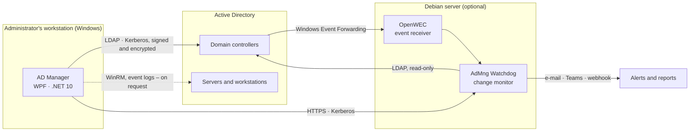
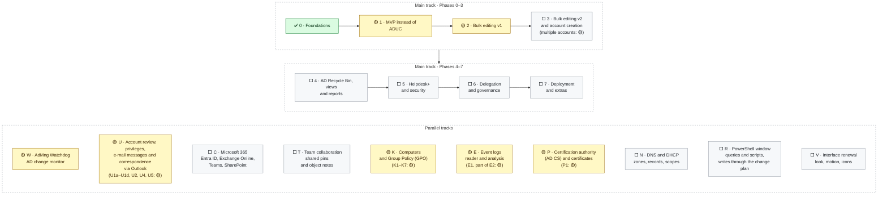

<div align="center">

**English** · [Polski](README.pl.md)

<picture>
  <source media="(prefers-color-scheme: dark)" srcset="docs/assets/banner-dark.svg">
  <source media="(prefers-color-scheme: light)" srcset="docs/assets/banner-light.svg">
  
</picture>

**A fast, modern successor to the `dsa.msc` snap-in – with bulk editing, the AD Recycle Bin and a directory change monitor**

[](https://github.com/DarienRahl/AD_MNG/actions/workflows/ci.yml)
[](https://github.com/DarienRahl/AD_MNG/releases)
[](https://github.com/DarienRahl/AD_MNG/releases)


[](LICENSE)

**[Features](#-features)** · **[Screenshots](#-screenshots)** · **[Roadmap](#-roadmap)** ·
**[Download](#-download-and-run)** · **[Build](#-build-and-test)** · **[Documentation](#-documentation)** ·
**[License](#-license)** · **[Code signing policy](#-code-signing-policy)**

</div>

> [!WARNING]
> **Development version.** Phases 1 (everyday work instead of ADUC) and 2 (bulk editing) of the [roadmap](#-roadmap)
> are implemented, as are creating multiple accounts from phase 3, the AD Recycle Bin from phase 4 and the AdMng
> Watchdog service. The application is tested automatically (unit tests, UI tests on Windows, integration tests against
> a Samba AD domain controller), but **it has not yet been piloted on a production Windows AD** – start with a test
> domain or an account with limited permissions.

## ✨ Features

AD Manager is a Windows desktop console for administrators of on-premises Active Directory. It replaces the
**Active Directory Users and Computers** snap-in (`dsa.msc`) with a fast, modern application – and brings in the jobs
that today need several separate tools: changing many objects at once, restoring deleted objects, reviewing accounts and
privileges, Group Policy, Certificate Services (AD CS), event logs and messages to users. A separate service, **AdMng
Watchdog**, records every change in the directory around the clock.

<table>
  <tr>
    <td width="33%" valign="top"><b>🗂 Everyday administration</b><br>Domain tree, fast lists without the 2000-object limit, search as you type, the familiar property pages and helpdesk actions.</td>
    <td width="33%" valign="top"><b>🧰 Bulk editing</b><br>Change hundreds of users, computers, groups or contacts at once – with a before → after preview, validation, a report and undo.</td>
    <td width="33%" valign="top"><b>♻ AD Recycle Bin</b><br>Browse deleted objects and restore them – single objects or whole OU subtrees – without ADAC or PowerShell.</td>
  </tr>
  <tr>
    <td width="33%" valign="top"><b>🔐 Account and privilege review</b><br>Locked-out, expiring and inactive accounts in one pass; every account with more rights than an ordinary user, and where those rights come from.</td>
    <td width="33%" valign="top"><b>🖥 Computers and Group Policy</b><br>Computer inventory and remote actions; create and link GPOs, edit settings from the latest ADMX templates, see what a computer will get.</td>
    <td width="33%" valign="top"><b>📋 Event logs</b><br>Find who locks out an account and from where, failed logons and password spraying – across all domain controllers at once.</td>
  </tr>
  <tr>
    <td width="33%" valign="top"><b>✉ Messages to users</b><br>E-mails from templates with account data ("your password expires on …") via SMTP, the Watchdog service or classic Outlook.</td>
    <td width="33%" valign="top"><b>🛡 AdMng Watchdog</b><br>A 24/7 change monitor on Linux: what changed (old → new value), who did it and from which computer – with alerts by e-mail, Teams or webhook.</td>
    <td width="33%" valign="top"><b>🔒 Secure by design</b><br>Kerberos with signing and encryption, one DC per session, no directory data on disk, no telemetry, every change through a plan you review first.</td>
  </tr>
</table>

### How it works



- **AD Manager** works only with live data: each window talks to one domain controller with your credentials and keeps
  directory data in memory only while it is shown. Every change goes through a change plan that you see before it runs.
- **AdMng Watchdog** is optional. It is the only component that stores data – the history of changes – in its own
  protected folder on the server.

### 🗂 Everyday administration

- ⚡ **Smooth instead of an MMC snap-in** – asynchronous LDAP queries streamed page by page, only the attributes that
  are needed are fetched, no 2000-object limit per folder, virtualized lists, tabs (Ctrl+T), a command palette
  (Ctrl+K), lists refreshed live through LDAP notifications – the changed objects, not the whole folder. Containers
  with more than 5000 objects switch to a **virtual list (VLV)**: the domain controller sorts, pages are read while you
  scroll, and memory does not grow with the number of objects.
- 🪪 **Familiar property pages** – user, computer, group, contact, OU: General, Address, Account (with **logon
  hours** – a weekly grid as in ADUC), Profile, Telephones, Organization, Member Of (direct and full, with nesting),
  Members, Managed By, Object, Attribute Editor; helpdesk actions (password reset, unlock, enable/disable, add to
  group), creating, moving (also drag and drop), renaming (F2), deleting. Well-known containers (`Users`,
  `Computers` – also redirected ones) are recognized by their WKGUID: the tree marks them, and new accounts created
  without a specified container go where the domain points.
- 📋 **Quick copying** – a "Copy" button next to the e-mail address, UPN, logon name (also `DOMAIN\login`), phone
  numbers and other values in the details pane and on property pages; Ctrl+C copies the selected list rows (to Excel,
  Teams, tickets); "Copy as…" for many objects at once – e.g. e-mail addresses as a list ready for the "To" field in
  Outlook (Ctrl+Shift+M). Confidential values do not reach the clipboard without being explicitly revealed.
- 🗂 **Views tailored to your AD** – pinning OUs (e.g. *Pracownicy*, *Komputery*), saved LDAP queries with columns,
  ready-made quick filters (locked out, disabled, inactive > N days, password never expires…), export/import of views
  for the team.
- 📧 **Mail (Exchange)** – the *E-mail Addresses* page: `proxyAddresses` with exactly one primary SMTP address, `mail`,
  `mailNickname`, `targetAddress`, hiding from the address book; mail attributes can also be edited in bulk.
- 🪟 **Several connections at once** – *File → New connection in a new window…* (Ctrl+Shift+N) opens another main
  window with its own connection: a different domain, or the same domain with a different account, each window with
  its own password (in memory only), tree, tabs, property windows, tools, background operations and session log. The
  windows are easy to tell apart: domain and account at the start of the title, a colored bar and connection badge
  (color from the profile or from the domain name), a "Domain: …" header in every dialog, and confirmations of
  destructive operations name the domain. Closing a window disconnects only its connection; settings, profiles, views
  and saved filters are shared.
- 🔍 **Comparing objects across connections** – *Compare with an object in another connection…* (list context menu,
  *Action* menu, details pane, property page, command palette) for a user, group, computer or contact: you pick the
  other open window, the program finds the matching object (automatically or by sAMAccountName, UPN prefix, e-mail
  address, name, or a DN / search you specify; with several hits it shows a list to choose from) and puts both sides
  next to each other: attributes (differences highlighted with a background and a sign, DNs compared without the
  domain suffix, addresses optionally without the domain, volatile and identifying attributes – GUID, SID, change
  dates, logon counters, replication metadata – hidden but available, secrets only as "set / not set"), group
  membership by name (direct, primary and nested; built-in groups by RID or SID, so *Domain Users* = *Użytkownicy
  domeny*) and – for groups – the members. Read-only: each side reads through its own window's session (with its
  domain controller, account and formatting), nothing is copied or saved; a CSV is created only on request.
- 🔎 **Transparency** – session log, history of the equivalent PowerShell commands, an activity center with progress
  and cancellation, AD error messages in plain language (in English or Polish).
- 🩺 **Environment readiness and problem reports** – *Tools → Check environment readiness…* checks, read-only, whether
  the domain and this computer are ready for the program's features (connection, directory, SYSVOL and Group Policy,
  remote actions, event logs, Watchdog, Outlook, this computer) – each item with an explanation, a hint and a chapter
  of the instructions; *Help → Report a problem…* puts together a description for a ticket without directory data
  (versions, connection method, codes of the check results, templates of the latest diagnostic messages). Pilot:
  [docs/en/PILOT.md](docs/en/PILOT.md).

### 🧰 Bulk editing and the AD Recycle Bin

- 🧰 **Bulk editing** of users, computers, groups and contacts: setting/clearing attributes, templates
  (`{givenName|nodiacritics|lower}.{sn|nodiacritics|lower}`), find and replace, enable/disable, unlock, password
  resets, moving, renaming, group membership, deleting, CSV import (also `;` and cp1250 from a Polish Excel) – always
  with a preview of the differences, validation, protection against overwriting other people's changes, a report,
  export to CSV/PowerShell and the option to undo.
- 👥 **Creating multiple accounts from Excel** – the *Multiple accounts…* wizard (command palette, *New* in the menu and
  in the tree, *Several at once…* in the *New Object* window): a range pasted from Excel, Calc or Google Sheets, a CSV
  or `.xlsx` file, columns recognized by Polish and English headers, names from rules with transliteration of Polish
  characters and a counter (`kd{$nr:201}` → kd201, kd202… with the UPN `kd201@contoso.com`), naming profiles that are
  the default for a container, a check of every row before anything is written (names already taken, possible existing
  accounts of the same person), initial passwords in memory only, one trial account first and an undo of everything
  the window created. Users, contacts, groups and computers – see
  [docs/en/CREATING-ACCOUNTS.md](docs/en/CREATING-ACCOUNTS.md).
- ♻ **AD Recycle Bin** – the *AD Recycle Bin* window (Ctrl+Shift+R): deleted objects read live, filters, restoring to
  the original or a chosen location, a whole OU subtree in one plan in parent → children order.

### 🔐 Account and privilege review

- 📊 **Account review** – *Tools → Account review…* checks the whole domain, an OU or a saved view in one pass:
  locked-out accounts (also the state on all DCs), expired and expiring passwords and accounts, inactive and never-used
  accounts, password hygiene – as tiles with counters. Every list leads on to the properties, bulk editing, a CSV export
  or a message to the users.
- 🔐 **Privileged access** – the *Privileges* tab lists every account with any rights beyond those of an ordinary domain
  user: from groups (also nested), risky account settings, delegations in ACLs and local rights granted by GPOs – with
  the level (Tier 0 / high / elevated / minor) and the path the right comes from (account → group A → group B → Account
  Operators).

Details: [Track U](#track-u--account-review-and-messages-to-users--u1a-u1b-u1c-u1d-u2-u4-and-u5-).

### 🖥 Computers and Group Policy

- 🖥 **Computers** – *Computer review…*: operating system and build, last logon (also the exact one from all DCs), site,
  owner and who joined the computer; ready-made reports (systems past their end of support, inactive computers, servers
  without an owner, computers in the wrong OUs); preparing, resetting, moving, disabling and deleting computer accounts;
  remote actions over WinRM with the window's credentials – who is logged on, `gpupdate /force`, restart, services –
  plus Remote Desktop, *Computer Management* and *Event Viewer* for the selected computer.
- 📜 **Group Policy** – GPOs in the domain tree and a *Group Policy* tab on the domain, OUs and sites (links, order,
  enforcement, inheritance); creating, copying and linking GPOs, security and WMI filtering, delegation, backup and
  restore, comparing two GPOs; an Administrative Templates editor based on the latest ADMX files (Windows, Edge,
  Microsoft 365 Apps, Chrome, Firefox …) with central store updates; security settings; the "what will the computer
  get" report and Group Policy diagnostics. Every change in AD and SYSVOL goes through the change plan, with rollback.

Details: [Track K](#track-k--computers-and-group-policy-gpo--k1k7-), [docs/en/COMPUTERS.md](docs/en/COMPUTERS.md) and
[docs/en/GROUP-POLICY.md](docs/en/GROUP-POLICY.md).

### 🏛 Certificate Services (AD CS)

- 🏛 **A read-only overview of the forest's PKI** – the *Public Key Services* node in the tree: enterprise CAs, trusted
  CAs and NTAuth, CRLs and health in the style of `pkiview.msc`, the LDAPS certificates of the domain controllers;
  certificate templates with their flags decoded and who can really enroll (with the account count); an ESC1–5, 9,
  13–15 and 17 security review with the Certipy and Locksmith equivalents; a readiness report for strong certificate
  mapping (KB5014754) and NTAuth; the *Published Certificates*, *Name Mappings* and *Key Credentials* tabs on accounts.
  All from LDAP through the window's controller, without connecting to the certification authority; nothing is changed
  or written to disk, and the program never shows key material (`userPKCS12` …).

Details: [Track P](#track-p--certification-authority-ad-cs-and-certificates--p1-),
[docs/en/CERTIFICATES.md](docs/en/CERTIFICATES.md).

### 📋 Event logs and troubleshooting

- 📋 **Event log reader** – the logs of domain controllers, servers, workstations and `.evtx` files straight from AD
  Manager: any channel, one timeline across several computers, fields and codes explained in plain language, SIDs and
  computers linked to their AD objects; nothing is written to disk.
- 🔓 **Lockout source and failed logons** – *Find the lockout source…* shows the state on all DCs and their logs at
  once, where the bad passwords came from (with the codes explained) and checks the source computer (sessions,
  services, scheduled tasks); another analysis finds failed logons and password spraying. Planned: readiness for
  disabling RC4, NTLMv1 and unsigned LDAP ("who will stop working"), DC health.

Details: [Track E](#track-e--event-logs-reader-and-analysis--e1-and-part-of-e2-),
[docs/en/EVENT-LOGS.md](docs/en/EVENT-LOGS.md).

### ✉ Messages to users

- ✉ **E-mail messages to users** – from templates with account data (e.g. "your password expires on …"), to one user
  from the properties window or to hundreds from a selection or a review result; sent directly over SMTP or through the
  Watchdog service, with a preview, a test message to yourself and a report; formatted messages pasted from Outlook with
  their images, salutations with title and gender.
- 📨 **Correspondence (Outlook)** – mail merge through classic Outlook: recipients from files or straight from AD,
  fields, signature, attachments, an "already sent" journal – and queries asking the owners of shared mailboxes whether
  the mailbox is still needed.

Details: [Track U](#track-u--account-review-and-messages-to-users--u1a-u1b-u1c-u1d-u2-u4-and-u5-),
[docs/en/CORRESPONDENCE.md](docs/en/CORRESPONDENCE.md).

### 🛡 AdMng Watchdog – change monitoring

- 🛡 **AdMng Watchdog – AD change monitor** – a separate service (24/7) on a **Debian 12/13** server outside the domain
  (since 0.3.0; `.deb` packages, systemd, a read-only computer account with a keytab and a password changed every 30
  days) detects new and deleted objects, attribute changes (old → new value), lockouts, expiring accounts, changes of
  membership and **privileged access** (also through nested groups), Tier 0 changes and **GPO content** changes
  ("setting: was → is"); it determines **who and from where** from the domain controllers' security logs forwarded
  through Windows Event Forwarding (OpenWEC, no agents on the DCs), keeps a 3-year history and notifies by e-mail
  (immediately and in a daily report), in Microsoft Teams (Workflows) and through a signed webhook (SIEM). In AD_MNG the
  **Watchdog** tab (Tools → Watchdog) shows events, rules, channels and the service status. The service is the only part
  of the solution that stores data – in its own protected folder
  ([ADR-0008](docs/en/adr/0008-watchdog-data-in-separate-folder.md), [ADR-0009](docs/en/adr/0009-watchdog-on-linux.md)).
  Features: [docs/en/WATCHDOG.md](docs/en/WATCHDOG.md), deployment: [docs/en/WATCHDOG-LINUX.md](docs/en/WATCHDOG-LINUX.md).

### 🔒 Security and privacy

- 🔒 **Zero local data** – nothing from the directory is written to disk (no database, cache or snapshots); every
  refresh asks the domain controller live. On disk (`%APPDATA%\AdMng`) there are only UI settings, connection profiles
  without passwords and view definitions. Passwords never end up in logs; they go to a file only in an export of
  password reset or account creation results that the operator explicitly asks for.
- 🔑 **Different credentials** – sign in with the current Windows account or another one (helpdesk, administrator);
  Kerberos with signing and encryption, LDAPS or StartTLS; the whole session works with one domain controller, which
  can be changed while you work (**"Change Domain Controller..."** – a list of DCs with site, GC and RODC, without
  re-entering the password, open tabs stay). The UI shows what a given account can and cannot change
  (`allowedAttributesEffective`) and highlights privileged accounts.
- 🕵 **No telemetry, no automatic updates** – the only connections to the internet are downloading browser ADMX
  templates and – in the PKI overview, when the forest's certificates name such URLs – checking the AIA, CDP and OCSP
  URLs, both only when you ask for it; see the [privacy policy](#privacy-policy).

What is still missing (among others LAPS, BitLocker, an ACL editor, "Copy user"): see
[known limitations](#known-limitations).

### AD Manager vs. ADUC

| | ADUC (`dsa.msc`) | AD Manager |
|---|---|---|
| **Large OUs** | "Not Responding", 2000-object limit | results streamed page by page, no limit, with cancellation; containers > 5000 objects as a VLV virtual list (sorting and type-ahead search on the server, constant memory) |
| **Search** | Find in a separate window | ANR as you type (Ctrl+E), command palette (Ctrl+K) |
| **Copying** | selecting text in a property page field | "Copy" button next to the value, Ctrl+C of list rows, "Copy as…" for many objects (e-mail addresses for Outlook) |
| **Many objects at once** | a fixed subset of fields, no preview or report | any attributes, before → after preview, report, PowerShell, undo |
| **AD Recycle Bin** | only in ADAC | browsing and restoring, also whole OU subtrees |
| **Refreshing** | manual F5 | lists refreshed live (LDAP notifications) |
| **Credentials** | `runas /netonly`, a separate console | the current Windows account or another one, connection profiles without passwords |
| **Look** | blurry on high DPI, no dark mode | Fluent, light and dark theme, EN / PL without a restart |
| **Installation** | RSAT | a single `AdMng.exe` file – no .NET or RSAT needed |
| **Who changed what** | nothing | AdMng Watchdog: actor, old → new value, notifications |
| **Account lockouts** | LockoutStatus and EventCombMT separately, Event Viewer computer by computer | *Find the lockout source*: state on all DCs and their logs at once, sources of the attempts with the codes explained, a check of the source computer (sessions, services, scheduled tasks) |

## 📸 Screenshots

<picture>
  <source media="(prefers-color-scheme: dark)" srcset="docs/assets/screenshots/02-main-window-dark.png">
  <source media="(prefers-color-scheme: light)" srcset="docs/assets/screenshots/01-main-window.png">
  
</picture>

<p align="center"><sub>Main window – the IT organizational unit with details of the selected user (light or dark theme, like your GitHub)</sub></p>

<table>
  <tr>
    <td width="50%" valign="top">
      
      <br><sub><b>Bulk editor</b> – preview of the changes (before → after) before they run</sub>
    </td>
    <td width="50%" valign="top">
      
      <br><sub><b>AD Recycle Bin</b> – deleted objects to restore</sub>
    </td>
  </tr>
  <tr>
    <td width="50%" valign="top">
      
      <br><sub><b>Account review</b> – check tiles and the accounts whose password expires soon</sub>
    </td>
    <td width="50%" valign="top">
      
      <br><sub><b>Privileges</b> – accounts with rights beyond an ordinary user, levels and the path of a right</sub>
    </td>
  </tr>
  <tr>
    <td width="50%" valign="top">
      
      <br><sub><b>Computer review</b> – systems past the end of support, version and housekeeping tiles</sub>
    </td>
    <td width="50%" valign="top">
      
      <br><sub><b>Group Policy</b> of an OU – linked GPOs, inheritance, the GPOs in the tree</sub>
    </td>
  </tr>
  <tr>
    <td width="50%" valign="top">
      
      <br><sub><b>Administrative Templates</b> – a setting from the central store with its options and help</sub>
    </td>
    <td width="50%" valign="top">
      
      <br><sub><b>Lockout source</b> – state on the DCs, sources of the bad passwords, the source computer checked</sub>
    </td>
  </tr>
  <tr>
    <td width="50%" valign="top">
      
      <br><sub><b>Find</b> – advanced conditions and a ready LDAP filter</sub>
    </td>
    <td width="50%" valign="top">
      
      <br><sub><b>AdMng Watchdog</b> – what changed, who and from where</sub>
    </td>
  </tr>
</table>

<sub>English UI over the sample company from the tests (Polish names and data). More pictures – properties, logon
hours, the Watchdog tabs, correspondence, environment readiness and others – are rendered for major releases and on
request, see [Screenshots from CI](#screenshots-from-ci).</sub>

## 🧭 Roadmap

The work plan is divided into phases. Each phase ends with a version that can actually be used and has measurable
completion criteria. The order follows what was agreed with the team:

- **technology:** WPF .NET 10 + Fluent ([ADR-0001](docs/en/adr/0001-wpf-net10-fluent.md));
- **interface:** PL + EN, switchable on the fly;
- **priorities beyond `dsa.msc`:** AD Recycle Bin (restore) and mail/Exchange attributes;
- **AD divisions** (employees, computers, …) handled by **configurable views** rather than hard-coded;
- **bulk editing** is key, so the change engine is built already in Phase 1 and the full UI in Phase 2.

Technical details and rationale: [ARCHITECTURE.md](docs/en/ARCHITECTURE.md), [RESEARCH.md](docs/en/RESEARCH.md).
What the project is for, its goals and the proposed goals of the next releases: [GOALS.md](docs/en/GOALS.md).

Status legend: ✅ done · 🟡 first version ready, needs refinement/verification on Windows AD · ⬜ planned



| Phase | Goal | Key deliverables | Status |
|---|---|---|---|
| 0 | Foundations | Solution, CI, Samba AD lab, LDAP core, contracts, performance prototype | ✅ |
| 1 | MVP – everyday work instead of ADUC | Sign-in (various credentials), tree, fast lists, search, properties, helpdesk actions, create/move/delete | 🟡 full scope implemented (including copying values, "Change Domain Controller", logon hours, WKGUID and VLV: ✅), awaiting a pilot on Windows AD |
| 2 | Bulk editing v1 (key) | Bulk operations with a diff preview, validation, report, PowerShell export, rollback; CSV import (update) | 🟡 implemented, awaiting load tests |
| 3 | Bulk editing v2 and account creation | CSV import (creation), per-OU templates, spreadsheet editor, basket, wizards (inactive accounts, surname change), full mail support | ⬜ (creating multiple accounts – a wizard with pasting from Excel, CSV and `.xlsx`, naming rules, counters and profiles for OUs: 🟡 implemented, awaiting a pilot on Windows Server AD; E-mail Addresses tab: ✅) |
| 4 | AD Recycle Bin, views and reports | Browsing and restoring deleted objects, query builder, workspaces for departments, reports, multiple domains | ⬜ (AD Recycle Bin: 🟡; nested membership, view export, multiple domains in separate windows and comparing objects between them: ✅) |
| 5 | Helpdesk+ and security | Credentials without the password in memory, protection from deletion, Security tab, lockout status on all DCs, change history, LAPS, BitLocker, live refresh | ⬜ (live list refresh: ✅) |
| 6 | Delegation and governance | ACL editor, delegation wizard and delegation review, ADMX policies, operator event log, rare ADUC tabs | ⬜ |
| 7 | Deployment and extras | Signed MSI, WDAC/AppLocker, "four-eyes" approval, time-bound membership (PAM) | ⬜ |
| W | AdMng Watchdog – change monitor (parallel track) | A Linux service (Debian, systemd) that detects changes in AD and determines who made them and from where (WEF), GPO content, 3-year history, notifications by e-mail / daily report / Teams / webhook, Watchdog tab in AD_MNG | 🟡 preview release (Debian packages since 0.3.0), awaiting a pilot on Windows Server domain controllers |
| U | Account review and messages to users (parallel track) | E-mail messages (SMTP) from templates with account data (e.g. "password expires on …") to a single user from the properties window or to many at once, a review of all accounts (locked out, expired and expiring passwords and accounts, inactive, password hygiene), account privileges (every account with rights beyond those of an ordinary domain user, with level and path), filter builder, automatic reminders in the Watchdog service, mail merge through classic Outlook (address files, recipients from AD, fields, preview, test, "already sent" journal) and queries to owners of shared mailboxes | 🟡 (U1a – messages from AD Manager over direct SMTP, U1b – sending through the Watchdog service, U1c – formatted messages pasted from Outlook with embedded images, U1d – salutations with title and gender, U2 – account status review, U4 – account privileges: U4a from groups and account settings with the filter builder, U4b from delegations in ACLs and U4c from local rights granted by GPO: 🟡 implemented, awaiting a pilot on Windows Server AD; U5 – Correspondence (Outlook) and queries to mailbox owners: 🟡 implemented, awaiting a pilot with classic Outlook and Exchange; U3: ⬜) |
| C | Microsoft 365: Entra ID, Exchange Online, Teams and SharePoint (parallel track) | Sign-in with an administrator or Global Reader account with automatic role detection (including roles eligible in PIM) and matching of the available features; users, groups, licenses, MFA and sign-ins in Entra ID, mailboxes and permissions in Exchange Online, Teams, SharePoint and OneDrive, linking an AD account to its Entra ID account; Microsoft Graph and PowerShell modules | ⬜ planned |
| T | Team collaboration (parallel track) | Several administrators on different computers work together through the AdMng Watchdog service: a "Shared" panel with objects pinned for the team (with a note, author, "Forward to…") and object notes visible to everyone on the account, group or computer, refreshed live | ⬜ planned |
| K | Computers and Group Policy (GPO) (parallel track) | Computer inventory and reports, computer account lifecycle, remote actions over WinRM; GPOs in the tree (creating, linking to OUs, order, filtering), Administrative Templates editor based on the latest ADMX files (Windows, Edge, Microsoft 365 Apps, Chrome, Firefox and others) with central store updates, security settings, "What will the computer get" report, readable settings and Group Policy diagnostics, searching for settings across all GPOs, copying settings and cleaning up GPOs | 🟡 (K1 – computers, K2 – GPOs in the tree, K3 – ADMX editor with central store updates, K4 – security settings, K5 – "What will the computer get" report, K6 – readability, editing convenience and diagnostics and K7 – searching, copying settings and cleaning up GPOs: implemented, awaiting a pilot on Windows Server AD) |
| E | Event logs: reader and analysis (parallel track) | Reading the event logs of DCs, servers, workstations and `.evtx` files from within the program (any channel, a shared timeline across multiple computers, explained fields and AD objects) and analyses: source of an account lockout, password spraying, Kerberos/RC4, NTLMv1, LDAP signing ("who will stop working"), logon history, account and group changes, GPO on a computer, DC health, audit integrity; separate from the Watchdog, nothing written to disk | 🟡 (E1 – reader and, from E2, the account lockout source and failed logons: implemented, awaiting a pilot on Windows Server AD) |
| P | Certification authority (AD CS) and certificates (parallel track) | A live overview of the forest's PKI from LDAP (CAs, templates with decoded flags and who can enroll, NTAuth, AIA, CRLs, OIDs) with health in the style of `pkiview.msc`; an ESC1–ESC17 security review with fixes in AD through the change plan with rollback; the *Published Certificates*, *Name Mappings* (strong mapping, KB5014754) and *Key Credentials* tabs, LDAPS/KDC certificates on DCs; issuing certificates from the CA's templates with the template's requirements explained (for users, computers, web servers with SANs and DCs, from PKCS#10 requests from any system, on behalf of others through an enrollment agent; renewal, pending requests) – including the HTTPS certificate of the Watchdog service from the host's request and a code signing certificate for AD Manager – as a change plan action with preview and audit; working with the CA over DCOM with the window's account (issued, pending, revoked, approval, revocation, CRL publication); links with the Watchdog, event logs, GPOs and notifications | 🟡 (P1 – a read-only overview of the PKI from LDAP: CAs, NTAuth, CRLs, health, DC LDAPS certificates, templates with enrollment permissions, the ESC security review, the strong mapping and NTAuth readiness report, certificate tabs on accounts: implemented, awaiting a pilot on Windows Server AD with AD CS; P2–P5: ⬜) |
| N | DNS and DHCP (parallel track) | DNS zones and records live from AD (all partitions, records decoded from `dnsRecord`, aging and stale records, conditional forwarders, DC locator records), going from a computer to its records, leases and reservations; DNS server settings and DHCP scopes, leases, reservations, options, policies and failover over WinRM/CIM or RPC with the window's account; a security and health review (who can create records, DnsAdmins, DnsUpdateProxy, nonsecure dynamic updates, DHCP on DCs, DNS credentials, name protection, scopes close to exhaustion) with fixes in AD through the change plan with rollback; links with computers, sites and subnets, the AD Recycle Bin, event logs and the Watchdog | ⬜ planned |
| R | PowerShell window (parallel track) | A PowerShell 7 console next to every connection window for ad hoc queries, AD data dumps and scripts: built-in read commands in the window's session (the same DC, credentials in memory only, no RSAT) with safely built LDAP filters, results as PowerShell objects that open in the program's grid, with a jump to the object, export only to a file the operator chooses; writes never go straight to AD – AD Manager commands and translated RSAT commands go into the pending change plan with preview, audit and rollback, other RSAT writes are rejected; installed RSAT `ActiveDirectory` and `GroupPolicy` modules pointed by default at the window's DC (`ActiveDirectory` also with the window's credentials); no command history and no transcripts on disk | ⬜ planned |
| V | Interface renewal: look, motion, icons (parallel track) | The same page skeleton everywhere (page header with a description and a guide link, one status line, toolbar card, content), a cancellable action button, search in the title bar for commands, pages, settings and objects (Ctrl+K), the areas of the program in view and a home page after connecting, one list toolbar, settings as cards, one dialog style; design tokens (light, dark, High Contrast, Mica where Windows offers it, compact density), a catalogue of short animations with a reduced-motion setting and a new set of colourful icons drawn for the project; modelled on *Harden System Security* and *AppControl Manager* for ease of use, without copying their artwork | 🟡 stage V1 built: colour icons, design tokens and panels in the main window, first motion, the settings *Icons*, *Background* and *Motion*; V2–V7 planned (design note: [v-interface-renewal.md](docs/dev/v-interface-renewal.md)) |

Details of each phase are below – click to expand.

### Phase 0 – Foundations ✅

**Goal:** make the technology decisions, verify the LDAP risks and prepare the engineering base.

<details>
<summary><b>Phase 0 details</b> – solution, lab, LDAP core, CI</summary>

- ✅ `.slnx` solution: `AdMng.Core`, `AdMng.Directory`, `AdMng.Presentation` (ViewModels without WPF), `AdMng.App` (WPF),
  test projects; central package versions; warnings treated as errors.
- ✅ Core: DN (RFC 4514, Polish characters), LDAP filters with escaping (RFC 4515) and AD rules (bit AND/OR, IN_CHAIN, ANR),
  `userAccountControl`/`groupType` flags, FILETIME/GeneralizedTime/SID/GUID conversions, object and schema model, mapping
  of AD errors (`0000052D`, `data 775`…).
- ✅ Contracts: directory session pinned to a DC, change engine (plan → execution → rollback), templates, CSV, session log.
- ✅ Samba AD DC lab with "Polish company" data (OUs by department and location, locked-out accounts, helpdesk delegation),
  run locally and in CI.
- ✅ S.DS.P performance prototype: bind 16 ms, first page of 100 objects 65 ms, VLV/ASQ/`allowedAttributesEffective` work.
- ✅ CI (GitHub Actions): build and tests on Windows, publishing `AdMng.exe`, integration tests on Ubuntu with a Samba DC.
- ✅ Documentation: architecture, ADRs, research.

**Completion criteria:** build without warnings on Windows and Linux; unit and integration tests green in CI. ✅

**To do in the Windows Server 2025 lab** (moved to Phase 1): measuring a list of 100,000 objects (paging vs VLV),
Kerberos sign-in with enforced signing and channel binding, a "no data on disk" test (profile scan after the session).

</details>

### Phase 1 – MVP: everyday work instead of ADUC 🟡

**Goal:** helpdesk staff and administrators can do their everyday tasks faster than in `dsa.msc`.

<details>
<summary><b>Phase 1 details</b> – implementation status, connection, lists, search, properties, actions</summary>

#### Implementation status

- ✅ **Connection:** current Windows account or other credentials, Kerberos with signing and encryption, LDAPS,
  StartTLS; discovery of the domain and domain controllers (DsGetDcName, site), DC selection when connecting, connection
  profiles without passwords, identity bar with a warning for privileged accounts, AD error messages in Polish and
  English, **"Change Domain Controller…"** during the session (list of DCs with site, GC, RODC and PDC emulator, "any
  writable DC in my site", without re-entering the password; open tabs reload from the new DC).
- ✅ **Navigation and lists:** lazily loaded tree, "Advanced Features", lists without the 2000 limit (streamed
  pages, virtualization), sorting, column selection from schema attributes, names from display specifiers (`CN=415`),
  status badges, address bar (DN or path), Back/Forward/Up, tabs (Ctrl+T, Ctrl+Enter), details pane,
  "as of" timestamp, server-side quick filters, **live list refresh** (LDAP change notifications),
  **well-known containers recognized by WKGUID** (`wellKnownObjects`: badge in the tree, default container for new
  users, groups and computers – also after `redirusr`/`redircmp`), **VLV virtual list** for containers with more than
  5000 objects (pages read while scrolling, sorting, quick filter and type-to-find on the server).
- ✅ **Search:** ANR while typing (Ctrl+E), Find (Ctrl+F) with categories and a custom LDAP filter, object picker,
  command palette (Ctrl+K).
- ✅ **Properties:** all tabs from the table below, modeless windows, fields the operator may not change are read-only
  (`allowedAttributesEffective`), direct **and full (nested)** membership, groups with > 1500 members,
  **"Logon Hours…"** (weekly grid in local time as in ADUC; also in bulk in the editor).
- ✅ **Actions:** all from the list below, plus a new `inetOrgPerson`, PowerShell command history and session log.
  Single changes go through the same change engine (validation, log, PowerShell), but **rollback is for now
  available only in the bulk editor** – rolling back a single change from the session log is planned.
- ✅ **Quality:** PL/EN without restart, light/dark/system theme (Fluent), ADUC-like shortcuts, UI tests (UI Automation)
  and a smoke test of the published `AdMng.exe` in CI.
- ✅ **Quick copy:** a "Copy" button next to the e-mail address, UPN, logon name, phone numbers and other values in the
  details pane and on property tabs, Ctrl+C in the object list (visible columns, tab-separated), "Copy as…"
  for many objects at once (e-mail addresses as a list for Outlook, Ctrl+Shift+M) – details in the
  [Copying values](#copying-values-) section below.
- ✅ **The functional scope of Phase 1 is complete** – the last gaps (copying values, "Change Domain Controller" during
  the session, "Logon Hours", well-known containers by WKGUID, VLV for the lists of very large OUs) are done;
  designs: [copying](docs/dev/phase1-copy.md), [DC change](docs/dev/phase1-changedc.md),
  [logon hours](docs/dev/phase1-logonhours.md), [WKGUID and VLV](docs/dev/phase1-navigation.md).
- ➡ **Moved to later phases:** "Copy user" (Phase 3), editing ACL-based fields – shown read-only for now
  (Phase 5).
- 🟡 **To verify on Windows Server:** pilot, measuring 100,000 objects, Kerberos with enforced channel binding,
  "no data on disk" test, high contrast and screen reader.

#### Connection and session
- Sign-in with the current Windows account or other credentials; Kerberos with signing and encryption, LDAPS, StartTLS.
- Discovery of the computer's domain and domain controllers (DsGetDcName, site), DC selection when connecting.
- "Change Domain Controller…" during the session (*File* menu, context menu of the domain in the tree, command palette):
  list of the domain's DCs with site, "Your site", GC, RODC and PDC emulator, typing a name manually or "any writable DC
  in my site"; the new session is created with the current session's credential (without re-entering the password) and
  replaces it only after a check (same domain, different DC) – an error or cancellation keeps the current one.
  Optionally the chosen DC is saved in the connection profile; the change is recorded in the session log.
- Connection profiles (without passwords), identity bar highlighting privileged accounts, understandable error messages
  in PL/EN.
- ✅ **Multiple connections at once** – one main window per connection (separate DI scope, session, password only in
  memory, background tasks, session log): *File → New connection in a new window…* (Ctrl+Shift+N, command palette,
  connection badge), window switcher in the badge and the palette ("Go to window: …"), window color in the connection
  profile, domain in the title, in dialog headers and in confirmation texts, *Close window* / *Exit application*
  ([dev/multi-window.md](docs/dev/multi-window.md)).
- ✅ **Comparing an object with an object in another connection** – *Comparison* window (modeless, one per invocation):
  choice of the second connection and the matching rule (automatically, sAMAccountName, UPN prefix, e-mail, name,
  specified object), list of candidates when the result is ambiguous, headers of both sides in their connections'
  colors, tabs *Attributes* (differences only, volatile and identity attributes, addresses without the domain, filter,
  values of the selected row marked *only A / only B / common*, Ctrl+C), *Membership* and *Members* (nested ones read in
  the background), a "the same object seen by two accounts" banner, *Refresh* after the second window's DC changes, CSV
  export on demand. Each side is read through its own pinned session (at most 2 concurrent requests to the second
  window), with no write path at all
  ([dev/multi-window.md, chapter 8](docs/dev/multi-window.md#8-comparison-of-objects-between-two-connections)).

#### Navigation and lists
- Lazily loaded domain/OU tree, "Advanced Features" toggle; well-known containers recognized by WKGUID
  (`wellKnownObjects`/`otherWellKnownObjects` of the domain head – badge and role description in the tree, also after a
  `redirusr`/`redircmp` redirection); "New User/Group/Contact/Computer" from the domain's tab, search results or a view
  creates the object in the default Users/Computers container.
- Lists without the 2000 limit: results streamed in pages, virtualization, sorting, column selection from schema
  attributes, column names from the Polish display specifiers (as in the Polish ADUC), status badges (disabled, locked
  out, protected).
- Very large containers (more than 5000 objects) as a VLV virtual list: the DC sorts and returns only the pages being
  viewed (200 rows, at most 12 pages in memory), type-to-find via VLV `seek`, server-side quick filter, live refresh of
  the visible pages; a "Virtual list (VLV)" badge in the status bar.
- Address bar (DN or path), Back/Forward history, tabs, details pane with quick actions, "as of" timestamp.
- Quick filters (chips) executed on the server side: disabled, locked out, inactive > N days, password never expires,
  password change required, expired/expiring accounts, empty groups.

#### Search
- Global search while typing (ANR, Ctrl+E), Find (Ctrl+F) with ADUC-like categories and a custom LDAP filter,
  object picker (a replacement for "Select Users, Computers, or Groups").

#### Properties (modeless windows, fields the operator may not change are read-only)

| Object type | Tabs |
|---|---|
| User | General, Address (c + co + countryCode), Account (flags, "end of day" expiration, UPN with suffixes, logon hours), Profile, Telephones, Organization, Member Of (with the primary group), E-mail Addresses, Object, Attribute Editor |
| Computer | General (role), Operating System, Member Of, Delegation (view only), Location, Managed By, Object, Attribute Editor |
| Group | General (scope/type with conversion rules), Members (> 1500 via ranged retrieval), Member Of, Managed By, Object, Attribute Editor |
| Contact | General, Address, Telephones, Organization, Member Of, E-mail Addresses, Object, Attribute Editor |
| Organizational unit | General, Managed By, Object, Attribute Editor |

#### Actions
- Password reset (typed or generated, force change, unlock), enable/disable, unlock, add to group,
  move (dialog and drag and drop), rename (F2), delete (warnings, subtree deletion after confirmation),
  new user/group/OU/computer/contact, list export to CSV, copying values (Ctrl+C, "Copy as…").
- Every change (including a single one) goes through the change engine: validation, session log, possibility of rollback.

#### Copying values ✅

A value is copied with one click or a shortcut – without selecting text in the field and without extra windows. Design:
[docs/dev/phase1-copy.md](docs/dev/phase1-copy.md).

- **One-click copy button** next to the values in the **details pane** (e-mail address, UPN, logon name
  `sAMAccountName` and `DOMENA\login`, display name, phone and mobile, employee number/ID, job title, department,
  company, manager, name, path and DN) and on property tabs (e-mail, display name, logon name with a `DOMENA\` button,
  phones, job title, department, company, office, UPN, manager, fields of the *Object* tab). The confirmation is a short
  "Copied: …" message (no window, read by screen readers) and a ✓ mark on the button; when the clipboard is held by
  another program, a warning appears instead of the confirmation. Values in the details pane can also be selected with
  the mouse.
- **Ctrl+C in the object list:** the selected rows (in list order) with the visible columns as tab-separated text – for
  Excel, Teams or a helpdesk ticket; "Copy rows with headers" adds the column headers. Values starting with `=`, `+`,
  `-`, `@` get an apostrophe (formula protection as in the CSV export), except numbers and phone numbers. Ctrl+Shift+C
  copies the DNs of the selected objects.
- **"Copy as…"** in the context menu, in the *Action* menu, on the toolbar and in the command palette (Ctrl+K, "Copy as"
  category): e-mail address, UPN, logon name, `DOMENA\login`, name, display name, DN, canonical path, GUID, SID – for one
  or many objects (values read live from the session's DC, one per line). E-mail addresses (Ctrl+Shift+M) go to the
  clipboard as a list separated by `; `, ready for the "To" field in Outlook; objects without an address are skipped,
  and a message says how many there were.
- **Copying from lists on tabs:** a single address from the *E-mail Addresses* tab without the `smtp:` prefix (button,
  menu, Ctrl+C), name (Ctrl+C), DN (Ctrl+Shift+C) and e-mail address from *Member Of* and *Members*, the e-mail
  addresses of all group members for Outlook, a session log entry (Ctrl+C), Watchdog event details.
- **Security:** confidential values (passwords, LAPS, BitLocker, attributes marked confidential in the schema) are not
  copied by these commands – columns containing them are skipped on Ctrl+C (a message says which); they can be copied
  only after being explicitly revealed in the Attribute Editor, excluded from the clipboard history and cleared after
  60 s. Copying writes nothing to disk ("zero local data" rule).
- Button and confirmation texts in Polish and English, keyboard operation (copy buttons are in the Tab order, with the
  name "Copy: …" for screen readers), unit tests and UI tests (Windows CI).

#### Quality
- PL/EN without restart, light/dark theme, ADUC-like shortcuts (F5, Del, F2, Alt+Enter, Ctrl+F) + Ctrl+K, accessibility
  (UI Automation, keyboard, high contrast).

**Completion criteria**
- Pilot: ~5 helpdesk staff work alongside ADUC for 2 weeks.
- Values displayed identically to ADUC in the Windows lab (country, logon hours, account expiration, group scope).
- A helpdesk account sees the locked fields correctly and gets understandable messages (access denied, password policy).
- First page of a large OU < 300 ms on the LAN, no UI "freezes".
- The "no directory data on disk" test passed.

</details>

### Phase 2 – Bulk editing v1 (key) 🟡

**Goal:** safe, predictable and reversible changes to hundreds and thousands of objects.

<details>
<summary><b>Phase 2 details</b> – operations, change pipeline, CSV import, completion criteria</summary>

#### Implementation status

- ✅ Bulk editor (Ctrl+Shift+B) with all operations from the table below, the whole pipeline 1–6, "Retry failed",
  rollback, export of the preview and the report to CSV, PowerShell script, CSV import that updates objects (with
  separator and encoding detection, including cp1250 from Polish Excel, and formula protection in the export).
- ✅ Execution with limited parallelism, retries of transient errors and optimistic concurrency (atomic
  "delete the old value + add the new one" – a change made by someone else after the preview ends in a conflict, not
  an overwrite). Batches above the threshold from the settings, or with deletions, moves or password resets, require
  typing the number of objects.
- ✅ Passwords generated during a reset exist only in memory; results with passwords are exported only on explicit
  request, with a warning before unsaved passwords are overwritten.
- 🟡 Completion criteria: conflicts, rollback and the PowerShell plan are covered by automated tests (also in the Samba
  lab); a batch of 5000 objects and the comparison with `-WhatIf` on Windows Server – still to do.

#### Selection sources
- Selection of multiple objects in a list, a search result, a quick filter or a saved view, a CSV file.

#### Operations (users, computers, groups, contacts)

| Operation | Details |
|---|---|
| Set attribute | Fixed value or template: `{givenName\|nodiacritics\|lower}.{sn\|nodiacritics\|lower}@firma.pl` |
| Clear attribute | With a check of mandatory attributes |
| Add / remove values | Multi-valued attributes (e.g. `proxyAddresses`, `otherTelephone`) – idempotently |
| Find and replace | Text or regular expression |
| Account | Enable/disable, unlock, flags (password never expires, smart card…), force password change, expiration date, logon hours (the same grid as on the Account tab) |
| Password reset | Unique cryptographically generated passwords or a single password; results exported only with explicit consent |
| Move / rename | To the specified OU; new name from a template |
| Groups | Add to groups / remove from groups (many-to-many) |
| Delete | Separately, with confirmation by typing the number of objects |

#### Pipeline
1. **Plan** – fresh read of the current values from the pinned DC, template rendering, skipping changes with no effect.
2. **Validation** – schema (type, single-/multi-valued, length), operator permissions (`allowedAttributesEffective`),
   uniqueness (`sAMAccountName`, UPN, mail – in AD and within the batch), protected objects (adminCount=1, critical
   system objects, built-in accounts).
3. **Diff preview** – "before → after" for every object and attribute, filters (changes / warnings / errors / no change),
   excluding individual objects, preview export to CSV, **equivalent PowerShell script**.
4. **Execution** – in the background, with progress and cancellation; limited parallelism; retries of transient errors;
   **optimistic concurrency** (a change made by someone else after the preview will not be overwritten).
5. **Report** – status of each object, AD error codes in Polish, "Retry failed", CSV export.
6. **Rollback** – inverse plan from the remembered (in-memory) old values, through the same preview.

#### CSV import (updating existing objects)
- Automatic separator detection (`;` from Polish Excel, `,`, tab), UTF-8/BOM, key: `sAMAccountName`, UPN, mail,
  `employeeID`, DN or `objectGUID`; mapping of columns to attributes (automatic by LDAP name or Polish label);
  empty cells: skip or clear; rows not found/ambiguous shown as errors in the preview.

**Completion criteria**
- A batch of 5000 objects in the lab without overloading the DC (concurrency limit, no LDAP latency alarms).
- Injected concurrent changes detected as conflicts.
- Rollback restores 100% of reversible changes (automated tests).
- The generated PowerShell with `-WhatIf` produces the same changes as the plan.

</details>

### Phase 3 – Bulk editing v2 and account creation ⬜ (creating multiple accounts: 🟡)

**Goal:** account creation from CSV and from templates assigned to OUs, spreadsheet editor, object basket, wizards
(inactive accounts, surname change) and full mail support. The first part – the **Create multiple accounts** wizard
(F3) – has a first version.

<details>
<summary><b>Phase 3 details</b> – creating multiple accounts, per-OU templates, spreadsheet editor, wizards, mail</summary>

#### Implementation status

- 🟡 **F3 – Creating multiple accounts** (command palette `new.bulkCreate` *Multiple accounts…*, *Action → New*, *New*
  in the tree and list menus, *Several at once…* in the *New Object* window). A wizard in the bulk editor, in four
  steps: **Data** – pasting from Excel, LibreOffice Calc and Google Sheets (clipboard text, the HTML table only when
  needed), CSV files (also cp1250 and UTF-16) and `.xlsx`, typing into the table, headers detected also below a sheet
  title, handling of Excel pitfalls (error values, scientific notation, Alt+Enter, merged cells); **Columns** – mapping
  to any attribute of the schema (also `extensionAttribute1–15`) by Polish and English headers and by content, *Full
  name*, manager, groups, country, expiration date, columns used only in patterns, password columns never used;
  **Names and options** – patterns with transliteration of Polish characters and the counter
  `{$nr:start[:digits[:step]]}` (*Numbered accounts (kd201…)*: the next number after the highest one in the domain,
  without reusing numbers from the AD Recycle Bin), UPN suffix, collisions (`jan.kowalski2`, *Jan Kowalski (2)*),
  generated passwords or one for all, forced password change, groups, Microsoft 365 / Exchange options (primary SMTP
  address, UPN = e-mail address – off by default), naming profiles that are the default for a container (without data
  and passwords); **Check** – every row with its computed values, status and remarks (taken in AD and in the sheet, a
  possible existing account of the same person, an ambiguous manager), correcting cells, excluding rows, filters,
  uniqueness of UPNs and addresses across the whole forest (the global catalog of the same DC). Then the usual
  pipeline: a change plan with preview and PowerShell (`New-ADUser … Read-Host -AsSecureString`), execution that starts
  with one trial account, results with passwords in memory only (safe copying, export only on request), *Retry failed*
  and *Undo* of everything the window created. Also contacts, groups (scope and type) and computers (random account
  password, join right). Verified with tests on a fake directory with Polish data (5,000 rows), on the Samba lab and
  with UI tests (screenshots 40–43 – Windows CI only); a forest with multiple domains and the rules for Windows
  computer accounts – pilot. Description: [docs/en/CREATING-ACCOUNTS.md](docs/en/CREATING-ACCOUNTS.md), design:
  [docs/dev/phase3-bulk-create.md](docs/dev/phase3-bulk-create.md).
- ⬜ The rest of the phase (scope below): "Copy user", spreadsheet editor, basket, wizards, full mail support,
  membership synchronization.

#### Phase scope

- 🟡 CSV import that **creates** objects (users, contacts, groups, computers); cp1250 support – in the F3 wizard
  (without a downloadable file template; *Add row* starts a table with the typical columns).
- 🟡 Templates for new objects assigned to OUs (e.g. *Pracownicy/IT*: UPN, mail, initial groups, department attributes),
  naming policy with transliteration of Polish characters and uniqueness counters (`jan.kowalski2`) – the F3 naming
  profiles, also as the default for a container (the window for a single new object does not use them).
- "Copy user" (attributes copyable according to the schema + memberships).
- Spreadsheet editor (like Excel) over list results: pasting from Excel, fill down, changes go to the preview.
- Basket of objects from different OUs, "paste a list" (matching by sAMAccountName/UPN/mail/employeeID).
- Wizards: inactive accounts and computers (disable → describe → move → delete later), surname change (sn, displayName,
  cn, UPN, mail, primary SMTP address), UPN suffix migration, copying memberships A → B.
- **Mail / Exchange (priority):** full `proxyAddresses` support (exactly one primary `SMTP:`, uniqueness across the whole
  forest via the GC), `mailNickname`, `targetAddress`, `extensionAttribute1–15`, hiding from the GAL; bulk operations on
  addresses (e.g. adding an alias in a new domain for a whole department).
- Group membership synchronization from a query or CSV (incremental, never by overwriting `member`).

</details>

### Phase 4 – AD Recycle Bin, views and reports ⬜ (AD Recycle Bin: 🟡)

**Goal:** browsing and restoring deleted objects, query builder, workspaces for departments, live reports and multiple
domains.

<details>
<summary><b>Phase 4 details</b> – AD Recycle Bin, views for departments, query builder, reports, multiple domains</summary>

- 🟡 **AD Recycle Bin (priority) – first version ready.** The *AD Recycle Bin* window (Tools menu, command palette,
  Ctrl+Shift+R): list of deleted objects read live from `CN=Deleted Objects` (Show Deleted control, streamed results,
  can be interrupted), server-side filters (name, object type, deletion date, container the object was deleted from),
  columns: name, type, original location (canonical path – also through deleted parent containers), deletion time.
  Restoring to the original or a specified location through the change engine: plan preview with remarks and
  confirmation, session log, PowerShell history (`Restore-ADObject`), refresh of the lists and the tree.
  **An entire OU subtree comes back in one plan in parent → children order** (which ADAC cannot do): the children go
  into the restored parent, and a child's execution waits for its parent. The plan detects name conflicts at the
  destination (live read), objects whose container remains deleted, and objects already permanently deleted. The window
  shows the Recycle Bin status and the retention time of deleted objects (`msDS-deletedObjectLifetime`/`tombstoneLifetime`);
  when the Recycle Bin is disabled, it warns and allows reanimating an object from its tombstone (without most
  attributes) after an extra confirmation. Verified with unit tests, UI tests and in the Samba lab (reanimating a subtree
  from tombstones).
  Still to do: verification on Windows Server with the Recycle Bin enabled and with permissions delegated on
  `CN=Deleted Objects`, a warning in the delete dialog when the Recycle Bin is disabled, restoring in the Configuration
  partition and in the DNS zone partitions (zones and `dnsNode` nodes – see [Track N](#track-n--dns-and-dhcp-)).
- 🟡 **Views for departments:** ✅ pinning OUs, saved views (LDAP query + container + columns), ready-made built-in views
  and view export/import for the team; ⬜ workspaces (e.g. *Pracownicy*, *Komputery*, *Kontrahenci*) combining views
  with templates, separate for helpdesk and administrators.
- 🟡 Query builder: ✅ filter builder (conditions ↔ LDAP, AND/OR groups) with saved filters, chips on object lists and
  JSON export/import ([Track U4a](#u4--account-privileges--u4a-u4b-and-u4c-)); ⬜ saved queries as folders in the tree,
  import of queries saved in ADUC (XML).
- Live reports: security (PASSWD_NOTREQD, no Kerberos preauthentication, unconstrained delegation, adminCount,
  accounts with SPNs), inventory (operating systems, empty and large groups, OU object counts); every result can be
  passed to bulk editing.
  User account status review (locked out, password and account deadlines, inactive) –
  [Track U](#track-u--account-review-and-messages-to-users--u1a-u1b-u1c-u1d-u2-u4-and-u5-); accounts with rights
  beyond an ordinary user (groups, Kerberos delegation, SPN, adminCount, no preauthentication, delegations in ACLs,
  local rights from GPO) – the *Privileges* tab of the same window ([U4](#u4--account-privileges--u4a-u4b-and-u4c-)).
- ✅ Direct vs full (nested) membership on the *Member Of* and *Members* tabs
  (`LDAP_MATCHING_RULE_IN_CHAIN`); ⬜ effective membership report for multiple users.
- 🟡 Multiple domains and forests (✅ multiple domains in separate windows and ✅ comparing an object with an object in
  another connection – attributes, membership and group members – [Multiple connections at once](#connection-and-session);
  ⬜ one tree with several domains, global catalog search, comparing two objects of the same connection or entire OUs),
  command palette with prefixes.

</details>

### Phase 5 – Helpdesk+ and security ⬜

**Goal:** credentials without the password in memory, protection from deletion, Security tab, lockout status on all
DCs, change history, LAPS and BitLocker.

<details>
<summary><b>Phase 5 details</b> – credentials, ACL-based fields, lockouts on all DCs, history, LAPS</summary>

- Alternative credentials without keeping the password in memory (`LogonUser` NEW_CREDENTIALS token + impersonation,
  WhoAmI verification), Kerberos-only with optional NTLM, Protected Users support, session lock after inactivity.
- ACL-based fields: "Protect object from accidental deletion", "User cannot change password", "Manager can
  update membership list"; Security tab (view only), Tier 0 badges.
- Last logon and lockout status on **all** DCs (a LockoutStatus.exe replacement) – also used by the account review of
  Track U; *where* the lockout comes from (events 4740, 4771, 4776, 4625) – Track E.
- History tab: when and on which DC each attribute (`msDS-ReplAttributeMetaData`) and group member was changed.
- ✅ Live list refresh through LDAP change notifications (a separate connection to the same DC, only the changed objects
  are refreshed); ⬜ fallback USN polling when the DC refuses notifications.
- Windows LAPS (read/decrypt for authorized users, "expire now"), BitLocker recovery keys, TPM,
  fine-grained password policies (FGPP) and the user's resultant policy.

</details>

### Phase 6 – Delegation and governance ⬜

**Goal:** ACL editor, delegation wizard and delegation review, ADMX policies, operator event log and rare
ADUC tabs.

<details>
<summary><b>Phase 6 details</b> – ACL editor, delegation, ADMX templates, rare ADUC tabs</summary>

- ACL editor, "Delegate Control" wizard and **delegation review** (non-default ACEs per OU) with rollback.
- Pre-check of extended rights (AuthZ) before an operation.
- ADMX templates (confirmation thresholds, export limits, inactivity lock, PAW requirement), an operator Event Log
  channel (change metadata, no values), support for correlation with DC auditing (5136/5137/5141 – moves to Track E).
- Rare ADUC tabs: Dial-in, Environment/Sessions/Remote control (RDS), RODC password replication policy (the *Name
  Mappings* and *Published Certificates* tabs moved to
  [Track P](#track-p--certification-authority-ad-cs-and-certificates--p1-)); operations masters (FSMO), gMSA/dMSA
  accounts.

</details>

### Phase 7 – Deployment and extras ⬜

**Goal:** signed MSI installer, WDAC/AppLocker, "four-eyes" approval and time-bound membership (PAM).

<details>
<summary><b>Phase 7 details</b> – MSI installer, WDAC/AppLocker, "four-eyes", PAM</summary>

- Signed MSI installer (AD Manager itself issues the code signing certificate from the company AD CS – see [Track P,
  stage P2](#track-p--certification-authority-ad-cs-and-certificates--p1-)), WDAC/AppLocker rules, distribution via
  Intune/ConfigMgr/GPO.
- "Four-eyes" approval: operator A exports a signed change plan, operator B verifies it live and executes it.
- Time-bound membership (PAM/TTL), authentication policies and silos (view only), smart card logon.

</details>

### AdMng Watchdog – AD change monitor 🟡

**Goal:** know within minutes what changed in the directory, who did it and from where – without reading DC logs and
without alerts about routine work. A separate service – since version 0.3.0 on Linux only (Debian 12/13, systemd;
[WATCHDOG.md](docs/en/WATCHDOG.md), deployment [WATCHDOG-LINUX.md](docs/en/WATCHDOG-LINUX.md),
[ADR-0008](docs/en/adr/0008-watchdog-data-in-separate-folder.md), [ADR-0009](docs/en/adr/0009-watchdog-on-linux.md),
specifications [dev/watchdog-spec.md](docs/dev/watchdog-spec.md) and
[dev/watchdog-linux-design.md](docs/dev/watchdog-linux-design.md)); AD_MNG has a Watchdog tab.

<details>
<summary><b>Track W details</b> – detection, attribution, notifications, service, plan before the stable release</summary>

- 🟡 **Detection:** polling `uSNChanged` of one DC with a snapshot of the watched attributes (Extended DN, replication
  metadata, per-DC watermark, daily reconciliation), new/deleted/restored/moved objects, attribute changes
  old → new value, account flags, lockouts and unlocks, membership and **privileged access through nesting**,
  Tier 0 changes (delegation, SPN, KeyCredentialLink, sIDHistory, ACLs and SACLs of critical objects, DCs, FSMO, PKI,
  schema, domain policies), **BadSuccessor** (dMSA), `ms-DS-MachineAccountQuota`, changes to the service's own account,
  expiring accounts and passwords, bursts (mass lockouts and deletions), self-check of the service account's permissions.
- 🟡 **GPO content** (since 0.3.0): reading SYSVOL over SMB 3 with Kerberos, security template, `Registry.pol`, GPP
  preferences, scripts, audit policies – changes shown as "setting: was → is", GPO folder redirection, changes that
  bypass GPMC, GPP passwords (`cpassword`) never stored.
- 🟡 **Attribution:** the DCs' Security logs forwarded through **Windows Event Forwarding to OpenWEC** (no agents
  on the DCs): 47xx, 5136–5141, 4624 (type 3 and 10) / 4625 / 4771 / 4776 for the source workstation and lockout
  sources – "who and from where"; confidence level and reason codes when the actor cannot be determined; follow-ups
  sent in the same thread.
- 🟡 **Notifications:** rules with scope, exceptions and working hours (Polish public holidays), aggregation and limits,
  e-mail (relay, Basic, Exchange Online OAuth2), daily digest, Microsoft Teams (Workflows, Adaptive Card 1.4), webhook
  signed per Standard Webhooks, heartbeat; rollout mode for the first 7 days.
- 🟡 **Service** (since 0.3.0): `admng-watchdog` and `admng-openwec` packages for Debian 12 and 13, systemd units
  with full hardening, computer account `ADMNG-WD$` with a keytab and a password change every 30 days
  (`admng-watchdog-keytab`), LDAP with Kerberos, signing and encryption, an HTTPS API with Kerberos only and roles from
  AD groups, SQLite with retention (3-year history, retention threshold in the startup settings) and backups, secrets in
  Data Protection with the key in a systemd credential (TPM2), bound to their destination, package installation tests in
  CI. The Windows service (gMSA, DPAPI-NG, HTTP.sys) is available only as the 0.2.0 release and will be removed from
  the code.
- 🟡 **Watchdog tab in AD_MNG**: events with filters and details, rules with preview, channels and test sends,
  daily digest, service status (since 0.3.0 also the service account, the WEF collector, GPO content, the host), delivery
  log, "Sources and retention", certificate thumbprint confirmation on the first connection.
- ✅ **Test environment:** engine and service tests on Linux, integration tests on the Samba lab (detection scenarios
  with a read-only account, end-to-end service with Mailpit and a signed webhook, computer account with a keytab,
  LDAP over GSSAPI, API with Negotiate and roles, OpenWEC, SYSVOL), lab scripts (`tools/testlab/watchdog`)
  also run in CI, package installation tests in Debian 12 and 13 containers.

**To do before the stable release (0.15.0 is a preview release):** a pilot in a Windows Server 2025 lab
with Debian 13 and an admin workstation, then in a test domain with 2025 and 2022 domain controllers – the shared
checklist [PILOT.md](docs/en/PILOT.md) (AD Manager, Group Policy, event logs) and the service checklist
[WATCHDOG-LINUX.md, section 7](docs/en/WATCHDOG-LINUX.md#7-pilot--checklist) (forwarding events from real
DCs to OpenWEC and "who and from where" attribution, computer account password change with a deny entry for SELF, the
first automatic change after 30 days, LDAP signing on Windows Server 2025 with GSSAPI, `tokenGroups` after granting
rights, real GPO content, SACL change, vTPM backup and restore); checking Teams Workflows on a live tenant;
approval of the data scope and the 3-year retention by the data protection officer (GDPR); after the 0.3.0 release –
removal of the Windows service code.

**Watchdog Phase 2:** Microsoft Graph `sendMail`, a certificate for Exchange Online OAuth2 on Linux, event stream
(SSE), correlation with AD_MNG change plans (less noise during bulk editing), change attribution via ADWS, multiple
domains in one instance, time-bound membership values (PAM TTL), signed packages and an APT repository.

</details>

### Track U – Account review and messages to users 🟡 (U1a, U1b, U1c, U1d, U2, U4 and U5: 🟡)

**Goal:** the helpdesk checks all accounts in one pass (locked out, expiring passwords and accounts, inactive …)
and immediately notifies the right people by e-mail – one person from the properties window or hundreds from a selection
or from a review result – with the same preview, report and safeguards as in bulk editing. A parallel track: it uses
the filter chips (Phase 1), the template engine (Phase 2) and the Watchdog SMTP transport
([WATCHDOG.md](docs/en/WATCHDOG.md#52-smtp)). U1 and U2 can be implemented independently; U3 needs the templates from U1
and the Watchdog service; U4 (account privileges) is the second tab of the U2 review window; U5 brings the
*Korespondencja WPiA* program (mail merge through classic Outlook) into AD Manager and adds queries to owners of shared
mailboxes.

<details>
<summary><b>Track U details</b> – e-mail messages (SMTP, Watchdog, Outlook), account status review, automatic reminders, account privileges and the filter wizard, correspondence through Outlook and queries to mailbox owners</summary>

#### U1 – E-mail messages to users (SMTP) 🟡

**Implementation status – U1a (the AD Manager side with direct sending through SMTP), U1b (sending through the Watchdog
service), U1c (formatted message pasted from Outlook with embedded images) and U1d (salutations with title and gender)
done; awaiting the pilot.** The salutation fields also work in pasted HTML content (shared test: a message from Outlook
with the fields `{$salutation}`, `{$honorific}` and `{$byGender:…}` split by Outlook and with a logo – "Szanowny Panie
Profesorze" in the pasted formatting with the logo embedded, directly through SMTP and through Watchdog). Technical
description: [docs/dev/u1-user-messages.md](docs/dev/u1-user-messages.md), U1c and U1d:
[docs/dev/u1c-u1d-rich-html-and-salutations.md](docs/dev/u1c-u1d-rich-html-and-salutations.md), on the service side:
[WATCHDOG.md, section 5.8](docs/en/WATCHDOG.md#58-messages-to-users-from-ad-manager).

- ✅ The *Send message…* window from the properties window (Account tab), from the list context menu and the Object
  menu, from the command palette (`object.sendMessage`) and from every account review list (U2) – with the template
  matching the check and its N days; recipients can be added through the object picker or removed. Always one message
  per account.
- ✅ Templates: PL/EN versions chosen by `preferredLanguage` (default language in the settings), text and optional HTML,
  bulk editing fields plus `{$passwordExpires:…}`, `{$passwordExpiresInDays}`, `{$accountExpires:…}`,
  `{$accountExpiresInDays}`, `{$lastLogon:…}`, `{$lockedSince:…}`, `{$created:…}` (account creation date, since U5),
  `{$today:…}`, `{$manager:atrybut}`, `{$input:nazwa}` –
  dates in the message language and the Europe/Warsaw time zone (from `AccountStatus` of U2, FGPP through
  `msDS-UserPasswordExpiryTimeComputed`). 9 built-in templates (password expires / expired, account expires / expired,
  locked out / unlocked, must change password, account will be disabled, free-form message), a send condition with N,
  recipient mode (user, manager, user + manager in CC, user or manager). Template library in the settings (save a copy,
  delete, JSON export and import – text only).
- ✅ Salutations with title and gender (U1d, [description](docs/dev/u1c-u1d-rich-html-and-salutations.md), part B):
  fields `{$salutation}` ("Szanowny Panie Profesorze", "Szanowna Pani Doktor", "Szanowny Księże", "Szanowny Panie"; EN
  "Dear Professor Kowalski", "Dear Dr Nowak", "Dear Ms Kowalska"; variants `noTitle`, `vocative`, `vocativeNoTitle`),
  `{$title}` (`prof. dr hab.`, `{$title:highest}`), `{$titledName}`, `{$honorific:dopełniacz}` (Pan / Pana / Panu …
  in all seven grammatical cases), `{$byGender:zmienił/zmieniła}`, their counterparts for the manager
  (`{$managerSalutation}` …) and the `capitalize` function. Title from `personalTitle` (the attribute can be changed in
  the settings), and when it is missing – from the display name ("prof. dr hab. Jan Kowalski", "…, prof. UW",
  "…, prof. IChF PAN"); gender from the attribute chosen in the settings, from the word "Pan" / "Pani" (Mr / Ms) at the
  start of the title attribute (not "PAN" – Polska Akademia Nauk, the Polish Academy of Sciences), from the given-name
  list in the settings, from the given name (Polish rules with exception lists: Kuba, Barnaba, Beatrycze, Noemi,
  Jennifer, Ilya …; in English messages the "-a" rule decides only for Polish names – with a Polish letter or from the
  built-in list – and for the others it only blocks a contradicting surname), from the surname (-ska / -ski, also in
  the second part: Nowak-Kowalska) and from a title used for one gender only ("ks." – priest); with an unknown gender, a
  neutral salutation with the title ("Szanowna Pani Profesor / Szanowny Panie Profesorze"). The *Salutations* section in
  the settings: a table of titles (rank, vocative for a man and for a woman, EN form; *Restore defaults*), the given-name
  list, neutral salutations, behavior with an unknown gender and a *Check* field; in the template *Use titles* and
  *When the gender is unknown*. Preview: a *Salutation* column with ≈ (guessed) and ⚠ (neutral or fallback salutation),
  *Derived fields*, a *Guessed salutations* filter and a gender choice for a single message (separately for the
  account and for the manager) for this send only (not saved – no directory value goes into the settings). Warnings only
  for fields the template uses (an unknown gender also warns when it was replaced by the default gender); in the
  *Insert field* list, `{title}` (job title) and `{$title}` (academic title) are described; built-in templates
  unchanged. Unit tests (titles, gender, salutations, fields, plan), tests of the window and settings view models on a
  fake DC, a UI test and the screenshot `25-user-messages-salutations.png` (Windows).
- ✅ Pipeline: plan (fresh read of the accounts and managers from the pinned DC) → validation → preview of every message
  (filter, exclusion, test message to yourself) → sending in the background (progress, cancellation, rate limit and daily
  recipient limit, retrying 4xx errors on a new connection, stop on an authentication or TLS error, confirmation by
  typing the count above a threshold) → report (SMTP code and a hint as in the Watchdog channel tests, "Retry failed",
  CSV export on demand, a session log entry without content and addresses).
- ✅ Security: no password fields (confidential attributes, everything with `password`/`pwd`, `{$input:…}` fields named
  like a password), links only to domains on the allow list (plus the AD domain and the sender's domain), restricted
  HTML (no scripts, forms, `on…=`, `javascript:`/`data:`), a fixed footer "We never ask for your password", no
  attachments, AD values HTML-encoded, CR/LF removed from the subject and headers, `Auto-Submitted: auto-generated`,
  UTF-8 and RFC 2047.
- ✅ Direct sending (new project `AdMng.Mail`, MailKit): STARTTLS required (default) / TLS from the start (465) /
  STARTTLS if available / no encryption (the last two only after confirming a warning), TLS 1.2+, certificate trusted by
  the system or pinned by SHA-256 (no "accept everything"), authentication: none, the current Windows account (SASL
  GSSAPI, otherwise NTLM), user name and password (the password only in memory until the end of the session, never over
  an unencrypted connection). The *E-mail messages* tab in the settings: sender (default `noreply@<domena AD>`), reply-to
  address, CC (helpdesk), test address, language, limits, threshold, allowed domains, sending method, SMTP server,
  *Test connection*, *Send a test message to me*, *Pin the certificate from the test*.
- ✅ Sending through AdMng Watchdog (U1b): automatic mode picks Watchdog when it is configured and the service has
  messages to users switched on (a switch in the Watchdog tab → Channels and SMTP, off by default), otherwise SMTP.
  Watchdog administrators and viewers can send (`DeniedSids` wins). Each message is one
  `POST /api/v1/user-messages` – idempotent by message ID, so a retry after a timeout never sends it twice. The service
  checks the message again (CR/LF in headers, no attachments, size limits, restricted HTML, sender and reply-to address
  only from the SMTP channel configuration or the list of allowed senders – the envelope sender is always `smtp.from`),
  enforces the hourly and daily limit (all callers), sends through the existing SMTP channel (also Exchange Online
  OAuth2) via a queue with retries and a delivery log (without subject and addresses), and deletes the content right
  after sending. AD Manager gets the result of the first attempt (accepted / rejected with an SMTP code / channel error
  that stops the run) or "queued in the service" (counted as accepted – the service will finish sending).
  Audit in the service: who, when, recipient count and a SHA-256 hash of the addresses – no content.
- ✅ Formatted message pasted from Outlook with images embedded in the body (U1c,
  [description](docs/dev/u1c-u1d-rich-html-and-salutations.md), part A): *Paste formatted content* (Ctrl+Shift+V) takes
  "HTML Format" from the clipboard (classic and new Outlook, Word, Edge/Chrome, Firefox) and keeps fonts, sizes,
  colors, links, tables and lists – Outlook class styles (`MsoNormal` …) inlined into `style` attributes, conditional
  comments, `o:`/`v:`/`w:` elements and `mso-*` properties removed (except Word's paragraph spacing
  `mso-margin-top-alt`/`mso-margin-bottom-alt`, which classic Outlook applies), Word lists converted to
  `ul`/`ol`, Safe Links unwrapped, fields split by Outlook (`{<span>sAMAccountName</span>}`) repaired;
  the same sanitizer
  (AngleSharp, allow lists of tags, attributes and CSS properties, no hidden content or overlays) checks the HTML
  in AD Manager and in the Watchdog service. Links to domains outside the allow list are shown in *Paste results* with
  the actions *Allow domain …* and *Remove link*. Images (Outlook's `clip_image001.png` – only from the temp folder,
  never from a network share; `data:` from browsers; *Paste image* from the clipboard) are read once, checked (PNG,
  JPEG, GIF by content, up to 1 MB and 4096 px, up to 10 per message and 2 MB in total), stripped of metadata (EXIF with
  GPS) and sent as embedded images (`multipart/related`, `Content-ID`, `cid:`), not as attachments; images from the
  internet are never downloaded (removed with a warning). Template with images: images in the `message-images` folder
  next to the settings (these are operator settings, not directory data), template export version 2 with images
  (version 1 still imports). Preview: *Formatting preview* in the editor and the *View* tab of every message – WebView2
  without scripts, navigation and network (content and images only from memory, the temp folder deleted on close), and
  without the WebView2 runtime or when switched off in the settings (`UserMessages.RenderedPreview`) – the HTML source.
  Watchdog accepts images (the `inlineImages` capability in `GET /api/v1/user-messages/status`, the switch
  `userMessages.allowInlineImages`, the storage limit `userMessages.maxStoredImageMb`, route up to 6 MiB; images only
  in the body of queued messages, deleted after sending); with an older service AD Manager stops sending and offers
  *Send directly through SMTP* or *Send without images* – it never silently drops images. Unit tests (CF_HTML, CSS,
  sanitizer with malicious samples, import of samples from Outlook, Word and browsers, images, plan), MIME of both
  senders, Mailpit (two images as *inline* parts with the same bytes), service contract and API, migration 0007, lab
  test through the service, window view model, UI tests and the screenshot `24-user-messages-rich-html.png` (Windows).
- ✅ Sending through Outlook (third sending method, from stage U5): *Settings → E-mail messages → How messages are sent →
  Through Outlook* sends messages with classic Outlook on the operator's computer – from the account chosen in the
  *Outlook* section (*Get the accounts from Outlook*; empty – the profile's default account), optionally *on behalf of*
  the sender address from the settings. Templates, footer, no attachments, the allowed-domain list, preview, report and
  "Retry failed" unchanged; the sending window shows *Sending through Outlook: …*, and the report shows `outlook.*` codes
  with a hint. Automatic mode still picks Watchdog or SMTP, never Outlook. Requirements (classic Outlook, the same
  privilege level as AD Manager, Outlook's programmatic access security):
  [CORRESPONDENCE.md, section 10](docs/en/CORRESPONDENCE.md#10-messages-to-users-u1-through-outlook).
- ⬜ XOAUTH2 (Exchange Online) in direct sending – does not fit the existing MSAL code (the Watchdog service's
  confidential client); Exchange Online with OAuth2 – through Watchdog (U1b, ✅) or through Outlook (U5, ✅).
- ✅ Tests: unit (fields and dates with Polish characters in both languages and the Europe/Warsaw time zone, security
  rules, header injection, plan and preview, rate limit, retries, stop, CSV report), window view model on a fake DC
  with the Polish sample company, SMTP transport against in-process SMTP servers (STARTTLS with a pinned certificate,
  465, rejections, 535 5.7.139) and against Mailpit (Polish subject and body, rejection, 4xx retry, rate limit), UI test,
  smoke test and the screenshot `18-user-messages.png`; U1b: JSON contract, in-process service endpoint (roles
  administrator / viewer / none / deny, validation, idempotency, limits, switch, SMTP sink, rejection,
  "queued"), audit store, HTTPS client, AD Manager transport against a fake client, lab test with Mailpit.
- 🟡 To verify on Windows and Exchange: authentication with the current Windows account (GSSAPI/NTLM) against Exchange
  on-premises, sending to ≥ 500 recipients from a selection, the "no directory data on disk" test after sending; U1c:
  pasting from the real clipboard of Outlook, Word and browsers, the WebView2 preview and its fallback source view, the
  look of the sent message in Outlook, Gmail and on phones; U1d: salutations for real `personalTitle` data and display
  names (the UI tests and screenshots `24-…` and `25-…` run only in CI on Windows); sending through Outlook – with
  real classic Outlook (U5 pilot).
- ⚠ Known limitations of U1c and U1d:
  - *Insert field* appends the field to the text body; in an HTML body the field (e.g. `{$salutation}`) is typed in
    Outlook before copying or in the HTML source – fields split by Outlook are repaired on paste.
  - Images from the internet (`http(s)`) are never downloaded – they are removed with a warning; the image has to be
    pasted with the content or via *Paste image*. A U1b template with such an image shows an error until the image is
    removed (U1c rule).
  - An older Watchdog service (U1b) does not accept images (AD Manager offers SMTP or sending without images) and still
    applies the old, stricter HTML check to the whole body, so it may reject a message that the new service accepts.
  - On Windows, converting a clipboard bitmap to PNG (when the clipboard has no PNG format) still runs on the UI
    thread – with a very large image the window stops responding for a moment; inlining styles from the stylesheet on
    paste has no upper time limit (it runs in the background, only on the operator's computer).
  - *Allow domain …* knows a selected list of shared domains (Microsoft 365, Google, GitHub, hosting providers, URL
    shorteners) – for those it offers the full host name; there is no full Public Suffix List (PSL).
  - Gender from the given name uses Polish rules with exception lists: in English messages the "-a" rule decides only
    for Polish names (a Polish letter or the built-in list – "Jan" gives "Mr"); other names not on the lists give a
    neutral salutation with a warning – a reliable gender comes from the gender attribute or the given-name list in the
    settings.
  - A title in the attribute whose last part after a comma is not recognized may yield an incomplete `{$title}`
    (`prof. dr hab., czł. koresp. PAN` → "prof. dr hab. czł."); the salutation and the gender are correct.

**Scope (specification):**

- **Where to send from:**
  - **one user** – the *Send message…* button in the properties window (also in the context menu and the command
    palette); the sending window opens with that account's data, and further recipients can be added through the object
    picker;
  - **many users** – selection in the list, search result, quick filter, saved view, group members
    (also nested), CSV file, a list from the account review (U2) – the same sources as in bulk editing.
- **Message templates:** subject and body (text and HTML in a simple editor), PL/EN versions chosen by the recipient's
  `preferredLanguage` (default language in the settings), a template library with export and import for the team
  (like saved views – just text with fields, no directory data). Fields from the bulk editing template engine
  (`{givenName}`, `{sAMAccountName|lower}` …) extended with computed values, with dates in the message language and in
  the Europe/Warsaw time zone: `{$passwordExpires:d MMMM yyyy}`, `{$passwordExpiresInDays}`, `{$accountExpires:dd.MM.yyyy}`,
  `{$lastLogon}`, manager data (`{$manager:displayName}`) and fields typed by the operator when sending
  (`{$input:termin}`). Example: *"Hello {givenName}, the password of the account {sAMAccountName} expires on
  {$passwordExpires:d MMMM yyyy} (in {$passwordExpiresInDays} days)."*
- **Built-in templates:** password expires in N days (on …), password expired on …, account expires / expired, account
  locked out / unlocked, password change required at next logon, account will be disabled due to
  inactivity, free-form message.
- **Condition with a parameter:** a template can have a send condition (e.g. "password expires within N days", N given
  when sending). Anyone who does not meet it at plan time (e.g. changed the password after the list was loaded) is
  skipped with a note in the preview. The password expiry date always comes from `msDS-UserPasswordExpiryTimeComputed`
  (takes FGPP into account); "password never expires" and "must change password" are recognized separately.
- **Recipients:** the account's `mail` (as a fallback the primary `SMTP:` address from `proxyAddresses`), additionally
  or instead the manager (`manager`) – e.g. for accounts without a mailbox and contractor accounts; CC to the helpdesk,
  reply-to address. **Always a separate message for each user** – never a shared address list in the To/CC fields.
- **Pipeline as in bulk editing:**
  1. **Plan** – fresh read from the pinned DC, rendering of every message.
  2. **Validation** – missing address, disabled account, empty field in the body, unmet condition, duplicate recipient,
     subject too long.
  3. **Preview** – the finished message for every recipient (switching between recipients, filter for warnings and
     errors, excluding individual people), a test message to yourself.
  4. **Sending** – in the background, with progress and cancellation; rate limit (Exchange Online default limits: 30
     messages per minute and 10,000 recipients per day per mailbox), retrying transient SMTP errors (4xx); above the
     threshold from the settings, confirmation by typing the number of recipients.
  5. **Report** – the status of every recipient (accepted by the server / rejected with an SMTP code and a hint, as in
     the Watchdog channel tests), "retry failed", CSV export on demand, a session log entry (template and number of
     recipients – no content).
- **Transport:** SMTP with required STARTTLS, TLS 1.2+ and certificate validation. Recommended: **sending through the
  AdMng Watchdog service** – the same SMTP configuration (relay, Basic, Exchange Online OAuth2 – Basic SMTP AUTH in
  Exchange Online is being switched off), secrets encrypted on the service side, a queue with retries, a delivery log
  and a new "Sender" role assigned by AD group. Variant without the service: sending directly from AD_MNG through a relay
  without authentication or with authentication as the current Windows account; the SMTP password, if needed, only in
  memory for the session (the "we never store passwords" rule). Third option (since U5): sending through the operator's
  classic Outlook – from their account and profile, without SMTP configuration in AD Manager.
- **Security and GDPR:** a password cannot be put into a template (there is no such field – sending a new password
  by e-mail is blocked); links only to domains on the allow list, a fixed footer "we never ask for your
  password", no attachments; values from AD are HTML-encoded, and newline characters are removed from the subject and
  headers (protection against header injection); the `Auto-Submitted: auto-generated` header (no auto-reply loops);
  Polish characters in the subject and body (UTF-8, RFC 2047). Rendered messages and recipient lists exist only
  in memory; only templates and settings are stored on disk (the "no directory data on disk" rule).

#### U2 – Account status review 🟡

**Implementation status (first version done):**

- ✅ The *Account review* window (Tools → *Account review…*, command palette; one window per application): scope – the
  entire domain, an organizational unit with its subtree, a saved view (its container, filter and chips), group members
  (nested, `LDAP_MATCHING_RULE_IN_CHAIN`, plus accounts for which the group is the primary group); N days for the checks
  and the chosen checks are remembered in the settings; *Check* (F5) / *Stop*. One paged query for user accounts
  (`sAMAccountType`) with a pre-filter built from the checks' filters (Phase 1 chips where they exist), constructed
  attributes (`msDS-User-Account-Control-Computed`, `msDS-UserPasswordExpiryTimeComputed`) only read and evaluated on
  the client side, results streamed and evaluated off the UI thread, an "as of" time, the number of accounts read and of
  accounts with findings. All checks from the table below as tiles with counters (grouped by area); clicking a tile
  shows a list with the columns relevant to the check (sorting by clicking a column header, relative dates
  "in 5 days" / "3 days ago").
- ✅ From every list: properties (Enter, double-click), bulk editing (selection or the whole list), CSV export on demand
  (list columns and DN, separator from the regional settings). Check actions always go through the change engine:
  unlock, require password change, disable (with a confirmation threshold as in the main window), and through the bulk
  editor with preview: extend validity (expiry date in 90 days, can be changed), clear a password hygiene flag, remove
  from groups (all groups of the selected accounts), hide from the GAL (`msExchHideFromAddressLists`, only with the
  Exchange schema). After changes (also from the bulk editor and other windows) the changed accounts are read again and
  re-evaluated – lists and counters update without a new review.
- ✅ *Exact last logon (all DCs)* on the "Inactive" and "Never logged on" lists: `lastLogon` from
  all domain controllers (list from the configuration partition), each through its own short-lived session pinned to
  that DC; accounts that are active after all disappear from the lists, a DC that does not answer is named in the message.
- ✅ Check sets saved under a name (e.g. "Morning helpdesk review"): checks, N days and scope (DN in the portable
  form `{domain}`) – no directory data.
- ✅ The *Account* tab of the properties window – the *Account state* section: lockout (since when), password expiry with
  the number of days (with FGPP; without the constructed attribute, an estimate from the domain's `maxPwdAge` with a
  note), account expiry ("end of day"), last logon (`lastLogonTimestamp`, approximate), the *Check on all DCs* button
  (on which DCs the account is locked out, exact last logon and its DC).
- ✅ Tests: unit (account state with a test clock and the Europe/Warsaw time zone – FGPP, "never expires", "must
  change", end of day at a daylight saving time change), view models on a fake DC with the Polish sample company (all
  checks, scopes, actions through the pipeline, handoff to the bulk editor, CSV, sets, all DCs, stop, end of session),
  UI test, smoke test, the screenshot `17-account-review.png` and a test on the Samba lab (pre-filters accepted by the
  server, constructed attributes in a subtree search, lockout after 5 bad passwords, expiries, flags,
  disabled manager, nested membership, DC list).
- ✅ *Send message…* from the review lists (template matching the check, with the review's N days) and from the Account
  tab – the sending window from U1. ⬜ Inactive account wizard (Phase 3) – until then, disabling from the list or
  in the bulk editor. ⬜ Bad password count and last failed attempt on every DC (Phase 5).
- 🟡 To verify on Windows Server: consistency with `Get-ADUser` (`LockedOut`, `PasswordExpired`,
  `msDS-UserPasswordExpiryTimeComputed`, `AccountExpirationDate`, `LastLogonDate`) also for accounts covered by FGPP,
  review time for 10,000 accounts, the "no directory data on disk" test after a review.

**The *Account review* window** (Tools menu, command palette): scope (domain, OU with subtree, saved view, group
members), parameters (N days for each check, remembered in the settings) and a single *Check* button. One
paged query with the required attributes, results streamed, with the option to stop and an "as of" time;
tiles with counters, and clicking a tile opens a list of accounts with the columns relevant to that check.

| Check | Data source | What next |
|---|---|---|
| Locked out now | `lockoutTime` + bit 0x10 in `msDS-User-Account-Control-Computed`; on demand the state on all DCs (bad password count, last attempt, DC – Phase 5) | unlock, "account locked out / unlocked" message |
| Password expired / expires in ≤ N days | `msDS-UserPasswordExpiryTimeComputed` | "password expires on …" message, force password change |
| Account expired / expires in ≤ N days | `accountExpires` ("end of day", as on the Account tab) | extend (expiry date), message to the user or the manager |
| Disabled | UAC 0x2 | inactive account wizard (Phase 3) |
| Must change password | `pwdLastSet = 0` | message |
| Inactive > N days, never logged on | `lastLogonTimestamp` (9–14 day lag), on demand the exact `lastLogon` from all DCs; "never": no logon and `whenCreated` older than N days | disable, inactive account wizard, "account will be disabled" message |
| Password hygiene | password never expires, password not required (PASSWD_NOTREQD), reversible encryption, password older than N days (`pwdLastSet`) | bulk editing of flags, force password change |
| Ready for notifications | no `mail`, no manager, manager disabled | fill in attributes (bulk editing) |
| Leftovers of disabled accounts | disabled, but still in groups (other than the primary group) or visible in the GAL | remove from groups, hide from the GAL |
| Privileged accounts with a problem | `adminCount = 1` or (nested) membership in protected groups + any of the above | report for the security team |

- From every list: open properties, hand over to bulk editing, **hand over to message sending with a matching
  template**, CSV export on demand. Check sets can be saved under a name (e.g. "Morning helpdesk review").
- **Single account:** on the Account tab of the properties window, a state summary – lockout (also on other DCs),
  password expiry date and the number of days until it, account expiry, last logon – with a *Send message…* button.
- Constructed attributes cannot be used in a filter, so the review pre-filters on the server where possible (like
  the Phase 1 chips, [RESEARCH.md 4.5](docs/en/RESEARCH.md#45-search-adaccount-style-quick-filters)), and computes the
  rest on the client side; results exist only in memory.

#### U3 – Automatic reminders (Watchdog service)

- An extension of Watchdog's "Expiry" category with messages **to the users themselves**: password expires in
  14 / 7 / 3 / 1 days (configurable thresholds), account expires (to the user or the manager) – from U1 templates,
  within the sending hours, moved to the previous working day when the date falls on a weekend or a public holiday.
- Each threshold is sent once (key: account + `pwdLastSet` + threshold) – a password change ends the series; scope
  (OUs, groups) and exceptions (service accounts, accounts without a mailbox); accounts that cannot be sent a message
  go into the helpdesk's daily digest.
- The first 7 days in dry-run mode (report only: who would have received a message) – like the rollout mode of rules.
- Rationale: the Windows prompt at logon does not reach people working over VPN, in OWA or on mobile devices;
  reminders replace scripts with the obsolete `Send-MailMessage` run from Task Scheduler.
- Requires an amendment to [ADR-0008](docs/en/adr/0008-watchdog-data-in-separate-folder.md): the service's send queue
  then also stores messages to users (retention, ACL).

#### U4 – Account privileges 🟡 (U4a, U4b and U4c: 🟡)

**Goal:** a single list of all accounts that have any permissions beyond those of an ordinary domain user – "even
minimally more than others" – with the level of each finding (Tier 0 / high / elevated / minor), the path "where it
comes from" (account → group A → group B → Account Operators) and the scope. Four sources: (1) groups and "power users",
(2) risky account settings – U4a; (3) delegations in ACLs – U4b; (4) local rights from GPOs – U4c. Technical description:
[docs/dev/u4-privileged-access.md](docs/dev/u4-privileged-access.md).

**Implementation status – U4 implemented in full: U4a (groups, account settings, similar accounts, filter builder), U4b
(delegations in ACLs) and U4c (local rights from GPOs); awaiting a pilot on Windows Server AD.** Everything was verified
by tests against a fake domain controller and on the Samba 4.19 lab, not on Windows Server: the default Windows ACLs,
Exchange, LAPS, the SYSVOL reader for Windows and agreement with `gpresult` will only be confirmed by the pilot (details
with each part below and in [known limitations](#known-limitations)).

- ✅ The *Privileges* tab in the *Account review* window: the same scope as U2 (domain, OU with subtree, saved view,
  group members) and a new *Filter* field (a saved filter, for both tabs); *Check* (F5) runs the selected tab,
  results are streamed, *Stop*. One paged query for security groups (membership graph in memory: shortest nesting path,
  primary group, cycles, *Everyone* / *Authenticated Users* nested in groups; distribution groups skipped) and one for
  accounts (users, optionally computers and gMSAs); results only in the window's memory.
- ✅ Source 1 – groups: a catalog of 40 built-in groups recognized by SID/RID (never by localized name): Tier 0
  (Administrators, Domain Admins, Enterprise Admins, Schema Admins, Domain Controllers, Account / Server / Print / Backup
  Operators, Key Admins, DnsAdmins, Exchange groups with permissions on the domain), high (Group Policy Creator Owners,
  Cert Publishers, RODC, Organization Management), elevated (Remote Desktop Users, Remote Management Users, Hyper-V
  Administrators, Replicator …) and minor (Event Log Readers, Performance Monitor / Log Users, Distributed COM Users,
  Network Configuration Operators …); the level of each group can be changed in the tab settings. Custom groups and
  accounts ("Mark groups…", "Mark accounts…" – level and note) and rules "mark as privileged with level X" from a saved
  filter – for accounts or for groups (then their members, nested ones too).
- ✅ Source 2 – risky account settings: built-in accounts (Administrator, krbtgt), `adminCount = 1` (also orphaned
  – without a protected group, with the *Clear adminCount…* action), a user account with an SPN (Kerberoasting),
  unconstrained delegation (except domain controllers), constrained delegation and delegation with protocol transition
  (Tier 0 when the target is on a domain controller), RBCD set on the account, `sIDHistory` (a higher level for a SID of
  this domain or of a privileged group), no Kerberos pre-authentication.
- ✅ Deviations from similar accounts: a (direct) group that none, or fewer than N % (20 % by default), of at least M (5)
  accounts in the same OU, in the same department or with the same job title have – "has 2 groups that nobody else in
  Księgowość (Accounting) has"; dimensions and thresholds in the settings, the *Only unusual compared with similar
  accounts* toggle.
- ✅ Account list: the account's level (the highest of its findings), sources, number of findings, "unusual", location;
  tiles with the number of accounts at each level and source toggles; details panel – every finding with its level, the
  *Where from* path, *Applies to*, the *What it gives* description, values (SPN, delegation targets, SID) and the
  operator's note. Actions through the change engine with a preview: *Remove from the group…* (the direct group on the
  path of the selected finding), *Clear adminCount…*, *Disable Account*, properties, bulk editing, *Send message…*, CSV
  export on demand (with a column of all findings). The "Privileged with a problem" list (U2) leads to the tab ("All
  privileged accounts: N →").
- ✅ Filter builder (Tools → *Saved filters…*, command palette, tab settings): groups of conditions combined with AND /
  OR; operators equals, does not equal, contains, starts with, ends with, exists, does not exist, greater / less than or
  equal to, date older / newer than N days, flag set / not set, member of the group (also nested) / not a member;
  attributes from the schema, live LDAP preview (always through `LdapFilter`), problems shown at the condition, *Test*
  (the number of matching objects), raw LDAP with a syntax check; conditions on constructed attributes are checked on the
  client side. Filters are saved under a name (conditions only – like saved views, without directory data), JSON
  export/import for the team. Used for: the review scope filter, saved filter chips on object lists next to the quick
  filters (kept by *Save as view*) and privilege rules.
- ✅ Several connections at once: *Account review* (with the *Privileges* tab), *Saved filters* and the filter builder
  are connection windows – one per main window, with its bar, color and domain in the title; the review reads only
  through the session of its own window (its domain controller and account – also SYSVOL for the local rights from GPOs),
  and actions go through that window's change engine. Saved filters and the *Privileges* tab settings (group levels,
  marks, rules, similar accounts) are shared by all windows: a change saved in one window shows up in the other one at
  once and is not reverted by its next save.
- ✅ Tests: unit tests (group catalog, filter compiler and evaluator with Polish characters, comparison with similar
  accounts, scanner on a fake directory with Polish names of built-in groups, consistency with the Watchdog group
  levels), view model tests (tab, actions through the pipeline, settings without review results, filters, chips, views),
  UI test, smoke test, screenshot `19-privileged-access.png`, Samba lab test (nesting into Account Operators through two
  groups, delegation, SPN, orphaned `adminCount`, no pre-authentication, every builder operator accepted by the server).
- 🟡 To verify on Windows Server: time for 10,000 accounts without UI freezes, a child domain (Enterprise / Schema
  Admins from the forest root domain), agreement with `Get-ADGroupMember -Recursive` and with the reports of audit tools.

**U4b – delegations in ACLs** 🟡 (done, awaiting the pilot):

- ✅ *Delegations in AD* source: security descriptors (owner and DACL, SD flags control) of the domain, all OUs,
  `CN=Users`, `CN=Computers`, `CN=Builtin`, `CN=Policies` and every GPO object, AdminSDHolder and Tier 0 objects
  (domain controllers, Administrator, `krbtgt`, protected groups and Tier 0 groups) – a few queries per run, on the
  session's domain controller, in memory only. Users, groups and computers one by one only with the *Deep scan* option
  in the tab settings (off by default, slower).
- ✅ Default values skipped: ACEs from the class's `defaultSecurityDescriptor` in the schema (*CREATOR OWNER* = the
  object's owner or the account in `mS-DS-CreatorSID` that joined the computer under `ms-DS-MachineAccountQuota`),
  default trustees (SYSTEM, Administrators, Domain/Enterprise Admins, Domain Controllers, Key Admins …)
  and what AD grants at installation (Account and Print Operators on `CN=Users`/`CN=Computers`, Group Policy Creator
  Owners on `CN=Policies`); an inherited permission is shown once – at the container it comes from, and additionally at
  the Tier 0 object that inherits it (e.g. DnsAdmins in `CN=Users`, the domain controllers OU) – there with the Tier 0
  level.
- ✅ Rights and levels: full control, WriteDacl, WriteOwner and owner (Tier 0 on the domain, AdminSDHolder, a Tier 0
  object and a GPO linked to the domain or to the domain controllers OU, otherwise high), DCSync
  (`DS-Replication-Get-Changes-All`, Tier 0), password reset, changing group members, all extended rights, writing all
  properties, `gPLink`, GPO editing, writing `msDS-KeyCredentialLink` and RBCD (high), creating and deleting objects
  (elevated), reading the LAPS password (high for servers, otherwise elevated); object type GUIDs resolved from the
  schema and `CN=Extended-Rights`. Principals listed in an account's RBCD get "may impersonate any user to this
  account" (Tier 0 for a domain controller, high for a server).
- ✅ Members of groups in an ACE get a finding with the path through the membership graph (account → group A → group B),
  also *Authenticated Users* / *Everyone*; the title "Right in the permissions of Firma", rights in plain language,
  scope = the object. The descriptor parser moved from the Watchdog to AdMng.Core (the Watchdog keeps using it).
- ✅ Tests: unit tests on real binary descriptors (Polish names, default values, inheritance, deep scan, LAPS, SDDL),
  view model tests of the tab, UI test, Samba lab test with delegation through `samba-tool dsacl` (password reset and
  membership on the test's OU, full control over a user; changes only in the test's OU).
- 🟡 To verify on Windows Server: no false findings on a fresh Windows domain (the default ACLs differ from Samba's),
  Exchange, LAPS (legacy and Windows LAPS), deep scan time for 10,000 accounts, owner and ACEs of computers joined under
  `ms-DS-MachineAccountQuota`.

**U4c – local rights from GPOs** 🟡 (done, awaiting the pilot):

- ✅ *Local rights from GPOs* source in the *Privileges* tab: GPO objects from `CN=Policies`, links from `gPLink`
  and `gPOptions` of the domain, organizational units and sites (link order, enforcement, blocked inheritance,
  disabled links, GPOs with the computer configuration disabled) and computer accounts – the scope of a finding is the
  computers the GPO actually reaches (*Computers in …* – the link's container), with the number of domain controllers,
  servers and workstations. The settings with the highest precedence win, as in the Group Policy client.
- ✅ From the SYSVOL of the session's DC (`\\<DC sesji>\SYSVOL\…\{GUID}`, never the path from `gPCFileSysPath`), in
  memory only, with a size limit: `GptTmpl.inf` – *Restricted Groups* (both forms: *Members* and *Member Of*)
  and *User Rights Assignment* – and *Group Policy Preferences* `Groups.xml` (adding and removing members,
  "remove all", replace/delete; items with item-level targeting marked as conditional). The parsers are
  shared with AdMng Watchdog (`AdMng.Core.GroupPolicy`).
- ✅ Local groups by SID: Administrators (high on servers, elevated on workstations), Backup Operators (high), Power
  Users, Remote Desktop Users, Remote Management Users (elevated) and minor ones; sensitive rights: `SeDebugPrivilege`,
  `SeBackupPrivilege`, `SeRestorePrivilege`, `SeTakeOwnershipPrivilege`, `SeLoadDriverPrivilege`,
  `SeImpersonatePrivilege`, `SeTcbPrivilege`, `SeAssignPrimaryTokenPrivilege`, `SeEnableDelegationPrivilege`,
  `SeCreateTokenPrivilege`, `SeManageVolumePrivilege`, `SeRelabelPrivilege` (high), `SeTrustedCredManAccessPrivilege`
  (elevated, high on domain controllers) and logging on locally and through Remote Desktop on domain controllers
  (elevated); `SeSecurityPrivilege` is skipped (on domain controllers the Exchange servers hold it). On domain
  controllers – through the *Default Domain Controllers Policy* or any GPO that reaches them – the level of the built-in
  group from the catalog applies (Administrators, Backup Operators: Tier 0), and the sensitive rights are Tier 0.
  *Restricted Groups* that put an account into a privileged domain group from the catalog (e.g. Domain Admins) in a GPO
  reaching the domain controllers are a finding with that group's level and a note that the GPO enforces this membership
  (a removal from the group comes back at the next policy refresh). Names from GPOs are resolved to SIDs with a single
  LDAP search; *Everyone* and *Authenticated Users* apply to every account. GPO security filters (the *Apply group
  policy* permission, also deny) are evaluated for each computer with its groups.
- ✅ A session with credentials other than the Windows account: SYSVOL is read in a separate logon session for the
  duration of the run (`LogonUser` with new credentials, like `runas /netonly`; the password only in memory, the
  operator's logon session does not get the session's credentials, so there is no conflict with their SMB connections);
  when that is not possible (simple bind with a DN, logon refused, no access to the share, unreachable controller, an
  operating system other than Windows), the bar above the list says why, and the other sources keep working. Also shown
  there: unreadable or invalid GPO files and names from outside the domain.
- ✅ Tests: parsers (UTF-16 with BOM, `Groups.xml`, hostile XML), link resolution, the source on a fake directory
  with SYSVOL in memory (Polish names), the tab (Polish texts, toggles, notices, CSV), UI test, Samba lab (GPOs from
  `samba-tool`, links and blocked inheritance via LDAP, files written with `smbclient` and the whole read through a test
  implementation of the SYSVOL reader).
- 🟡 To verify on Windows Server: the SYSVOL reader with the session's credentials (a separate `LogonUser` logon session
  with new credentials) and with the Windows account – not run anywhere yet, because it requires Windows (the tests cover
  only parsing the logon name and mapping errors); agreement with `gpresult` / RSoP. Not evaluated: WMI filter queries
  and item-level targeting conditions (shown as "conditional"), sites of computers other than domain controllers, the
  *Read* permission in security filters, and the order of extensions (Restricted Groups and preferences are evaluated
  independently).

**U4b and U4c together** 🟡: both sources are registered in the application and work in a single run of the tab (the
*Delegations in AD* and *Local rights from GPOs* toggles, a shared notice bar); one account can have findings from both,
each with its own path and scope. The security descriptor parser in AdMng.Core serves the delegations in ACLs, the GPO
security filters and the Watchdog service. Verified by a test of both sources at once on a fake controller (both data
samples), a UI test (both sources in the tab; run on Windows in CI) and tests of both sources in a single run on the
Samba lab (each only in its own OU). Details:
[docs/dev/u4-privileged-access.md, 6.3](docs/dev/u4-privileged-access.md#63-u4b-and-u4c-together-as-built).

#### U5 – Correspondence (Outlook) and queries to mailbox owners 🟡

**Goal:** the *Korespondencja WPiA* program (`MailerWPiA.exe`, mass sending of the same message through classic
Outlook – a separate message to each recipient, with a copy in *Sent Items*, with the operator's account and signature)
with all its features in AD Manager, plus **recipients straight from AD** and **queries to mailbox owners**: a shared
mailbox account bearing the first and last name of the person it was assigned to leads to that person's own account,
and the person receives a message asking whether the mailbox is still needed.

**Implementation status – implemented, awaiting a pilot with classic Outlook and Exchange.** User guide:
[docs/en/CORRESPONDENCE.md](docs/en/CORRESPONDENCE.md); technical description:
[docs/dev/u5-outlook-correspondence.md](docs/dev/u5-outlook-correspondence.md).

- ✅ The *Correspondence* window (a connection window): *Tools → Correspondence (Outlook)…* (`tools.correspondence`),
  *Action → Send correspondence…* (`object.correspondence`, selected users, contacts and group members) and
  *Action → Ask mailbox owners…* (`object.mailboxOwners`), also from the list's context menu and the command palette.
  Tabs: *Mailboxes*, *1 · Recipients*, *2 · Message*, *3 · Preview*, *4 · Sending*, *5 · Responses*.
- ✅ Recipients: the newest contacts file from *Downloads*, CSV/TSV/TXT files, Excel (XLSX/XLSM/XLTX – by cell
  addresses, each sheet with its own header), Word (DOCX/DOTX/DOCM), OpenDocument (ODT/ODS), RTF and HTML (tables with
  columns), the clipboard, typed text, dragged files; from AD – selected objects, the picker dialog, group members
  (nested). Each column is a `{{Kolumna}}` field; fields from AD are **user message expressions** (`{givenName}`,
  `{$salutation}`, `{$honorific:biernik}`, `{$lastLogon:d MMMM yyyy}` …) evaluated live from the window's controller.
  The *Do not send* list, a filter, CSV export on demand.
- ✅ Fields `{{zwrot}}` (salutation), `{{nazwa}}` (name), `{{email}}`, `{{Pole|tekst gdy puste}}` (field|text when
  empty), custom fields, date fields (calendar and format, e.g. "15 listopada 2026r."), `{{podpis}}` (the Outlook
  signature at a chosen place in the body), grouping by address (`{{lista}}` (list), `{{liczba}}` (count)); fields split
  by Word formatting are joined back together.
- ✅ Message: WYSIWYG editor (bold, italic, underline, lists, links, pasting from Word and Outlook with embedded
  images), Outlook signatures with images, attachments, *Send as*, *On behalf of*, delivery at a set time, read
  receipt, voting buttons, a separate message to each recipient or BCC (up to 500 recipients per message), the interval
  between messages, font, size and line spacing of the message, templates with export and import, the last draft.
- ✅ Preview as the recipient sees it (700 px, 380 px, full width), *Preview from Outlook*, *Open in the browser* (from
  memory, at 127.0.0.1, for 15 minutes), *Save as .html*, warnings (unknown and empty fields, a date in the past,
  `{{podpis}}` without a signature, a row field in the subject of a grouped message, things that break in e-mail, size).
- ✅ Sending through Outlook on a separate thread (the window stays responsive): *Test to myself*, *Create drafts*,
  *Send* with a confirmation (above 20 messages – typing the number), *Stop*, *Retry failed*, stopping after 5 errors in
  a row, time remaining, a report on demand; each message is saved first and on an error it stays in *Drafts*. The
  "already sent" journal skips addresses that were sent to before – it stores only **address hashes** (HMAC with the
  user's key protected by DPAPI), the time and the subject – for mailbox queries separately for each mailbox; the
  recipient list is not saved.
- ✅ *Mailboxes* tab: shared mailboxes, rooms and equipment, or all mailboxes (`msExchRecipientTypeDetails`, also remote
  ones), and without the Exchange schema – all accounts in scope; the owner's first and last name from
  `givenName`/`sn`, the display name, the description or an attribute (without titles and remarks); matching in memory
  regardless of Polish diacritics, the order of first and last name, titles in the display name and double-barreled
  surnames, confirmed by delegate access (`msExchDelegateListLink`, `publicDelegates`); statuses to review, manual
  choice of a person or address, exclusion; the owners go to the recipients with mailbox and owner fields – one message
  per mailbox or per owner with a list of their mailboxes – with two built-in templates: *Weryfikacja skrzynki
  pocztowej* ("Mailbox verification"; the mailbox name in the subject, the deadline as a date field, the signature in the
  body) and a version with a list of mailboxes.
- ✅ *Responses* tab: votes from Outlook's *Sent Items* assigned to mailboxes, a summary and CSV export.
- ✅ Messages to users (U1) have a third way of sending – *Through Outlook* (section U1 above); a new U1 field
  `{$created:…}`.
- ✅ Tests: unit tests (readers of all file formats with Polish characters and code page 1250, protection against zip
  bombs, fields and their repair, composition with a signature and images, e-mail compatibility, the journal, owner
  matching on a sample of 14 mailboxes with Polish surnames), the Outlook engine on a fake object model (order of steps,
  `cid:` images, draft after an error, error classification, STA thread, reading votes), window models on a fake DC and
  a fake Outlook, UI tests, smoke test and screenshots `26-…`–`28-…` (Windows).
- 🟡 To verify in the pilot: the checklist in
  [CORRESPONDENCE.md, ch. 14](docs/en/CORRESPONDENCE.md#14-pilot-checklist) – among others Microsoft 365 Apps 32-
  and 64-bit, Exchange Online and on-premises, *On behalf of*, images in Outlook, in the browser and in Gmail, voting
  buttons and reading votes, Outlook's programmatic access security, AD Manager run as administrator, 300 messages with
  a 3 s interval, real `msExchRecipientTypeDetails` values in a hybrid environment.

**Completion criteria**
- A message to one user from the properties window and to ≥ 500 users from a selection: a preview of every
  message, a per-recipient report, "retry failed"; automated tests with Mailpit on the Samba lab (Polish characters
  in the subject and body, rejections, rate limit).
- The password expiration date in the message and the account status in the review match `Get-ADUser` (`LockedOut`,
  `PasswordExpired`, `msDS-UserPasswordExpiryTimeComputed`, `AccountExpirationDate`, `LastLogonDate`) on the Windows
  Server lab, also for accounts covered by FGPP.
- A review of 10,000 accounts in a time comparable to a single `Get-ADUser -Filter *` with the same attributes, without
  UI freezes.
- The "no directory data on disk" test passed also after a review and a mailing (messages are only on the mail server,
  and when sending through the service – in its queue as per the ADR).
- Automatic reminders: each threshold exactly once, a password change ends the series, public holidays shift the
  sending.
- Account privileges: 10,000 accounts without UI freezes; on the Windows Server lab all accounts from Tier 0 groups
  (also nested and through the primary group), with Kerberos delegation and with delegation in ACLs (U4b) are on the
  list with the correct level and path; local rights from GPOs (U4c) agree with `gpresult /scope computer` of computers
  in an OU with blocked inheritance and enforced links, also for a session with credentials other than the Windows
  account; the "no directory data on disk" test passed after the privilege review.
- Correspondence (U5): 300 messages through classic Outlook with a 3 s interval without window freezes and without
  rejections, embedded images visible in Outlook, in the browser and in Gmail, votes read on the *Responses* tab; a query
  to mailbox owners on a real directory with Exchange (also hybrid) without false matches; the "no directory data on
  disk" test passed after sending (only the hash journal on disk).

</details>

### Track C – Microsoft 365: Entra ID, Exchange Online, Teams and SharePoint ⬜

**Goal:** checking and managing accounts in the Microsoft 365 cloud as well – from Entra ID to Exchange Online, Teams and
SharePoint – from the same tool, after signing in with an administrator account or an account with the **Global Reader**
role. After sign-in, AD Manager **checks the roles of the signed-in account by itself** and adapts the available
features to them: whatever the role does not allow is grayed out, with information on which role is needed. In a hybrid
environment it links an AD object with its counterpart in Entra ID. Parallel track; uses the change pipeline (Phase 2),
multiple connections at once (a separate window per connection) and object comparison.

<details>
<summary><b>Track C details</b> – sign-in and roles, Entra ID, hybrid, Exchange Online, Teams, SharePoint,
reports, stages</summary>

#### Sign-in and role detection

- Interactive sign-in through Microsoft (MSAL: system browser or the Windows account manager) with MFA and Conditional
  Access – AD Manager never sees the password. Tokens in memory only, separately for each connection window (like
  connections to several domains); the "we never store passwords" rule covers tokens.
- Right after sign-in, the roles of the signed-in account are read: Entra ID directory roles (active and **eligible in
  PIM**, including those assigned through groups and scoped to administrative units), Exchange Online RBAC roles, Teams
  and SharePoint administrator roles.
- Roles → capabilities, for example:

  | Role | What it unlocks |
  |---|---|
  | Global Reader | viewing everything and reports, without any changes |
  | Helpdesk / User Administrator | password reset and session revocation (Helpdesk – only for accounts without roles), editing users and membership |
  | Authentication Administrator | MFA methods, forcing re-registration |
  | License Administrator | license assignment |
  | Exchange / Recipient Administrator | mailboxes, mailbox permissions, forwarding |
  | Teams Administrator | teams, owners, Teams policies |
  | SharePoint Administrator | sites, site administrators, external sharing |
  | Global Administrator | everything – with a visible warning about working with the highest privileges |

- Role eligible in PIM: *Activate role* (justification, duration); after activation the capabilities refresh without
  signing in again. **"My permissions"** panel: roles, their source (direct, group, PIM) and expiration time.

#### Entra ID

- **Users:** search and properties, sign-in blocked / allowed, last sign-in (interactive and non-interactive), licenses
  and service plans, **authentication methods** (whether the user has MFA and which), devices, groups (including dynamic
  and role-assignable ones), administrator roles, risky users (Entra ID P2), guests (invitation, last sign-in).
- **Groups:** security, Microsoft 365, dynamic (rule and member preview), owners, groups without an owner.
- **Logs:** sign-ins – who could not sign in and why (error code, Conditional Access policy); audit log – who changed
  what.
- **Applications:** registrations and service principals with expiring secrets and certificates, permissions granted to
  applications (admin consents).
- **Conditional Access:** policy preview and "what if" for a selected user.

#### Hybrid environment (AD + Entra ID)

- AD object ↔ Entra ID user (`onPremisesImmutableId` / `objectGUID`), status and time of the last synchronization,
  synchronization errors (e.g., `proxyAddresses` or UPN conflicts).
- One-click jump from the AD properties window to the cloud account and back; comparison of AD and Entra ID attributes
  just like object comparison between domains.
- A warning when trying to change, in the cloud, an attribute synchronized from AD – such a change has to be made in AD.

#### Exchange Online

- **Mailboxes:** type (user, shared, resource), size and quota, archive, hold, aliases, **forwarding** – including
  outside the company and through mailbox rules, mobile devices.
- **Permissions:** Full Access, Send As, Send on Behalf, folder permissions (e.g., calendar).
- Distribution lists and Microsoft 365 groups as recipients, hiding from the address book, message trace for a user.

#### Teams

- A user's teams (owner, member, guest), teams without an owner, guests in teams, private and shared channels, Teams
  policies assigned to the user (meetings, messaging, calling).

#### SharePoint and OneDrive

- Sites: administrators and owners, external sharing; a user's OneDrive: size, additional administrators, sharing links
  created by the user (anonymous, outside the company) – e.g., when an employee leaves.

#### How it works technically

- **Microsoft Graph** wherever it is sufficient (Entra ID, groups, licenses, authentication methods, logs, Teams,
  SharePoint); **PowerShell modules** where Graph does not reach: `ExchangeOnlineManagement`, `MicrosoftTeams`,
  `PnP.PowerShell` – in an embedded PowerShell 7 inside the AD Manager process, with the token from the same sign-in
  (no second sign-in). Every operation has an equivalent PowerShell command in the history, as for AD today. The
  PowerShell window ([Track R](#track-r--powershell-window-)) uses the same embedded PowerShell 7.
- **Delegated permissions** only: AD Manager always acts on behalf of the signed-in person and never with application
  permissions of its own – it cannot grant more than that person's roles allow.
- Read-only by default; changes go through the same pipeline as in AD (plan → validation → preview → execution →
  report) with PowerShell commands to copy.
- Tenant data in memory only (like directory data), to disk only by explicit export; API limits (throttling) –
  queuing, retries, progress in the activity center.

#### Initial reports

- Administrators without MFA, roles assigned permanently instead of through PIM, roles unused for N days.
- Accounts and guests with no sign-in for N days, licenses on disabled accounts, unused licenses.
- Mailboxes forwarding outside the company, shared mailboxes with sign-in enabled.
- Teams and groups without an owner, applications with secrets expiring within N days.

#### Stages

- **C1** – sign-in, role detection (with PIM), "My permissions" panel, read-only Entra ID: users, groups, licenses,
  MFA, sign-ins.
- **C2** – Exchange Online (mailboxes, permissions, forwarding, message trace) and the AD ↔ Entra ID link.
- **C3** – Teams plus SharePoint and OneDrive.
- **C4** – changes through the pipeline matched to roles: password reset and session revocation, licenses, membership,
  mailbox permissions; role activation in PIM.
- **C5** – reports and (optionally) AdMng Watchdog alerts from Entra ID logs: new roles, consents for applications,
  administrator sign-ins from new locations.

#### To be agreed with the team

- App registration: in the organization's own tenant (recommended) or a multi-tenant AD Manager application, and who
  grants admin consent.
- Entra ID P1/P2 licenses – some features (PIM, risky users, sign-in logs) require them.
- Whether the Watchdog should monitor the cloud as well (C5); national clouds and GCC – out of scope at the start.

**Completion criteria**
- An account with the Global Reader role sees all data and cannot change anything; an account with the Helpdesk
  Administrator role resets the password of a regular user but not of an administrator (as in Entra ID).
- After a role is activated in PIM, the new features appear without signing in again.
- Data consistent with the Microsoft 365 admin center for at least 10 test accounts (licenses, MFA, mailboxes,
  teams, sites).
- No tokens or tenant data on disk apart from an explicit export.

</details>

### Track T – Team collaboration ⬜

**Goal:** several administrators work together from different computers – they see the same **pinned objects** and
**object notes** ("waiting for the manager's approval – do not unlock"), without e-mails and sticky notes. The exchange
goes **through the AdMng Watchdog service**, which already runs on the network (Kerberos, roles, database, access only
from the administrators' subnet) – no workstation-to-workstation connections and no ports opened on workstations; it
also works over VPN. Parallel track; uses the Watchdog tab (connection to the service), multiple connections at once
and the details pane.

<details>
<summary><b>Track T details</b> – "Shared" panel, object notes, technology, stages</summary>

#### "Shared" panel (the team's pinned objects)

- A new panel on the left side of the main window, next to *Views* in the tree: accounts, groups, computers, contacts,
  OUs, saved views and saved filters **pinned for the team** – each with a note, author and date; team folders (e.g.,
  "To clarify", "New employees", "Leaving this month").
- *Pin for team…* from the context menu of the list, the details pane, the properties window and the command palette;
  clicking a pin opens the object (jump to the OU, properties).
- *Forward to…* – a pin with a recipient from the team: highlighted for the recipient as "for you", with the option to
  mark it "done"; unpinning by the author or a Watchdog administrator.
- With several connections at once, a window shows the pins of its own domain (the domain is shown with every pin).

#### Object notes

- A comment on an account, group, computer or OU visible to the team: in the details pane, in the properties window
  (*Team notes* section) and as a marker in the object list; author, date, editing and deletion by the author, note
  change history.
- An **important** note is shown before the object is changed (e.g., before unlocking or a password reset) – as a
  warning in the change plan preview, without blocking.
- Other people's notes and pins appear **live** (like events in the Watchdog tab), without refreshing.

#### How it works technically

- A new AdMng Watchdog service API (HTTPS + Kerberos, roles from AD groups): Watchdog administrators and observers read
  and add, authors edit their own entries, administrators moderate; `DeniedSids` wins, as everywhere.
- Objects are identified by `objectGUID` (with the DN for display), so moving or renaming an object does not lose the
  note or pin; deleted object – the note is marked as "object deleted".
- Collaboration data (pins, notes, authors, dates) in the service database – requires an amendment to ADR-0008/0009
  (team data, not a copy of the directory; retention and permissions as for events). AD Manager still **stores nothing
  locally** (rule 1): without a connection to the service, the "Shared" panel and notes are unavailable, with an
  explanation.
- Every change to pins and notes goes to the service log (who, what, when) – no content in the diagnostic log.

#### Stages

- **T1** – service API and store, object notes (details pane, properties window, marker in the list), team pins in the
  "Shared" panel.
- **T2** – *Forward to…*, team folders, important notes in the change plan preview, live refresh.
- **Later (requested, not selected for now):** "who is working on what" (presence and a warning about a simultaneous
  change of the same object) and team tasks with assignment and status.

#### To be agreed with the team

- Note retention (e.g., indefinitely, as long as the object exists, or N days after the object is deleted).
- Whether notes should be visible to all Watchdog observers or only to a selected group.

**Completion criteria**
- A note added on one workstation appears on another within a few seconds, and in a second window of another domain
  only when it concerns that domain.
- Moving and renaming an object do not lose the note or pin.
- Without a connection to the service, AD Manager works as it does today, and the "Shared" panel explains what is
  missing; no collaboration data on the workstation's disk.

</details>

### Track K – Computers and Group Policy (GPO) 🟡 (K1–K7: 🟡)

**Goal:** full work with computers in AD and with Group Policy without GPMC and the GPO editor: computer inventory and
reports, the lifecycle of their accounts, remote actions, and for GPOs – creating them and linking them to OUs, editing
settings from the **latest ADMX templates**, security settings and the "what will the computer get" report. Every change –
in AD and in SYSVOL – goes through the change plan preview, with rollback. Parallel track: K1 (computers), K2 (GPOs in
the tree), K3 (ADMX editor with the central store), K4 (security settings), K5 ("what will the computer get" report),
K6 (readable settings, editing convenience, Group Policy diagnostics) and K7 (searching for settings, copying settings
and cleaning up GPOs) have a first version; replaces "ADMX policies" from Phase 6. AdMng Watchdog sees GPO changes right
away (GPO content "before → after").

<details>
<summary><b>Track K details</b> – computers, GPOs, ADMX editor, security, report, cleanup, stages</summary>

#### Computers

- **Inventory and reports:** operating system and version with build number (`operatingSystem`, `operatingSystemVersion`),
  last logon (including the exact one from all DCs), site and subnet, who joined the computer
  (`ms-DS-CreatorSID`), owner (`managedBy`), description and location, type (workstation / server / domain controller);
  ready-made reports: Windows 10 and other systems past their end of support, Windows 11 / Server versions by build,
  computers inactive for N days, servers without an owner, computers in the wrong OUs; CSV export on demand.
- **Computer account lifecycle:** preparing the account before the join (with the join right for a specified person or
  group), resetting the computer account, moving, disabling and deleting – through the change engine with preview.
  Inactive computers: **report only** (a list with export and handoff to bulk editing), no automatic disabling.
- **Remote actions** over WinRM (WS-Management, Kerberos) **with the credentials of the given window**: who is logged on,
  `gpupdate /force`, restart with confirmation, delay and a message for the user, service status; plus ping, Remote
  Desktop (mstsc), *Computer Management* and *Event Viewer* launched for the selected computer. Requires WinRM enabled on
  the computers – instructions (via GPO) in the documentation. Window passwords in memory only (rule 2).

#### GPOs in the main window tree

- **"Group Policy Objects"** node in the domain tree (as in GPMC) and the **"Group Policy"** tab on the domain, OUs and
  sites: linked GPOs, order, enforcement, disabling a link, blocking inheritance, inherited GPOs.
- New GPO, copy, rename, delete, linking and unlinking, disabling the computer / user part, security filtering and WMI
  filters, delegation of GPO editing, backup and restore (files only at the operator's request), comparison of two
  GPOs.

#### Administrative Templates (ADMX) editor

- Computer and user policy tree from ADMX/ADML templates **in Polish and English**, search, "only configured" and "only
  changed" filters, policy description, supported Windows versions; *Enabled / Disabled / Not configured* with options
  (lists, numbers, text); writes `Registry.pol` according to the template rules (like Microsoft's editor), and the
  extension names and GPO version in AD and in `GPT.INI`, in one change plan with PowerShell (`Set-GPRegistryValue`) and
  rollback; registry entries outside the templates are shown separately.
- **Latest templates:** the editor reads the central store in SYSVOL (`PolicyDefinitions`; without it – the templates of
  this computer). *Update templates* loads vendor packages from a file – **Windows 11 / Server 2025** (MSI),
  **Microsoft 365 Apps** (EXE), **Microsoft Edge** (CAB/ZIP), **Google Chrome** and **Mozilla Firefox** (ZIP), any
  ADMX with a language folder (e.g., **OneDrive**, **Adobe Acrobat / Reader**, **Zoom**, **FSLogix**, **Citrix
  Workspace**) – and it **downloads the Edge, Chrome and Firefox templates by itself** from the vendors' addresses (HTTPS,
  checksum when the vendor publishes one). It checks the installer signatures, shows the differences (new, changed and
  skipped files, number of added and removed policies, namespace collisions), makes a copy of the store in a chosen
  folder and saves through the change plan preview.

#### Security settings

- Local groups (Administrators, Remote Desktop Users …) through Restricted Groups and GPO preferences, user rights,
  audit policies (advanced), system services and Windows Firewall – editing `GptTmpl.inf`, `Groups.xml`, `audit.csv`
  and firewall settings; parsers shared with the *Privileges* tab (U4c) and with the Watchdog.

#### "What will the computer get" report

- For a selected computer or OU: which GPOs will apply, in what order, which setting wins and why (links, enforcement,
  blocked inheritance, security filtering, loopback); WMI filters and preference conditions shown as "depends on the
  computer" – modeling without connecting to the computer.

#### Readability, editing convenience and diagnostics

- GPO settings everywhere in GPMC language instead of keys from files; keyboard editing and "Edit this setting" straight
  from the settings view, the model and diagnostics; a summary of changes before saving.
- *Group Policy diagnostics*: logic errors (links, scope, filtering, versions, SYSVOL, conflicts between GPOs) and weak
  security settings in all GPOs of the domain, with a fix through the change plan preview.

#### Searching, copying settings and cleanup

- *GPO settings search*: which GPOs of the domain set a given setting, value or account ("minimum password length",
  "K:", `KONTOSO\Serwisanci`), with a comparison of the values between GPOs.
- Copying selected settings to another GPO, removing a duplicate and merging two GPOs – through the change plan
  preview.
- *GPO cleanup*: empty, unlinked and disabled GPOs, GPOs with a single setting, repeated settings, merge candidates –
  every proposal with an action through the change plan.

#### Stages

- 🟡 **K1** – computers: inventory and reports, account lifecycle, remote actions over WinRM. First version ready:
  *Computer review* (8 reports, a catalog of Windows versions with end-of-support dates, exact last logon, site from the
  subnet, CSV), the *Status* tab in properties, account preparation with the join right, *Reset Account*, the *Remote
  actions* window (CIM over WinRM, Kerberos only) and tools (ping, mstsc, *Computer Management*, *Event
  Viewer*); description: [COMPUTERS.md](docs/en/COMPUTERS.md). Awaiting a pilot on Windows Server 2025 and Windows 11.
- 🟡 **K2** – GPOs in the tree: GPO node, "Group Policy" tab, creating, linking, order, filtering, backups. First
  version ready: the *Group Policy Objects*, *WMI Filters* and *Sites* nodes, GPO tabs (scope, details, read-only
  settings, delegation, AD/SYSVOL status) and the *Group Policy* tab of the domain, OUs and sites; new GPO, copy,
  rename, delete, linking, order, enforcement, disabling links, blocking inheritance, GPO status, security filtering
  (MS16-072), WMI filters, delegation, backups in GPMC format (restore, import settings), comparison of two GPOs; every
  AD and SYSVOL change goes through the change plan preview with file diffs, PowerShell and rollback. Verified on the
  fake directory and the Samba lab; WPF windows and GPMC compatibility – Windows CI and the pilot. Description:
  [GROUP-POLICY.md](docs/en/GROUP-POLICY.md).
- 🟡 **K1 + K2 together:** both stages work in one version of the program – the computer join right, security filtering
  and GPO delegation change permissions with the same change plan action (with an audit of only what really changed the
  ACL, and rollback). Unit tests and the Samba lab pass on the combined version; the WPF windows of both stages are
  checked by Windows CI, the rest by the pilot. Trying a WMI filter on a computer (K2 + K1 remote actions) – later.
- 🟡 **K3** – ADMX editor and central store update (Windows, Edge, Microsoft 365 Apps, Chrome, Firefox and others).
  First version ready: the GPO *Administrative templates* tab (category tree, search, editing settings with options,
  *Unclear* state, writing `Registry.pol` with conflict detection) and the *Update ADMX templates* window (packages from
  a file or folder, templates of this computer, downloading Edge, Chrome and Firefox, trust, languages, comparison,
  store copy, transactional save with rollback). Verified on the fake directory and synthetic templates; WPF windows –
  Windows CI; vendor packages and `Registry.pol` compatibility with Microsoft's editor – pilot.
  Description: [GROUP-POLICY.md, chapters 7 and 8](docs/en/GROUP-POLICY.md#7-administrative-templates-admx).
- 🟡 **K4** – security settings. First version ready: the GPO *Security settings* tab with local groups (Restricted
  Groups and preference local groups side by side, with a description of precedence), user rights, account policies and
  security options, auditing (basic categories and advanced subcategories) and services; saving changes only the edited
  lines of `GptTmpl.inf`, `audit.csv` and `Groups.xml` (the rest of the file, item-level targeting and unknown entries
  stay), with extension names as in GPMC and conflict detection. Verified on the fake directory; WPF window – Windows CI;
  GPMC compatibility and behavior on the client – pilot. Firewall, file and registry permissions and the remaining
  preferences – later. Description:
  [GROUP-POLICY.md, chapter 10](docs/en/GROUP-POLICY.md#10-security-settings-local-groups-rights-account-policies-auditing-services).
- 🟡 **K5** – "what will the computer get" report. First version ready: a model tab for a computer, a user or new
  accounts in a container (*What will the computer get…*, *What will the user get…*, *Model Group Policy…*, the
  computer's *Status* page) with the site, an assumption about WMI filters and loopback; a list of GPOs with the outcome
  (blocking, enforcement, security filtering with ACL entries evaluated in the same order as Windows, MS16-072, disabled
  parts, empty GPOs), settings with the winning GPO and a *Why* panel, token groups, CSV export. Verified on the fake
  directory and the Samba lab (consistent with `samba-tool gpo list`); WPF window – Windows CI; comparison with GPMC and
  `gpresult` – pilot. Description: [GROUP-POLICY.md, chapter 9](docs/en/GROUP-POLICY.md#9-what-the-computer-will-get-group-policy-modeling).
- 🟡 **K6** – GPO readability, editing convenience and diagnostics. First version ready: settings everywhere in GPMC
  language (the *Settings* tab grouped like the GPMC report, with search, *Edit this setting* and *HTML report…*; the K5
  model, GPO comparison, change plan preview, Watchdog tab) – names, values with units and explanations, accounts instead
  of SIDs, ADMX policies instead of registry values; editing convenience (Ctrl+S, Ctrl+F, *Edit this setting* opens the
  editor at the setting, *Setting changes* before saving, search and filters in the editors and in the GPO list, headers
  without truncation); the **Group Policy diagnostics** tab (quick and full check of all GPOs of the domain, 51 rules in
  the areas of links, scope, filtering, versions, SYSVOL folder, settings, conflicts between GPOs and security – among
  others `cpassword`, MS16-072, sensitive rights for broad groups, NTLM/LM, SMB and LDAP signing on DCs – with *Fix…*
  through the change plan preview, and export); the GPO *Status* tab on the same engine. Verified on the fake directory;
  windows – Windows CI; name compatibility with the GPMC report – pilot. Description:
  [GROUP-POLICY.md, chapter 11](docs/en/GROUP-POLICY.md#11-readable-settings-editing-comfort-and-diagnostics-k6).
- 🟡 **K7** – searching, copying settings and cleaning up GPOs. The **GPO settings search** tab (command palette
  `gpo.searchSettings`, *Search settings…* in the GPO list, *Find in all GPOs* on the *Settings* tab): one read of all
  GPOs of the domain into the window's memory, search by name, value, technical key and account (name or SID)
  regardless of Polish diacritics, configuration and area filters, *Only different values*, results grouped by setting
  with the verdict *values match / differ / not comparable*, CSV and HTML export. **Copy to another GPO…** (at most 10
  source GPOs, the *Replace*, *Skip* and *Merge lists* modes) – one change plan for the target GPO with a *Setting
  changes* section and rollback. The **GPO cleanup** tab (command palette `gpo.cleanup`, *Cleanup…*): empty, unlinked
  and disabled GPOs, all links disabled, GPOs with a single setting, duplicated settings (only when the second GPO
  applies everywhere the first one does), different values, merge candidates; the actions *Delete GPO…* (with a check
  for changes since the analysis and a backup), *Unlink everywhere…*, *Disable GPO*, *Remove the duplicate from this
  GPO*, *Merge with…* (copies the settings, replaces the links, disables the merged GPO). Description:
  [GROUP-POLICY.md, chapter 12](docs/en/GROUP-POLICY.md#12-searching-copying-settings-and-cleaning-up-gpos-k7).
  - ⚠ Known limitations of K7:
    - Not verified on a real Windows domain: tests on a fake directory with Polish data; the WPF windows and
      screenshots 34 and 35 – Windows CI only; consistency with the GPMC *Find*, `gpresult /h` and GPMC after copying
      and merging – pilot.
    - Not copied or merged: hidden values (GPP `cpassword` passwords – MS14-025, SNMP communities), scripts, file and
      registry permissions, audit options, comments, collection items with targeting or disabled ones, settings stored
      in the directory; a GPO with such settings cannot be merged.
    - No copying to a new GPO and between domains; a merge does not move the target GPO's link to the position of the
      merged one; links from other domains of the forest are not visible.

#### Ideas for further development of Group Policy (K8–K11, to choose from)

Proposals for the next stages – order and scope to be agreed with the team.

- ⬜ **K8 – history and safe rollout.**
  - **GPO version history** from the content snapshots AdMng Watchdog already stores: a timeline of changes and
    comparison with any earlier version. *Restore this setting* works through the change plan.
  - **Staged rollout**: a GPO first for a pilot group (security filtering) or a test OU, then for everyone. A wizard
    guides through the steps.
  - **Approval of GPO changes by a second person** (the "four-eyes" principle from Phase 7).
- ⬜ **K9 – Group Policy on a real computer.**
  - **Group Policy result read from the computer** (RSoP over CIM, like `gpresult`), set against the K5 model and the
    *GroupPolicy/Operational* events (Track E4). Answers the question of why a setting does not work.
  - **Remote `gpupdate` for an OU or a list of computers** with a report of the results.
  - **Trying a WMI filter on a selected computer**: a WQL query through the K1 remote actions.
- ⬜ **K10 – more editors.**
  - **Windows Firewall**: rules and profiles.
  - **Remaining preferences**: drive mappings, printers, shortcuts, registry, files and folders, scheduled tasks,
    local users, environment variables – with an item-level targeting editor.
  - **File and registry permissions.**
  - **Event log settings**: size and retention, linked to Track E.
  - Startup and logon **scripts**, with the files copied to SYSVOL.
  - **Comments on template settings, and platform and keyword filters.**
- ⬜ **K11 – baselines and compliance.**
  - **Comparing GPOs with a security baseline** from a backup the operator points to (e.g., Microsoft Security
    Baseline or CIS). The compliance report shows every setting, and *Apply differences* works through the change plan.
  - **Starter GPOs and migration tables** when copying GPOs between domains (from the window of another connection).
  - **Group Policy diagnostics run daily by AdMng Watchdog**, with a notification about new critical and high
    findings.

**Completion criteria**
- A GPO created and changed in AD Manager works on a test computer (`gpresult /h`) the same as one changed in
  Microsoft's GPO editor; `Registry.pol` and GPO versions consistent with GPMC.
- The central store update shows the differences before saving and keeps a copy of the previous version.
- Remote actions work on Windows 11 and Server 2025 with the window's account (also one other than the Windows
  account), without storing passwords; inventory consistent with `Get-ADComputer`.

</details>

### Track E – Event logs: reader and analysis 🟡 (E1 and part of E2: 🟡)

**Goal:** read the event logs of domain controllers, servers and workstations as well as `.evtx` files **directly from
AD Manager** and get ready answers instead of thousands of rows: *who is locking out this account and from where*,
*who will stop working once NTLMv1, RC4 or unsigned LDAP is disabled*, *why a GPO did not apply on this computer*,
*what is going on with replication and SYSVOL*. The results are linked to the directory: SIDs as AD objects with a jump
to their properties, privileged account markers (U4), actions on the source computer (K1), fixes to audit settings
through the GPO editors (K4, K3).
This is a **separate feature, independent of AdMng Watchdog**: Watchdog is a service that continuously collects selected
security events of the domain controllers, keeps the history and sends alerts. Track E is ad hoc investigation in the
application: any channel, any computer, history reaching as far back as the log itself, without installing anything and
without writing anything to disk (rule 1). When Watchdog is connected, the reader offers its longer history.

<details>
<summary><b>Track E details</b> – reader, analyses, technology, stages</summary>

#### Reader ("Event logs" tab)

- **Sources:** computers chosen from AD – all DCs of the domain (with the PDC emulator and the DC on which the account
  was locked out highlighted), computers from a list, an OU or a K1 report, a single computer from its *Status* page
  (*Event log of this computer* next to the existing Event Viewer launch) – and `.evtx` files chosen by the operator
  (several at once; event descriptions from the `LocaleMetaData` folder when the file was saved with display
  information).
- **Channels:** any available on the computer – *Security*, *System*, *Application*, *Directory Service*, *DFS
  Replication*, *DNS Server*, *GroupPolicy/Operational*, *NTLM/Operational*, the Remote Desktop Services channels,
  *PowerShell*, *Windows Defender*, *Sysmon* (if present).
- **Query builder:** time range (by default the last 24 hours, boundaries in UTC), IDs, levels, providers, success and
  failure auditing, fields (account, SID, IP address, workstation). The builder creates a safe XPath query (values
  escaped, like LDAP filters – rule 3); expert mode accepts a custom XPath with a syntax check. The filter runs on the
  target computer, so only the matching events travel over the network.
- **Shared timeline** of many computers (*Computer* column), newest first, loaded as a stream with progress and
  cancellation separately for each computer; a limit on the rows held in memory, while counters and summaries are
  computed on the fly; *Refresh – new only* and an optional live preview.
- **Event details:** fields by name with plain-language explanations – logon status codes (`0xC000006A` – bad
  password, `0xC0000234` – account locked out …), Kerberos codes (`0x18`, `0x25` …), logon types (2, 3, 10 …),
  encryption types (RC4, AES), `%%NNNN` tokens; SIDs and account names as AD objects with a jump to their properties, the
  IP address and workstation name as a computer from AD; the full event description only for the selected row (with a
  fallback field view when the computer has no descriptions in the given language).
- **Coverage and access for each computer:** the oldest event, the size and maximum size of the log, the mode
  (overwrite, archive, stop), a warning *the DC01 log only goes back 6 hours*, and on access denied – the cause (the
  *Event Log Readers* group, the *Remote Event Log Management* firewall rule, channel permissions).
- **Saved queries** (names, channels, IDs, XPath, computer lists – no values from the logs) and export to CSV or HTML
  only to a file chosen by the operator, with a note that the file contains personal data.

#### Built-in analyses

Each analysis states which question it answers, which computers and channels it reads and which audit settings it
needs. It checks the requirements **before** searching (the effective audit policy of the DCs from the K5 model): instead
of "no events found" it shows *DC01 does not log Kerberos authentication failures* with a button that fixes this in
the GPO security settings editor (K4) or the templates editor (K3), through a preview of the change plan. The results
use the layout of the Group Policy diagnostics (K6): severity, area, details, recommendation, *Fix…* wherever the
application has a fix.

1. **Account lockout – who and from where** (replaces LockoutStatus and EventCombMT, extends phase 5): on every DC the
   bad password count, the time of the last bad password and of the lockout, the DC on which the lockout originated;
   lockout event 4740 with the caller computer, failed attempts 4771, 4776 and 4625 with codes, a timeline of bad
   passwords. Then a jump to the source computer through the K1 remote actions: services, scheduled tasks, sessions and
   mapped drives running under this account. Hints when the source is an intermediary (Exchange, ADFS, NPS, Remote
   Desktop Gateway).
2. **Failed logons, password guessing and password spraying:** many attempts on one account, many accounts from one
   source below the lockout threshold, account enumeration (`0xC0000064`, Kerberos `0x6`), a successful logon after a
   series of failures; caveats for NAT and VPN.
3. **Kerberos:** error codes with explanations, use of RC4 and DES (encryption types in 4768 and 4769 and the KDC events
   added in the Microsoft updates that phase out RC4) – a list of *who will stop working once RC4 is disabled*; accounts
   without pre-authentication (with a link to the U4 risk flags) and patterns typical of Kerberoasting.
4. **NTLM and NTLMv1:** the NTLM version in 4624 logons, 4776 on DCs, *NTLM/Operational* events (NTLM restriction
   auditing and the enhanced NTLM auditing of newer Windows versions) – *who will stop working once NTLMv1 or NTLM is
   blocked*; missing NTLM audit options are set by K4.
5. **LDAP signing and channel binding:** *Directory Service* events 2886–2889, 3039–3041, 3074 and 3075 – clients with
   unsigned and simple binds. The detailed event 2889 requires raising the diagnostic logging level on the DC: switched on
   for a set time through K1, with a reminder to restore it.
6. **Where and when a user logged on, who logged on to a computer:** 4624 logons with the logon type explained,
   logoffs, logons with explicit credentials and administrative logons, Remote Desktop sessions (4778, 4779 and the
   Remote Desktop Services channels), Kerberos traces on the DCs that lead to the workstation.
7. **Account and group changes in DC logs:** creating, enabling, disabling and deleting accounts, password resets,
   membership changes of global, domain local and universal groups, renames, directory changes 5136–5141 and suspected
   DCSync (4662 with replication rights from outside the DCs) – with privileged accounts and groups marked (U4, Tier 0).
   As much as the log still remembers; longer history – in Watchdog. Takes over *support for correlation with DC
   auditing* from phase 6.
8. **Group Policy on a computer – model vs. reality:** *GroupPolicy/Operational* (applied and filtered-out GPOs with the
   reason, the result and duration of each extension, the DC used, bandwidth) and errors from the *System* log (1058,
   1085, 1125, 1129 …) compared with the *what the computer will get* model (K5); SceCli error 1202 with a non-existent
   account leads to the security settings editor (K4).
9. **Domain controller health:** replication (1311, 1925, 2042, 2092, 2095 – USN rollback, lingering objects), SYSVOL
   replication through DFSR (4012, 2213, 5002), Netlogon (5719, 5722, 5805, 5807 – clients outside the site subnets,
   with a link to the K1 sites and subnets, 5827–5831), DNS server (4013, 4015), time service (PDC emulator without an
   external time source, clock drift).
10. **Audit integrity and persistence traces:** cleared logs (1102, 104), audit policy changes (4719, with the author of
    the GPO change from Watchdog or 5136), new services (7045, 4697), scheduled tasks (4698–4702), PowerShell (4103,
    4104 – script content hidden until clicked, because it may contain passwords), process creation with the command
    line (4688), Microsoft Defender (detections, real-time protection turned off, exclusions), Sysmon, if present.

#### How it works technically

- **Reading:** `EventLogSession` (the MS-EVEN6 protocol over RPC) with Kerberos and the window's credentials (in memory
  only, rule 2), by fully qualified DNS name, without falling back to NTLM. The target computer needs the *Remote Event
  Log Management* firewall rule group and the operator's membership in the *Event Log Readers* group – the *Security*
  channel is readable for that group by default, so domain administrator permissions are not needed. Membership in the
  local group is set by K4 (Restricted Groups or preferences). `.evtx` files are read by the same API.
- **Analyses do not parse message text:** event fields are read by name from the XML, and codes (`%%NNNN`, logon
  statuses, Kerberos codes and encryption types, logon types) – from built-in tables; the analyses tolerate different
  versions of the events. The event description in the system language is for display only.
- **Performance:** every query has a time range, reads newest first and stops when it reaches the start of the range;
  it fetches only the fields it needs; at most 4 computers at once (like reading from all DCs in the account review);
  summaries computed on the fly, a memory limit; cancellation stops the read on the target computer (rule 6).
- **Code:** the event parsers, XPath building and decoders move from `AdMng.Watchdog.Core` to `AdMng.Core` (like the GPO
  parsers in K2.0) and serve both programs; the Windows reader lives in a new project used only by the application (like
  `AdMng.Remote`); the document is per connection window, and AD lookups go through the window's DC (rule 4).
- **Personal data and rule 1:** events stay in memory only while they are visible – no cache and no index on disk, a
  diagnostic log without event content, saved queries without values, export only on request.

#### Stages

- 🟡 **E1** – reader: sources (DCs, computers, `.evtx` files), channels, query builder and XPath, shared timeline,
  details with explained fields and AD objects, coverage and access diagnosis, saved queries, export; moving the
  parsers to `AdMng.Core`. First version ready (reading over RPC; WinRM – later).
- 🟡 **E2** – accounts: lockout source with a jump to the computer (K1), failed logons and password spraying – first
  version ready; ⬜ logon history, account and group changes in DC logs. Description:
  [EVENT-LOGS.md](docs/en/EVENT-LOGS.md). Verified on fake logs and in UI tests on Windows; reading from
  real DCs and a comparison with LockoutStatus and EventCombMT – pilot.
- **E3** – hardening readiness: Kerberos and RC4, NTLM and NTLMv1, LDAP signing and channel binding – *who will stop
  working* – with a check of the audit requirements and fixes through K4 and K3.
- **E4** – DC health, Group Policy *model vs. reality*, audit integrity and persistence traces.
- **Later (to be decided):** Sigma rules (the DRL 1.1 license allows including selected rules as long as the author is
  kept in every result), a custom parser for damaged `.evtx` files.

#### To be agreed with the team

- How to read: RPC (MS-EVEN6; an additional firewall rule on the computers) or also WinRM, which the K1 remote actions
  already require (summaries computed on the target computer, less data over the network) – or both with automatic
  selection.
- The default time range and the limit of events in memory.
- Whether searching the events of a specific person should require a reason (GDPR, employee monitoring – Art. 22³ of
  the Polish Labor Code; to be agreed with the DPO) and whether to keep a value-free trail of such searches (requires an
  amendment to ADR-0003).
- Whether the *Event Log Readers* group on DCs should be a separate domain group treated as Tier 0 (DC logs reveal what
  administrators do), watched in Watchdog.

**Completion criteria**
- The source of an account lockout is found in under a minute on all DCs of the test domain, consistent with
  LockoutStatus and EventCombMT.
- Reading 24 hours of the *Security* log of a busy DC does not block the window, can be cancelled at any moment, and
  memory stays within the limit.
- Before searching, every analysis says what it is missing and proposes a fix to the audit settings through a change
  plan.
- No log data on the workstation's disk; export only on request. Works without Watchdog.

</details>

### Track P – Certification authority (AD CS) and certificates 🟡 (P1: 🟡)

**Goal:** the forest's public key infrastructure in one place, instead of the *Certification Authority* (`certsrv.msc`),
*Certificate Templates* (`certtmpl.msc`), *Enterprise PKI* (`pkiview.msc`) and *ADSI Edit* (`adsiedit.msc`) consoles and
`certutil`. The program shows all CAs of the forest, the templates with their flags decoded and with **who can really
enroll**, as well as the NTAuth store, the CRLs and the expiration dates. It assesses security against the
**ESC1–ESC17** catalog (Certipy's numbering; Locksmith and Microsoft Defender for Identity cover some of the classes)
and proposes every fix in AD as a **change plan with preview and rollback**. It also handles the certificates on
accounts and DCs (*Published Certificates*, *Name Mappings* with an assessment against strong mapping (KB5014754), KDC
and LDAPS certificates). It **issues certificates** from the CA's templates – instead of `certreq` and the *Certificate
Enrollment* wizard (*Request New Certificate…*) in the *Certificates* snap-in – for users, computers, servers and DCs,
from requests made on any system and on behalf of other people, also for AD Manager (code signing) and the Watchdog
service (an HTTPS certificate from the host's request). It also works with the CA itself: issued, pending and revoked
certificates, approval and revocation over DCOM with the window's account. A parallel track; it takes over the *Name
Mappings* and *Published Certificates* tabs from phase 6 and lifts the part of the U4b limitation about the PKI
containers in the configuration partition (sites are still skipped). It uses the U4 permission engine, permission writes
through the `ModifySecurity` action (K1/K2), remote actions (K1) and the log reader (E). Stage P1 – the read-only
overview from LDAP – has its first version; P2–P5 are planned.

<details>
<summary><b>Track P details</b> – implementation status, PKI overview, templates, ESC, account and DC certificates,
issuance, CA, stages</summary>

#### Implementation status

- 🟡 **P1 – a read-only AD CS overview (LDAP)**: implemented, awaiting a pilot on Windows Server AD with AD CS. The
  *Public Key Services* node in the tree (*View → Public Key Services in the tree*), the *Tools → Certificate Services
  (AD CS)* menu and the palette commands `pki.overview`, `pki.templates`, `pki.security`, `pki.readiness`. Four
  documents use one PKI read of the window (in memory only, F5 reads again):
  - **Public Key Services** – the enterprise CAs (certificate, path from the certificates in AD, templates to issue,
    CES, *Open computer* and *Remote actions…* of the CA host), trusted CAs and NTAuth matched to the CAs, CRLs, key
    recovery agents, OIDs with their linked groups; a *Health* tab in the style of `pkiview.msc` (thresholds in the
    settings, HTTP URLs checked only after *Check HTTP URLs*) and an *LDAPS certificates* tab (only the TLS handshake
    with port 636 and 3269 of every DC – name, EKU, validity, chain to a CA from AD, NTAuth – and a KDC certificate
    indicator);
  - **Certificate Templates** – the columns of `certtmpl.msc`, flags as sentences, periods, the issuing CAs, *who can
    enroll* and *who can change the template* (evaluated like AccessCheck with deny ACEs, Tier 0 / broad group / other
    classes, account counts from one pass), a comparison of two templates, CSV and HTML export;
  - **AD CS security review** – ESC1–5, 9, 13, 14, 15 and 17 (11 finding codes with their Certipy and Locksmith
    equivalents), severities, filters, condition, attack path, accounts and groups with counts, notes (among them the
    assumed *Enroll* right on the CA until P4), CSV and HTML export; no *Fix…* (P3);
  - **Strong mapping and NTAuth readiness** – weak `altSecurityIdentities`, authentication templates without the SID
    extension, CAs outside NTAuth, the LDAPS and KDC certificates of the domain controllers, CSV export;
  - the *Published Certificates*, *Name Mappings* (strength under KB5014754) and *Key Credentials* (metadata only) tabs
    on users, computers and contacts; key material (`userPKCS12`, the roaming credentials …) is masked in the Attribute
    Editor and in list columns; the *Privileges* tab (U4b) also reads the PKI containers;
  - no connection to the CA; outside the LDAP session only the TLS probe of the domain controllers and – on a button –
    the HTTP URL check. Verified by tests on a fake directory with Polish data (a deliberately vulnerable template for
    every ESC rule and a safe look-alike), the TLS probe against an in-process TLS server and on the Samba lab (no AD
    CS: empty PKI containers and the controller's LDAPS); the WPF windows and the screenshots 36–39 – only Windows CI;
    consistency with `pkiview.msc`, `certtmpl.msc`, Certipy and Locksmith – the pilot. User guide:
    [docs/en/CERTIFICATES.md](docs/en/CERTIFICATES.md), design:
    [docs/dev/p-certificate-services.md](docs/dev/p-certificate-services.md).
- ⬜ **P2–P5** – issuing certificates, repairs through the change plan, working with the CA and the links with other
  tracks (scope below).

#### PKI overview and health

- A **"Public Key Services"** node in the tree (like the GPO node), read live from
  `CN=Public Key Services,CN=Services,CN=Configuration,…`:
  - **enterprise CAs** (`pKIEnrollmentService`): host, CA certificate with its chain and validity, *Certificate
    Templates to Issue* (`certificateTemplates`), the addresses of the Certificate Enrollment Web Service (CES,
    `msPKI-Enrollment-Servers`);
  - **trusted root and intermediate CAs** (`CN=Certification Authorities`, `CN=AIA`) and the **NTAuth store**
    (`CN=NTAuthCertificates`) with thumbprint, subject, validity and matching to the enterprise CAs; a warning when a CA
    that issues logon certificates is not in NTAuth (smart card and certificate logon require it; since KB5057784,
    CVE-2025-26647, also with mapping by SKI in `altSecurityIdentities`);
  - **CRLs** published in AD (`CN=CDP`, base and delta): number, `thisUpdate` / `nextUpdate`, number of revoked
    certificates;
  - **key recovery agents** (`CN=KRA`) and **OIDs** (`CN=OID`): issuance policies linked to a group
    (`msDS-OIDToGroupLink`).
- **Health in the style of `pkiview.msc`** for all CAs at once: CA certificate, AIA and CDP locations, delta CRL – status
  OK / expiring / expired / unavailable, with an adjustable "expiring" threshold. The program checks HTTP addresses from
  the certificates (AIA, CDP, OCSP) only when the operator chooses to; it keeps the responses in memory.
- From every place, a jump to the CA host in the remote actions (K1) and to its computer object.

#### Templates and enrollment permissions

- A list of templates with the columns: display name and the name used by the CA (`cn`), schema version (1–4), template
  version, purpose (EKUs and application policies), validity and renewal period, minimum key length and provider,
  subject source (*Supply in the request* or built from AD), CA certificate manager approval, number of authorized
  signatures required, publishing to AD, superseded templates, issuance policies. In addition: the CAs that issue a
  given template, and the templates that no CA issues.
- The `msPKI-Certificate-Name-Flag`, `msPKI-Enrollment-Flag`, `msPKI-Private-Key-Flag` and `flags` flags shown as
  readable sentences in Polish and English, with the technical name of the bit in a tooltip; the `pKIExpirationPeriod` /
  `pKIOverlapPeriod` periods in days, weeks and years.
- **Who can enroll:** the *Enroll* and *Autoenroll* permissions from the template's ACL (also *Full Control* and *All
  Extended Rights*) expanded through group membership by the U4 engine – with the number of accounts and a jump to them.
  Separately: who can **change** the template (writing attributes, the ACL, the owner).
- Comparing two templates (e.g. a copy with the original) and exporting the list on request.

#### ESC security with fixes through the change plan

- An **AD CS security review** in the style of the readiness check (stage S) and the Group Policy diagnostics (K6):
  every finding has a level, an ESC number consistent with Certipy and the counterpart in Locksmith and in the Microsoft
  Defender for Identity assessment when there is one, a description of the condition and of the attack path, the object
  it concerns, the accounts and groups with excessive rights and a *Fix…* button.
- **From LDAP only** (from P1): ESC1 (subject supplied in the request + an authentication EKU + enrollment for broad
  groups + no approval and no signatures), ESC2 (any purpose or no EKU), ESC3 (enrollment agent and the templates that
  allow enrolling on behalf of others), ESC4 (write rights and the owner of a template), ESC5 (ACLs of the PKI
  containers, NTAuth, OIDs, enrollment services and the CA's computer object), ESC9 (`CT_FLAG_NO_SECURITY_EXTENSION`),
  ESC13 (an issuance policy linked to a privileged group), ESC14 (weak `altSecurityIdentities` and the right to write
  them), ESC15 (a version 1 template with the subject from the request – CVE-2024-49019; in P1 marked as depending on
  the CA's November 2024 update, confirmed in P4 from the updates of the CA host), ESC17 (subject from the request with
  a server authentication EKU). Until the CA's security is read (P4), the result assumes the default right of
  *Authenticated Users* to enroll on the CA and says so.
- **Need the CA or a DC** (from P4, until then marked "to be checked on the CA"): ESC6 (`EditFlags` with
  `EDITF_ATTRIBUTESUBJECTALTNAME2`), ESC7 (*Manage CA* and *Issue and Manage Certificates* for accounts outside Tier 0),
  ESC11 (`InterfaceFlags` without `IF_ENFORCEENCRYPTICERTREQUEST`), ESC16 (the SID extension in
  `DisableExtensionList`), ESC8 (enrollment over HTTP without HTTPS and Extended Protection for Authentication – the
  addresses are checked only with the operator's consent), ESC10 (weak mapping on DCs: `StrongCertificateBindingEnforcement`
  only on DCs without the September 2025 update, which ignores it, and the UPN bit in the Schannel
  `CertificateMappingMethods` – through K1 or from the GPO that sets them), a second check of ESC15. ESC12 (the CA key
  in a YubiHSM with its password stored in the CA's registry; needs shell access to the CA) is outside the program's
  scope. The catalog is open to further numbers.
- **Fixes in AD through the change plan** (from P3): turning off *Supply in the request* or
  `CT_FLAG_NO_SECURITY_EXTENSION`, requiring CA certificate manager approval or an authorized signature, narrowing the
  EKUs, removing the *Enroll* entry for *Domain Users* (the `ModifySecurity` action), correcting the owner, removing a
  template from a CA, removing `msDS-OIDToGroupLink`, removing a foreign certificate from NTAuth, replacing a weak
  mapping with a strong one. Every fix has a diff preview, a warning about its effects (who stops getting a
  certificate) and rollback.
- Fixes on the CA side (ESC6, ESC7, ESC11, ESC16): in P4 the program only detects them and describes the fix; whether it
  will make them itself or generate a `certutil` script is to be decided (see "Later" and "To be agreed with the team").

#### Certificates on accounts and DCs

- **Published Certificates** (a tab as in ADUC, from phase 6) on users, computers and contacts: `userCertificate` and
  `userSMIMECertificate` with the columns *Issued To*, *Issued By*, purpose, validity, template, thumbprint; adding from
  a file, removing, *Copy to File…* (saved only on a click); in bulk – removing expired certificates from the selected
  accounts through the bulk editor (phase 2).
- **Name Mappings** (a tab as in ADUC, which creates only weak forms): `altSecurityIdentities` with a strength
  assessment according to KB5014754. Weak forms (`X509:<I>…<S>…`, `X509:<S>…`, `X509:<RFC822>…`) are marked, and the
  program builds a new mapping from a chosen `.cer` file only in strong forms (`X509:<I>…<SR>…` with the serial number
  reversed, `X509:<SKI>…`, `X509:<SHA1-PUKEY>…`); Kerberos names separately. A report of accounts with weak mappings and
  a bulk replacement with strong ones.
- **Key Credentials** (`msDS-KeyCredentialLink` – Windows Hello for Business, FIDO, *Shadow Credentials*): a list of
  keys with the device ID, source (AD / Entra ID), creation and last use date; removing a stale key through the change
  plan; history from the Watchdog when it is connected.
- **DC certificates:** for every DC a TLS connection on port 636 (and 3269) without signing in – the LDAPS certificate
  with subject and SAN (full name of the DC and of the domain), EKUs, issuer, validity and chain; KDC readiness for smart
  card and Windows Hello logon (the *KDC Authentication* EKU, issuer in NTAuth). The mapping settings on DCs through
  the K1 remote actions: `StrongCertificateBindingEnforcement` (ignored since the September 2025 update – it matters
  only on DCs without it, so K1 also reads the installed updates) and the Schannel `CertificateMappingMethods`.
- **Readiness for strong mapping and NTAuth:** one report with the accounts with weak mappings, authentication
  templates without the SID extension, CAs outside NTAuth and – through Track E – the KDC events 39, 40 and 41
  (KB5014754) and 45 and 21 (KB5057784, NTAuth) from the DCs. It answers the question of who will not be able to sign
  in with a certificate.

#### Issuing certificates

- **The *Issue certificate…* wizard**, available from the CA node, a template, a user or computer account, a DC and the
  command palette: choosing a CA, then a template among those that this CA issues and for which the operator has the
  *Enroll* right (the engine from "Who can enroll"; the right to enroll on the CA itself assumed until P4 as in P1); the
  other templates are visible with an explanation of why they are not available (no right, a template no CA issues, a
  kind of request the program does not support).
- **The template's requirements explained before sending:**
  - where the subject comes from: *Supply in the request* – the operator types the subject and the SAN names; subject
    built from AD – the CA builds it from the account that sends the request and ignores the subject from the request
    (a certificate for another person then needs an enrollment agent);
  - key: algorithm and minimum length, provider (`msPKI-Minimal-Key-Size`, `pKIDefaultCSPs`; CNG providers only in
    templates compatible with at least Windows Server 2008), whether the private key can be exported, strong key
    protection, TPM key attestation (required or preferred), the same key on renewal;
  - CA certificate manager approval (the request goes to *Pending Requests*), the number of authorized signatures and
    the required application policy (usually *Certificate Request Agent*), validity and renewal period;
  - the template's ESC findings (e.g. ESC1, ESC2, ESC15 for version 1 with the subject from the request) – the wizard
    shows them with the template, not only in the security review.
- **Kinds of requests:**
  - **for yourself or for this computer** – the key is created in the Windows key store (CNG: the software provider, a
    smart card or the TPM through the *Microsoft Platform Crypto Provider*), not exportable by default; a request for
    the computer (the `LocalMachine` store) requires the program to run elevated. Whether the CA then authenticates the
    computer or the operator (the subject built from AD depends on it) has to be confirmed on Windows Server: according
    to Microsoft, `certreq -machine` sends the request in the user's context (the user's rights to the template count,
    not the computer's), and whether CertEnroll in the program's process can authenticate the computer is not known yet;
  - **from a PKCS#10 request (CSR) made on any system** (Linux, network devices, other servers; from a file or the
    clipboard): the program shows what is in the request (subject, SAN, key algorithm and length, EKUs, other extensions
    and attributes), checks its signature and says which fields of the request the CA will drop or replace according to
    the template; the key stays where it was created;
  - **on behalf of another person** through an enrollment agent (a CMC request with `RequesterName`, signed with a
    certificate with the *Certificate Request Agent* EKU), e.g. smart cards for users – from P4 (reading the CA
    configuration) with information on whether the enrollment agent restrictions on the CA (by templates and groups,
    not OUs) allow this agent to submit a request with this template for this person, and with an ESC3 warning when the
    CA has no restrictions at all; in P2 the preview says that the restrictions were not checked;
  - **renewal** of an existing certificate with the same or a new key (according to the template's flag), also from the
    list of certificates in the Windows store that are close to expiration (from P4 – from the *Issued Certificates* view
    with an expiration filter);
  - **a self-signed certificate** for the lab and tests (no CA; the preview says that workstations do not trust it).
- **Certificates for AD Manager and the Watchdog service:**
  - **HTTPS of the AdMng Watchdog service on Debian:** the key and the request are created on the host by a new
    `admng-watchdog` subcommand (next to `cert-fingerprint` and `cert-renew-self-signed`; the name is to be decided), AD
    Manager sends the request to the CA (a template with the *Server Authentication* EKU, a SAN with the service name,
    e.g. `admng-wd.contoso.com`) and hands the issued certificate with its chain to the host; **the key never leaves the
    host**. This replaces the manual steps with `certreq` and `certutil` from
    [WATCHDOG-LINUX.md, 3.8](docs/en/WATCHDOG-LINUX.md#38-tls-certificate-for-the-api), also on renewal (a new pair next
    to the working one, swapped only after checking that the key matches the certificate).
  - **Code signing** of `AdMng.exe` and of the MSI installer ([phase 7](#phase-7--deployment-and-extras-)): a template
    (prepared in `certtmpl.msc`, from P3 as a copy of a template made in the program) with the *Code Signing* EKU, a key
    that cannot be exported – preferably on a token, a smart card or in a TPM with attestation (since June 2023 the
    CA/Browser Forum requires, for public code signing certificates, a hardware module certified to FIPS 140 Level 2 or
    Common Criteria EAL 4+; a TPM only with such a certification) – CA certificate manager approval, the *Enroll* right
    for a narrow group only and a short validity period. A signature with an RFC 3161 timestamp
    (`signtool sign /fd sha256 /tr <address> /td sha256`) stays valid after the certificate expires; AD CS has no
    timestamping server (TSA) of its own, so the program proposes a public one (which receives only the hash of the
    signature, not the file) or a company one.
- **Other typical certificates:** a web server with multiple SAN names (DNS names and IP addresses), users (S/MIME, smart
  card logon, file encryption), computers, DCs (LDAPS and *KDC Authentication*, with a check of the names as in "DC
  certificates"). For logon certificates the program checks strong mapping (KB5014754): the SID extension added by the CA
  or the SAN `tag:microsoft.com,2022-09-14:sid:<SID>`; whether the CA adds the SID extension itself with *Supply in the
  request* templates or copies it from the request is to be confirmed on Windows Server.
- **Pending requests:** the request ID and status (*pending*, *issued*, *denied*) in the window's activity center; after
  approval (in `certsrv.msc`, from P4 also in the program) the program retrieves the certificate (like `certreq -retrieve`)
  and finishes the installation or the save. The key of a pending request stays in the Windows *Certificate Enrollment
  Requests* store (as with `certreq`); the program keeps no list of requests of its own – after a restart it finds them
  in that store or by the request ID.
- **Receiving the certificate:** installation in the Windows store (*Current User* or *Local Computer*) with the chain,
  or saving to a file the operator chooses: `.cer` (DER or Base64), `.p7b` with the chain; `.pfx` with the key only when
  the key is exportable and the operator asks for it – the file password exists only in memory (never in the audit, the
  log or `ToString()`), and the program warns that a file with a private key has to be protected like credentials.
- **Every issuance is a change plan action:** the preview says exactly to which CA and with what the program will send
  the request – template, subject, SAN, key (algorithm, length, provider, exportability), EKUs and application policies
  – and what the CA will add or replace according to the template (subject built from AD, SID extension, validity
  period), whether the request will wait for approval and where the certificate and the key will be stored. After
  confirmation, an audit entry (without the key and the password). **An issuance cannot be undone** – the only way back
  is revoking the certificate on the CA (P4) – and the preview says so explicitly.

#### Working with the CA

- **Views of the CA database** as in `certsrv.msc`, but for multiple CAs and with filters on the CA side: *Issued
  Certificates*, *Pending Requests*, *Failed Requests*, *Revoked Certificates*. Filters: template, requester, subject,
  expiration period, request date. Rows are streamed and virtualized (rule 6).
- **An anomaly view** (like PSPKIAudit): a requester different from the subject or the SAN, a SAN with a privileged
  account or a DC name, certificates from templates with ESC findings, certificates issued for the Watchdog service
  account `ADMNG-WD$` (today a manual `certutil -view` from
  [WATCHDOG-LINUX.md, 2.5](docs/en/WATCHDOG-LINUX.md#25-the-admng-wd-service-account)).
- **Actions:** approving and denying a pending request, revocation with a reason, releasing a hold
  (`certificateHold`), publishing a CRL (base or delta). The program asks the CA about the operator's roles and enables
  only the actions the operator has the right to.
- **The CA configuration, read-only:** `EditFlags`, `InterfaceFlags`, `DisableExtensionList`, the audit filter
  (`AuditFilter`), certificate manager and enrollment agent restrictions, the validity limit, the CRL schedule, the CDP
  and AIA addresses, the CA roles with their accounts (ESC6, ESC7, ESC11, ESC16), the OS version and the installed
  updates of the CA host (through K1).

#### Links with other tracks

- **W – Watchdog:** watching the template attributes that are missing today (`msPKI-Private-Key-Flag`,
  `msPKI-Certificate-Policy`, schema version, validity period), the `CN=OID` objects with `msDS-OIDToGroupLink`,
  `CN=KRA`, `CN=CDP` / `CN=AIA` and the ACL of the Public Key Services container; an alert when a change **makes a
  template vulnerable** (an ESC assessment on every template change), not just when it changes an attribute; reminders
  about expiring CA certificates, CRLs and LDAPS certificates; optionally the CA events (4886, 4887, 4888, 4870, 4882,
  4885, 4899, 4900) from the CA hosts through OpenWEC as a Tier 0 source – this needs an amendment of
  ADR-0008/ADR-0009 (a new source: the Security log of the CAs, the range of fields, retention, the WEF subscription) and
  of WATCHDOG-LINUX.md. The HTTPS certificate of the service itself is issued by AD Manager from the host's request
  (P2, see "Issuing certificates").
- **E – Event logs:** an *AD CS* analysis on the CAs (requests with a SAN in the attributes, changes of templates, of
  permissions and of the audit filter, deleted database rows) with a check of whether CA auditing is turned on; a
  *certificate logon* analysis on the DCs (the KDC events 39/40/41 and 45/21 and the certificate fields in 4768) – who
  will stop being able to sign in.
- **K – Computers and GPO:** a readable editor for *Certificate Services Client - Auto-Enrollment* (`AEPolicy`) and for
  the certificates distributed through *Public Key Policies* on the `Registry.pol` infrastructure (K3); K6 diagnostics
  rules (e.g. a template with autoenrollment while the policy is turned off); a row in the K5 model; auditing of
  *Certification Services* through K4.
- **U – Accounts and messages:** notifications about expiring certificates from `userCertificate` to the account owners
  through U1 templates (a "certificate expires on …" field), automatically in U3; CA hosts and accounts with CA roles as
  Tier 0 in the account privileges (U4).
- **Stage S – readiness check:** a warning about an expiring CA certificate, CRL or DC LDAPS certificate.
- **Phase 7 – deployment:** the code signing certificate from P2 for `AdMng.exe` and the MSI installer.
- **R – PowerShell window:** PKI objects, templates with decoded flags and ESC findings available also through the read
  commands of the PowerShell window; R1 is queued before P2.

#### How it works technically

- **Two data sources.** Everything that is in AD (templates, CAs, NTAuth, AIA, CDP, KRA, OIDs, certificates and mappings
  on accounts) the program reads over the window's LDAP session – from one DC (rule 4); the configuration partition is
  replicated across the whole forest, so an ordinary read is enough. The state of the CA itself (database,
  configuration, roles) is available only on the CA host: through MS-CSRA (DCOM/RPC) or the registry over CIM as in K1.
  These calls, like the K1 remote actions, the E reader and the TLS check on ports 636/3269 of every DC, go outside the
  window's LDAP session; all reads and writes in AD (also matching a requester or a CA host to an AD object) go through
  the window's DC. Kerberos with the window's credentials, packet encryption, passwords in memory only (rule 2); Windows
  code in a new project used only by the application (like `AdMng.Remote`). The template flag decoders, the ESC
  assessment from LDAP data and the building of strong mappings are in `AdMng.Core` (no Windows types), shared with
  AdMng Watchdog – like the GPO and security descriptor parsers.
- **Nothing on disk (rule 1):** certificates, CRLs, CA database rows, the CA configuration and ESC findings are in memory
  only while they are visible. A `.cer`, `.crl` or CSV file is created only at the operator's explicit request; a
  diagnostic log without values.
- **Private keys from AD and from the CA – never:** the program does not show, copy or save `userPKCS12`, roaming
  credentials (`msPKIAccountCredentials`, `msPKIDPAPIMasterKeys`) or keys archived on the CA (`userPKCS12` goes into
  `SecretAttributes` next to the `msPKIAccountCredentials` and `msPKIDPAPIMasterKeys` already there, so it is masked
  everywhere, also in the Attribute Editor, the audit and exports); key recovery through a key recovery agent (KRA) is
  not in scope. The keys of new certificates (P2) are created only in the Windows key store, on a token or on the host
  that created the request.
- **Changes in AD through the change plan (rule 5):** template flags and properties, targeted ACL changes with the
  `ModifySecurity` action, issuing a template on a CA (`certificateTemplates`), NTAuth, `msDS-OIDToGroupLink`,
  `userCertificate`, `altSecurityIdentities`, `msDS-KeyCredentialLink` – with preview, audit and rollback (the old
  value or the old descriptor). A copy of a template is two new objects – the template and an OID object with a new
  identifier under the forest's OID root – as `certtmpl.msc` does it. DNs through `DistinguishedName.Child`, filters
  through `LdapFilter` (rule 3). The CA sees a template change only after replication and a refresh of its cache
  (minutes) – the preview says so.
- **Issuance (P2)** goes outside the window's LDAP session, straight to the CA host:
  - **DCOM:** MS-WCCE (the `ICertRequestD2` interface, Kerberos with the window's credentials, packet encryption; port
    135 and dynamic RPC ports) through the Windows `certcli` client and CertEnroll. `certcli` (`ICertRequest`) and
    CertEnroll do not accept credentials for DCOM – they send the identity of the process or the thread. When the
    window's account differs from the account signed in to Windows, a custom `ICertRequestD2` client is needed
    (`CoCreateInstanceEx` with `COAUTHIDENTITY`, `CoSetProxyBlanket`) or a thread with a `LOGON32_LOGON_NEW_CREDENTIALS`
    token (like `runas /netonly`) and COM cloaking – to be confirmed on Windows Server; CertEnroll then only builds the
    request, and the preview says that the key goes to the store of the Windows account and the subject built from AD
    comes from the window's account.
  - **CEP/CES:** when DCOM is blocked, the program can use the *Certificate Enrollment Policy Web Service* and the
    *Certificate Enrollment Web Service* (MS-XCEP, MS-WSTEP over HTTPS) if they are deployed (see "To be agreed with the
    team"), but never *Certification Authority Web Enrollment* (`/certsrv`, HTTP, ESC8). CertEnroll authenticates to
    CEP/CES with Kerberos of the current account (it does not accept the window's credentials) or with a name and
    password (`X509AuthUsername`), which Windows saves in the workstation's credential store – that breaks rule 2, so
    outside the domain only client certificate authentication (`X509AuthCertificate`) remains.
  - **Request:** the program reads the CA and the template from AD through the window's DC and builds the request
    itself from that data (`InitializeFromPrivateKey` without a template name, or .NET, with the template extension
    added by the program); it does not use `InitializeFromTemplateName` or the CertEnroll enrollment policy (`LDAP:`),
    which read the templates over their own connection to AD, outside the window's session (rule 4) – to be confirmed.
    Requests with a key on this workstation (for yourself, for the computer, renewal, the enrollment agent's CMC, TPM
    attestation) are built and installed by CertEnroll: `IX509Enrollment::CreateRequest` writes a dummy certificate to
    the *Certificate Enrollment Requests* store, and `InstallResponse` joins the issued certificate to it. .NET
    (`CertificateRequest`, `LoadSigningRequest`) reads and checks requests from other systems and builds the preview and
    self-signed certificates. The template name: the template extension in the request or the
    `CertificateTemplate:<name>` attribute when sending (like `certreq -attrib`) – only the latter works for requests
    from other systems, because changing the request would invalidate its signature.
  - **COM and cancellation:** the program calls the COM objects through late binding on a separate thread (like
    `AdMng.Outlook`), without `COMReference`, so that the solution still builds on Linux. A DCOM call can be cancelled
    only on the client side (`CoEnableCallCancellation` and `CoCancelCall`, or giving up the wait) – the CA may finish
    it anyway. So the window does not wait for it to finish (rule 6), and after a cancellation the program says that the
    CA may have accepted the request regardless.
  - **Change plan and data:** an issuance is a new kind of change plan action (like the CA actions below): preview,
    confirmation, an audit entry, no rollback. Certificates and keys are the operator's content (rule 1): the private
    key stays in the Windows key store, on a token or in a file the operator chooses; the `.pfx` password is only in
    memory (rule 2).
- **Changes on the CA side** (approval, denial, revocation, CRL publication; configuration flags – if the team decides
  so) are a new kind of change plan action, like the SYSVOL write in K2: preview, confirmation and an audit entry. **A
  revocation cannot be undone** – except with the *Certificate Hold* reason – and the preview says so explicitly; nor
  can a CRL publication. A change of a CA flag remembers the old value for rollback and needs a restart of the
  certificate service – the preview shows this as a separate step.
- **Tests:** Samba does not support AD CS, so the LDAP features are tested against PKI objects in `FakeDirectoryBuilder`
  (CAs and templates with Polish names, deliberately vulnerable templates for every ESC on the LDAP list); operations on
  the CA – a Windows CA in Windows CI or in the lab ([WATCHDOG-LINUX.md,
  1.7](docs/en/WATCHDOG-LINUX.md#17-a-certification-authority-in-the-lab-optional)), tests skipped without the
  `ADMNG_TEST_CA_*` variables; that is also where the issuance tests run (test templates with certificate manager
  approval, with an enrollment agent and for code signing). Reading PKCS#10 requests (.NET) and the issuance preview are
  checked by unit tests, also on Linux; building requests through CertEnroll – tests on Windows.

#### Stages

- 🟡 **P1** – a read-only overview, LDAP only: the "Public Key Services" node, CAs, templates with flags and expanded
  enrollment permissions, NTAuth, AIA, CDP with CRLs, KRA, OIDs; health in the style of `pkiview.msc`; the ESC security
  review from LDAP (ESC1–5, 9, 13–15, 17); DC LDAPS certificates; reading the *Published Certificates*, *Name Mappings*
  and *Key Credentials* tabs; the readiness report for strong mapping and NTAuth. The U4b ACL engine reads the PKI
  containers in the configuration partition (sites are still skipped). First version done (see *Implementation
  status*), awaiting a pilot on Windows Server AD with AD CS; user guide: [CERTIFICATES.md](docs/en/CERTIFICATES.md).
- **P2** – issuing certificates (queued after R1 – [Track R](#track-r--powershell-window-)): a wizard with the choice
  of the CA and the template and an explanation of the template's requirements; certificates for yourself and for the
  computer with the key in the Windows store, from a PKCS#10 request from any system (also the HTTPS certificate of the
  Watchdog service from the host's request), on behalf of others through an enrollment agent, renewal, a code signing
  certificate for AD Manager, web servers with SANs, DCs (LDAPS, KDC), self-signed certificates; pending requests and
  retrieving issued certificates; installation in the store or export (`.cer`, `.p7b`, `.pfx` only with an exportable
  key). Every issuance as a change plan action with preview and audit.
- **P3** – safe changes in AD through the change plan: *Fix…* for the findings from P1, editing template properties and
  targeted ACL changes (the *Enroll* and *Autoenroll* entries, write rights, owner) with the `ModifySecurity` action
  (the full ACL editor belongs to phase 6), a copy of a template (e.g. from version 1 to a newer one for ESC15), issuing
  and removing templates on CAs, NTAuth, `msDS-OIDToGroupLink`, editing *Published Certificates*, *Name Mappings* (strong
  forms only) and removing keys from `msDS-KeyCredentialLink`; bulk operations (expired certificates, weak mappings).
- **P4** – working with the CA: reading the configuration, the roles and the host version (ESC6, ESC7, ESC11, ESC16,
  ESC8 with the operator's consent, ESC10 from the DCs), database views with filters and the anomaly view, then the
  actions – approval, denial, revocation, releasing a hold, CRL publication.
- **P5** – links: Watchdog rules and reminders, analyses in the log reader (E), autoenrollment and *Public Key Policies*
  in GPOs (K3, K5, K6), notifications about expiring certificates (U1, U3), warnings in the readiness check (S).
- **Later (to be decided):** changes to the CA configuration from the program (flags, roles, enrollment agent
  restrictions), readiness for post-quantum cryptography (the signature algorithm of CAs and templates, mixed chains;
  issuing with ML-DSA keys – Windows Server 2025 CAs from the KB5087539 update, .NET support to be confirmed), a review
  of SHA-1 signatures and RSA-1024 keys.

#### To be agreed with the team

- Reading the CA configuration and roles: the registry over WinRM/CIM (like K1) or MS-CSRA over DCOM – or both with an
  automatic choice; the database views and the actions need MS-CSRA (DCOM, dynamic RPC ports) regardless of this choice.
- Whether to make changes to the CA configuration (ESC6, ESC7, ESC11, ESC16) in the program, or only to generate a
  verified `certutil` script for the CA administrator to run.
- Who may browse the CA database, and whether searching for the certificates of a specific person should require a
  reason (as in Track E).
- The default "expiring" threshold for CA certificates, CRLs and LDAPS certificates (P1: 180 days for CAs, 30 days for
  the other certificates, a CRL – less than 20 % of its validity; both thresholds can be changed in the settings).
- Whether the program may send HTTP requests to the AIA, CDP, OCSP and web enrollment (ESC8) addresses by itself, or
  only at the operator's request (P1: only on request – *Check HTTP URLs*).
- A Windows CA for tests in Windows CI and in the pilot (the Samba lab cannot provide one).
- Issuance: only MS-WCCE over DCOM (port 135 and dynamic RPC ports to the CA, membership in the *Certificate Service DCOM
  Access* group on the CA host – the Polish name of the group is to be confirmed) or also CEP/CES over HTTPS – for
  workstations outside the domain and networks in which DCOM is blocked, as long as the services are deployed (outside
  the domain only with client certificate authentication, see "How it works technically"); for a window account other
  than the Windows account – a custom `ICertRequestD2` client or a thread with a `LOGON32_LOGON_NEW_CREDENTIALS` token.
- Whether the `.pfx` export (exportable key only, at the operator's explicit request) is available to every operator,
  or only after it is turned on in the settings; whether the key of the code signing certificate has to be only on a
  token or in a TPM (with attestation), and on which computer we sign the releases.
- Who may submit requests on behalf of others (enrollment agents, their restrictions on the CA) and whether the wizard
  should allow templates with the subject from the request and an authentication EKU (ESC1) at all, even with a
  warning.
- How the request and the certificate of the Watchdog service travel between the host and AD Manager: as a file
  (`scp`, as today) or through the Watchdog API (HTTPS with Kerberos) – and who may order a replacement of the service
  certificate.

**Completion criteria**
- In a test domain with at least two CAs the health status matches `pkiview.msc`, and the properties and permissions of
  every template match `certtmpl.msc`.
- On deliberately vulnerable templates the review finds everything that `certipy find -vulnerable` and Locksmith find
  for the ESCs on the LDAP list; every difference is explained in the documentation.
- Every fix in AD made and rolled back through the change plan restores identical attributes and an identical security
  descriptor.
- The database views match `certsrv.msc` and `certutil -view`; a database with 100,000 rows does not block the window,
  and the read can be cancelled at any moment. The revocation preview says that it cannot be undone; the new CRL is
  visible in the CDP.
- A strong mapping built from a `.cer` file has exactly the KB5014754 format (`X509:<I>…<SR>…`, `X509:<SKI>…`,
  `X509:<SHA1-PUKEY>…`), and signing in with that certificate works with full enforcement on the DCs; the program
  recognizes a mapping from the ADUC tab as weak.
- The HTTPS certificate of the Watchdog service issued from the host's request passes the "Verification" from
  [WATCHDOG-LINUX.md, 3.8](docs/en/WATCHDOG-LINUX.md#38-tls-certificate-for-the-api) (chain, SAN, EKU, the key matches
  the certificate), and the key has not left the host; the code signing certificate signs `AdMng.exe`
  (`signtool verify /pa` succeeds, the signature has a timestamp), and its key cannot be exported; a web server
  certificate with several SAN names has exactly those names.
- A certificate request from a template that requires CA certificate manager approval goes to *Pending Requests*, and
  after approval the program retrieves the certificate and finishes the installation – also after a restart.
- The issuance preview says exactly what the program will ask for (CA, template, subject, SAN, key, EKUs); the issued
  certificate matches it, and every difference comes from the template and was announced by the preview. The `.pfx`
  password does not reach the audit, the log or the disk.
- No certificates, CRLs or CA database rows on the workstation's disk apart from an explicit export (and the Windows
  stores: *Certificate Enrollment Requests* for pending requests with a key on this workstation, as with `certreq`, and
  the certificate store when the operator chooses installation); private keys from AD and from the CA are never read.

</details>

### Track N – DNS and DHCP ⬜

**Goal:** the domain's DNS and DHCP in one place, instead of the *DNS* (`dnsmgmt.msc`) and *DHCP* (`dhcpmgmt.msc`)
consoles, part of the IPAM features (by default based on the deprecated WID database, since Windows Server 2012 R2 also
on SQL Server), *ADSI Edit* (`adsiedit.msc`) for the DNS partitions and the `dnscmd` / `Get-DnsServer*` /
`Get-DhcpServer*` commands. The program reads live from AD the zones, the records (with timestamps), the records deleted
by the server and the conditional forwarders, and shows **who can create and change records**. It lets you go from a
computer to its records, lease and reservation, and from the DNS and DHCP servers themselves it reads the settings,
scopes, leases, options and the failover state. It assesses security and health (DnsAdmins, DnsUpdateProxy, nonsecure
dynamic updates, DC locator records, DHCP on DCs, the DNS credentials of DHCP servers, name protection, scopes close to
exhaustion) and proposes every fix in AD as a **change plan with preview and rollback**. A parallel track; it lifts the
part of the U4b limitation about the DNS zones (N1). It uses the U4 permission engine, permission writes through the
`ModifySecurity` action (K1/K2), remote actions over WinRM/CIM with the window's credentials (K1), sites and subnets
(K1), the log reader (E) and the Watchdog (W).

<details>
<summary><b>Track N details</b> – zones and records, DNS server, DHCP, security, changes, stages</summary>

#### DNS zones and records from AD (LDAP)

- A **"DNS"** node in the tree (like the GPO node), read live over LDAP: the domain zones
  (`CN=MicrosoftDNS,DC=DomainDnsZones,…`), the forest zones (`CN=MicrosoftDNS,DC=ForestDnsZones,…`, among others
  `_msdcs`), older Windows 2000-compatible zones (`CN=MicrosoftDNS,CN=System,…`) and zones in custom application
  partitions; AD-integrated primary and stub zones, forward lookup zones and reverse lookup zones (below: reverse zones),
  root hints (`RootDNSServers`) and the **conditional forwarders** stored in AD (with the server addresses).
- **Records** decoded from `dnsRecord` (the MS-DNSP format): A, AAAA, CNAME, PTR, MX, SRV, NS, SOA, TXT and the other
  MS-DNSP types (among others DNAME, DHCID, TLSA, DNSSEC records); a type the program does not know is shown as bytes.
  Columns: name, type, data, TTL, **timestamp** (date of the last refresh or *static*), owner of the node (with secure
  dynamic update – the account that registered the record). Rows are streamed and the list is virtualized (rule 6).
- **Stale records** (dynamic ones whose timestamp is older than the sum of the zone's *No-refresh* and *Refresh*
  intervals) with the date from which scavenging can delete them – only in zones with aging turned on and after the
  zone's "can be scavenged after" date; separately, for review and re-creation, **records deleted by the DNS server**
  (a node with `dNSTombstoned` and a single record of type 0 with the deletion time; the record data is no longer in
  AD).
- **Zone properties** from `dnsProperty`: type, dynamic updates (*None*, *Nonsecure and secure*, *Secure only*), aging
  with its intervals, scavenging servers, the target servers of conditional forwarders; plus the partition, the ACL and
  the owner of the zone.
- **Search across all zones** by name, IP address and record type. LDAP filters the name; the address and the record
  type are in the binary data of `dnsRecord`, so the program decodes the records in a stream, with the option to
  cancel.
- **From a computer to its records and back:** on a computer, the A/AAAA records for `dNSHostName` and the PTR records
  for their addresses, with mismatches marked (no PTR, a PTR to another name, several addresses, a node owned by
  another account); from a record, a jump to the computer object.
- **DC locator:** for every DC the records it should have: in the domain zone the SRV records `_ldap`, `_kerberos`,
  `_kpasswd` and the A/AAAA records of the domain name; in `_msdcs.<domain>` the SRV records `_ldap` and `_kerberos`
  under `dc` and `_ldap._tcp.pdc` only for the PDC emulator; in `_msdcs.<forest>` the CNAME `<DSA GUID>` and the SRV
  record `_ldap._tcp.<domain GUID>.domains`, and for a GC also the SRV `_ldap._tcp.gc` and the A record `gc`; for a GC
  also the SRV `_gc._tcp` in the zone of the forest root domain. The SRV records `_ldap`, `_kerberos` and `_gc` also
  have site-specific versions. The list is computed from the DC objects, the sites and the GC roles and then compared
  with the records in the zones, taking into account automatic site coverage (DC records for sites without a DC) and
  the records excluded by the `DnsAvoidRegisterRecords` setting in a GPO (the K5 model): OK / missing / superfluous
  (e.g. a record of a DC that no longer exists) – like the health in the style of `pkiview.msc` in Track P.
- **Reverse zones and the K1 subnets:** site subnets without a reverse zone and reverse zones without any subnet.

#### DNS server (outside LDAP)

- **DNS servers** from the NS records of the zones and from the DC list, as well as servers the operator specifies. The
  settings of each of them: forwarders and root hints, recursion, scavenging (interval, last run), default aging of new
  zones, the **global query block list**, the socket pool, query resolution policies and zone scopes, response rate
  limiting, the DNSSEC state (signed zones, trust anchors), `ServerLevelPluginDll`, `OpenACLOnProxyUpdates`, the event
  logging level, statistics; DNS over HTTPS (Windows Server 2025 from the KB5094125 update of June 9, 2026; it encrypts
  only the traffic between the client and the server, not to the forwarders; reading over CIM – to be confirmed).
- **Zones outside AD** (file-based primary and stub zones, secondary zones) with records read from the server.
- **Zone transfers and notifications** (to any server, only to the servers from the NS records, only to the servers on
  the list, turned off): these settings are not in AD – every server keeps them in its registry, so they can differ, and
  the program shows the differences; changing a zone's replication scope can reset them on the other servers.
- Access through CIM over WinRM as in K1 (the WMI provider used by the `DnsServer` module) or through MS-DNSP (RPC,
  `\pipe\dnsserver` or TCP) – see "To be agreed with the team"; with the window's credentials, read-only at first.

#### DHCP

- **Authorized servers** from AD (LDAP, in `CN=NetServices,CN=Services,CN=Configuration,…`: the list in the
  multi-valued `dhcpServers` attribute of the `CN=DhcpRoot` object – this is what a starting DHCP server checks – and
  the separate `dHCPClass` objects of the servers; discrepancies between them are a finding too): name and address,
  matching to the computer object, stale authorizations (the computer no longer exists or does not run the DHCP service
  – such entries stay on the list, e.g. after decommissioned DCs). The format of the `dhcpServers` values is to be
  confirmed with MS-DHCPE and on Windows Server.
- **DHCP servers** (CIM in the `root/Microsoft/Windows/DHCP` namespace used by the `DhcpServer` module, or MS-DHCPM):
  IPv4 and IPv6 scopes, superscopes, multicast scopes, exclusions, bindings, statistics and **utilization** of the
  scopes, free addresses; **leases** (active ones and, on request, also offered, expired and bad ones – BAD_ADDRESS,
  i.e. declined by the client or with a detected conflict) with IP address, MAC address, name, expiration time and
  state; **reservations**; server, scope, reservation and policy options together with the option definitions, vendor
  and user classes; **policies** with conditions and address ranges; *Allow* and *Deny* MAC filters; conflict detection
  (0–5 attempts, 0 by default).
- **Failover** (IPv4 only, since Windows Server 2012, two servers in a relationship): mode (load balance, 50% by
  default, or *hot standby*, 5% by default), MCLT, the automatic state switchover interval, message authentication with
  a shared secret, the relationship state (NORMAL, COMMUNICATION_INT, PARTNER_DOWN, …) and a **comparison of the scope
  configuration on both partners** – the configuration does not synchronize by itself.
- **DNS updates by DHCP** at every level (server, scope, policy, reservation): *always*, *never*, *when requested by the
  client*, deleting records when the lease expires, records for older clients, PTR, **name protection** (DHCID records;
  off by default, requires secure updates), DNS suffix; **DNS credentials** – only the account and the domain (the DHCP
  interface does not return the password), with an assessment of the account in U4.
- **Audit log:** whether it is turned on (yes by default), the path, the maximum size of the files and the minimum free
  disk space below which the server stops writing.
- **From a computer to its lease and reservation:** by the addresses from the computer's A records – server, scope,
  lease expiration time and MAC address.

#### Security and health

- **A DNS and DHCP security and health review** in the style of the readiness check (stage S), the Group Policy
  diagnostics (K6) and the ESC review (Track P): every finding has a level, a description of the condition and its
  effect, the object it concerns, the accounts and groups with excessive rights, the counterpart in BlueTuxedo or
  Invoke-DHCPCheckup when there is one, and a *Fix…* button when the fix is a change in AD.
- **From LDAP only** (DNS from N1, DHCP from N4):
  - who can create and change records in each zone (the ACLs of the zone and of the nodes expanded through group
    membership by the U4 engine); the program shows the default *Create all child objects* right for *Authenticated
    Users* as a known factory setting, not as an error (see "To be agreed with the team"); a zone ACL and owner that
    differ from the defaults;
  - missing protective records for the names `*` and `wpad` (BlueTuxedo checks whether they exist and have the right
    type), zones with nonsecure dynamic updates, zones in the older `CN=MicrosoftDNS,CN=System` container, empty zone
    scope containers (BlueTuxedo);
  - the members of DnsAdmins (Tier 0 in U4 – they can run code on DCs) and DnsUpdateProxy (objects created by its
    members have no security – with the DNS server's default `OpenACLOnProxyUpdates` = 1 – and their owner becomes the
    first account outside the group that changes them; Microsoft advises against using this group in zones with secure
    updates only unless additional safeguards are applied); the members of *DHCP Administrators* with DHCP on a DC (on
    a DC it is a domain local group); records owned by DHCP servers and records that *Authenticated Users* can
    overwrite (as in Invoke-DHCPCheckup);
  - aging turned off in a zone with dynamic records among which there are stale ones (with aging turned off the
    timestamps are not refreshed, so staleness is indicated by a missing computer object or a computer that is inactive
    according to K1, not by the age of the timestamp), nodes of records deleted by the server that still linger in the
    zone (BlueTuxedo), missing or superfluous DC locator records, CNAMEs and delegations pointing to names that are not
    in the zones (the program checks names outside the zones with a DNS query only with the operator's consent, like
    the HTTP addresses in Track P), SPNs without a record for the host name (BlueTuxedo);
  - DHCP authorizations without a computer object or inconsistent between `dhcpServers` and the `dHCPClass` objects,
    DHCP servers on DCs.
- **Need the DNS or DHCP server** (from N3 and N4, until then marked "to be checked on the server"):
  - DNS: a `ServerLevelPluginDll` value set, zone transfers to any server, the global query block list turned off or
    without `wpad` and `isatap`, scavenging turned off on all servers while aging is turned on in the zones, a socket
    pool size below the maximum, `OpenACLOnProxyUpdates` = 1 with a non-empty DnsUpdateProxy group, forwarders to public
    resolvers (BlueTuxedo), zones outside AD, query resolution policies and zone scopes (rare and easy to overlook – for
    review), different settings of the same zone on different servers;
  - DHCP on a DC without DNS credentials (event 1056; the DHCPv6 counterpart is to be confirmed on Windows Server) – the
    service then registers records with the DC's computer account and can change every record in secured zones; DNS
    credentials of a privileged account, or no DNS credentials on a server with DNS updates turned on (BlueTuxedo
    reports their absence on every DHCP server; the credentials are not in a backup of the DHCP database – after a
    restore from a backup they have to be set again); name protection turned off at the server level (the default for
    new scopes) or in a scope; a DHCP server in DnsUpdateProxy; DNS updates turned on without need. These points are
    Akamai's recommendations after the DDSpoof research of 2023; Invoke-DHCPCheckup checks the DNS credentials, name
    protection and DnsUpdateProxy, but not whether updates are turned on;
  - scopes close to exhaustion (adjustable threshold), failover in a state other than NORMAL, a clock skew between the
    partners of more than a minute, a relationship without a shared secret, a different scope configuration on the
    partners, a turned-off audit log, reservations whose name matches no computer object, a server in the domain without
    authorization (event 1046) or without contact with the directory (event 1059) – both from the log reader (Track E).
- **Fixes in AD through the change plan** (DNS from N2, DHCP from N5): creating the `*` and `wpad` protective records,
  turning on *Secure only* dynamic updates and aging in a zone (`dnsProperty`), narrowing the zone ACL with the
  `ModifySecurity` action, removing members of DnsAdmins and DnsUpdateProxy (an ordinary membership change), deleting
  stale records and the records of DCs that no longer exist, removing a stale DHCP authorization. Every fix has a diff
  preview, a warning about its effects (e.g. who stops registering their own name) and rollback. The program does not
  create missing DC locator records itself – it describes how to force the Netlogon service on the DC to register them
  again.
- Fixes on the server side (global query block list, zone transfers, scavenging, the DNS settings of a DHCP server) go
  through a new kind of plan action (see "Changes through the change plan"); the program only detects
  `ServerLevelPluginDll` and describes the fix (it requires a restart of the DNS service on the DC).

#### Changes through the change plan

- **Records in AD zones** as LDAP writes through the window's DC: a new record is a new `dnsNode` node or a new
  `dnsRecord` value, a change replaces one value, and deleting one of several records of a node deletes that value.
  Deleting the last record works the way the DNS server does it: instead of deleting the object, the program sets
  `dNSTombstoned` = `TRUE` and leaves a single record of type 0 with the deletion time (the DNS servers delete the node
  itself later). The program sets the serial numbers of the record (`dwSerial`) and of the zone (SOA) according to
  MS-DNSP (to be confirmed on Windows Server). A rollback restores identical `dnsRecord` bytes. DNs through
  `DistinguishedName.Child` (also the names `_ldap._tcp` and `*`), filters through `LdapFilter` (rule 3). The DNS
  servers see a change only after replication and their next read of the directory (`DsPollingInterval`) – the preview
  says so.
- **Zones:** properties in `dnsProperty` (dynamic updates, aging, intervals), conditional forwarders in AD, the ACL of
  the zone and of the nodes with the `ModifySecurity` action, with the old descriptor kept for rollback.
- **DHCP authorization in AD** as an LDAP write in the configuration partition (by default requires membership in
  Enterprise Admins or permissions delegated on `CN=NetServices`): adding and removing an entry in `dhcpServers` of the
  `CN=DhcpRoot` object together with the server's `dHCPClass` object (whether the console also deletes the `dHCPClass`
  object when an authorization is revoked is to be confirmed).
- **Changes on the server side** – DNS server settings, zones outside AD, zone transfers, moving an older zone to a DNS
  partition (the preview warns that changing the replication scope can reset the zone transfer settings on the other
  servers); scopes, exclusions, reservations, options, policies, filters, DNS settings and failover replication of DHCP
  – are a new kind of change plan action executed over WinRM/CIM (or RPC), like the SYSVOL write in K2: preview,
  confirmation and an audit entry; the old value (except passwords) is kept in memory for rollback. A DHCP server has no
  locks and no version check on writes (MS-DHCPM), so the program reads the state just before the write and stops if
  someone has changed it in the meantime. **It is not possible to undo** deleting a lease, a failover replication (it
  overwrites the partner's configuration) or a change of the DNS credentials and of the failover shared secret (the old
  passwords cannot be read, and the program does not store them) – the preview says so explicitly and, before a
  replication, shows the differences on the partner.

#### Links with other tracks

- **K – Computers and GPO:** DNS records, lease and reservation on a computer (K1); the K1 sites and subnets versus the
  reverse zones and the DHCP scopes (a subnet without a scope, a scope without a subnet); deleting computers (K1, also
  from the inactive computers report through the bulk editor) also **proposes** deleting their records and
  reservations – as a separate step of the plan, never automatically; the DNS client settings from GPOs (suffixes,
  registration, DNS over HTTPS) only as a pointer to K5 and K6.
- **Phase 4 – AD Recycle Bin:** restoring deleted zones and `dnsNode` nodes from the DNS partitions with the Recycle Bin
  engine – the task stays in the "Still to do" of phase 4, and N adds an entry point from the "DNS" node. Before deleting
  a zone, the DNS server renames it to `..Deleted-<zone>`, so a restore means the zone object, its nodes by
  `lastKnownParent` and renaming it back (to be checked on Windows Server). A record deleted by the DNS server
  (`dNSTombstoned`) does not go to the Recycle Bin, and its data disappears from `dnsRecord` (only the deletion time
  remains): the change plan restores it only when rolling back its own change; in other cases the operator types the
  data again (the node and the name remain).
- **U – Accounts and messages:** DnsAdmins (Tier 0), DnsUpdateProxy, *DHCP Administrators* (Tier 0 when DHCP runs on a
  DC), *DHCP Users* and the DNS credential accounts of DHCP servers in the account privileges (U4); rights in DNS zones
  in the U4b delegations.
- **E – Event logs:** the *DNS Server* channel and the DHCP server channels (among others the failover state changes in
  `Microsoft-Windows-DHCP Server Events/Admin`, the authorization events 1046 and 1059 and the credential event 1056) in
  the reader and in the DC health analysis (E4, whose plan so far has only the events 4013 and 4015 from the DNS
  server).
- **W – Watchdog:** alerts when a `*` or `wpad` record is created, changed or disappears, when the ACL of a zone or its
  `dnsProperty` changes (e.g. secure updates turned off), when the membership of DnsAdmins changes (already watched
  today as a privileged group) or when a new DHCP authorization appears. This requires extending the detection scope to
  the DNS partitions, the older zones in `CN=MicrosoftDNS,CN=System` and `CN=NetServices` in the configuration
  partition (today they are outside it – the specification, items 9.1 and 10.11; item 10.9 skips deleted `dnsNode`
  nodes) and an amendment of [WATCHDOG-LINUX.md, 2.5](docs/en/WATCHDOG-LINUX.md#25-the-admng-wd-service-account); the
  optional denial of the `CC` right (create child objects) for `ADMNG-WD$` in the zones stays.
- **Stage S – readiness check:** the DC locator records, and whether the session's DC holds replicas of the DNS
  partitions.

#### How it works technically

- **The LDAP part through the window's DC (rule 4).** The program reads and writes zones, records, properties, ACLs and
  DHCP authorizations through the window's LDAP session. `DomainDnsZones` and `ForestDnsZones` are application
  partitions replicated only to the DCs that hold their replicas (`msDS-NC-Replica-Locations` in `CN=Partitions`); when
  the session's DC has no replica of one of them, the program explains this and proposes *Change Domain Controller...* –
  it does not switch DCs by itself and does not follow referrals (`ReferralChasing = None`,
  [RESEARCH.md, 6.3](docs/en/RESEARCH.md#63-connections-and-their-configuration)).
- **The server part outside the LDAP session**, like the K1 remote actions and the E reader: DNS servers through
  MS-DNSP (`\pipe\dnsserver` or TCP) or CIM over WinRM; DHCP servers through CIM in `root/Microsoft/Windows/DHCP`
  (requires WinRM on the server, no 2008/R2 servers) or MS-DHCPM through `dhcpsapi.dll` (that is how the console works;
  the calls go with the thread's identity, so the program has to impersonate the window's account). Kerberos with the
  window's credentials, packet encryption, passwords in memory only (rule 2); Windows code in a new project used only by
  the application (like `AdMng.Remote`, with which it shares the CIM stack). Membership in the *DHCP Users* group is
  enough for reading DHCP, changes require the *DHCP Administrators* group; whether access over CIM also needs WinRM
  and WMI permissions is to be confirmed.
- **Decoders in `AdMng.Core`:** `dnsRecord` (a header with the type, version, rank, serial number, TTL and a timestamp
  counted in hours since 1601, where 0 means a static record; data by type) and `dnsProperty` – pure code without
  Windows types, later shared with AdMng Watchdog (like the GPO and security descriptor parsers). Unknown types and
  properties are kept byte for byte; the program tolerates unusual values seen in practice (a zero-length property from
  some Windows servers, a node without records and without `dNSTombstoned`) the way Samba does.
- **Nothing on disk (rule 1):** zones, records, leases with MAC addresses and host names, reservations, statistics and
  findings are in memory only while they are visible; a CSV file is created only at the operator's explicit request; a
  diagnostic log without values.
- **Passwords – never:** the program shows the DNS credentials of a DHCP server only as the account and the domain; a
  new password typed by the operator lives only in the memory of the plan action – never in the preview, the audit, the
  PowerShell history or `ToString()` (like `PlannedChange.Password`); the same goes for the failover shared secret – the
  program only says whether it is set.
- **Tests:** Samba's internal DNS server stores zones in the same LDAP format (the same partitions, `dnsNode`,
  `dnsRecord`, `dnsProperty`, deletion through `dNSTombstoned`) and supports MS-DNSP (the `dnsserver` interface used by
  `samba-tool dns`), so the LDAP part and the zone handling over RPC can be checked with lab tests. Samba does not
  support `OpenACLOnProxyUpdates` (the value is always 0), so the lab cannot reproduce the behavior of DnsUpdateProxy.
  Samba's schema has `dHCPClass`, and provisioning creates `CN=NetServices,CN=Services`, so reading and writing DHCP
  authorizations in LDAP is also checked in the lab (without a DHCP server). `FakeDirectoryBuilder` gets sample zones
  with Polish names (also IDN, e.g. `xn--krakw-3ta` = `kraków`), K1 computers and subnets and deliberately weak
  settings for every finding from LDAP. We test the Windows DNS and DHCP servers in Windows CI: both roles install
  without a restart on the `windows-2022` image (that is how the windows_exporter CI works), the DNS role also on
  `windows-2025` (the DnsServerDsc integration tests); the DHCP groups have to be created separately
  (`Add-DhcpServerSecurityGroup`). These machines are not in a domain (the CIM connection there is local, without
  Kerberos), so we check AD zones and the DHCP authorization in the lab, and Kerberos with the window's account against
  Windows servers in the pilot. Tests are skipped without the `ADMNG_TEST_DNS_*` and `ADMNG_TEST_DHCP_*` variables.

#### Stages

- **N1** – read-only DNS, LDAP only: the "DNS" node with the zones from all partitions, records decoded from
  `dnsRecord`, aging, stale records and records deleted by the server, conditional forwarders, zone properties, search,
  records on a computer, DC locator, reverse zones versus the K1 subnets; the DNS security review from LDAP. The U4b ACL
  engine reads the DNS zones (the DNS partitions and `CN=MicrosoftDNS,CN=System`).
- **N2** – DNS changes in AD through the change plan: records (adding, changing, deleting the way the DNS server does
  it, re-creating a record deleted by the server – data from the operator or from the rollback of its own change), zone
  properties, the ACL of the zone and of the nodes with the `ModifySecurity` action, *Fix…* for the findings from N1,
  deleting the records of computers being deleted, proposed when deleting in K1 and in the bulk editor.
- **N3** – DNS server: reading the settings, zones outside AD, zone transfers and statistics, findings on the server
  side, the *DNS Server* channel in the E analyses; then changes – server settings, zones outside AD, transfers, moving
  older zones to the DNS partitions.
- **N4** – read-only DHCP: authorizations from LDAP, servers through CIM or MS-DHCPM (scopes, utilization, leases,
  reservations, options, policies, filters, failover, DNS and audit settings), lease and reservation on a computer, DHCP
  findings, the DHCP server channels in the E analyses.
- **N5** – DHCP changes: authorization in AD through the change plan, scopes, exclusions, reservations, options,
  policies, filters, DNS settings (also DNS credentials), failover replication.
- **Later (to be decided):** an overview of IP addresses as in IPAM (K1 subnets, scopes, records and leases together),
  Watchdog rules for the DNS partitions, managing DNSSEC and DNS over HTTPS on the server. DNS and DHCP servers other
  than Windows (BIND, Kea, Infoblox) are outside the program's scope.

#### To be agreed with the team

- Reading and changes on the servers: CIM over WinRM (like K1; no 2008/R2 DHCP servers) or RPC – MS-DNSP and MS-DHCPM
  (dynamic RPC ports, for DHCP impersonation of the window's account) – or both with an automatic choice.
- Records in AD zones: writing through LDAP (the default – change plan, rollback and audit as for other objects) or
  through MS-DNSP to the DNS server on the session's DC (the server then sets the serial number and the owner of the
  record itself).
- Who may browse DHCP leases (MAC addresses and host names point to the devices of specific people) and whether
  searching for the leases of a specific person should require a reason (as in Track E).
- The default *Create all child objects* right for *Authenticated Users* in the zones: once this right is narrowed, not
  every account can register any name, but new computers then cannot register their own names – what remains is
  registration by DHCP on their behalf (DNS credentials, name protection) or a right for a chosen group; whether the
  program should propose this as a fix or only describe it.
- The aging and scavenging proposed in a fix (the Windows default: 7 days *No-refresh* and 7 days *Refresh*), the
  threshold for the number of stale records in a zone without aging (a missing computer object or a computer that is
  inactive according to K1) and the DHCP scope utilization threshold.
- Servers for tests: Windows DNS and DHCP in Windows CI; in the pilot a Windows domain with AD-integrated DNS and two
  DHCP servers in a failover relationship (the Samba lab cannot provide a Windows DHCP server or failover).

**Completion criteria**
- The zones, records (with TTL and timestamp) and properties of the test zones match `dnsmgmt.msc` and
  `Get-DnsServerResourceRecord`, and the expected DC locator records match `netlogon.dns` on every DC.
- In deliberately weakly secured zones and on such servers the review finds everything that BlueTuxedo and
  Invoke-DHCPCheckup find; every difference is explained in the documentation.
- After rolling back the creation, change and deletion of a record through the change plan the `dnsRecord` bytes are
  identical to the original ones, and the zone's security descriptor after rolling back an ACL change is identical to
  the original one; after replication the DNS server answers according to the change.
- The DHCP data matches `dhcpmgmt.msc`, `Get-DhcpServerv4Scope` and `Get-DhcpServerv4Lease`, and the failover state
  matches `Get-DhcpServerv4Failover`.
- 100,000 records or leases do not block the window, and the read can be cancelled at any moment.
- No zones, records, leases or MAC addresses on the workstation's disk apart from an explicit export; the DNS credential
  password is never shown or stored.

</details>

### Track R – PowerShell window ⬜

**Goal:** a PowerShell 7 window next to every connection window – for ad hoc queries, AD data dumps (attributes, lists
and memberships) and scripts – without a separate console, without RSAT and without signing in again. The built-in
commands use the window's session: the same DC, the same credentials (in memory only), safely built LDAP filters. The
results are PowerShell objects that can be opened in the program's grid; from every DN you can jump to the object, and
the results go to a file only when the operator chooses one. **Reads work right away, writes never go straight to AD:**
the write commands (AD Manager's and the translated commands of the `ActiveDirectory` module) add operations to a
pending change plan, which the operator looks at in the preview and executes – with audit, rollback and PowerShell
history; the window rejects the other RSAT write commands. The installed RSAT `ActiveDirectory` and `GroupPolicy`
modules connect to the window's DC by default (`ActiveDirectory` also with the window's credentials). A parallel track;
R1 is queued right after P1 (before P2). It uses the change pipeline (phase 2), multiple connections at once (a separate
window per connection) and list export; it shares the embedded PowerShell with Track C.

<details>
<summary><b>Track R details</b> – window and reads, writes through the change plan, RSAT modules, security,
stages</summary>

#### Window and read commands

- **The *PowerShell* window** (*Tools → PowerShell…* and the command palette), opened from a connection window and
  belonging to it, like the other windows of the session; the title shows the domain, the DC and the account. A custom
  line editor in WPF (PSReadLine works only in a console): completion of commands, parameters, attribute names and DNs,
  syntax highlighting, multi-line scripts, a command history only in the window's memory; a long command does not block
  the window and can be interrupted (rule 6).
- **AD Manager commands** bound to the window's session, without `-Server` and `-Credential` (names to be decided):
  `Get-AdmObject`, `Get-AdmUser`, `Get-AdmGroup`, `Get-AdmComputer`, `Get-AdmGroupMember` (also nested membership) and
  `Search-AdmObject` – with a ready LDAP filter or with parameters (`-Name`, `-Attribute`, `-Value`, `-SearchBase`,
  `-Scope`) from which the program builds the filter itself through `LdapFilter` (rule 3). Results are streamed, with
  paging and the option to cancel; values are decoded according to the schema as in the program (GUIDs, SIDs, dates,
  `userAccountControl` flags as names), and secret attributes (`SecretAttributes`) are masked as in the Attribute
  Editor.
- **Results** are ordinary PowerShell objects – `Where-Object`, `Select-Object`, `Group-Object`, `Measure-Object` and
  the pipeline work on them – shown as a table or a list; `Out-AdmGrid` opens them in the program's grid (sorting,
  filters, columns, copying), and every DN has *Open in the program* (properties, place in the tree).
- **Export** (`Export-Csv`, `Export-AdmList` with formula protection as in the list export) only to a file the operator
  chooses – in the *Save As* dialog or with an explicit path in the command; the program itself saves nothing.

#### Writes through the change plan

- **Write commands never change AD right away.** `Set-AdmObject`, `New-AdmUser`, `New-AdmGroup`, `Remove-AdmObject`,
  `Move-AdmObject`, `Rename-AdmObject`, `Add-AdmGroupMember`, `Remove-AdmGroupMember`, `Enable-AdmAccount`,
  `Disable-AdmAccount`, `Unlock-AdmAccount`, `Reset-AdmPassword` (names to be decided) add operations to the window's
  **pending change plan** and print what they added (object, attribute, before → after).
- **A pending plan panel** next to the console: the number of operations, *Preview…* (diff preview, validation and
  confirmations the same as in the bulk editor – object count threshold, deleting, moving, password resets), *Execute*,
  *Clear*; in the console `Show-AdmPlan`, `Clear-AdmPlan` and `Invoke-AdmPlan`, which only opens the preview – execution
  always after confirmation in the window. Execution through the change pipeline: audit, report, "retry failed",
  rollback and an equivalent script in the PowerShell history, as with every other change (rule 5).
- **From the history to the console:** an operation from the history of equivalent PowerShell commands (phase 1, the
  change pipeline from phase 2) can be copied into the window as a `…-Adm…` command, e.g. to repeat it for other
  objects; execution again goes through the plan.
- **Passwords** in write commands only as a `SecureString` or generated by the program; never in the window's history,
  the preview, the audit or `ToString()` (rule 2). The program warns before a password typed as plain text
  (`-AsPlainText`), because script block logging from a GPO can write it to the event log. The window does not add a
  line with a plain-text password (`-AsPlainText`, `ConvertTo-SecureString '…'`, a parameter with *Password* in its
  name) to the history (like the PSReadLine history filter).
- RSAT write commands – see "RSAT modules"; the program rejects commands that are not on the translated list and those
  that cannot be translated, with an explanation and a hint (the `…-Adm…` counterpart or a program window).

#### RSAT modules

- When the workstation has the `ActiveDirectory` and `GroupPolicy` modules (RSAT), the window loads them on demand and
  sets the window's DC as the default (`$PSDefaultParameterValues` with a separate key for every read command of these
  modules from the `Get-Command -Module` list, e.g. `Get-ADUser:Server`) and the window's credentials
  (`<command>:Credential` only for the read commands of the `ActiveDirectory` module, in memory only); a key with a
  wildcard, e.g. `*-AD*:Credential`, would also cover the commands of other modules (e.g.
  `Install-ADDSDomainController`) and AD Manager's commands. The `AD:` drive points to the window's DC (the default drive
  is turned off through `ADPS_LoadDefaultDrive=0`) and is read-only: the window rejects the provider commands that write
  to it (`Set-Item`, `Set-ItemProperty`, `Clear-ItemProperty`, `New-Item`, `Remove-Item`, `Rename-Item`, `Move-Item`,
  `Copy-Item`, `Set-Acl`) with a hint (the `…-Adm…` counterpart). The operator can override the defaults in reads – the
  window then shows that the command goes to a server other than the session's DC; the window rejects a write command
  with a `-Server` other than the window's DC or with `-Credential`, because the plan always runs on the window's DC
  and with the window's credentials (rule 4).
- RSAT **reads** work unchanged (e.g. `Get-ADUser -Filter …`, `Get-GPO`, `Get-GPOReport`). The `ActiveDirectory`
  module connects to *Active Directory Web Services* (ADWS, TCP port 9389) on the same DC, but over a separate
  connection, not the window's LDAP session; the Samba lab has no ADWS, so we test these commands only on Windows
  Server.
- **RSAT write commands** (e.g. `Set-ADUser`, `Set-ADObject`, `New-ADUser`, `Remove-ADObject`, `Move-ADObject`,
  `Rename-ADObject`, `Add-ADGroupMember`, `Remove-ADGroupMember`, `Enable-ADAccount`, `Unlock-ADAccount`,
  `Set-ADAccountPassword`; the list is to be decided) are intercepted by proxy functions with the same names – also
  when they are called with the module name (`ActiveDirectory\Set-ADUser`) – which translate the parameters into change
  plan operations. The window rejects, with an explanation, every other command of the `ActiveDirectory` and
  `GroupPolicy` modules that is not on the list of reads (`Get-*`, `Search-*`, `Test-*`, `Show-*`) – e.g.
  `Set-ADOrganizationalUnit`, `Add-ADPrincipalGroupMembership`, `New-GPLink` and the `GroupPolicy` commands that write
  to SYSVOL – as well as a call that cannot be translated faithfully (e.g. `-Instance`, an unknown value type).
  `-WhatIf` in RSAT commands only prints text, so it is not suitable for building a plan.
- **`GroupPolicy`:** the commands of this module have no `-Credential` parameter – they run with the identity of the AD
  Manager process, not with the window's credentials, and the window says so when the window's credentials differ.
  Microsoft marks this module as "Untested with Compatibility Layer" – it is not natively compatible with PowerShell 7,
  so `pwsh` loads it through the compatibility layer (serialized objects – which is why `Get-GPInheritance` shows type
  names instead of GPOs in `InheritedGpoLinks`), and natively only with `Import-Module GroupPolicy -SkipEditionCheck`
  (untested). With the compatibility layer turned off, R3 has to choose one of the two – to be confirmed.
- Older systems without modules compatible with PowerShell 7: the Windows PowerShell 5.1 compatibility layer (a
  separate `powershell.exe` process, serialized objects, proxy modules in `%TEMP%`) is on by default in PowerShell 7; AD
  Manager turns it off in its `powershell.config.json` (`DisableImplicitWinCompat`) and allows it only on request
  (`Import-Module -UseWindowsPowerShell`); whether it works from an embedded host is to be confirmed.

#### Security and data

- **Nothing on disk (rule 1):** results, the command history and the window's content are only in memory and disappear
  when the window is closed. AD Manager does not save a command history or transcripts: PSReadLine is not loaded, and a
  configuration file in the program folder turns off transcription and module logging turned on in the user's
  `powershell.config.json`. Only what the operator explicitly exports goes to a file; the window rejects
  `Start-Transcript` without `-Path` (by default a file in *Documents*) – transcription only to an explicitly specified
  file. Code snippets saved in the settings contain only code typed by the operator (like saved views: names, DNs,
  filters) – without results or values read from the directory; the program does not save a snippet with a plain-text
  password. Profiles (`$PROFILE`) are not loaded by default.
- **Passwords (rule 2):** the window's credentials are only in memory and do not appear in the history or in the
  results. The `ActiveDirectory` module gets them as a `PSCredential` in `$PSDefaultParameterValues`, from where a
  script in the window can take them and read the password in any language mode (`GetNetworkCredential()`) – see "To be
  agreed with the team".
- **One DC (rule 4):** AD Manager's commands go through the window's LDAP session; the RSAT modules point to the same DC
  by default.
- **Writes through the change plan (rule 5):** as above. Intercepting commands protects against mistakes, it is **not a
  security boundary**: in any language mode it is bypassed by the call `& (Get-Command -Module ActiveDirectory
  Set-ADUser)` (the command object does not go through name lookup, so neither the proxy function nor
  `PreCommandLookupAction` sees it), in FullLanguage also by a direct .NET call, and the operator can run `pwsh.exe`
  anyway. The only boundary is the account's rights in AD – the window gives no more than the account has; changes made
  around the plan have no audit and no rollback in the program, but the Watchdog sees them like any other change in AD.
- **Outside the program's control:** a computer or user GPO can turn on PowerShell transcription, script block logging
  (event 4104 in the *PowerShellCore/Operational* log – provided the PowerShell 7 event provider is registered: by the
  installer or `RegisterManifest.ps1`) and module logging. Transcription covers every program with the PowerShell
  engine, so the commands and results – that is, directory data – end up in the file specified in the GPO. PowerShell 7
  reads its own policies (*PowerShell Core*, `HKLM`/`HKCU\Software\Policies\Microsoft\PowerShellCore`), and the Windows
  PowerShell policies only with *Use Windows PowerShell Policy setting* turned on. The window checks both places when it
  opens and points these policies out clearly – it does not try to get around them. AMSI checks every script block (the
  antivirus program sees its content). WDAC (App Control) and AppLocker enforce the ConstrainedLanguage mode – the
  window switches to this mode by itself, and AD Manager's commands keep working in it. Execution policies
  (`ExecutionPolicy`) apply to `.ps1` and `.psm1` files.
- **Other:** PowerShell telemetry turned off; also turned off is the diagnostics channel through which another process
  of the same user or an administrator could attach to the AD Manager process with the `Enter-PSHostProcess` command.
  EDR systems may report "a PowerShell engine in a process other than `powershell.exe`" (e.g. a Sigma rule for
  `System.Management.Automation.dll`) – hence the signed `AdMng.exe` (phase 7, certificate from P2) and information for
  the security team (SOC).

#### Links with other tracks

- **C – Microsoft 365:** the same embedded PowerShell 7 (one package version, the same host); the
  `ExchangeOnlineManagement`, `MicrosoftTeams` and `PnP.PowerShell` modules in the window can use the sign-in token from
  C, and writes in the cloud go – as in C – through the change pipeline (details together with C4).
- **Phase 2 – change pipeline:** plan, validation, preview, execution, report and rollback; entries from the history of
  equivalent PowerShell commands (phase 1) can be moved to the window.
- **Lists and export:** `Out-AdmGrid` uses the object list grid (columns, copying, CSV export with formula protection),
  and the result can be passed as a selection to the bulk editor.
- **U, K, E, P, N as data sources:** read commands for the account status (U2) and account privileges (U4), computers
  and GPOs (K), events from the log reader (E – with the window's credentials, nothing written to disk), PKI objects and
  ESC findings (P), DNS zones and records (N) – as the stages of these tracks are delivered, through the same engines
  and with the same rules as the program's windows.
- **Stage S – readiness check:** an item about the PowerShell transcription and logging policies from GPOs and about
  the language mode on this workstation.

#### How it works technically

- **Embedded PowerShell 7.6 (LTS, supported until November 2028)** from the `Microsoft.PowerShell.SDK` package in the
  AD Manager process, in a new project used only by the application (like `AdMng.Remote`). PowerShell 7.7 requires .NET
  11, so we will move to it only together with the upgrade to .NET 11. A custom host (`PSHost`,
  `PSHostUserInterface`) – the `-WhatIf` text and confirmation prompts go to the window; a separate runspace for every
  PowerShell window. The package makes the program about 19 MB larger (single file with compression) or about 54 MB
  larger (without compression), and every PowerShell security update (roughly once a month) means a new AD Manager
  release. Whether it works in the single-file `AdMng.exe` is to be confirmed with a smoke test in Windows CI.
- **AD Manager's commands** are cmdlets from the program's assembly added to `InitialSessionState` (no module on
  disk), which call the same services as the program's windows: the window's `IDirectorySession` (rule 4), `LdapFilter`
  and `DistinguishedName` (rule 3), the change planning mechanism (`IChangePlanner`) for writes (rule 5). The calls are
  asynchronous with a `CancellationToken`, and interrupting a command cancels the read (rule 6). Writes build operations
  in the window's pending plan; execution only after the preview is confirmed in the interface.
- **Translating RSAT commands** (R3): proxy functions for the recognized write commands, refusal functions for the
  other commands that are not on the list of reads, and a command lookup hook (`PreCommandLookupAction`) for names with
  the module; the program maps the parameters (`-Identity`, `-Replace`, `-Add`, `-Remove`, `-Clear` and named
  properties such as `-Department`) through the schema to plan operations, and recognizes an object from the pipeline
  (`Get-ADUser … | Set-ADUser …`) by its DN or `objectGUID`.
- **Language mode:** with WDAC/AppLocker policies the window checks the system lockdown by itself and switches to
  ConstrainedLanguage – an ordinary `Runspace` from `InitialSessionState.CreateDefault()` stays in FullLanguage, because
  the lockdown is enforced only by `ConsoleHost` or `RunspacePool`; the window checks the public
  `SystemPolicy.GetSystemLockdownPolicy()` or uses a `RunspacePool` (behavior to be confirmed on a machine with WDAC).
  The default mode without such policies – see "To be agreed with the team".
- **The engine's environment**, set before its first use: no telemetry and no diagnostics channel
  (`POWERSHELL_TELEMETRY_OPTOUT`, `POWERSHELL_DIAGNOSTICS_OPTOUT`), a `powershell.config.json` file in the program
  folder (`$PSHOME`; GPO settings take precedence over it), a module analysis cache without writes to disk, no
  PSReadLine, profiles or `Start-Job` (it requires `pwsh.exe`).
- **Tests:** the commands and the plan on `FakeDirectorySession` (unit tests – the package also works on Linux) and on
  the Samba lab; the host and the window in UI tests on Windows; the RSAT modules (ADWS) only on Windows Server – in
  Windows CI with a domain controller or in the pilot; a "no files" test checks that working in the PowerShell window
  left no file with directory data behind.

#### Stages

- **R1** – window and reads (queued right after P1): the PowerShell window next to the connection window, with a custom
  line editor (completion, highlighting, history in memory), AD Manager's read commands in the window's session
  (`Get-Adm…`, `Search-Adm…` with safely built filters), results as objects, `Out-AdmGrid`, *Open in the program* for
  DNs, export only to a file the operator chooses; detection of the transcription and logging policies from GPOs and of
  the language mode; no PSReadLine, profiles, telemetry or diagnostics channel.
- **R2** – writes through the change plan: AD Manager's write commands adding operations to the pending plan, the
  pending plan panel with preview and execution through the pipeline (audit, rollback, PowerShell history), copying
  commands from the pipeline history into the window.
- **R3** – RSAT modules: `ActiveDirectory` and `GroupPolicy` pointed by default at the window's DC (`ActiveDirectory`
  also with the window's credentials), the `AD:` drive on the window's DC read-only, translation of the recognized RSAT
  write commands into the change plan and a refusal with an explanation for the others; code snippets saved in the
  settings (only code typed by the operator).
- **Later (to be decided):** remote PowerShell sessions to servers (WinRM, like K1) with the window's credentials;
  scripts run on a schedule – rather out of scope (AD Manager is not a service), and if at all, then as a separate
  decision about the Watchdog service.

#### To be agreed with the team

- Package size: the embedded PowerShell adds about 19–54 MB and forces a release with each of its security updates; the
  alternative – `pwsh.exe` out of process in a terminal (ConPTY), with PSReadLine, but without access to the window's
  session and credentials and without objects in the program's grid.
- The language mode without WDAC/AppLocker policies: whether we allow FullLanguage (any .NET code – including writes
  around the change plan), or ConstrainedLanguage by default with AD Manager's commands and a switch for trusted
  operators. No mode protects the password in a `PSCredential` object: `PSCredential` is an allowed type in
  ConstrainedLanguage, so `$cred.GetNetworkCredential().Password` works there too.
- Whether the window may load any modules and scripts from disk (`Import-Module`, running `.ps1` files, the user's
  module folder in `PSModulePath`), or only the modules on a list (RSAT, Microsoft 365).
- Which RSAT write commands to translate in R3 (to start with `Set-ADUser`, `Set-ADGroup`, `Set-ADComputer`,
  `Set-ADObject`, `New-ADUser`, `New-ADGroup`, `Remove-ADObject`, `Move-ADObject`, `Rename-ADObject`,
  `Add-ADGroupMember`, `Remove-ADGroupMember`, `Enable-ADAccount`, `Disable-ADAccount`, `Unlock-ADAccount`,
  `Set-ADAccountPassword`), and which to reject right away (e.g. the `GroupPolicy` commands that write to SYSVOL,
  `Restore-ADObject`).
- The window's credentials for the `ActiveDirectory` module: a script in the window can take the `PSCredential` from
  `$PSDefaultParameterValues` and read the password from it in any language mode (`GetNetworkCredential()`) – whether,
  with a window account other than the current Windows account, to always pass them, or only after the operator
  confirms it at the first RSAT command.
- The names of AD Manager's commands (the `Adm` prefix) and the window's keyboard shortcut.

**Completion criteria**
- The read commands return the same objects and values as the program's windows (a comparison for 1,000 lab objects)
  and go only to the window's DC; 100,000 results do not block the window, and the read can be cancelled at any
  moment.
- A value with a parenthesis, an asterisk, a backslash or Polish characters (e.g. `Łukasz (Kraków)*`) in the
  `Search-AdmObject` parameters gives a correctly escaped filter (RFC 4515) – without extra results.
- No write command – AD Manager's or RSAT's – changes AD without a preview and confirmation; after execution the change
  is in the audit, the report and the PowerShell history and can be rolled back; an RSAT write command that is not on
  the translated list, a call that cannot be translated and a write on the `AD:` drive are rejected with an
  explanation.
- With the RSAT `ActiveDirectory` module, `Get-ADUser` without `-Server` connects to the window's DC, and `Set-ADUser`
  adds an operation to the plan instead of writing the change.
- After the window is closed there is no command history, transcript or result on the workstation's disk (when no GPO
  turns on transcription or script block logging); with transcription turned on by a GPO, the window warns before the
  first command; the password does not appear in the history or in the audit.
- When a WDAC policy applies, the window works in ConstrainedLanguage mode, and AD Manager's commands work.

</details>

### Track V – Interface renewal (look, motion, icons) 🟡 (V1: 🟡)

**Goal:** make AD Manager as easy to use as the best current Windows tools and give it a current look: every page built
the same way, every function found by name, the result of every action shown in one place, calm motion that explains
what changed, and a set of colourful icons of our own. The model the owner named is *Harden System Security* and
*AppControl Manager* (WinUI 3): the ease of use is to match strongly, the look partly. The track adds no function and
changes none of the six rules; lists with thousands of rows, keyboard work and the tests must not get worse. A parallel
track – its stages are proposed to alternate with R1, P2 and N. Design note:
[docs/dev/v-interface-renewal.md](docs/dev/v-interface-renewal.md); the project's goals:
[GOALS.md](docs/en/GOALS.md).

<details>
<summary><b>Track V details</b> – what the user gets, look and icons, motion, technology, stages</summary>

#### What the user gets

- **One page skeleton** on every tab and in every tool window: a page header (title, one sentence saying what the page
  is for, a link to the right chapter of the guide), the status line, a toolbar card, the content.
- **One status line**, always in the same place, with four kinds of message – working, done, attention, error. A long
  operation shows progress and is cancelled with the button that started it; closing a window asks only while
  something is running.
- **Search in the title bar** (Ctrl+K): commands, pages and views, settings and directory objects in one box; the
  target is opened and highlighted for two seconds.
- **The areas of the program in view** (directory, Group Policy, certificates, event logs, Watchdog, reviews,
  messages) and a **home page** after connecting: the connection, environment readiness, quick actions, pinned views.
- **The same list toolbar everywhere:** filter while typing, "displayed / total", columns, export, a selection menu.
- **Settings as cards** with an icon, a title and a description; one dialog style with the safe button as the default;
  a few teaching tips, each shown once.

#### Look and icons

- Design tokens in one place: surfaces and colours from the Fluent theme (light, dark, High Contrast), the Mica
  background on Windows 11 22H2 and newer and a solid background elsewhere, a compact density for an administrator's
  tool, one type ramp, spacing and corner radii.
- **New icons drawn for this project** (`docs/assets/icons/`): colourful pictures for things – object kinds with state
  badges (disabled, locked), areas, statuses – and monochrome glyphs for actions; sizes from 16 to 48 px; a setting
  *Icons: colour / monochrome*; High Contrast always uses glyphs. Nothing is copied from the model: its artwork is
  licensed to that repository only.

#### Motion

- A small catalogue of animations, each with a meaning: hover and press feedback (83 ms), the content swap of the
  action button (150 ms), a status message arriving (250 ms), page entrance (200 ms), the "look here" highlight (2 s),
  the loading skeleton. Routine motion takes at most about 300 ms.
- Rules: motion never delays input; nothing animates in a virtualized list beyond its first screen, and nothing on
  live refresh; only opacity and position are animated.
- **Reduced motion:** the program follows the Windows "Animation effects" setting and has its own setting *Motion:
  follow Windows / on / off*; UI tests and screenshots run with motion off.

#### Technology of the renewal

- **Decided by the owner** (the options are compared in the design note): evolve the WPF application
  in place and build a few small controls for what WPF's Fluent theme lacks – status line, action button, page header,
  title bar, area strip, teaching tip, settings card. The alternative, a new WinUI 3 shell over the existing view
  models, would write about 66,000 lines of views, application code and UI tests again, and the Windows App SDK ships
  under a licence that is not OSI-approved.
- The new concepts (page status, operation scope, page header, areas, search index, motion and icon preferences) are
  view models and services in `AdMng.Presentation` without WPF types, tested on Linux; the views only draw them.
- Element names (`x:Name`) are kept, so the UI tests keep finding their elements; the README screenshots are rendered
  again with each stage.

#### Stages of the renewal

- **V1** 🟡 – look: tokens, the new icons in the tree, lists, tabs and details, card surfaces, hover feedback, page
  entrance, settings for icons, motion and background. No change of structure. **Built:** colour icons for things
  (monochrome as a setting and always in High Contrast); spacing, density, radii and the type ramp as tokens; the
  main window as a toolbar card and three rounded panels; icon buttons that answer the pointer, a document and the
  details pane that enter when they are shown, notifications that slide in and out – all behind the setting
  *Motion: follow Windows / on / off*; the setting *Background: follow the theme / solid*. Left for the next stages:
  the density of controls and rows, the page margin, hover feedback of the other buttons.
- **V2** – feedback: the status line, one shape for every command, the cancellable action button, status pills, empty
  states, the loading skeleton, progress on the taskbar.
- **V3** – page skeleton: page header with description and guide link, toolbar card, the standard list toolbar, compact
  density everywhere.
- **V4** – shell: title bar with search, area strip (or navigation pane), home page, slimmer menus, a layout for
  narrow windows.
- **V5** – settings as cards, one dialog style, teaching tips, "What's new".
- **V6** – the large windows: property sheet, bulk editor, Correspondence, account review and the others.
- **V7** – audit: High Contrast, screen reader, a keyboard shortcuts page, reduced motion in remote sessions,
  performance budgets, the guides.

#### Renewal decisions to be agreed with the team

- **Decided (10 November 2026):** the technology is WPF in place (no WinUI 3 shell, no WPF-UI library); the tree
  stays the main navigation, with an area strip next to it; V1 comes before R1.
- Still open: whether the classic menu bar stays visible; colour or monochrome icons by default; compact density as
  the default.
- The full list of fifteen questions is in section 9 of the design note.

**Completion criteria**
- Every command, page and settings section is found by the search (a test walks the command registry).
- Every tab and tool window has exactly one status line, in the same place; every operation longer than a second can
  be cancelled with the button that started it.
- Every page has a description and a guide link in both languages, and every link resolves.
- No literal colour, font size, corner radius or animation duration outside the theme dictionaries.
- Opening a container with 10,000 objects is no slower than in 0.15.0; no animation runs while a list scrolls or
  refreshes; with "Animation effects" switched off in Windows nothing moves.
- All UI and view model tests stay green with the element names unchanged; High Contrast works in every window.

</details>

### Stage S – stabilization and pilot readiness 🟡

**Goal:** before more features arrive – reliable tests, an environment readiness check in the application, problem
reports without directory data and a single pilot checklist for Windows Server AD ([PILOT.md](docs/en/PILOT.md)).

<details>
<summary><b>Stage S details</b> – tests, environment readiness, report a problem, pilot</summary>

- **Reliable tests:** the view model tests run on a single UI thread, just like in WPF, so they see the same order of
  events as the application; the tests that sometimes failed under load have had their causes removed (none was
  skipped or retried); time limits were replaced with checks of logical bounds and of linear growth of work.
- **Environment readiness** (*Tools → Check environment readiness…*, also in *Help* and the command palette; one tab per
  connection window): *Quick check* (connection, directory, this computer) and *Full check* (also SYSVOL, the event log
  of every DC, a chosen test computer, Watchdog, Outlook). Status: OK, warning, error or "not checked"; an explanation,
  a hint and the relevant chapter of the guide. Nothing is written – the right to write to `Policies` in SYSVOL is
  derived from the folder's permission list. Results in memory only; HTML/CSV export on request (it contains host
  names – the application says so).
- **Report a problem** (*Help → Report a problem…*): text to copy or save – the application and OS version, the
  connection method (without server and account names), availability of Outlook, WebView2 and Watchdog, the result
  codes of the readiness check and the latest diagnostic log entries as message templates (no values, in memory only).
- **A single classification of** NTSTATUS and Kerberos **codes** in the event log analyses and in their descriptions.
- Technical description: [docs/dev/s-pilot-readiness.md](docs/dev/s-pilot-readiness.md).

**Completion criteria**
- Full test runs under load without a single random failure.
- The pilot according to [PILOT.md](docs/en/PILOT.md) starts with a readiness report, and every issue report comes with
  the description from *Report a problem…* attached.

</details>

### Known limitations

As of November 2026 (version 0.15.0). Features of the next phases are described above; this section lists gaps and
simplifications in what already works.

- **Not verified on Windows Server AD.** Integration tests run against a Samba 4.19 domain controller; the pilot,
  measurements on large directories, Kerberos with enforced channel binding, the AD Recycle Bin with delegated
  permissions and the "no data on disk" test are still ahead of us (phases 1–2, 4). This also applies to the new phase 1
  features: VLV on OUs with tens of thousands of objects (server limits, e.g. `MaxTempTableSize`), the DC list and "Any
  writable domain controller in my site" in the "Change Domain Controller" window (the DsGetDcName locator, AD sites)
  and the compatibility of the logon hours grid with ADUC.
- **"Change Domain Controller"** – windows opened before the change (e.g. properties) stay with the previous
  controller: they neither read nor write, they only say that they need to be reopened. The change stops background
  operations (after confirmation). When the computer's site is unknown (a computer outside the domain, the DsGetDcName
  locator does not respond), the "Any writable domain controller in my site" option is unavailable and the DC list
  comes only from the directory. A controller of another domain cannot be chosen – that requires a new connection.
- **AdMng Watchdog on Linux – not verified with Windows domain controllers:** the Linux service has passed installation
  tests on Debian 12 and 13 and tests against the Samba lab, but event forwarding from real domain controllers (WEF →
  OpenWEC), the computer account password change with a deny entry for SELF, encryption of secrets with a vTPM
  (systemd) and the GPO content of a real domain will only be confirmed by the pilot (list:
  [WATCHDOG-LINUX.md, 7.4](docs/en/WATCHDOG-LINUX.md#74-what-the-pilot-is-to-settle)). AD Manager does not yet have an
  editor for event retention and the database size limit; Exchange Online OAuth2 works on Linux only with a client
  secret; notifications that the service stopped because of a configuration error go only to the system journal.
  Details: [WATCHDOG.md, chapter 9](docs/en/WATCHDOG.md#9-limitations).
- **Well-known containers** – the default container from `wellKnownObjects` applies to "New" commands without a given
  container (domain tab, search results, views); organizational units have no default container. When the attribute
  cannot be read, the tree shows no markers and objects are created in the current container (names are not guessed).
- **Virtual list (VLV)** – a container switches to it only after 5000 loaded objects (streamed before that); in this
  mode there is no "Select all" and no list export (use Find or a saved view to export), the Type and Location columns
  cannot be sorted, the quick filter runs on the server side (without ignoring Polish diacritics), and the "Locked out"
  filter falls back to the stream. Live refresh rereads the visible pages. Type-to-find works on the sort column (like
  in a phone book).
- **ACL-based fields** ("Protect object from accidental deletion", "User cannot change password", "Manager can update
  membership list") are shown read-only; there is no Security tab.
- **Logon hours** are shown in the local time of the operator's computer with the **current** offset from UTC – just
  like in ADUC. The domain controller applies them in UTC, so hours entered in winter (UTC+1) are displayed and take
  effect an hour later in summer (UTC+2) (the window shows the offset used). Time zones with a partial-hour offset (e.g.
  UTC+5:30) are rounded toward zero to a full hour. "All hours" is saved the way ADUC does it (21 `FF` bytes) – the
  attribute is not cleared.
- **Undo** works in the bulk editor (the whole batch); single changes from property pages and menus cannot yet be
  undone from the session log – they can be reversed manually, and the log shows the old values.
- **Copying** – the employee ID and employee number have no field on the property pages (as in ADUC): copy them from the
  details pane or from the Attribute Editor. "Copy as…" for many thousands of objects rereads them from the controller
  (in batches of 100) – with a very large selection this takes a moment and there is no progress indicator
  (disconnecting the session or changing the DC stops the read). Ctrl+C in the object list copies rows, not – as
  before – the DN; Ctrl+Shift+C copies the DNs of the selected objects. In the virtual list (VLV) only the loaded
  selected rows are copied ("Loading…" rows are skipped, and a message says how many there were), and the whole
  container cannot be selected – use Find or a saved view for that.
- **LAPS and BitLocker** – no tabs; LAPS passwords are treated as confidential attributes (masked in the log).
- **Computers (K1) – remote actions not verified on Windows.** CIM over WinRM (Kerberos only, the window's credentials),
  restart with a message (`Win32ShutdownTracker`), launching *Computer Management* and *Event Viewer* with another
  account (`runas /netonly`) and the KB5020276 rules for prestaged accounts will only be confirmed by the pilot; until
  then, refreshing the policies of logged-on users is turned off in the settings. Services are read-only (no starting
  or stopping). The computer's site is determined through the DNS of the operator's workstation, not of the domain
  controller. End-of-support dates come from a built-in catalog (the catalog date is shown in the window, custom dates
  go in the settings). Inactive computers are only a report – nothing is disabled automatically.
- **Creating multiple accounts (F3) – not verified on Windows Server AD.** The wizard is verified with tests on a fake
  directory, on the Samba lab (one domain in the forest) and with UI tests in Windows CI; a forest with several domains
  (global catalog, the UPN check by Windows), the rules for computer accounts (KB5020276, KB5008102), RID pool
  exhaustion and the behavior with delegated permissions will be confirmed by the pilot
  ([list](docs/en/CREATING-ACCOUNTS.md#12-limitations-and-pilot)).
  One container per run; no passwords from the sheet, mailboxes, home folders, account flags at creation and "Copy
  user". Excel copies hidden columns but not rows hidden by a filter, and leading zeros removed by Excel cannot be
  detected. The undo covers everything the window created, but works only until the window is closed; the counter
  number and the uniqueness of names are as current as the window's domain controller (replication).
- **Account review (U2)** – the problem checks (lockout, passwords, expirations, inactivity, password hygiene,
  notification readiness) apply only to enabled accounts; "Disabled" and leftovers – only to disabled ones (excluding
  critical system accounts, e.g. krbtgt, Guest). "Never logged on" uses the same N as "Inactive" (`whenCreated`
  older than N days). "Privileged with a problem" = `adminCount = 1` or (nested) membership in the protected groups of
  the current domain (Administrators, operators, Domain/Schema/Enterprise Admins, domain controllers, Key Admins…) plus
  a lockout, an expired password or account, "must change", inactivity, hygiene flags, an old password or – for disabled
  accounts – remaining memberships; groups of the forest root domain seen from a child domain are not recognized.
  "Visible in the GAL" = a non-empty `showInAddressBook` and `msExchHideFromAddressLists` other than TRUE. After changes,
  only the accounts already visible in the review are refreshed – accounts that have only just become a "problem" appear
  after the next *Check*. A group as the scope includes the accounts for which it is the primary group, but not members
  through a nested primary group. Samba does not write `lastLogon` on a simple LDAP bind; FGPP and "never logged on"
  were verified only by tests on a fake DC (the lab would need a PSO outside its own OU and an old `whenCreated`).
- **Account privileges (U4)** – verified only by tests on a fake controller and on the Samba lab, not on Windows Server
  AD: the default ACLs of a fresh Windows domain differ from Samba's (false delegation findings are possible), Exchange,
  LAPS and computers joined under `ms-DS-MachineAccountQuota` also remain to be confirmed, and the SYSVOL reader for
  Windows has not been run yet. Delegations in ACLs (U4b): deny entries are not evaluated; containers other than
  `CN=Users` / `CN=Computers` (e.g. `CN=Managed Service Accounts`, `CN=System`), the configuration partition outside the
  PKI containers (read since P1; sites are not) and the DNS zone partitions (planned in Track N) are not read; owners of
  ordinary users, groups and computers are not shown; GPO editing is assessed by the ACL of the GPO object in AD (not by
  the file permissions in SYSVOL); a descriptor that cannot be read is skipped without a message; individual accounts
  and groups only with *Deep scan*. Local permissions from GPOs (U4c): WMI filters and item-level targeting are not
  evaluated ("conditional" findings), and neither are the sites of member computers; the local accounts and groups of
  the computers themselves are out of scope (only what GPOs grant); SYSVOL only on Windows. Enterprise / Schema Admins
  of the forest root domain are not visible from a child domain.
- **Messages to users (U1)** – sent by AD Manager directly over SMTP, by the Watchdog service (U1b: queue, secrets on
  the service side, Exchange Online OAuth2) or – since U5 – by the operator's classic Outlook; XOAUTH2 is not supported
  for direct sending – without Watchdog, the options for Exchange Online are a relay, an account with SMTP AUTH enabled
  or Outlook. When sending through Watchdog, the service does not know AD Manager's list
  of allowed link domains (AD Manager checks it), and the report shows a message "queued in the service" as
  accepted – the final result is in Watchdog's send log. The SMTP password has to be entered once per
  session (it is not saved). The rate limit and the daily recipient limit are counted only by this AD Manager instance
  (in memory, since it started) – other computers and the sender mailbox in other programs are not counted. `{$input:…}`
  fields have one value for all recipients. HTML content is pasted from Outlook, Word or a browser or edited as HTML
  source (no visual editor); the rendered preview (WebView2) requires the WebView2 Runtime – without it the HTML source
  is shown. Messages have a fixed footer and no attachments (images embedded in the content are not attachments).
  Authentication with the current
  Windows account was verified only by a mechanism negotiation test (without Exchange).
- **Correspondence (U5) – not verified with a real Outlook.** The Outlook engine is tested against a fake object model
  (CI has no Outlook); the connection to a real Outlook, releasing COM objects, the Outlook object model guard,
  *On behalf of*, delivery at a set time, voting buttons and reading them (the date filter of *Sent Items*), the editor
  on Windows and the `msExchRecipientTypeDetails` values in a hybrid environment will only be confirmed by the pilot
  ([list](docs/en/CORRESPONDENCE.md#14-pilot-checklist)). Only classic Outlook works (not the "new Outlook" or
  Outlook on the web), at the same privilege level as AD Manager. The recipient list is not saved (after an
  interruption the file is loaded again, and the "already sent" journal skips the addresses already sent to); the
  journal knows only hashes of the addresses, is separate for each Windows user and does not take over the `wyslane.csv`
  journal of Korespondencja WPiA. The *Do not send* list and attachments are not remembered. In BCC mode the column
  fields are empty (one message for everyone). *Responses* read only the *Sent Items* of the profile's default mailbox,
  and the votes are counted by the sender's Outlook. A query to mailbox owners matches people by the first and last name
  stored on the mailbox account – without this data (or without the Exchange schema and mailbox delegations) the result
  needs manual review; the *Last logon* of the mailbox account does not say whether the mailbox is in use.
- **Multiple connections and object comparison** – a modal window of one connection (confirmation, *Reset password*,
  *New Object*, settings) briefly blocks all windows of the application (one UI thread); two windows of the same domain
  do not see each other's changes immediately (live refresh or F5 helps), just like two ADUC consoles. The comparison is
  read-only and puts side by side two objects from **different** windows; a missing value and a missing right to read it
  look the same ("no value (or no read permission)"). Membership covers only groups from the domain of the given side
  – no groups of other domains of the forest and no memberships through foreign security principals (FSP members are
  only counted); the group and member lists are truncated to 5000 entries per side, and nested membership
  (`LDAP_MATCHING_RULE_IN_CHAIN`) can take a few seconds in large domains. The lab has one domain: two accounts and two
  independent sessions were verified on Samba, another domain (DN without the domain suffix, group matching by RID in
  different languages) – only by tests on fake directories. The WPF windows (both connection windows, the comparison
  window, screenshots 20 and 21) are verified only by CI on Windows. *Account review* and *Saved filters* are separate
  in each connection window, but the saved filters and the settings of the *Privileges* tab are shared: a change in one
  window rebuilds the setting lists of that tab in the others (the last write wins when two windows change the same
  field at the same time).
- **Group Policy (K2)** – verified on a fake directory and on the Samba 4.19 lab (SYSVOL through `smbclient`); writing
  to SYSVOL on Windows, the WPF windows and screenshot 23 are verified only by CI on Windows. Two-way compatibility of
  backups with GPMC, the GPMC permission level masks, the query format of WMI filters and the behavior of a GPO created
  in AD Manager on a client (`gpresult /h`) will be confirmed by the pilot. GPO changes go to the window's controller –
  when it is not the PDC emulator, the tabs show a warning (switching is manual only). The operator's permissions are not
  checked up front (a missing right = an error in the preview results, the SYSVOL files return to their state before
  the change). Security settings are edited on the K4 tab (without the firewall, file and registry permissions and the
  remaining preferences); there are no migration tables, no copying between domains, no Starter GPOs, no comparison with
  a GPO of another window and no WMI filter test on a computer. Details:
  [GROUP-POLICY.md, chapter 15](docs/en/GROUP-POLICY.md#15-limitations-and-pilot).
- **Searching, copying settings and cleaning up GPOs (K7)** – verified on a fake directory; the windows and screenshots 34
  and 35 only in Windows CI, on a real Windows domain – pilot. Copying and merging refuse the settings the program does
  not write (GPP passwords – MS14-025, scripts, file and registry permissions, audit options, comments, settings stored
  in the directory); no copying to a new GPO and between domains.
- **Administrative Templates (K3)** – verified on a fake directory and synthetic templates; downloading the Edge,
  Chrome and Firefox templates – against responses prepared according to the vendors' formats (no access to their
  servers in tests); unpacking MSI, EXE and CAB and checking signatures work only on Windows. Compatibility of
  `Registry.pol` with the file written by the Microsoft editor and the behavior on a client will be confirmed by the
  pilot. No comments on settings, no filters by platform and keywords, and no old ADM templates.
- **Certificate Services (P1) – not verified on Windows Server AD with AD CS.** The overview is read-only and reads
  LDAP only: the *Enroll* right on the CA itself is assumed (*Authenticated Users*), while the CA configuration (ESC6,
  ESC7, ESC8, ESC11, ESC16), its updates (ESC15), the enforcement of strong mapping on the DCs (ESC10) and the KDC's
  certificate store stay unknown until P4; OCSP – reachability only; KDC events – P5. From a child domain window the CA
  computers of the root domain and the trustees of other domains of the forest are not resolved (account count
  unknown). Samba has no AD CS, so everything but the LDAPS probe was verified on a fake directory; the windows and the
  screenshots 36–39 – only Windows CI; consistency with `pkiview.msc`, `certtmpl.msc`, Certipy and Locksmith will be
  confirmed by the pilot ([list](docs/en/CERTIFICATES.md#11-limitations-and-pilot)).
- **"Empty groups" filter** checks the `member` attribute and skips the default primary groups of the domain (Domain
  Users, Domain Guests, Domain Computers, Domain Controllers, Read-only Domain Controllers – by the domain SID); a custom
  group that is the primary group (`primaryGroupID`) of some accounts and has no other members may still be shown as
  empty.

### Coverage by object type

<details>
<summary><b>Table: which feature in which phase</b> for users, computers, groups, contacts and OUs</summary>

| Feature | Users | Computers | Groups | Contacts | OU |
|---|---|---|---|---|---|
| List, search, properties | F1 | F1 | F1 | F1 | F1 |
| Field editing, Attribute Editor | F1 | F1 | F1 | F1 | F1 |
| Creation | F1 (form), F3 (multiple accounts wizard: Excel, CSV, `.xlsx`, profiles) | F1, F3 | F1, F3 | F1, F3 | F1 |
| Account actions (reset, unlock, enable/disable) | F1 | F1 (enable/disable) | – | – | – |
| Bulk attribute editing | F2 | F2 | F2 | F2 | F2 |
| Bulk membership | F2 | F2 | F2 (nesting) | F2 | – |
| CSV import (update / create) | F2 / F3 | F2 / F3 | F2 / F3 | F2 / F3 | – |
| Mail / Exchange | F1 (tab), F3 (full) | – | F3 | F1, F3 | – |
| AD Recycle Bin | F4 | F4 | F4 | F4 | F4 (subtree) |
| LAPS, BitLocker | – | F5 | – | – | – |
| Delegation, ACL | F5–F6 | F5–F6 | F5–F6 | F5–F6 | F6 |
| Account status review | U | – | – | – | – |
| E-mail messages to users | U | – | U (members as recipients) | – | – |
| Correspondence through Outlook | U5 | – | U5 (members as recipients) | U5 | – |
| Queries to mailbox owners | U5 (mailboxes and their owners) | – | – | – | U5 (scope) |
| Certificates on accounts (*Published Certificates*, *Name Mappings*, *Key Credentials*) | P1 (read), P3 (changes) | P1 (read), P3 (changes) | – | P1 (*Published Certificates*) | – |

</details>

### Decisions to make with the team

<details>
<summary><b>Key questions</b> for the next phases</summary>

Full list of questions: [RESEARCH.md](docs/en/RESEARCH.md#11-open-questions-for-the-team). The most important ones for the
next phases:

1. **Scale and topology:** number of domains/forests and trusts, number of objects, the largest OU and group (affects
   the threshold of the VLV virtual list and the priority of multi-domain support).
2. **The "no local data" boundary:** whether the following are acceptable: saved views with DNs (we assume yes), CSV
   exports on request (we assume yes), a change log with old/new values in a file or in the Event Log (by default in
   memory only), export of the undo log.
3. **Domain security configuration:** LDAPS on the DCs, enforced signing/channel binding, NTLM restrictions, tiered
   model/PAW, Protected Users.
4. **Bulk editing:** the most common operations and typical batch size, confirmation thresholds, need for approval by a second person.
5. **Naming conventions:** the `sAMAccountName`/UPN/mail pattern, UPN suffixes, rules for double-barreled surnames and
   duplicates, differences between OUs.
6. **CSV data source** (HR system?): format, encoding, uniqueness of `employeeID`.
7. **Exchange:** on-premises, hybrid or only Entra/Exchange Online; whether address changes should go through AD.
8. **Rarely used ADUC tabs in use** (RDS, Dial-in) – decides the scope of phase 6; certificates – Track P.
9. **Messages to users (track U):** sending through the Watchdog service (recommended) or directly from AD_MNG; the
   sender mailbox (e.g. a shared helpdesk mailbox) and the reply address; who can send and to how many people at once;
   template content and footer approved by security (phishing protection) and the DPO (GDPR); whether copies stay in
   Sent Items; whether automatic reminders should replace the current scripts and with which thresholds.
10. **Event logs (track E):** reading over RPC (additional firewall rule) or also over WinRM; default time range and
   limit of events in memory; whether searching the events of a specific person requires a reason (GDPR, DPO); a
   separate *Event Log Readers* group on DCs treated as Tier 0.
11. **DNS and DHCP (track N):** reading and changes on the servers over WinRM/CIM or RPC (MS-DNSP, MS-DHCPM); records in
   AD zones written through LDAP or through the DNS server; who may browse DHCP leases (MAC addresses, host names) and
   whether that requires a reason; whether to narrow the default right of *Authenticated Users* to create records in
   the zones.
12. **PowerShell window (track R):** full language mode (FullLanguage) or ConstrainedLanguage; whether the window may
   load any modules and scripts from disk; which RSAT write commands to translate into the change plan; whether to
   embed PowerShell in the process (about 19–54 MB more and a new release with each of its updates) or to run
   `pwsh.exe` separately; the PowerShell transcription and logging policies from GPOs on the administrators'
   workstations (they also record directory data).

</details>

<a name="-pobierz-i-uruchom"></a>

## 🚀 Download and run

**Requirements**

- Windows 10 22H2 / Windows 11 / Windows Server 2019+ (a domain-joined workstation or one with network access to a DC).
- The self-contained version needs neither .NET nor RSAT.
- The rendered message preview uses the Microsoft Edge WebView2 Runtime (included in Windows 11 and current Windows
  10, often missing on Windows Server 2019 and 2022); without it the window shows the HTML source.
- The *Correspondence* window (U5) and sending messages to users through Outlook require **classic Outlook**
  (Microsoft 365 Apps or Office 2016+) with a mail profile on the same computer, running at the same privilege level as
  AD Manager (both without *Run as administrator*) – see [CORRESPONDENCE.md](docs/en/CORRESPONDENCE.md#1-requirements).
- To build: .NET SDK 10.0.

**Ready-made version**

Releases are on the repository's **Releases** tab: the archive `AdMng-<version>-win-x64.zip` with `AdMng.exe`
and its native libraries (WPF `*_cor3.dll`, `WebView2Loader.dll`,
`microsoft.management.infrastructure.native.unmanaged.dll`; win-x64, self-contained – no installation, .NET or RSAT)
plus the `LICENSE` and `NOTICE` files, SHA-256 checksums and – for major releases – screenshots.
Extract the whole archive into one folder and run `AdMng.exe`.

> [!NOTE]
> The file is not signed yet (signing and MSI – phase 7), so SmartScreen or AppLocker/WDAC may block it.
> We are preparing code signing with SignPath Foundation – see the [Code signing policy](#-code-signing-policy).

Development builds between releases: every CI run publishes the **AdMng-win-x64** artifact (**Actions** tab →
**CI** workflow → latest green run → *Artifacts*; kept for 14 days).

**First start:** the connection window suggests the computer's domain and a list of domain controllers; choose the
current Windows account or enter other credentials (`DOMAIN\login` or UPN) and the connection security mode (by
default Kerberos with signing and encryption). The connection profile can be saved – without the password.

**A second domain or another account at the same time:** *File → New connection in a new window…* (Ctrl+Shift+N; also
in the Ctrl+K command palette and in the connection badge in the top right corner) opens a connection window for a new
main window. Choose a profile or enter the domain (e.g. `fabrikam.test`), account and password – the password is
entered in each window separately and is not passed between windows. In the **Window colour** field you can choose the
color of the bar and badge (automatic from the domain name by default); a saved profile remembers it. Each window works
only in its own domain: the title starts with the domain and account (`fabrikam.test – FABRIKAM\anna.zielinska – …`),
property windows, the bulk editor and other tools opened from a window carry its bar and header, dialogs show
"Domain: …", and confirmations of deleting, moving, password resets or sending messages name the domain in their text.
You switch between windows with the connection badge, the palette ("Go to window: …") or the taskbar. *File → Close
window* (Alt+F4) disconnects only that window (it asks about operations still running in its domain); the program ends
when the last window is closed or through *File → Exit application*. Settings, profiles, saved views and the language
are shared by all windows; each window shows pinned and recently opened containers only from its own domain. Dialogs
are modal for the whole program (they briefly block the other windows too). Details:
[docs/dev/multi-window.md](docs/dev/multi-window.md).

**AdMng Watchdog** (since version 0.3.0 – a Debian 12 or 13 server, amd64) is in the same release as the packages
`admng-watchdog_<version>-1_amd64.deb` (one for both Debian versions) and `admng-openwec_…-deb12_amd64.deb` /
`admng-openwec_…-deb13_amd64.deb` (the receiver of events from the domain controllers, GPL-3.0 – its sources are
attached as `admng-openwec-…-source.tar.xz`), and between releases as the CI artifacts **admng-watchdog-deb** and
**admng-openwec-deb12/13**. The service requires ASP.NET Core Runtime ≥ 10.0.13 from the packages.microsoft.com
repository. Step-by-step installation (service account and keytab, permissions, auditing, WEF, certificate, pilot):
[docs/en/WATCHDOG-LINUX.md](docs/en/WATCHDOG-LINUX.md). The Windows service (archive `AdMng-Watchdog-0.2.0-win-x64.zip`) is
only in release 0.2.0 and will not be developed further.

<details>
<summary><b>How a release is made</b></summary>

A release is created by the `.github/workflows/release.yml` workflow when a new description
`docs/releases/v<version>.md` reaches a release branch (its first line may name the commit:
`<!-- release-commit: <sha> -->`) or when a `v<version>` tag is pushed. The workflow builds and tests that commit on
Windows (AD Manager; screenshots only for a major release `X.0.0` or when the notes contain
`<!-- screenshots -->`) and on Linux (Debian packages of the Watchdog and OpenWEC with an installation test on
Debian 12 and 13), creates the tag and the release with the application archive, the packages, the OpenWEC sources,
the screenshots (if any) and SHA-256 checksums; a later change of the description only updates the release description.

</details>

## 🔧 Build and test

```powershell
dotnet build AdMng.slnx
dotnet run --project src/AdMng.App
# single-file version:
dotnet publish src/AdMng.App -c Release -r win-x64 --self-contained -p:PublishSingleFile=true -o publish
# quick start-up test of all windows without a connection to AD:
publish\AdMng.exe --smoke-test
```

Tests:

```bash
dotnet test tests/AdMng.Core.Tests
dotnet test tests/AdMng.Presentation.Tests
# messages to users (U1): MIME and SMTP transport against in-process servers, and with Mailpit also an integration test
tools/testlab/watchdog/start-mailpit.sh
ADMNG_TEST_SMTP_HOST=127.0.0.1 ADMNG_TEST_SMTP_PORT=1025 ADMNG_TEST_MAILPIT_API=http://127.0.0.1:8025 dotnet test tests/AdMng.Mail.Tests
# integration tests against the Samba AD DC lab – see tools/testlab/README.md
```

The solution also builds on Linux (the WPF application is only compiled there); unit and integration tests run on both
systems.

<details>
<summary><b>AdMng Watchdog</b> – tests, lab and service smoke test</summary>

Each test project in a separate `dotnet test` call:

```bash
dotnet test tests/AdMng.Watchdog.Core.Tests        # engine: detection, attribution, rules, notifications, formatters
dotnet test tests/AdMng.Watchdog.Service.Tests     # in-process service: API, SQLite, transports, hosting
dotnet test tests/AdMng.Watchdog.IntegrationTests  # Samba + Mailpit lab (see tools/testlab/watchdog/README.md)
# the service against the lab (Mailpit, webhook receiver, change scenario):
tools/testlab/watchdog/run-watchdog-lab.sh --reset --background
tools/testlab/watchdog/configure-lab.sh --test
tools/testlab/watchdog/lab-scenario.sh --verify
```

Debian packages (on Linux; version from `VersionPrefix`) and the installation test as in CI:

```bash
tools/packaging/build-deb.sh --output artifacts/deb                 # admng-watchdog_<version>-1_amd64.deb
# admng-openwec – in the rust:slim-trixie (Debian 13) or rust:slim-bookworm (12) image:
tools/packaging/build-openwec-deb.sh --release 13 --output artifacts/deb --source-tarball
docker run --rm --cap-add=NET_ADMIN -v "$PWD:/src:ro" debian:13 bash /src/tools/packaging/test-deb-install.sh \
    /src/artifacts/deb/admng-watchdog_<version>-1_amd64.deb /src/packaging/admng-watchdog /src/artifacts/deb/admng-openwec_<version>~deb13_amd64.deb
```

</details>

<details>
<summary><b>UI tests</b> – Windows only</summary>

```powershell
$env:ADMNG_UI_TESTS = "1"; dotnet test tests/AdMng.App.UiTests
```

</details>

#### Screenshots from CI

Screenshots (the English UI on the sample company from the tests, PNG + `manifest.json` with descriptions) are no
longer taken on every push, so that the repository and the CI storage do not grow. They are made:

- for major releases (`X.0.0`) and for releases whose notes contain `<!-- screenshots -->` – attached to the release;
- on request: **Actions** → **CI** → **Run workflow** with *Render the screenshots* ticked (UI language: English by
  default, or Polish) – as the `screenshots` artifact of that run (kept for 7 days). With *Also commit the README
  pictures* the run also commits the pictures this page shows to `docs/assets/screenshots` on that branch, losslessly
  compressed.

The `screenshots` branch holds the pictures of earlier CI runs and is no longer updated.

Locally (Windows): `$env:ADMNG_SCREENSHOTS_DIR = "$PWD\zrzuty"; dotnet test tests/AdMng.App.UiTests --filter "FullyQualifiedName~ScreenshotTests"`.

## 📚 Documentation

Every document is available in English (`docs/en/`) and Polish (`docs/`).

| Document | About |
|---|---|
| 🎯 [Goals](docs/en/GOALS.md) | what AD Manager is for and for whom, product goals and their measures, the rules that never bend, what it is not, where we are, the goals of the next releases and the road to 1.0 (proposals) |
| 🏗 [Architecture](docs/en/ARCHITECTURE.md) | layers, directory session, change pipeline, UI, security, AdMng Watchdog, tests |
| 📐 [Architecture decision records (ADR)](docs/en/adr/) | why WPF .NET 10, S.DS.P, no local data, one change pipeline, a session pinned to a DC … |
| 🔬 [Research findings](docs/en/RESEARCH.md) | `dsa.msc`, ADAC, competing products, LDAP techniques |
| 🛡 [AdMng Watchdog](docs/en/WATCHDOG.md) | features and configuration of the monitoring service |
| 🐧 [AdMng Watchdog on Linux](docs/en/WATCHDOG-LINUX.md) | step-by-step deployment: AD, domain controllers, Debian server, packages, pilot, rollback |
| 👥 [Creating multiple accounts](docs/en/CREATING-ACCOUNTS.md) | the *Multiple accounts…* wizard: pasting from Excel, CSV and `.xlsx`, column recognition, naming rules and the counter (kd201…), UPNs and addresses, initial passwords, the check, the change plan, results, undo, privacy, pilot |
| 🖥 [Computers](docs/en/COMPUTERS.md) | computer review and reports, account life cycle, remote actions over WinRM, WinRM through Group Policy |
| 📋 [Event logs](docs/en/EVENT-LOGS.md) | event log reader for DCs, servers, workstations and `.evtx` files, lockout source, failed logons; requirements (firewall, group, auditing) |
| 📜 [Group Policy](docs/en/GROUP-POLICY.md) | Group Policy Objects in the tree, the *Group Policy* tab, GPO operations, security filtering, WMI filters, delegation, backups, comparison, settings editors, the "what will the computer get" model, Group Policy diagnostics, searching and copying settings, GPO cleanup |
| 🏛 [Certificate Services](docs/en/CERTIFICATES.md) | read-only overview of the forest's PKI (stage P1): the *Public Key Services* node, CAs, NTAuth, CRLs, health, the HTTP URL check, the LDAPS certificates of the domain controllers, templates and enrollment rights, the ESC security review and its differences from Certipy and Locksmith, strong mapping and NTAuth readiness, certificate tabs on accounts, key masking, privacy and network, pilot |
| 📨 [Correspondence](docs/en/CORRESPONDENCE.md) | the *Correspondence (Outlook)* window: recipients from files and from AD, fields, message, preview, sending through Outlook, the "already sent" journal, queries to mailbox owners, replies, troubleshooting, pilot |
| ✅ [Pilot](docs/en/PILOT.md) | pilot checklist for Windows Server AD: environment, readiness check, scenarios with a Microsoft tool for comparison, reporting problems, results |
| 🧪 [Test lab](tools/testlab/README.md) | Samba AD DC with "Polish company" data; [Watchdog in the lab](tools/testlab/watchdog/README.md) |
| 🧑‍💻 [Developer notes](CLAUDE.md) | rules, project layout, commands, conventions (English) |

## 📄 License

AD Manager and AdMng Watchdog are released under the [Apache 2.0](LICENSE) license – © 2025–2026 AD_MNG contributors,
see also [NOTICE](NOTICE).

Exception: the files of the `admng-openwec` package in [`packaging/admng-openwec`](packaging/admng-openwec) are, like
OpenWEC itself, licensed under GPL-3.0 ([details](packaging/admng-openwec/debian/copyright)). OpenWEC runs as a separate
process and is not linked with AdMng Watchdog, so the GPL does not cover the AD_MNG code.

## 🔏 Code signing policy

Free code signing provided by [SignPath.io](https://about.signpath.io/), certificate by
[SignPath Foundation](https://signpath.org/).

> [!NOTE]
> **Status:** code signing through SignPath Foundation is being set up; the releases published so far are not
> signed.

Only files built in GitHub Actions from the source code of this repository are signed, and every signing of a release
is approved manually by a member of the *Approvers* role.

Team roles:

- Committers and reviewers: [DarienRahl](https://github.com/DarienRahl)
- Approvers: [DarienRahl](https://github.com/DarienRahl)

### Privacy policy

This program will not transfer any information to other networked systems unless specifically requested by the user
or the person installing or operating it.

AD Manager connects only to the domain controllers and servers the operator specifies (LDAP, WinRM, event logs, the
AdMng Watchdog service, mail). It has only two connections to the internet, both at the operator's explicit request:
downloading the ADMX templates of the Edge, Chrome and Firefox browsers (*Update templates…*) and – when the AIA, CDP or
OCSP URLs in the forest's certificates name servers on the internet – *Check HTTP URLs* in the PKI overview (without
credentials). The program has no telemetry and no automatic updates, and the HTML message preview does not fetch remote
images or other resources. AdMng Watchdog sends notifications only to the channels configured by the service
administrator.

---

<div align="center">
<sub>AD Manager · WPF .NET 10 · live LDAP, zero directory data on disk · <a href="#top">⬆ back to top</a></sub>
</div>
