<div align="center">

**English** · [Polski](README.pl.md)

<picture>
  <source media="(prefers-color-scheme: dark)" srcset="docs/assets/banner-dark.svg">
  <source media="(prefers-color-scheme: light)" srcset="docs/assets/banner-light.svg">
  
</picture>

**A fast, modern successor to the `dsa.msc` snap-in – with bulk editing, the AD Recycle Bin and a directory change monitor**

[](https://github.com/DarienRahl/AD_MNG/actions/workflows/ci.yml)
[](https://github.com/DarienRahl/AD_MNG/releases)
[](https://github.com/DarienRahl/AD_MNG/releases)


[](LICENSE)

**[Features](#-features)** · **[Screenshots](#-screenshots)** · **[Roadmap](#-roadmap)** ·
**[Download](#-download-and-run)** · **[Build](#-build-and-test)** · **[Documentation](#-documentation)** ·
**[License](#-license)** · **[Code signing policy](#-code-signing-policy)**

</div>

> [!WARNING]
> **Development version.** Phases 1 (everyday work instead of ADUC) and 2 (bulk editing) of the [roadmap](#-roadmap)
> are implemented, as are the AD Recycle Bin from phase 4 and the AdMng Watchdog service. The application is tested
> automatically (unit tests, UI tests on Windows, integration tests against a Samba AD domain controller), but **it has
> not yet been piloted on a production Windows AD** – start with a test domain or an account with limited permissions.

## ✨ Features

AD Manager is a Windows desktop console for administrators of on-premises Active Directory. It replaces the
**Active Directory Users and Computers** snap-in (`dsa.msc`) with a fast, modern application – and brings in the jobs
that today need several separate tools: changing many objects at once, restoring deleted objects, reviewing accounts and
privileges, Group Policy, event logs and messages to users. A separate service, **AdMng Watchdog**, records every change
in the directory around the clock.

<table>
  <tr>
    <td width="33%" valign="top"><b>🗂 Everyday administration</b><br>Domain tree, fast lists without the 2000-object limit, search as you type, the familiar property pages and helpdesk actions.</td>
    <td width="33%" valign="top"><b>🧰 Bulk editing</b><br>Change hundreds of users, computers, groups or contacts at once – with a before → after preview, validation, a report and undo.</td>
    <td width="33%" valign="top"><b>♻ AD Recycle Bin</b><br>Browse deleted objects and restore them – single objects or whole OU subtrees – without ADAC or PowerShell.</td>
  </tr>
  <tr>
    <td width="33%" valign="top"><b>🔐 Account and privilege review</b><br>Locked-out, expiring and inactive accounts in one pass; every account with more rights than an ordinary user, and where those rights come from.</td>
    <td width="33%" valign="top"><b>🖥 Computers and Group Policy</b><br>Computer inventory and remote actions; create and link GPOs, edit settings from the latest ADMX templates, see what a computer will get.</td>
    <td width="33%" valign="top"><b>📋 Event logs</b><br>Find who locks out an account and from where, failed logons and password spraying – across all domain controllers at once.</td>
  </tr>
  <tr>
    <td width="33%" valign="top"><b>✉ Messages to users</b><br>E-mails from templates with account data ("your password expires on …") via SMTP, the Watchdog service or classic Outlook.</td>
    <td width="33%" valign="top"><b>🛡 AdMng Watchdog</b><br>A 24/7 change monitor on Linux: what changed (old → new value), who did it and from which computer – with alerts by e-mail, Teams or webhook.</td>
    <td width="33%" valign="top"><b>🔒 Secure by design</b><br>Kerberos with signing and encryption, one DC per session, no directory data on disk, no telemetry, every change through a plan you review first.</td>
  </tr>
</table>

### How it works

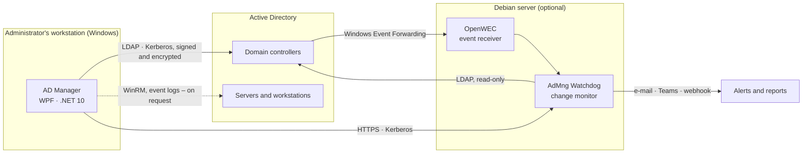

- **AD Manager** works only with live data: each window talks to one domain controller with your credentials and keeps
  directory data in memory only while it is shown. Every change goes through a change plan that you see before it runs.
- **AdMng Watchdog** is optional. It is the only component that stores data – the history of changes – in its own
  protected folder on the server.

### 🗂 Everyday administration

- ⚡ **Smooth instead of an MMC snap-in** – asynchronous LDAP queries streamed page by page, only the attributes that
  are needed are fetched, no 2000-object limit per folder, virtualized lists, tabs (Ctrl+T), a command palette
  (Ctrl+K), lists refreshed live through LDAP notifications – the changed objects, not the whole folder. Containers
  with more than 5000 objects switch to a **virtual list (VLV)**: the domain controller sorts, pages are read while you
  scroll, and memory does not grow with the number of objects.
- 🪪 **Familiar property pages** – user, computer, group, contact, OU: General, Address, Account (with **logon
  hours** – a weekly grid as in ADUC), Profile, Telephones, Organization, Member Of (direct and full, with nesting),
  Members, Managed By, Object, Attribute Editor; helpdesk actions (password reset, unlock, enable/disable, add to
  group), creating, moving (also drag and drop), renaming (F2), deleting. Well-known containers (`Users`,
  `Computers` – also redirected ones) are recognized by their WKGUID: the tree marks them, and new accounts created
  without a specified container go where the domain points.
- 📋 **Quick copying** – a "Copy" button next to the e-mail address, UPN, logon name (also `DOMAIN\login`), phone
  numbers and other values in the details pane and on property pages; Ctrl+C copies the selected list rows (to Excel,
  Teams, tickets); "Copy as…" for many objects at once – e.g. e-mail addresses as a list ready for the "To" field in
  Outlook (Ctrl+Shift+M). Confidential values do not reach the clipboard without being explicitly revealed.
- 🗂 **Views tailored to your AD** – pinning OUs (e.g. *Pracownicy*, *Komputery*), saved LDAP queries with columns,
  ready-made quick filters (locked out, disabled, inactive > N days, password never expires…), export/import of views
  for the team.
- 📧 **Mail (Exchange)** – the *E-mail Addresses* page: `proxyAddresses` with exactly one primary SMTP address, `mail`,
  `mailNickname`, `targetAddress`, hiding from the address book; mail attributes can also be edited in bulk.
- 🪟 **Several connections at once** – *File → New connection in a new window…* (Ctrl+Shift+N) opens another main
  window with its own connection: a different domain, or the same domain with a different account, each window with
  its own password (in memory only), tree, tabs, property windows, tools, background operations and session log. The
  windows are easy to tell apart: domain and account at the start of the title, a colored bar and connection badge
  (color from the profile or from the domain name), a "Domain: …" header in every dialog, and confirmations of
  destructive operations name the domain. Closing a window disconnects only its connection; settings, profiles, views
  and saved filters are shared.
- 🔍 **Comparing objects across connections** – *Compare with an object in another connection…* (list context menu,
  *Action* menu, details pane, property page, command palette) for a user, group, computer or contact: you pick the
  other open window, the program finds the matching object (automatically or by sAMAccountName, UPN prefix, e-mail
  address, name, or a DN / search you specify; with several hits it shows a list to choose from) and puts both sides
  next to each other: attributes (differences highlighted with a background and a sign, DNs compared without the
  domain suffix, addresses optionally without the domain, volatile and identifying attributes – GUID, SID, change
  dates, logon counters, replication metadata – hidden but available, secrets only as "set / not set"), group
  membership by name (direct, primary and nested; built-in groups by RID or SID, so *Domain Users* = *Użytkownicy
  domeny*) and – for groups – the members. Read-only: each side reads through its own window's session (with its
  domain controller, account and formatting), nothing is copied or saved; a CSV is created only on request.
- 🔎 **Transparency** – session log, history of the equivalent PowerShell commands, an activity center with progress
  and cancellation, AD error messages in plain language (in English or Polish).
- 🩺 **Environment readiness and problem reports** – *Tools → Check environment readiness…* checks, read-only, whether
  the domain and this computer are ready for the program's features (connection, directory, SYSVOL and Group Policy,
  remote actions, event logs, Watchdog, Outlook, this computer) – each item with an explanation, a hint and a chapter
  of the instructions; *Help → Report a problem…* puts together a description for a ticket without directory data
  (versions, connection method, codes of the check results, templates of the latest diagnostic messages). Pilot:
  [docs/PILOTAZ.md](docs/PILOTAZ.md).

### 🧰 Bulk editing and the AD Recycle Bin

- 🧰 **Bulk editing** of users, computers, groups and contacts: setting/clearing attributes, templates
  (`{givenName|nodiacritics|lower}.{sn|nodiacritics|lower}`), find and replace, enable/disable, unlock, password
  resets, moving, renaming, group membership, deleting, CSV import (also `;` and cp1250 from a Polish Excel) – always
  with a preview of the differences, validation, protection against overwriting other people's changes, a report,
  export to CSV/PowerShell and the option to undo.
- ♻ **AD Recycle Bin** – the *AD Recycle Bin* window (Ctrl+Shift+R): deleted objects read live, filters, restoring to
  the original or a chosen location, a whole OU subtree in one plan in parent → children order.

### 🔐 Account and privilege review

- 📊 **Account review** – *Tools → Account review…* checks the whole domain, an OU or a saved view in one pass:
  locked-out accounts (also the state on all DCs), expired and expiring passwords and accounts, inactive and never-used
  accounts, password hygiene – as tiles with counters. Every list leads on to the properties, bulk editing, a CSV export
  or a message to the users.
- 🔐 **Privileged access** – the *Privileges* tab lists every account with any rights beyond those of an ordinary domain
  user: from groups (also nested), risky account settings, delegations in ACLs and local rights granted by GPOs – with
  the level (Tier 0 / high / elevated / minor) and the path the right comes from (account → group A → group B → Account
  Operators).

Details: [Track U](#track-u--account-review-and-messages-to-users--u1a-u1b-u1c-u1d-u2-u4-and-u5-).

### 🖥 Computers and Group Policy

- 🖥 **Computers** – *Computer review…*: operating system and build, last logon (also the exact one from all DCs), site,
  owner and who joined the computer; ready-made reports (systems past their end of support, inactive computers, servers
  without an owner, computers in the wrong OUs); preparing, resetting, moving, disabling and deleting computer accounts;
  remote actions over WinRM with the window's credentials – who is logged on, `gpupdate /force`, restart, services –
  plus Remote Desktop, *Computer Management* and *Event Viewer* for the selected computer.
- 📜 **Group Policy** – GPOs in the domain tree and a *Group Policy* tab on the domain, OUs and sites (links, order,
  enforcement, inheritance); creating, copying and linking GPOs, security and WMI filtering, delegation, backup and
  restore, comparing two GPOs; an Administrative Templates editor based on the latest ADMX files (Windows, Edge,
  Microsoft 365 Apps, Chrome, Firefox …) with central store updates; security settings; the "what will the computer
  get" report and Group Policy diagnostics. Every change in AD and SYSVOL goes through the change plan, with rollback.

Details: [Track K](#track-k--computers-and-group-policy-gpo--k1k6-), [docs/KOMPUTERY.md](docs/KOMPUTERY.md) and
[docs/ZASADY-GRUPY.md](docs/ZASADY-GRUPY.md) (Polish).

### 📋 Event logs and troubleshooting

- 📋 **Event log reader** – the logs of domain controllers, servers, workstations and `.evtx` files straight from AD
  Manager: any channel, one timeline across several computers, fields and codes explained in plain language, SIDs and
  computers linked to their AD objects; nothing is written to disk.
- 🔓 **Lockout source and failed logons** – *Find the lockout source…* shows the state on all DCs and their logs at
  once, where the bad passwords came from (with the codes explained) and checks the source computer (sessions,
  services, scheduled tasks); another analysis finds failed logons and password spraying. Planned: readiness for
  disabling RC4, NTLMv1 and unsigned LDAP ("who will stop working"), DC health.

Details: [Track E](#track-e--event-logs-reader-and-analysis--e1-and-part-of-e2-),
[docs/DZIENNIKI-ZDARZEN.md](docs/DZIENNIKI-ZDARZEN.md) (Polish).

### ✉ Messages to users

- ✉ **E-mail messages to users** – from templates with account data (e.g. "your password expires on …"), to one user
  from the properties window or to hundreds from a selection or a review result; sent directly over SMTP or through the
  Watchdog service, with a preview, a test message to yourself and a report; formatted messages pasted from Outlook with
  their images, salutations with title and gender.
- 📨 **Correspondence (Outlook)** – mail merge through classic Outlook: recipients from files or straight from AD,
  fields, signature, attachments, an "already sent" journal – and queries asking the owners of shared mailboxes whether
  the mailbox is still needed.

Details: [Track U](#track-u--account-review-and-messages-to-users--u1a-u1b-u1c-u1d-u2-u4-and-u5-),
[docs/KORESPONDENCJA.md](docs/KORESPONDENCJA.md) (Polish).

### 🛡 AdMng Watchdog – change monitoring

- 🛡 **AdMng Watchdog – AD change monitor** – a separate service (24/7) on a **Debian 12/13** server outside the domain
  (since 0.3.0; `.deb` packages, systemd, a read-only computer account with a keytab and a password changed every 30
  days) detects new and deleted objects, attribute changes (old → new value), lockouts, expiring accounts, changes of
  membership and **privileged access** (also through nested groups), Tier 0 changes and **GPO content** changes
  ("setting: was → is"); it determines **who and from where** from the domain controllers' security logs forwarded
  through Windows Event Forwarding (OpenWEC, no agents on the DCs), keeps a 3-year history and notifies by e-mail
  (immediately and in a daily report), in Microsoft Teams (Workflows) and through a signed webhook (SIEM). In AD_MNG the
  **Watchdog** tab (Tools → Watchdog) shows events, rules, channels and the service status. The service is the only part
  of the solution that stores data – in its own protected folder
  ([ADR-0008](docs/adr/0008-watchdog-dane-w-osobnym-folderze.md), [ADR-0009](docs/adr/0009-watchdog-na-linuksie.md)).
  Features: [docs/WATCHDOG.md](docs/WATCHDOG.md), deployment: [docs/WATCHDOG-LINUX.md](docs/WATCHDOG-LINUX.md).

### 🔒 Security and privacy

- 🔒 **Zero local data** – nothing from the directory is written to disk (no database, cache or snapshots); every
  refresh asks the domain controller live. On disk (`%APPDATA%\AdMng`) there are only UI settings, connection profiles
  without passwords and view definitions. Passwords never end up in logs; they go to a file only in an export of
  password reset results that the operator explicitly asks for.
- 🔑 **Different credentials** – sign in with the current Windows account or another one (helpdesk, administrator);
  Kerberos with signing and encryption, LDAPS or StartTLS; the whole session works with one domain controller, which
  can be changed while you work (**"Change Domain Controller..."** – a list of DCs with site, GC and RODC, without
  re-entering the password, open tabs stay). The UI shows what a given account can and cannot change
  (`allowedAttributesEffective`) and highlights privileged accounts.
- 🕵 **No telemetry, no automatic updates** – the only connection to the internet is downloading browser ADMX templates
  when you ask for it; see the [privacy policy](#privacy-policy).

What is still missing (among others LAPS, BitLocker, an ACL editor, creating accounts from CSV, "Copy user"): see
[known limitations](#known-limitations).

### AD Manager vs. ADUC

| | ADUC (`dsa.msc`) | AD Manager |
|---|---|---|
| **Large OUs** | "Not Responding", 2000-object limit | results streamed page by page, no limit, with cancellation; containers > 5000 objects as a VLV virtual list (sorting and type-ahead search on the server, constant memory) |
| **Search** | Find in a separate window | ANR as you type (Ctrl+E), command palette (Ctrl+K) |
| **Copying** | selecting text in a property page field | "Copy" button next to the value, Ctrl+C of list rows, "Copy as…" for many objects (e-mail addresses for Outlook) |
| **Many objects at once** | a fixed subset of fields, no preview or report | any attributes, before → after preview, report, PowerShell, undo |
| **AD Recycle Bin** | only in ADAC | browsing and restoring, also whole OU subtrees |
| **Refreshing** | manual F5 | lists refreshed live (LDAP notifications) |
| **Credentials** | `runas /netonly`, a separate console | the current Windows account or another one, connection profiles without passwords |
| **Look** | blurry on high DPI, no dark mode | Fluent, light and dark theme, EN / PL without a restart |
| **Installation** | RSAT | a single `AdMng.exe` file – no .NET or RSAT needed |
| **Who changed what** | nothing | AdMng Watchdog: actor, old → new value, notifications |
| **Account lockouts** | LockoutStatus and EventCombMT separately, Event Viewer computer by computer | *Find the lockout source*: state on all DCs and their logs at once, sources of the attempts with the codes explained, a check of the source computer (sessions, services, scheduled tasks) |

## 📸 Screenshots

<picture>
  <source media="(prefers-color-scheme: dark)" srcset="docs/assets/screenshots/02-main-window-dark.png">
  <source media="(prefers-color-scheme: light)" srcset="docs/assets/screenshots/01-main-window.png">
  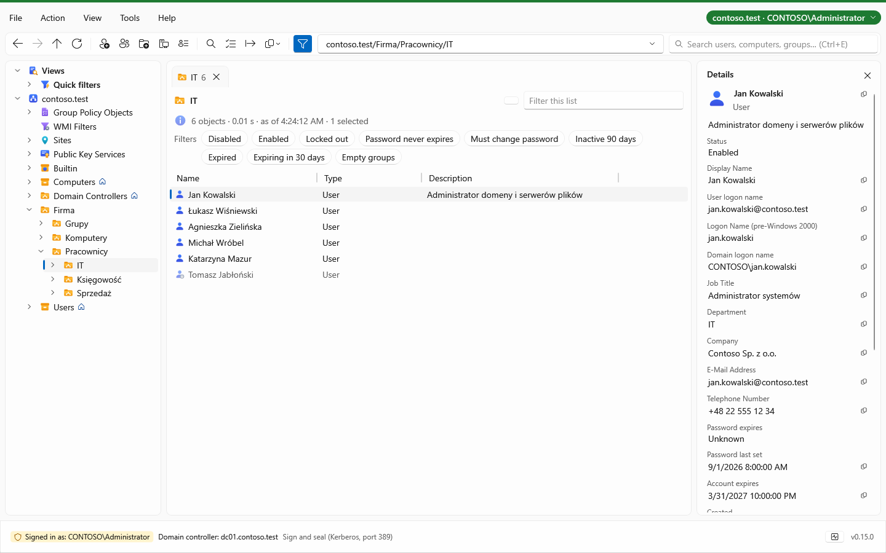
</picture>

<p align="center"><sub>Main window – the IT organizational unit with details of the selected user (light or dark theme, like your GitHub)</sub></p>

<table>
  <tr>
    <td width="50%" valign="top">
      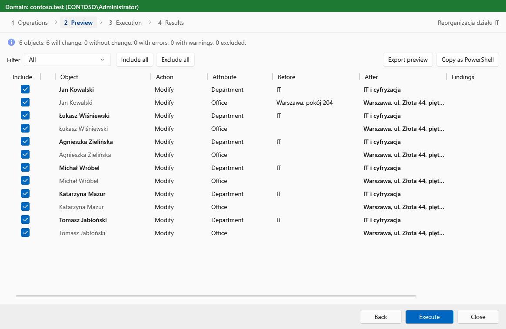
      <br><sub><b>Bulk editor</b> – preview of the changes (before → after) before they run</sub>
    </td>
    <td width="50%" valign="top">
      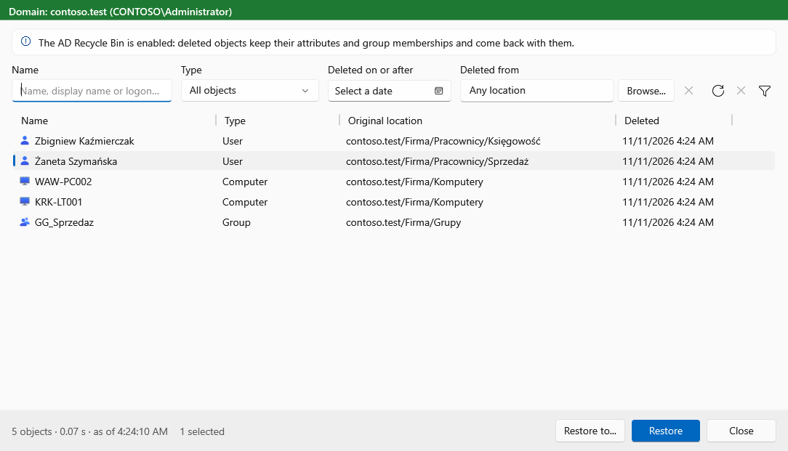
      <br><sub><b>AD Recycle Bin</b> – deleted objects to restore</sub>
    </td>
  </tr>
  <tr>
    <td width="50%" valign="top">
      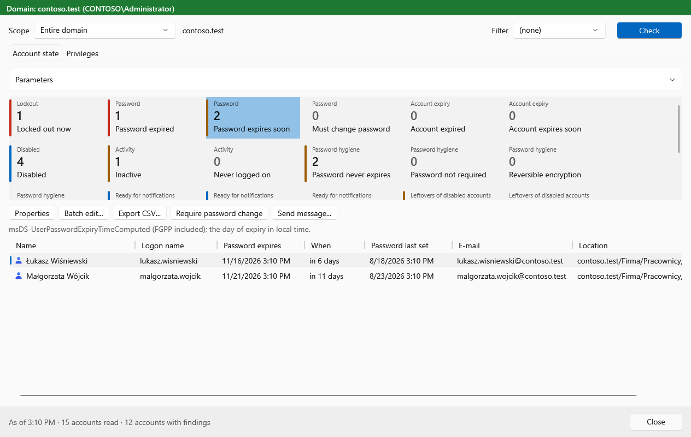
      <br><sub><b>Account review</b> – check tiles and the accounts whose password expires soon</sub>
    </td>
    <td width="50%" valign="top">
      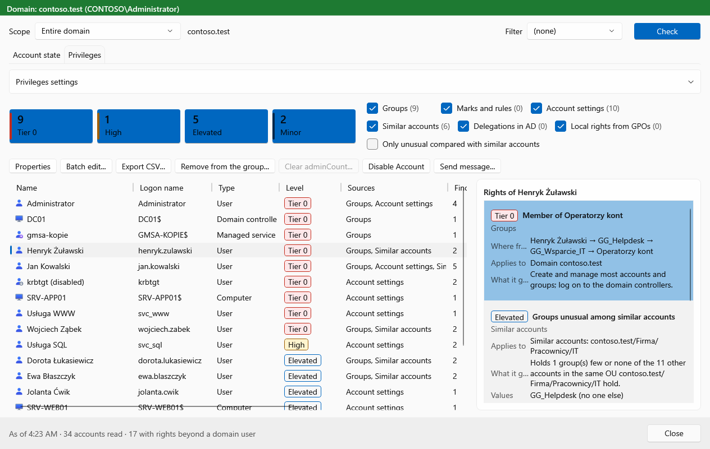
      <br><sub><b>Privileges</b> – accounts with rights beyond an ordinary user, levels and the path of a right</sub>
    </td>
  </tr>
  <tr>
    <td width="50%" valign="top">
      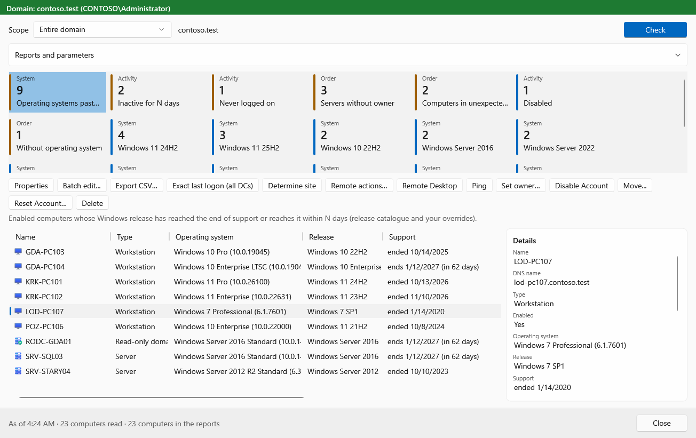
      <br><sub><b>Computer review</b> – systems past the end of support, version and housekeeping tiles</sub>
    </td>
    <td width="50%" valign="top">
      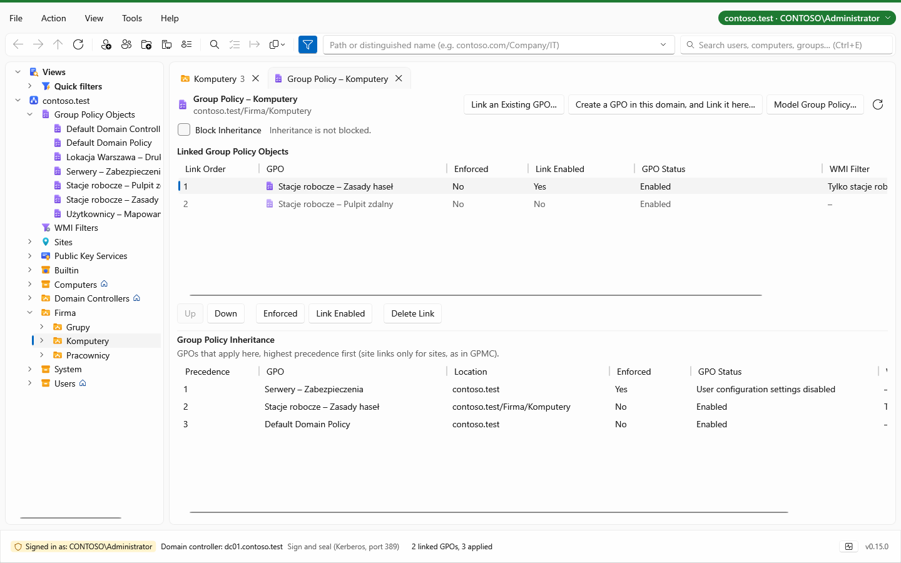
      <br><sub><b>Group Policy</b> of an OU – linked GPOs, inheritance, the GPOs in the tree</sub>
    </td>
  </tr>
  <tr>
    <td width="50%" valign="top">
      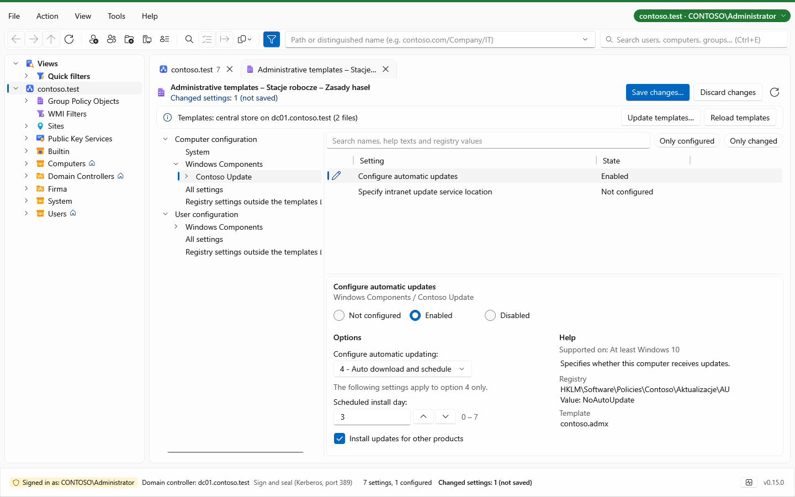
      <br><sub><b>Administrative Templates</b> – a setting from the central store with its options and help</sub>
    </td>
    <td width="50%" valign="top">
      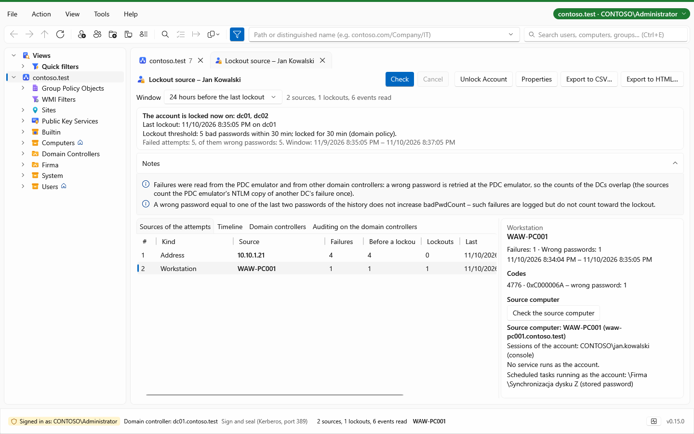
      <br><sub><b>Lockout source</b> – state on the DCs, sources of the bad passwords, the source computer checked</sub>
    </td>
  </tr>
  <tr>
    <td width="50%" valign="top">
      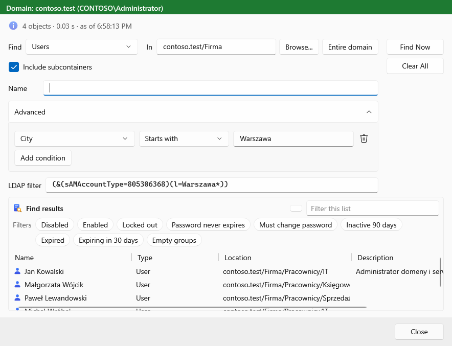
      <br><sub><b>Find</b> – advanced conditions and a ready LDAP filter</sub>
    </td>
    <td width="50%" valign="top">
      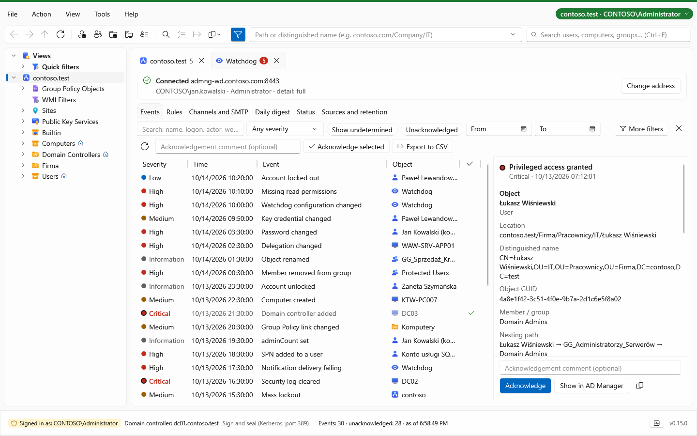
      <br><sub><b>AdMng Watchdog</b> – what changed, who and from where</sub>
    </td>
  </tr>
</table>

<sub>English UI over the sample company from the tests (Polish names and data). More pictures – properties, logon
hours, the Watchdog tabs, correspondence, environment readiness and others – are rendered for major releases and on
request, see [Screenshots from CI](#screenshots-from-ci).</sub>

## 🧭 Roadmap

The work plan is divided into phases. Each phase ends with a version that can actually be used and has measurable
completion criteria. The order follows what was agreed with the team:

- **technology:** WPF .NET 10 + Fluent ([ADR-0001](docs/adr/0001-wpf-net10-fluent.md));
- **interface:** PL + EN, switchable on the fly;
- **priorities beyond `dsa.msc`:** AD Recycle Bin (restore) and mail/Exchange attributes;
- **AD divisions** (employees, computers, …) handled by **configurable views** rather than hard-coded;
- **bulk editing** is key, so the change engine is built already in Phase 1 and the full UI in Phase 2.

Technical details and rationale: [ARCHITECTURE.md](docs/ARCHITECTURE.md), [RESEARCH.md](docs/RESEARCH.md).

Status legend: ✅ done · 🟡 first version ready, needs refinement/verification on Windows AD · ⬜ planned

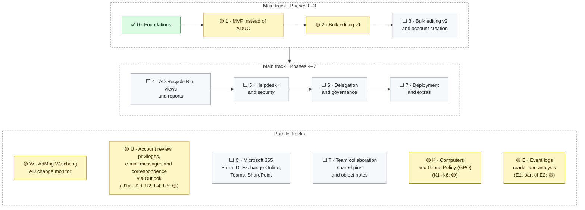

| Phase | Goal | Key deliverables | Status |
|---|---|---|---|
| 0 | Foundations | Solution, CI, Samba AD lab, LDAP core, contracts, performance prototype | ✅ |
| 1 | MVP – everyday work instead of ADUC | Sign-in (various credentials), tree, fast lists, search, properties, helpdesk actions, create/move/delete | 🟡 full scope implemented (including copying values, "Change Domain Controller", logon hours, WKGUID and VLV: ✅), awaiting a pilot on Windows AD |
| 2 | Bulk editing v1 (key) | Bulk operations with a diff preview, validation, report, PowerShell export, rollback; CSV import (update) | 🟡 implemented, awaiting load tests |
| 3 | Bulk editing v2 and account creation | CSV import (creation), per-OU templates, spreadsheet editor, basket, wizards (inactive accounts, surname change), full mail support | ⬜ (E-mail Addresses tab: ✅) |
| 4 | AD Recycle Bin, views and reports | Browsing and restoring deleted objects, query builder, workspaces for departments, reports, multiple domains | ⬜ (AD Recycle Bin: 🟡; nested membership, view export, multiple domains in separate windows and comparing objects between them: ✅) |
| 5 | Helpdesk+ and security | Credentials without the password in memory, protection from deletion, Security tab, lockout status on all DCs, change history, LAPS, BitLocker, live refresh | ⬜ (live list refresh: ✅) |
| 6 | Delegation and governance | ACL editor, delegation wizard and delegation review, ADMX policies, operator event log, rare ADUC tabs | ⬜ |
| 7 | Deployment and extras | Signed MSI, WDAC/AppLocker, "four-eyes" approval, time-bound membership (PAM) | ⬜ |
| W | AdMng Watchdog – change monitor (parallel track) | A Linux service (Debian, systemd) that detects changes in AD and determines who made them and from where (WEF), GPO content, 3-year history, notifications by e-mail / daily report / Teams / webhook, Watchdog tab in AD_MNG | 🟡 preview release (Debian packages since 0.3.0), awaiting a pilot on Windows Server domain controllers |
| U | Account review and messages to users (parallel track) | E-mail messages (SMTP) from templates with account data (e.g. "password expires on …") to a single user from the properties window or to many at once, a review of all accounts (locked out, expired and expiring passwords and accounts, inactive, password hygiene), account privileges (every account with rights beyond those of an ordinary domain user, with level and path), filter builder, automatic reminders in the Watchdog service, mail merge through classic Outlook (address files, recipients from AD, fields, preview, test, "already sent" journal) and queries to owners of shared mailboxes | 🟡 (U1a – messages from AD Manager over direct SMTP, U1b – sending through the Watchdog service, U1c – formatted messages pasted from Outlook with embedded images, U1d – salutations with title and gender, U2 – account status review, U4 – account privileges: U4a from groups and account settings with the filter builder, U4b from delegations in ACLs and U4c from local rights granted by GPO: 🟡 implemented, awaiting a pilot on Windows Server AD; U5 – Correspondence (Outlook) and queries to mailbox owners: 🟡 implemented, awaiting a pilot with classic Outlook and Exchange; U3: ⬜) |
| C | Microsoft 365: Entra ID, Exchange Online, Teams and SharePoint (parallel track) | Sign-in with an administrator or Global Reader account with automatic role detection (including roles eligible in PIM) and matching of the available features; users, groups, licenses, MFA and sign-ins in Entra ID, mailboxes and permissions in Exchange Online, Teams, SharePoint and OneDrive, linking an AD account to its Entra ID account; Microsoft Graph and PowerShell modules | ⬜ planned |
| T | Team collaboration (parallel track) | Several administrators on different computers work together through the AdMng Watchdog service: a "Shared" panel with objects pinned for the team (with a note, author, "Forward to…") and object notes visible to everyone on the account, group or computer, refreshed live | ⬜ planned |
| K | Computers and Group Policy (GPO) (parallel track) | Computer inventory and reports, computer account lifecycle, remote actions over WinRM; GPOs in the tree (creating, linking to OUs, order, filtering), Administrative Templates editor based on the latest ADMX files (Windows, Edge, Microsoft 365 Apps, Chrome, Firefox and others) with central store updates, security settings, "What will the computer get" report, readable settings and Group Policy diagnostics | 🟡 (K1 – computers, K2 – GPOs in the tree, K3 – ADMX editor with central store updates, K4 – security settings, K5 – "What will the computer get" report and K6 – readability, editing convenience and diagnostics: implemented, awaiting a pilot on Windows Server AD) |
| E | Event logs: reader and analysis (parallel track) | Reading the event logs of DCs, servers, workstations and `.evtx` files from within the program (any channel, a shared timeline across multiple computers, explained fields and AD objects) and analyses: source of an account lockout, password spraying, Kerberos/RC4, NTLMv1, LDAP signing ("who will stop working"), logon history, account and group changes, GPO on a computer, DC health, audit integrity; separate from the Watchdog, nothing written to disk | 🟡 (E1 – reader and, from E2, the account lockout source and failed logons: implemented, awaiting a pilot on Windows Server AD) |

Details of each phase are below – click to expand.

### Phase 0 – Foundations ✅

**Goal:** make the technology decisions, verify the LDAP risks and prepare the engineering base.

<details>
<summary><b>Phase 0 details</b> – solution, lab, LDAP core, CI</summary>

- ✅ `.slnx` solution: `AdMng.Core`, `AdMng.Directory`, `AdMng.Presentation` (ViewModels without WPF), `AdMng.App` (WPF),
  test projects; central package versions; warnings treated as errors.
- ✅ Core: DN (RFC 4514, Polish characters), LDAP filters with escaping (RFC 4515) and AD rules (bit AND/OR, IN_CHAIN, ANR),
  `userAccountControl`/`groupType` flags, FILETIME/GeneralizedTime/SID/GUID conversions, object and schema model, mapping
  of AD errors (`0000052D`, `data 775`…).
- ✅ Contracts: directory session pinned to a DC, change engine (plan → execution → rollback), templates, CSV, session log.
- ✅ Samba AD DC lab with "Polish company" data (OUs by department and location, locked-out accounts, helpdesk delegation),
  run locally and in CI.
- ✅ S.DS.P performance prototype: bind 16 ms, first page of 100 objects 65 ms, VLV/ASQ/`allowedAttributesEffective` work.
- ✅ CI (GitHub Actions): build and tests on Windows, publishing `AdMng.exe`, integration tests on Ubuntu with a Samba DC.
- ✅ Documentation: architecture, ADRs, research.

**Completion criteria:** build without warnings on Windows and Linux; unit and integration tests green in CI. ✅

**To do in the Windows Server 2025 lab** (moved to Phase 1): measuring a list of 100,000 objects (paging vs VLV),
Kerberos sign-in with enforced signing and channel binding, a "no data on disk" test (profile scan after the session).

</details>

### Phase 1 – MVP: everyday work instead of ADUC 🟡

**Goal:** helpdesk staff and administrators can do their everyday tasks faster than in `dsa.msc`.

<details>
<summary><b>Phase 1 details</b> – implementation status, connection, lists, search, properties, actions</summary>

#### Implementation status

- ✅ **Connection:** current Windows account or other credentials, Kerberos with signing and encryption, LDAPS,
  StartTLS; discovery of the domain and domain controllers (DsGetDcName, site), DC selection when connecting, connection
  profiles without passwords, identity bar with a warning for privileged accounts, AD error messages in Polish and
  English, **"Change Domain Controller…"** during the session (list of DCs with site, GC, RODC and PDC emulator, "any
  writable DC in my site", without re-entering the password; open tabs reload from the new DC).
- ✅ **Navigation and lists:** lazily loaded tree, "Advanced Features", lists without the 2000 limit (streamed
  pages, virtualization), sorting, column selection from schema attributes, names from display specifiers (`CN=415`),
  status badges, address bar (DN or path), Back/Forward/Up, tabs (Ctrl+T, Ctrl+Enter), details pane,
  "as of" timestamp, server-side quick filters, **live list refresh** (LDAP change notifications),
  **well-known containers recognized by WKGUID** (`wellKnownObjects`: badge in the tree, default container for new
  users, groups and computers – also after `redirusr`/`redircmp`), **VLV virtual list** for containers with more than
  5000 objects (pages read while scrolling, sorting, quick filter and type-to-find on the server).
- ✅ **Search:** ANR while typing (Ctrl+E), Find (Ctrl+F) with categories and a custom LDAP filter, object picker,
  command palette (Ctrl+K).
- ✅ **Properties:** all tabs from the table below, modeless windows, fields the operator may not change are read-only
  (`allowedAttributesEffective`), direct **and full (nested)** membership, groups with > 1500 members,
  **"Logon Hours…"** (weekly grid in local time as in ADUC; also in bulk in the editor).
- ✅ **Actions:** all from the list below, plus a new `inetOrgPerson`, PowerShell command history and session log.
  Single changes go through the same change engine (validation, log, PowerShell), but **rollback is for now
  available only in the bulk editor** – rolling back a single change from the session log is planned.
- ✅ **Quality:** PL/EN without restart, light/dark/system theme (Fluent), ADUC-like shortcuts, UI tests (UI Automation)
  and a smoke test of the published `AdMng.exe` in CI.
- ✅ **Quick copy:** a "Copy" button next to the e-mail address, UPN, logon name, phone numbers and other values in the
  details pane and on property tabs, Ctrl+C in the object list (visible columns, tab-separated), "Copy as…"
  for many objects at once (e-mail addresses as a list for Outlook, Ctrl+Shift+M) – details in the
  [Copying values](#copying-values-) section below.
- ✅ **The functional scope of Phase 1 is complete** – the last gaps (copying values, "Change Domain Controller" during
  the session, "Logon Hours", well-known containers by WKGUID, VLV for the lists of very large OUs) are done;
  designs: [copying](docs/dev/phase1-copy.md), [DC change](docs/dev/phase1-changedc.md),
  [logon hours](docs/dev/phase1-logonhours.md), [WKGUID and VLV](docs/dev/phase1-navigation.md).
- ➡ **Moved to later phases:** "Copy user" (Phase 3), editing ACL-based fields – shown read-only for now
  (Phase 5).
- 🟡 **To verify on Windows Server:** pilot, measuring 100,000 objects, Kerberos with enforced channel binding,
  "no data on disk" test, high contrast and screen reader.

#### Connection and session
- Sign-in with the current Windows account or other credentials; Kerberos with signing and encryption, LDAPS, StartTLS.
- Discovery of the computer's domain and domain controllers (DsGetDcName, site), DC selection when connecting.
- "Change Domain Controller…" during the session (*File* menu, context menu of the domain in the tree, command palette):
  list of the domain's DCs with site, "Your site", GC, RODC and PDC emulator, typing a name manually or "any writable DC
  in my site"; the new session is created with the current session's credential (without re-entering the password) and
  replaces it only after a check (same domain, different DC) – an error or cancellation keeps the current one.
  Optionally the chosen DC is saved in the connection profile; the change is recorded in the session log.
- Connection profiles (without passwords), identity bar highlighting privileged accounts, understandable error messages
  in PL/EN.
- ✅ **Multiple connections at once** – one main window per connection (separate DI scope, session, password only in
  memory, background tasks, session log): *File → New connection in a new window…* (Ctrl+Shift+N, command palette,
  connection badge), window switcher in the badge and the palette ("Go to window: …"), window color in the connection
  profile, domain in the title, in dialog headers and in confirmation texts, *Close window* / *Exit application*
  ([dev/multi-window.md](docs/dev/multi-window.md)).
- ✅ **Comparing an object with an object in another connection** – *Comparison* window (modeless, one per invocation):
  choice of the second connection and the matching rule (automatically, sAMAccountName, UPN prefix, e-mail, name,
  specified object), list of candidates when the result is ambiguous, headers of both sides in their connections'
  colors, tabs *Attributes* (differences only, volatile and identity attributes, addresses without the domain, filter,
  values of the selected row marked *only A / only B / common*, Ctrl+C), *Membership* and *Members* (nested ones read in
  the background), a "the same object seen by two accounts" banner, *Refresh* after the second window's DC changes, CSV
  export on demand. Each side is read through its own pinned session (at most 2 concurrent requests to the second
  window), with no write path at all
  ([dev/multi-window.md, chapter 8](docs/dev/multi-window.md#8-comparison-of-objects-between-two-connections)).

#### Navigation and lists
- Lazily loaded domain/OU tree, "Advanced Features" toggle; well-known containers recognized by WKGUID
  (`wellKnownObjects`/`otherWellKnownObjects` of the domain head – badge and role description in the tree, also after a
  `redirusr`/`redircmp` redirection); "New User/Group/Contact/Computer" from the domain's tab, search results or a view
  creates the object in the default Users/Computers container.
- Lists without the 2000 limit: results streamed in pages, virtualization, sorting, column selection from schema
  attributes, column names from the Polish display specifiers (as in the Polish ADUC), status badges (disabled, locked
  out, protected).
- Very large containers (more than 5000 objects) as a VLV virtual list: the DC sorts and returns only the pages being
  viewed (200 rows, at most 12 pages in memory), type-to-find via VLV `seek`, server-side quick filter, live refresh of
  the visible pages; a "Virtual list (VLV)" badge in the status bar.
- Address bar (DN or path), Back/Forward history, tabs, details pane with quick actions, "as of" timestamp.
- Quick filters (chips) executed on the server side: disabled, locked out, inactive > N days, password never expires,
  password change required, expired/expiring accounts, empty groups.

#### Search
- Global search while typing (ANR, Ctrl+E), Find (Ctrl+F) with ADUC-like categories and a custom LDAP filter,
  object picker (a replacement for "Select Users, Computers, or Groups").

#### Properties (modeless windows, fields the operator may not change are read-only)

| Object type | Tabs |
|---|---|
| User | General, Address (c + co + countryCode), Account (flags, "end of day" expiration, UPN with suffixes, logon hours), Profile, Telephones, Organization, Member Of (with the primary group), E-mail Addresses, Object, Attribute Editor |
| Computer | General (role), Operating System, Member Of, Delegation (view only), Location, Managed By, Object, Attribute Editor |
| Group | General (scope/type with conversion rules), Members (> 1500 via ranged retrieval), Member Of, Managed By, Object, Attribute Editor |
| Contact | General, Address, Telephones, Organization, Member Of, E-mail Addresses, Object, Attribute Editor |
| Organizational unit | General, Managed By, Object, Attribute Editor |

#### Actions
- Password reset (typed or generated, force change, unlock), enable/disable, unlock, add to group,
  move (dialog and drag and drop), rename (F2), delete (warnings, subtree deletion after confirmation),
  new user/group/OU/computer/contact, list export to CSV, copying values (Ctrl+C, "Copy as…").
- Every change (including a single one) goes through the change engine: validation, session log, possibility of rollback.

#### Copying values ✅

A value is copied with one click or a shortcut – without selecting text in the field and without extra windows. Design:
[docs/dev/phase1-copy.md](docs/dev/phase1-copy.md).

- **One-click copy button** next to the values in the **details pane** (e-mail address, UPN, logon name
  `sAMAccountName` and `DOMENA\login`, display name, phone and mobile, employee number/ID, job title, department,
  company, manager, name, path and DN) and on property tabs (e-mail, display name, logon name with a `DOMENA\` button,
  phones, job title, department, company, office, UPN, manager, fields of the *Object* tab). The confirmation is a short
  "Copied: …" message (no window, read by screen readers) and a ✓ mark on the button; when the clipboard is held by
  another program, a warning appears instead of the confirmation. Values in the details pane can also be selected with
  the mouse.
- **Ctrl+C in the object list:** the selected rows (in list order) with the visible columns as tab-separated text – for
  Excel, Teams or a helpdesk ticket; "Copy rows with headers" adds the column headers. Values starting with `=`, `+`,
  `-`, `@` get an apostrophe (formula protection as in the CSV export), except numbers and phone numbers. Ctrl+Shift+C
  copies the DNs of the selected objects.
- **"Copy as…"** in the context menu, in the *Action* menu, on the toolbar and in the command palette (Ctrl+K, "Copy as"
  category): e-mail address, UPN, logon name, `DOMENA\login`, name, display name, DN, canonical path, GUID, SID – for one
  or many objects (values read live from the session's DC, one per line). E-mail addresses (Ctrl+Shift+M) go to the
  clipboard as a list separated by `; `, ready for the "To" field in Outlook; objects without an address are skipped,
  and a message says how many there were.
- **Copying from lists on tabs:** a single address from the *E-mail Addresses* tab without the `smtp:` prefix (button,
  menu, Ctrl+C), name (Ctrl+C), DN (Ctrl+Shift+C) and e-mail address from *Member Of* and *Members*, the e-mail
  addresses of all group members for Outlook, a session log entry (Ctrl+C), Watchdog event details.
- **Security:** confidential values (passwords, LAPS, BitLocker, attributes marked confidential in the schema) are not
  copied by these commands – columns containing them are skipped on Ctrl+C (a message says which); they can be copied
  only after being explicitly revealed in the Attribute Editor, excluded from the clipboard history and cleared after
  60 s. Copying writes nothing to disk ("zero local data" rule).
- Button and confirmation texts in Polish and English, keyboard operation (copy buttons are in the Tab order, with the
  name "Copy: …" for screen readers), unit tests and UI tests (Windows CI).

#### Quality
- PL/EN without restart, light/dark theme, ADUC-like shortcuts (F5, Del, F2, Alt+Enter, Ctrl+F) + Ctrl+K, accessibility
  (UI Automation, keyboard, high contrast).

**Completion criteria**
- Pilot: ~5 helpdesk staff work alongside ADUC for 2 weeks.
- Values displayed identically to ADUC in the Windows lab (country, logon hours, account expiration, group scope).
- A helpdesk account sees the locked fields correctly and gets understandable messages (access denied, password policy).
- First page of a large OU < 300 ms on the LAN, no UI "freezes".
- The "no directory data on disk" test passed.

</details>

### Phase 2 – Bulk editing v1 (key) 🟡

**Goal:** safe, predictable and reversible changes to hundreds and thousands of objects.

<details>
<summary><b>Phase 2 details</b> – operations, change pipeline, CSV import, completion criteria</summary>

#### Implementation status

- ✅ Bulk editor (Ctrl+Shift+B) with all operations from the table below, the whole pipeline 1–6, "Retry failed",
  rollback, export of the preview and the report to CSV, PowerShell script, CSV import that updates objects (with
  separator and encoding detection, including cp1250 from Polish Excel, and formula protection in the export).
- ✅ Execution with limited parallelism, retries of transient errors and optimistic concurrency (atomic
  "delete the old value + add the new one" – a change made by someone else after the preview ends in a conflict, not
  an overwrite). Batches above the threshold from the settings, or with deletions, moves or password resets, require
  typing the number of objects.
- ✅ Passwords generated during a reset exist only in memory; results with passwords are exported only on explicit
  request, with a warning before unsaved passwords are overwritten.
- 🟡 Completion criteria: conflicts, rollback and the PowerShell plan are covered by automated tests (also in the Samba
  lab); a batch of 5000 objects and the comparison with `-WhatIf` on Windows Server – still to do.

#### Selection sources
- Selection of multiple objects in a list, a search result, a quick filter or a saved view, a CSV file.

#### Operations (users, computers, groups, contacts)

| Operation | Details |
|---|---|
| Set attribute | Fixed value or template: `{givenName\|nodiacritics\|lower}.{sn\|nodiacritics\|lower}@firma.pl` |
| Clear attribute | With a check of mandatory attributes |
| Add / remove values | Multi-valued attributes (e.g. `proxyAddresses`, `otherTelephone`) – idempotently |
| Find and replace | Text or regular expression |
| Account | Enable/disable, unlock, flags (password never expires, smart card…), force password change, expiration date, logon hours (the same grid as on the Account tab) |
| Password reset | Unique cryptographically generated passwords or a single password; results exported only with explicit consent |
| Move / rename | To the specified OU; new name from a template |
| Groups | Add to groups / remove from groups (many-to-many) |
| Delete | Separately, with confirmation by typing the number of objects |

#### Pipeline
1. **Plan** – fresh read of the current values from the pinned DC, template rendering, skipping changes with no effect.
2. **Validation** – schema (type, single-/multi-valued, length), operator permissions (`allowedAttributesEffective`),
   uniqueness (`sAMAccountName`, UPN, mail – in AD and within the batch), protected objects (adminCount=1, critical
   system objects, built-in accounts).
3. **Diff preview** – "before → after" for every object and attribute, filters (changes / warnings / errors / no change),
   excluding individual objects, preview export to CSV, **equivalent PowerShell script**.
4. **Execution** – in the background, with progress and cancellation; limited parallelism; retries of transient errors;
   **optimistic concurrency** (a change made by someone else after the preview will not be overwritten).
5. **Report** – status of each object, AD error codes in Polish, "Retry failed", CSV export.
6. **Rollback** – inverse plan from the remembered (in-memory) old values, through the same preview.

#### CSV import (updating existing objects)
- Automatic separator detection (`;` from Polish Excel, `,`, tab), UTF-8/BOM, key: `sAMAccountName`, UPN, mail,
  `employeeID`, DN or `objectGUID`; mapping of columns to attributes (automatic by LDAP name or Polish label);
  empty cells: skip or clear; rows not found/ambiguous shown as errors in the preview.

**Completion criteria**
- A batch of 5000 objects in the lab without overloading the DC (concurrency limit, no LDAP latency alarms).
- Injected concurrent changes detected as conflicts.
- Rollback restores 100% of reversible changes (automated tests).
- The generated PowerShell with `-WhatIf` produces the same changes as the plan.

</details>

### Phase 3 – Bulk editing v2 and account creation ⬜

**Goal:** account creation from CSV and from templates assigned to OUs, spreadsheet editor, object basket, wizards
(inactive accounts, surname change) and full mail support.

<details>
<summary><b>Phase 3 details</b> – CSV import that creates objects, per-OU templates, spreadsheet editor, wizards, mail</summary>

- CSV import that **creates** objects (users, contacts, groups, computers) with a downloadable file template; cp1250 support.
- Templates for new objects assigned to OUs (e.g. *Pracownicy/IT*: UPN, mail, initial groups, department attributes),
  naming policy with transliteration of Polish characters and uniqueness counters (`jan.kowalski2`).
- "Copy user" (attributes copyable according to the schema + memberships).
- Spreadsheet editor (like Excel) over list results: pasting from Excel, fill down, changes go to the preview.
- Basket of objects from different OUs, "paste a list" (matching by sAMAccountName/UPN/mail/employeeID).
- Wizards: inactive accounts and computers (disable → describe → move → delete later), surname change (sn, displayName,
  cn, UPN, mail, primary SMTP address), UPN suffix migration, copying memberships A → B.
- **Mail / Exchange (priority):** full `proxyAddresses` support (exactly one primary `SMTP:`, uniqueness across the whole
  forest via the GC), `mailNickname`, `targetAddress`, `extensionAttribute1–15`, hiding from the GAL; bulk operations on
  addresses (e.g. adding an alias in a new domain for a whole department).
- Group membership synchronization from a query or CSV (incremental, never by overwriting `member`).

</details>

### Phase 4 – AD Recycle Bin, views and reports ⬜ (AD Recycle Bin: 🟡)

**Goal:** browsing and restoring deleted objects, query builder, workspaces for departments, live reports and multiple
domains.

<details>
<summary><b>Phase 4 details</b> – AD Recycle Bin, views for departments, query builder, reports, multiple domains</summary>

- 🟡 **AD Recycle Bin (priority) – first version ready.** The *AD Recycle Bin* window (Tools menu, command palette,
  Ctrl+Shift+R): list of deleted objects read live from `CN=Deleted Objects` (Show Deleted control, streamed results,
  can be interrupted), server-side filters (name, object type, deletion date, container the object was deleted from),
  columns: name, type, original location (canonical path – also through deleted parent containers), deletion time.
  Restoring to the original or a specified location through the change engine: plan preview with remarks and
  confirmation, session log, PowerShell history (`Restore-ADObject`), refresh of the lists and the tree.
  **An entire OU subtree comes back in one plan in parent → children order** (which ADAC cannot do): the children go
  into the restored parent, and a child's execution waits for its parent. The plan detects name conflicts at the
  destination (live read), objects whose container remains deleted, and objects already permanently deleted. The window
  shows the Recycle Bin status and the retention time of deleted objects (`msDS-deletedObjectLifetime`/`tombstoneLifetime`);
  when the Recycle Bin is disabled, it warns and allows reanimating an object from its tombstone (without most
  attributes) after an extra confirmation. Verified with unit tests, UI tests and in the Samba lab (reanimating a subtree
  from tombstones).
  Still to do: verification on Windows Server with the Recycle Bin enabled and with permissions delegated on
  `CN=Deleted Objects`, a warning in the delete dialog when the Recycle Bin is disabled, restoring in the Configuration
  and DNS zone partitions.
- 🟡 **Views for departments:** ✅ pinning OUs, saved views (LDAP query + container + columns), ready-made built-in views
  and view export/import for the team; ⬜ workspaces (e.g. *Pracownicy*, *Komputery*, *Kontrahenci*) combining views
  with templates, separate for helpdesk and administrators.
- 🟡 Query builder: ✅ filter builder (conditions ↔ LDAP, AND/OR groups) with saved filters, chips on object lists and
  JSON export/import ([Track U4a](#u4--account-privileges--u4a-u4b-and-u4c-)); ⬜ saved queries as folders in the tree,
  import of queries saved in ADUC (XML).
- Live reports: security (PASSWD_NOTREQD, no Kerberos preauthentication, unconstrained delegation, adminCount,
  accounts with SPNs), inventory (operating systems, empty and large groups, OU object counts); every result can be
  passed to bulk editing.
  User account status review (locked out, password and account deadlines, inactive) –
  [Track U](#track-u--account-review-and-messages-to-users--u1a-u1b-u1c-u1d-u2-u4-and-u5-); accounts with rights
  beyond an ordinary user (groups, Kerberos delegation, SPN, adminCount, no preauthentication, delegations in ACLs,
  local rights from GPO) – the *Privileges* tab of the same window ([U4](#u4--account-privileges--u4a-u4b-and-u4c-)).
- ✅ Direct vs full (nested) membership on the *Member Of* and *Members* tabs
  (`LDAP_MATCHING_RULE_IN_CHAIN`); ⬜ effective membership report for multiple users.
- 🟡 Multiple domains and forests (✅ multiple domains in separate windows and ✅ comparing an object with an object in
  another connection – attributes, membership and group members – [Multiple connections at once](#connection-and-session);
  ⬜ one tree with several domains, global catalog search, comparing two objects of the same connection or entire OUs),
  command palette with prefixes.

</details>

### Phase 5 – Helpdesk+ and security ⬜

**Goal:** credentials without the password in memory, protection from deletion, Security tab, lockout status on all
DCs, change history, LAPS and BitLocker.

<details>
<summary><b>Phase 5 details</b> – credentials, ACL-based fields, lockouts on all DCs, history, LAPS</summary>

- Alternative credentials without keeping the password in memory (`LogonUser` NEW_CREDENTIALS token + impersonation,
  WhoAmI verification), Kerberos-only with optional NTLM, Protected Users support, session lock after inactivity.
- ACL-based fields: "Protect object from accidental deletion", "User cannot change password", "Manager can
  update membership list"; Security tab (view only), Tier 0 badges.
- Last logon and lockout status on **all** DCs (a LockoutStatus.exe replacement) – also used by the account review of
  Track U; *where* the lockout comes from (events 4740, 4771, 4776, 4625) – Track E.
- History tab: when and on which DC each attribute (`msDS-ReplAttributeMetaData`) and group member was changed.
- ✅ Live list refresh through LDAP change notifications (a separate connection to the same DC, only the changed objects
  are refreshed); ⬜ fallback USN polling when the DC refuses notifications.
- Windows LAPS (read/decrypt for authorized users, "expire now"), BitLocker recovery keys, TPM,
  fine-grained password policies (FGPP) and the user's resultant policy.

</details>

### Phase 6 – Delegation and governance ⬜

**Goal:** ACL editor, delegation wizard and delegation review, ADMX policies, operator event log and rare
ADUC tabs.

<details>
<summary><b>Phase 6 details</b> – ACL editor, delegation, ADMX templates, rare ADUC tabs</summary>

- ACL editor, "Delegate Control" wizard and **delegation review** (non-default ACEs per OU) with rollback.
- Pre-check of extended rights (AuthZ) before an operation.
- ADMX templates (confirmation thresholds, export limits, inactivity lock, PAW requirement), an operator Event Log
  channel (change metadata, no values), support for correlation with DC auditing (5136/5137/5141 – moves to Track E).
- Rare ADUC tabs: Dial-in, Environment/Sessions/Remote control (RDS), Name Mappings, Published Certificates,
  RODC password replication policy; operations masters (FSMO), gMSA/dMSA accounts.

</details>

### Phase 7 – Deployment and extras ⬜

**Goal:** signed MSI installer, WDAC/AppLocker, "four-eyes" approval and time-bound membership (PAM).

<details>
<summary><b>Phase 7 details</b> – MSI installer, WDAC/AppLocker, "four-eyes", PAM</summary>

- Signed MSI installer (certificate from the company AD CS), WDAC/AppLocker rules, distribution via Intune/ConfigMgr/GPO.
- "Four-eyes" approval: operator A exports a signed change plan, operator B verifies it live and executes it.
- Time-bound membership (PAM/TTL), authentication policies and silos (view only), smart card logon.

</details>

### AdMng Watchdog – AD change monitor 🟡

**Goal:** know within minutes what changed in the directory, who did it and from where – without reading DC logs and
without alerts about routine work. A separate service – since version 0.3.0 on Linux only (Debian 12/13, systemd;
[WATCHDOG.md](docs/WATCHDOG.md), deployment [WATCHDOG-LINUX.md](docs/WATCHDOG-LINUX.md),
[ADR-0008](docs/adr/0008-watchdog-dane-w-osobnym-folderze.md), [ADR-0009](docs/adr/0009-watchdog-na-linuksie.md),
specifications [dev/watchdog-spec.md](docs/dev/watchdog-spec.md) and
[dev/watchdog-linux-design.md](docs/dev/watchdog-linux-design.md)); AD_MNG has a Watchdog tab.

<details>
<summary><b>Track W details</b> – detection, attribution, notifications, service, plan before the stable release</summary>

- 🟡 **Detection:** polling `uSNChanged` of one DC with a snapshot of the watched attributes (Extended DN, replication
  metadata, per-DC watermark, daily reconciliation), new/deleted/restored/moved objects, attribute changes
  old → new value, account flags, lockouts and unlocks, membership and **privileged access through nesting**,
  Tier 0 changes (delegation, SPN, KeyCredentialLink, sIDHistory, ACLs and SACLs of critical objects, DCs, FSMO, PKI,
  schema, domain policies), **BadSuccessor** (dMSA), `ms-DS-MachineAccountQuota`, changes to the service's own account,
  expiring accounts and passwords, bursts (mass lockouts and deletions), self-check of the service account's permissions.
- 🟡 **GPO content** (since 0.3.0): reading SYSVOL over SMB 3 with Kerberos, security template, `Registry.pol`, GPP
  preferences, scripts, audit policies – changes shown as "setting: was → is", GPO folder redirection, changes that
  bypass GPMC, GPP passwords (`cpassword`) never stored.
- 🟡 **Attribution:** the DCs' Security logs forwarded through **Windows Event Forwarding to OpenWEC** (no agents
  on the DCs): 47xx, 5136–5141, 4624 (type 3 and 10) / 4625 / 4771 / 4776 for the source workstation and lockout
  sources – "who and from where"; confidence level and reason codes when the actor cannot be determined; follow-ups
  sent in the same thread.
- 🟡 **Notifications:** rules with scope, exceptions and working hours (Polish public holidays), aggregation and limits,
  e-mail (relay, Basic, Exchange Online OAuth2), daily digest, Microsoft Teams (Workflows, Adaptive Card 1.4), webhook
  signed per Standard Webhooks, heartbeat; rollout mode for the first 7 days.
- 🟡 **Service** (since 0.3.0): `admng-watchdog` and `admng-openwec` packages for Debian 12 and 13, systemd units
  with full hardening, computer account `ADMNG-WD$` with a keytab and a password change every 30 days
  (`admng-watchdog-keytab`), LDAP with Kerberos, signing and encryption, an HTTPS API with Kerberos only and roles from
  AD groups, SQLite with retention (3-year history, retention threshold in the startup settings) and backups, secrets in
  Data Protection with the key in a systemd credential (TPM2), bound to their destination, package installation tests in
  CI. The Windows service (gMSA, DPAPI-NG, HTTP.sys) is available only as the 0.2.0 release and will be removed from
  the code.
- 🟡 **Watchdog tab in AD_MNG**: events with filters and details, rules with preview, channels and test sends,
  daily digest, service status (since 0.3.0 also the service account, the WEF collector, GPO content, the host), delivery
  log, "Sources and retention", certificate thumbprint confirmation on the first connection.
- ✅ **Test environment:** engine and service tests on Linux, integration tests on the Samba lab (detection scenarios
  with a read-only account, end-to-end service with Mailpit and a signed webhook, computer account with a keytab,
  LDAP over GSSAPI, API with Negotiate and roles, OpenWEC, SYSVOL), lab scripts (`tools/testlab/watchdog`)
  also run in CI, package installation tests in Debian 12 and 13 containers.

**To do before the stable release (0.13.0 is a preview release):** a pilot in a Windows Server 2025 lab
with Debian 13 and an admin workstation, then in a test domain with 2025 and 2022 domain controllers – the shared
checklist [PILOTAZ.md](docs/PILOTAZ.md) (AD Manager, Group Policy, event logs) and the service checklist
[WATCHDOG-LINUX.md, section 7](docs/WATCHDOG-LINUX.md#7-pilotaż--lista-kontrolna) (forwarding events from real
DCs to OpenWEC and "who and from where" attribution, computer account password change with a deny entry for SELF, the
first automatic change after 30 days, LDAP signing on Windows Server 2025 with GSSAPI, `tokenGroups` after granting
rights, real GPO content, SACL change, vTPM backup and restore); checking Teams Workflows on a live tenant;
approval of the data scope and the 3-year retention by the data protection officer (GDPR); after the 0.3.0 release –
removal of the Windows service code.

**Watchdog Phase 2:** Microsoft Graph `sendMail`, a certificate for Exchange Online OAuth2 on Linux, event stream
(SSE), correlation with AD_MNG change plans (less noise during bulk editing), change attribution via ADWS, multiple
domains in one instance, time-bound membership values (PAM TTL), signed packages and an APT repository.

</details>

### Track U – Account review and messages to users 🟡 (U1a, U1b, U1c, U1d, U2, U4 and U5: 🟡)

**Goal:** the helpdesk checks all accounts in one pass (locked out, expiring passwords and accounts, inactive …)
and immediately notifies the right people by e-mail – one person from the properties window or hundreds from a selection
or from a review result – with the same preview, report and safeguards as in bulk editing. A parallel track: it uses
the filter chips (Phase 1), the template engine (Phase 2) and the Watchdog SMTP transport
([WATCHDOG.md](docs/WATCHDOG.md#52-smtp)). U1 and U2 can be implemented independently; U3 needs the templates from U1
and the Watchdog service; U4 (account privileges) is the second tab of the U2 review window; U5 brings the
*Korespondencja WPiA* program (mail merge through classic Outlook) into AD Manager and adds queries to owners of shared
mailboxes.

<details>
<summary><b>Track U details</b> – e-mail messages (SMTP, Watchdog, Outlook), account status review, automatic reminders, account privileges and the filter wizard, correspondence through Outlook and queries to mailbox owners</summary>

#### U1 – E-mail messages to users (SMTP) 🟡

**Implementation status – U1a (the AD Manager side with direct sending through SMTP), U1b (sending through the Watchdog
service), U1c (formatted message pasted from Outlook with embedded images) and U1d (salutations with title and gender)
done; awaiting the pilot.** The salutation fields also work in pasted HTML content (shared test: a message from Outlook
with the fields `{$salutation}`, `{$honorific}` and `{$byGender:…}` split by Outlook and with a logo – "Szanowny Panie
Profesorze" in the pasted formatting with the logo embedded, directly through SMTP and through Watchdog). Technical
description: [docs/dev/u1-user-messages.md](docs/dev/u1-user-messages.md), U1c and U1d:
[docs/dev/u1c-u1d-rich-html-and-salutations.md](docs/dev/u1c-u1d-rich-html-and-salutations.md), on the service side:
[WATCHDOG.md, section 5.8](docs/WATCHDOG.md#58-wiadomości-do-użytkowników-z-ad-managera).

- ✅ The *Send message…* window from the properties window (Account tab), from the list context menu and the Object
  menu, from the command palette (`object.sendMessage`) and from every account review list (U2) – with the template
  matching the check and its N days; recipients can be added through the object picker or removed. Always one message
  per account.
- ✅ Templates: PL/EN versions chosen by `preferredLanguage` (default language in the settings), text and optional HTML,
  bulk editing fields plus `{$passwordExpires:…}`, `{$passwordExpiresInDays}`, `{$accountExpires:…}`,
  `{$accountExpiresInDays}`, `{$lastLogon:…}`, `{$lockedSince:…}`, `{$created:…}` (account creation date, since U5),
  `{$today:…}`, `{$manager:atrybut}`, `{$input:nazwa}` –
  dates in the message language and the Europe/Warsaw time zone (from `AccountStatus` of U2, FGPP through
  `msDS-UserPasswordExpiryTimeComputed`). 9 built-in templates (password expires / expired, account expires / expired,
  locked out / unlocked, must change password, account will be disabled, free-form message), a send condition with N,
  recipient mode (user, manager, user + manager in CC, user or manager). Template library in the settings (save a copy,
  delete, JSON export and import – text only).
- ✅ Salutations with title and gender (U1d, [description](docs/dev/u1c-u1d-rich-html-and-salutations.md), part B):
  fields `{$salutation}` ("Szanowny Panie Profesorze", "Szanowna Pani Doktor", "Szanowny Księże", "Szanowny Panie"; EN
  "Dear Professor Kowalski", "Dear Dr Nowak", "Dear Ms Kowalska"; variants `noTitle`, `vocative`, `vocativeNoTitle`),
  `{$title}` (`prof. dr hab.`, `{$title:highest}`), `{$titledName}`, `{$honorific:dopełniacz}` (Pan / Pana / Panu …
  in all seven grammatical cases), `{$byGender:zmienił/zmieniła}`, their counterparts for the manager
  (`{$managerSalutation}` …) and the `capitalize` function. Title from `personalTitle` (the attribute can be changed in
  the settings), and when it is missing – from the display name ("prof. dr hab. Jan Kowalski", "…, prof. UW",
  "…, prof. IChF PAN"); gender from the attribute chosen in the settings, from the word "Pan" / "Pani" (Mr / Ms) at the
  start of the title attribute (not "PAN" – Polska Akademia Nauk, the Polish Academy of Sciences), from the given-name
  list in the settings, from the given name (Polish rules with exception lists: Kuba, Barnaba, Beatrycze, Noemi,
  Jennifer, Ilya …; in English messages the "-a" rule decides only for Polish names – with a Polish letter or from the
  built-in list – and for the others it only blocks a contradicting surname), from the surname (-ska / -ski, also in
  the second part: Nowak-Kowalska) and from a title used for one gender only ("ks." – priest); with an unknown gender, a
  neutral salutation with the title ("Szanowna Pani Profesor / Szanowny Panie Profesorze"). The *Salutations* section in
  the settings: a table of titles (rank, vocative for a man and for a woman, EN form; *Restore defaults*), the given-name
  list, neutral salutations, behavior with an unknown gender and a *Check* field; in the template *Use titles* and
  *When the gender is unknown*. Preview: a *Salutation* column with ≈ (guessed) and ⚠ (neutral or fallback salutation),
  *Derived fields*, a *Guessed salutations* filter and a gender choice for a single message (separately for the
  account and for the manager) for this send only (not saved – no directory value goes into the settings). Warnings only
  for fields the template uses (an unknown gender also warns when it was replaced by the default gender); in the
  *Insert field* list, `{title}` (job title) and `{$title}` (academic title) are described; built-in templates
  unchanged. Unit tests (titles, gender, salutations, fields, plan), tests of the window and settings view models on a
  fake DC, a UI test and the screenshot `25-user-messages-salutations.png` (Windows).
- ✅ Pipeline: plan (fresh read of the accounts and managers from the pinned DC) → validation → preview of every message
  (filter, exclusion, test message to yourself) → sending in the background (progress, cancellation, rate limit and daily
  recipient limit, retrying 4xx errors on a new connection, stop on an authentication or TLS error, confirmation by
  typing the count above a threshold) → report (SMTP code and a hint as in the Watchdog channel tests, "Retry failed",
  CSV export on demand, a session log entry without content and addresses).
- ✅ Security: no password fields (confidential attributes, everything with `password`/`pwd`, `{$input:…}` fields named
  like a password), links only to domains on the allow list (plus the AD domain and the sender's domain), restricted
  HTML (no scripts, forms, `on…=`, `javascript:`/`data:`), a fixed footer "We never ask for your password", no
  attachments, AD values HTML-encoded, CR/LF removed from the subject and headers, `Auto-Submitted: auto-generated`,
  UTF-8 and RFC 2047.
- ✅ Direct sending (new project `AdMng.Mail`, MailKit): STARTTLS required (default) / TLS from the start (465) /
  STARTTLS if available / no encryption (the last two only after confirming a warning), TLS 1.2+, certificate trusted by
  the system or pinned by SHA-256 (no "accept everything"), authentication: none, the current Windows account (SASL
  GSSAPI, otherwise NTLM), user name and password (the password only in memory until the end of the session, never over
  an unencrypted connection). The *E-mail messages* tab in the settings: sender (default `noreply@<domena AD>`), reply-to
  address, CC (helpdesk), test address, language, limits, threshold, allowed domains, sending method, SMTP server,
  *Test connection*, *Send a test message to me*, *Pin the certificate from the test*.
- ✅ Sending through AdMng Watchdog (U1b): automatic mode picks Watchdog when it is configured and the service has
  messages to users switched on (a switch in the Watchdog tab → Channels and SMTP, off by default), otherwise SMTP.
  Watchdog administrators and viewers can send (`DeniedSids` wins). Each message is one
  `POST /api/v1/user-messages` – idempotent by message ID, so a retry after a timeout never sends it twice. The service
  checks the message again (CR/LF in headers, no attachments, size limits, restricted HTML, sender and reply-to address
  only from the SMTP channel configuration or the list of allowed senders – the envelope sender is always `smtp.from`),
  enforces the hourly and daily limit (all callers), sends through the existing SMTP channel (also Exchange Online
  OAuth2) via a queue with retries and a delivery log (without subject and addresses), and deletes the content right
  after sending. AD Manager gets the result of the first attempt (accepted / rejected with an SMTP code / channel error
  that stops the run) or "queued in the service" (counted as accepted – the service will finish sending).
  Audit in the service: who, when, recipient count and a SHA-256 hash of the addresses – no content.
- ✅ Formatted message pasted from Outlook with images embedded in the body (U1c,
  [description](docs/dev/u1c-u1d-rich-html-and-salutations.md), part A): *Paste formatted content* (Ctrl+Shift+V) takes
  "HTML Format" from the clipboard (classic and new Outlook, Word, Edge/Chrome, Firefox) and keeps fonts, sizes,
  colors, links, tables and lists – Outlook class styles (`MsoNormal` …) inlined into `style` attributes, conditional
  comments, `o:`/`v:`/`w:` elements and `mso-*` properties removed (except Word's paragraph spacing
  `mso-margin-top-alt`/`mso-margin-bottom-alt`, which classic Outlook applies), Word lists converted to
  `ul`/`ol`, Safe Links unwrapped, fields split by Outlook (`{<span>sAMAccountName</span>}`) repaired;
  the same sanitizer
  (AngleSharp, allow lists of tags, attributes and CSS properties, no hidden content or overlays) checks the HTML
  in AD Manager and in the Watchdog service. Links to domains outside the allow list are shown in *Paste results* with
  the actions *Allow domain …* and *Remove link*. Images (Outlook's `clip_image001.png` – only from the temp folder,
  never from a network share; `data:` from browsers; *Paste image* from the clipboard) are read once, checked (PNG,
  JPEG, GIF by content, up to 1 MB and 4096 px, up to 10 per message and 2 MB in total), stripped of metadata (EXIF with
  GPS) and sent as embedded images (`multipart/related`, `Content-ID`, `cid:`), not as attachments; images from the
  internet are never downloaded (removed with a warning). Template with images: images in the `message-images` folder
  next to the settings (these are operator settings, not directory data), template export version 2 with images
  (version 1 still imports). Preview: *Formatting preview* in the editor and the *View* tab of every message – WebView2
  without scripts, navigation and network (content and images only from memory, the temp folder deleted on close), and
  without the WebView2 runtime or when switched off in the settings (`UserMessages.RenderedPreview`) – the HTML source.
  Watchdog accepts images (the `inlineImages` capability in `GET /api/v1/user-messages/status`, the switch
  `userMessages.allowInlineImages`, the storage limit `userMessages.maxStoredImageMb`, route up to 6 MiB; images only
  in the body of queued messages, deleted after sending); with an older service AD Manager stops sending and offers
  *Send directly through SMTP* or *Send without images* – it never silently drops images. Unit tests (CF_HTML, CSS,
  sanitizer with malicious samples, import of samples from Outlook, Word and browsers, images, plan), MIME of both
  senders, Mailpit (two images as *inline* parts with the same bytes), service contract and API, migration 0007, lab
  test through the service, window view model, UI tests and the screenshot `24-user-messages-rich-html.png` (Windows).
- ✅ Sending through Outlook (third sending method, from stage U5): *Settings → E-mail messages → How messages are sent →
  Through Outlook* sends messages with classic Outlook on the operator's computer – from the account chosen in the
  *Outlook* section (*Get the accounts from Outlook*; empty – the profile's default account), optionally *on behalf of*
  the sender address from the settings. Templates, footer, no attachments, the allowed-domain list, preview, report and
  "Retry failed" unchanged; the sending window shows *Sending through Outlook: …*, and the report shows `outlook.*` codes
  with a hint. Automatic mode still picks Watchdog or SMTP, never Outlook. Requirements (classic Outlook, the same
  privilege level as AD Manager, Outlook's programmatic access security):
  [KORESPONDENCJA.md, section 10](docs/KORESPONDENCJA.md#10-wiadomości-do-użytkowników-u1-przez-outlooka).
- ⬜ XOAUTH2 (Exchange Online) in direct sending – does not fit the existing MSAL code (the Watchdog service's
  confidential client); Exchange Online with OAuth2 – through Watchdog (U1b, ✅) or through Outlook (U5, ✅).
- ✅ Tests: unit (fields and dates with Polish characters in both languages and the Europe/Warsaw time zone, security
  rules, header injection, plan and preview, rate limit, retries, stop, CSV report), window view model on a fake DC
  with the Polish sample company, SMTP transport against in-process SMTP servers (STARTTLS with a pinned certificate,
  465, rejections, 535 5.7.139) and against Mailpit (Polish subject and body, rejection, 4xx retry, rate limit), UI test,
  smoke test and the screenshot `18-user-messages.png`; U1b: JSON contract, in-process service endpoint (roles
  administrator / viewer / none / deny, validation, idempotency, limits, switch, SMTP sink, rejection,
  "queued"), audit store, HTTPS client, AD Manager transport against a fake client, lab test with Mailpit.
- 🟡 To verify on Windows and Exchange: authentication with the current Windows account (GSSAPI/NTLM) against Exchange
  on-premises, sending to ≥ 500 recipients from a selection, the "no directory data on disk" test after sending; U1c:
  pasting from the real clipboard of Outlook, Word and browsers, the WebView2 preview and its fallback source view, the
  look of the sent message in Outlook, Gmail and on phones; U1d: salutations for real `personalTitle` data and display
  names (the UI tests and screenshots `24-…` and `25-…` run only in CI on Windows); sending through Outlook – with
  real classic Outlook (U5 pilot).
- ⚠ Known limitations of U1c and U1d:
  - *Insert field* appends the field to the text body; in an HTML body the field (e.g. `{$salutation}`) is typed in
    Outlook before copying or in the HTML source – fields split by Outlook are repaired on paste.
  - Images from the internet (`http(s)`) are never downloaded – they are removed with a warning; the image has to be
    pasted with the content or via *Paste image*. A U1b template with such an image shows an error until the image is
    removed (U1c rule).
  - An older Watchdog service (U1b) does not accept images (AD Manager offers SMTP or sending without images) and still
    applies the old, stricter HTML check to the whole body, so it may reject a message that the new service accepts.
  - On Windows, converting a clipboard bitmap to PNG (when the clipboard has no PNG format) still runs on the UI
    thread – with a very large image the window stops responding for a moment; inlining styles from the stylesheet on
    paste has no upper time limit (it runs in the background, only on the operator's computer).
  - *Allow domain …* knows a selected list of shared domains (Microsoft 365, Google, GitHub, hosting providers, URL
    shorteners) – for those it offers the full host name; there is no full Public Suffix List (PSL).
  - Gender from the given name uses Polish rules with exception lists: in English messages the "-a" rule decides only
    for Polish names (a Polish letter or the built-in list – "Jan" gives "Mr"); other names not on the lists give a
    neutral salutation with a warning – a reliable gender comes from the gender attribute or the given-name list in the
    settings.
  - A title in the attribute whose last part after a comma is not recognized may yield an incomplete `{$title}`
    (`prof. dr hab., czł. koresp. PAN` → "prof. dr hab. czł."); the salutation and the gender are correct.

**Scope (specification):**

- **Where to send from:**
  - **one user** – the *Send message…* button in the properties window (also in the context menu and the command
    palette); the sending window opens with that account's data, and further recipients can be added through the object
    picker;
  - **many users** – selection in the list, search result, quick filter, saved view, group members
    (also nested), CSV file, a list from the account review (U2) – the same sources as in bulk editing.
- **Message templates:** subject and body (text and HTML in a simple editor), PL/EN versions chosen by the recipient's
  `preferredLanguage` (default language in the settings), a template library with export and import for the team
  (like saved views – just text with fields, no directory data). Fields from the bulk editing template engine
  (`{givenName}`, `{sAMAccountName|lower}` …) extended with computed values, with dates in the message language and in
  the Europe/Warsaw time zone: `{$passwordExpires:d MMMM yyyy}`, `{$passwordExpiresInDays}`, `{$accountExpires:dd.MM.yyyy}`,
  `{$lastLogon}`, manager data (`{$manager:displayName}`) and fields typed by the operator when sending
  (`{$input:termin}`). Example: *"Hello {givenName}, the password of the account {sAMAccountName} expires on
  {$passwordExpires:d MMMM yyyy} (in {$passwordExpiresInDays} days)."*
- **Built-in templates:** password expires in N days (on …), password expired on …, account expires / expired, account
  locked out / unlocked, password change required at next logon, account will be disabled due to
  inactivity, free-form message.
- **Condition with a parameter:** a template can have a send condition (e.g. "password expires within N days", N given
  when sending). Anyone who does not meet it at plan time (e.g. changed the password after the list was loaded) is
  skipped with a note in the preview. The password expiry date always comes from `msDS-UserPasswordExpiryTimeComputed`
  (takes FGPP into account); "password never expires" and "must change password" are recognized separately.
- **Recipients:** the account's `mail` (as a fallback the primary `SMTP:` address from `proxyAddresses`), additionally
  or instead the manager (`manager`) – e.g. for accounts without a mailbox and contractor accounts; CC to the helpdesk,
  reply-to address. **Always a separate message for each user** – never a shared address list in the To/CC fields.
- **Pipeline as in bulk editing:**
  1. **Plan** – fresh read from the pinned DC, rendering of every message.
  2. **Validation** – missing address, disabled account, empty field in the body, unmet condition, duplicate recipient,
     subject too long.
  3. **Preview** – the finished message for every recipient (switching between recipients, filter for warnings and
     errors, excluding individual people), a test message to yourself.
  4. **Sending** – in the background, with progress and cancellation; rate limit (Exchange Online default limits: 30
     messages per minute and 10,000 recipients per day per mailbox), retrying transient SMTP errors (4xx); above the
     threshold from the settings, confirmation by typing the number of recipients.
  5. **Report** – the status of every recipient (accepted by the server / rejected with an SMTP code and a hint, as in
     the Watchdog channel tests), "retry failed", CSV export on demand, a session log entry (template and number of
     recipients – no content).
- **Transport:** SMTP with required STARTTLS, TLS 1.2+ and certificate validation. Recommended: **sending through the
  AdMng Watchdog service** – the same SMTP configuration (relay, Basic, Exchange Online OAuth2 – Basic SMTP AUTH in
  Exchange Online is being switched off), secrets encrypted on the service side, a queue with retries, a delivery log
  and a new "Sender" role assigned by AD group. Variant without the service: sending directly from AD_MNG through a relay
  without authentication or with authentication as the current Windows account; the SMTP password, if needed, only in
  memory for the session (the "we never store passwords" rule). Third option (since U5): sending through the operator's
  classic Outlook – from their account and profile, without SMTP configuration in AD Manager.
- **Security and GDPR:** a password cannot be put into a template (there is no such field – sending a new password
  by e-mail is blocked); links only to domains on the allow list, a fixed footer "we never ask for your
  password", no attachments; values from AD are HTML-encoded, and newline characters are removed from the subject and
  headers (protection against header injection); the `Auto-Submitted: auto-generated` header (no auto-reply loops);
  Polish characters in the subject and body (UTF-8, RFC 2047). Rendered messages and recipient lists exist only
  in memory; only templates and settings are stored on disk (the "no directory data on disk" rule).

#### U2 – Account status review 🟡

**Implementation status (first version done):**

- ✅ The *Account review* window (Tools → *Account review…*, command palette; one window per application): scope – the
  entire domain, an organizational unit with its subtree, a saved view (its container, filter and chips), group members
  (nested, `LDAP_MATCHING_RULE_IN_CHAIN`, plus accounts for which the group is the primary group); N days for the checks
  and the chosen checks are remembered in the settings; *Check* (F5) / *Stop*. One paged query for user accounts
  (`sAMAccountType`) with a pre-filter built from the checks' filters (Phase 1 chips where they exist), constructed
  attributes (`msDS-User-Account-Control-Computed`, `msDS-UserPasswordExpiryTimeComputed`) only read and evaluated on
  the client side, results streamed and evaluated off the UI thread, an "as of" time, the number of accounts read and of
  accounts with findings. All checks from the table below as tiles with counters (grouped by area); clicking a tile
  shows a list with the columns relevant to the check (sorting by clicking a column header, relative dates
  "in 5 days" / "3 days ago").
- ✅ From every list: properties (Enter, double-click), bulk editing (selection or the whole list), CSV export on demand
  (list columns and DN, separator from the regional settings). Check actions always go through the change engine:
  unlock, require password change, disable (with a confirmation threshold as in the main window), and through the bulk
  editor with preview: extend validity (expiry date in 90 days, can be changed), clear a password hygiene flag, remove
  from groups (all groups of the selected accounts), hide from the GAL (`msExchHideFromAddressLists`, only with the
  Exchange schema). After changes (also from the bulk editor and other windows) the changed accounts are read again and
  re-evaluated – lists and counters update without a new review.
- ✅ *Exact last logon (all DCs)* on the "Inactive" and "Never logged on" lists: `lastLogon` from
  all domain controllers (list from the configuration partition), each through its own short-lived session pinned to
  that DC; accounts that are active after all disappear from the lists, a DC that does not answer is named in the message.
- ✅ Check sets saved under a name (e.g. "Morning helpdesk review"): checks, N days and scope (DN in the portable
  form `{domain}`) – no directory data.
- ✅ The *Account* tab of the properties window – the *Account state* section: lockout (since when), password expiry with
  the number of days (with FGPP; without the constructed attribute, an estimate from the domain's `maxPwdAge` with a
  note), account expiry ("end of day"), last logon (`lastLogonTimestamp`, approximate), the *Check on all DCs* button
  (on which DCs the account is locked out, exact last logon and its DC).
- ✅ Tests: unit (account state with a test clock and the Europe/Warsaw time zone – FGPP, "never expires", "must
  change", end of day at a daylight saving time change), view models on a fake DC with the Polish sample company (all
  checks, scopes, actions through the pipeline, handoff to the bulk editor, CSV, sets, all DCs, stop, end of session),
  UI test, smoke test, the screenshot `17-account-review.png` and a test on the Samba lab (pre-filters accepted by the
  server, constructed attributes in a subtree search, lockout after 5 bad passwords, expiries, flags,
  disabled manager, nested membership, DC list).
- ✅ *Send message…* from the review lists (template matching the check, with the review's N days) and from the Account
  tab – the sending window from U1. ⬜ Inactive account wizard (Phase 3) – until then, disabling from the list or
  in the bulk editor. ⬜ Bad password count and last failed attempt on every DC (Phase 5).
- 🟡 To verify on Windows Server: consistency with `Get-ADUser` (`LockedOut`, `PasswordExpired`,
  `msDS-UserPasswordExpiryTimeComputed`, `AccountExpirationDate`, `LastLogonDate`) also for accounts covered by FGPP,
  review time for 10,000 accounts, the "no directory data on disk" test after a review.

**The *Account review* window** (Tools menu, command palette): scope (domain, OU with subtree, saved view, group
members), parameters (N days for each check, remembered in the settings) and a single *Check* button. One
paged query with the required attributes, results streamed, with the option to stop and an "as of" time;
tiles with counters, and clicking a tile opens a list of accounts with the columns relevant to that check.

| Check | Data source | What next |
|---|---|---|
| Locked out now | `lockoutTime` + bit 0x10 in `msDS-User-Account-Control-Computed`; on demand the state on all DCs (bad password count, last attempt, DC – Phase 5) | unlock, "account locked out / unlocked" message |
| Password expired / expires in ≤ N days | `msDS-UserPasswordExpiryTimeComputed` | "password expires on …" message, force password change |
| Account expired / expires in ≤ N days | `accountExpires` ("end of day", as on the Account tab) | extend (expiry date), message to the user or the manager |
| Disabled | UAC 0x2 | inactive account wizard (Phase 3) |
| Must change password | `pwdLastSet = 0` | message |
| Inactive > N days, never logged on | `lastLogonTimestamp` (9–14 day lag), on demand the exact `lastLogon` from all DCs; "never": no logon and `whenCreated` older than N days | disable, inactive account wizard, "account will be disabled" message |
| Password hygiene | password never expires, password not required (PASSWD_NOTREQD), reversible encryption, password older than N days (`pwdLastSet`) | bulk editing of flags, force password change |
| Ready for notifications | no `mail`, no manager, manager disabled | fill in attributes (bulk editing) |
| Leftovers of disabled accounts | disabled, but still in groups (other than the primary group) or visible in the GAL | remove from groups, hide from the GAL |
| Privileged accounts with a problem | `adminCount = 1` or (nested) membership in protected groups + any of the above | report for the security team |

- From every list: open properties, hand over to bulk editing, **hand over to message sending with a matching
  template**, CSV export on demand. Check sets can be saved under a name (e.g. "Morning helpdesk review").
- **Single account:** on the Account tab of the properties window, a state summary – lockout (also on other DCs),
  password expiry date and the number of days until it, account expiry, last logon – with a *Send message…* button.
- Constructed attributes cannot be used in a filter, so the review pre-filters on the server where possible (like
  the Phase 1 chips, [RESEARCH.md 4.5](docs/RESEARCH.md#45-szybkie-filtry-w-stylu-search-adaccount)), and computes the
  rest on the client side; results exist only in memory.

#### U3 – Automatic reminders (Watchdog service)

- An extension of Watchdog's "Expiry" category with messages **to the users themselves**: password expires in
  14 / 7 / 3 / 1 days (configurable thresholds), account expires (to the user or the manager) – from U1 templates,
  within the sending hours, moved to the previous working day when the date falls on a weekend or a public holiday.
- Each threshold is sent once (key: account + `pwdLastSet` + threshold) – a password change ends the series; scope
  (OUs, groups) and exceptions (service accounts, accounts without a mailbox); accounts that cannot be sent a message
  go into the helpdesk's daily digest.
- The first 7 days in dry-run mode (report only: who would have received a message) – like the rollout mode of rules.
- Rationale: the Windows prompt at logon does not reach people working over VPN, in OWA or on mobile devices;
  reminders replace scripts with the obsolete `Send-MailMessage` run from Task Scheduler.
- Requires an amendment to [ADR-0008](docs/adr/0008-watchdog-dane-w-osobnym-folderze.md): the service's send queue
  then also stores messages to users (retention, ACL).

#### U4 – Account privileges 🟡 (U4a, U4b and U4c: 🟡)

**Goal:** a single list of all accounts that have any permissions beyond those of an ordinary domain user – "even
minimally more than others" – with the level of each finding (Tier 0 / high / elevated / minor), the path "where it
comes from" (account → group A → group B → Account Operators) and the scope. Four sources: (1) groups and "power users",
(2) risky account settings – U4a; (3) delegations in ACLs – U4b; (4) local rights from GPOs – U4c. Technical description:
[docs/dev/u4-privileged-access.md](docs/dev/u4-privileged-access.md).

**Implementation status – U4 implemented in full: U4a (groups, account settings, similar accounts, filter builder), U4b
(delegations in ACLs) and U4c (local rights from GPOs); awaiting a pilot on Windows Server AD.** Everything was verified
by tests against a fake domain controller and on the Samba 4.19 lab, not on Windows Server: the default Windows ACLs,
Exchange, LAPS, the SYSVOL reader for Windows and agreement with `gpresult` will only be confirmed by the pilot (details
with each part below and in [known limitations](#known-limitations)).

- ✅ The *Privileges* tab in the *Account review* window: the same scope as U2 (domain, OU with subtree, saved view,
  group members) and a new *Filter* field (a saved filter, for both tabs); *Check* (F5) runs the selected tab,
  results are streamed, *Stop*. One paged query for security groups (membership graph in memory: shortest nesting path,
  primary group, cycles, *Everyone* / *Authenticated Users* nested in groups; distribution groups skipped) and one for
  accounts (users, optionally computers and gMSAs); results only in the window's memory.
- ✅ Source 1 – groups: a catalog of 40 built-in groups recognized by SID/RID (never by localized name): Tier 0
  (Administrators, Domain Admins, Enterprise Admins, Schema Admins, Domain Controllers, Account / Server / Print / Backup
  Operators, Key Admins, DnsAdmins, Exchange groups with permissions on the domain), high (Group Policy Creator Owners,
  Cert Publishers, RODC, Organization Management), elevated (Remote Desktop Users, Remote Management Users, Hyper-V
  Administrators, Replicator …) and minor (Event Log Readers, Performance Monitor / Log Users, Distributed COM Users,
  Network Configuration Operators …); the level of each group can be changed in the tab settings. Custom groups and
  accounts ("Mark groups…", "Mark accounts…" – level and note) and rules "mark as privileged with level X" from a saved
  filter – for accounts or for groups (then their members, nested ones too).
- ✅ Source 2 – risky account settings: built-in accounts (Administrator, krbtgt), `adminCount = 1` (also orphaned
  – without a protected group, with the *Clear adminCount…* action), a user account with an SPN (Kerberoasting),
  unconstrained delegation (except domain controllers), constrained delegation and delegation with protocol transition
  (Tier 0 when the target is on a domain controller), RBCD set on the account, `sIDHistory` (a higher level for a SID of
  this domain or of a privileged group), no Kerberos pre-authentication.
- ✅ Deviations from similar accounts: a (direct) group that none, or fewer than N % (20 % by default), of at least M (5)
  accounts in the same OU, in the same department or with the same job title have – "has 2 groups that nobody else in
  Księgowość (Accounting) has"; dimensions and thresholds in the settings, the *Only unusual compared with similar
  accounts* toggle.
- ✅ Account list: the account's level (the highest of its findings), sources, number of findings, "unusual", location;
  tiles with the number of accounts at each level and source toggles; details panel – every finding with its level, the
  *Where from* path, *Applies to*, the *What it gives* description, values (SPN, delegation targets, SID) and the
  operator's note. Actions through the change engine with a preview: *Remove from the group…* (the direct group on the
  path of the selected finding), *Clear adminCount…*, *Disable Account*, properties, bulk editing, *Send message…*, CSV
  export on demand (with a column of all findings). The "Privileged with a problem" list (U2) leads to the tab ("All
  privileged accounts: N →").
- ✅ Filter builder (Tools → *Saved filters…*, command palette, tab settings): groups of conditions combined with AND /
  OR; operators equals, does not equal, contains, starts with, ends with, exists, does not exist, greater / less than or
  equal to, date older / newer than N days, flag set / not set, member of the group (also nested) / not a member;
  attributes from the schema, live LDAP preview (always through `LdapFilter`), problems shown at the condition, *Test*
  (the number of matching objects), raw LDAP with a syntax check; conditions on constructed attributes are checked on the
  client side. Filters are saved under a name (conditions only – like saved views, without directory data), JSON
  export/import for the team. Used for: the review scope filter, saved filter chips on object lists next to the quick
  filters (kept by *Save as view*) and privilege rules.
- ✅ Several connections at once: *Account review* (with the *Privileges* tab), *Saved filters* and the filter builder
  are connection windows – one per main window, with its bar, color and domain in the title; the review reads only
  through the session of its own window (its domain controller and account – also SYSVOL for the local rights from GPOs),
  and actions go through that window's change engine. Saved filters and the *Privileges* tab settings (group levels,
  marks, rules, similar accounts) are shared by all windows: a change saved in one window shows up in the other one at
  once and is not reverted by its next save.
- ✅ Tests: unit tests (group catalog, filter compiler and evaluator with Polish characters, comparison with similar
  accounts, scanner on a fake directory with Polish names of built-in groups, consistency with the Watchdog group
  levels), view model tests (tab, actions through the pipeline, settings without review results, filters, chips, views),
  UI test, smoke test, screenshot `19-privileged-access.png`, Samba lab test (nesting into Account Operators through two
  groups, delegation, SPN, orphaned `adminCount`, no pre-authentication, every builder operator accepted by the server).
- 🟡 To verify on Windows Server: time for 10,000 accounts without UI freezes, a child domain (Enterprise / Schema
  Admins from the forest root domain), agreement with `Get-ADGroupMember -Recursive` and with the reports of audit tools.

**U4b – delegations in ACLs** 🟡 (done, awaiting the pilot):

- ✅ *Delegations in AD* source: security descriptors (owner and DACL, SD flags control) of the domain, all OUs,
  `CN=Users`, `CN=Computers`, `CN=Builtin`, `CN=Policies` and every GPO object, AdminSDHolder and Tier 0 objects
  (domain controllers, Administrator, `krbtgt`, protected groups and Tier 0 groups) – a few queries per run, on the
  session's domain controller, in memory only. Users, groups and computers one by one only with the *Deep scan* option
  in the tab settings (off by default, slower).
- ✅ Default values skipped: ACEs from the class's `defaultSecurityDescriptor` in the schema (*CREATOR OWNER* = the
  object's owner or the account in `mS-DS-CreatorSID` that joined the computer under `ms-DS-MachineAccountQuota`),
  default trustees (SYSTEM, Administrators, Domain/Enterprise Admins, Domain Controllers, Key Admins …)
  and what AD grants at installation (Account and Print Operators on `CN=Users`/`CN=Computers`, Group Policy Creator
  Owners on `CN=Policies`); an inherited permission is shown once – at the container it comes from, and additionally at
  the Tier 0 object that inherits it (e.g. DnsAdmins in `CN=Users`, the domain controllers OU) – there with the Tier 0
  level.
- ✅ Rights and levels: full control, WriteDacl, WriteOwner and owner (Tier 0 on the domain, AdminSDHolder, a Tier 0
  object and a GPO linked to the domain or to the domain controllers OU, otherwise high), DCSync
  (`DS-Replication-Get-Changes-All`, Tier 0), password reset, changing group members, all extended rights, writing all
  properties, `gPLink`, GPO editing, writing `msDS-KeyCredentialLink` and RBCD (high), creating and deleting objects
  (elevated), reading the LAPS password (high for servers, otherwise elevated); object type GUIDs resolved from the
  schema and `CN=Extended-Rights`. Principals listed in an account's RBCD get "may impersonate any user to this
  account" (Tier 0 for a domain controller, high for a server).
- ✅ Members of groups in an ACE get a finding with the path through the membership graph (account → group A → group B),
  also *Authenticated Users* / *Everyone*; the title "Right in the permissions of Firma", rights in plain language,
  scope = the object. The descriptor parser moved from the Watchdog to AdMng.Core (the Watchdog keeps using it).
- ✅ Tests: unit tests on real binary descriptors (Polish names, default values, inheritance, deep scan, LAPS, SDDL),
  view model tests of the tab, UI test, Samba lab test with delegation through `samba-tool dsacl` (password reset and
  membership on the test's OU, full control over a user; changes only in the test's OU).
- 🟡 To verify on Windows Server: no false findings on a fresh Windows domain (the default ACLs differ from Samba's),
  Exchange, LAPS (legacy and Windows LAPS), deep scan time for 10,000 accounts, owner and ACEs of computers joined under
  `ms-DS-MachineAccountQuota`.

**U4c – local rights from GPOs** 🟡 (done, awaiting the pilot):

- ✅ *Local rights from GPOs* source in the *Privileges* tab: GPO objects from `CN=Policies`, links from `gPLink`
  and `gPOptions` of the domain, organizational units and sites (link order, enforcement, blocked inheritance,
  disabled links, GPOs with the computer configuration disabled) and computer accounts – the scope of a finding is the
  computers the GPO actually reaches (*Computers in …* – the link's container), with the number of domain controllers,
  servers and workstations. The settings with the highest precedence win, as in the Group Policy client.
- ✅ From the SYSVOL of the session's DC (`\\<DC sesji>\SYSVOL\…\{GUID}`, never the path from `gPCFileSysPath`), in
  memory only, with a size limit: `GptTmpl.inf` – *Restricted Groups* (both forms: *Members* and *Member Of*)
  and *User Rights Assignment* – and *Group Policy Preferences* `Groups.xml` (adding and removing members,
  "remove all", replace/delete; items with item-level targeting marked as conditional). The parsers are
  shared with AdMng Watchdog (`AdMng.Core.GroupPolicy`).
- ✅ Local groups by SID: Administrators (high on servers, elevated on workstations), Backup Operators (high), Power
  Users, Remote Desktop Users, Remote Management Users (elevated) and minor ones; sensitive rights: `SeDebugPrivilege`,
  `SeBackupPrivilege`, `SeRestorePrivilege`, `SeTakeOwnershipPrivilege`, `SeLoadDriverPrivilege`,
  `SeImpersonatePrivilege`, `SeTcbPrivilege`, `SeAssignPrimaryTokenPrivilege`, `SeEnableDelegationPrivilege`,
  `SeCreateTokenPrivilege`, `SeManageVolumePrivilege`, `SeRelabelPrivilege` (high), `SeTrustedCredManAccessPrivilege`
  (elevated, high on domain controllers) and logging on locally and through Remote Desktop on domain controllers
  (elevated); `SeSecurityPrivilege` is skipped (on domain controllers the Exchange servers hold it). On domain
  controllers – through the *Default Domain Controllers Policy* or any GPO that reaches them – the level of the built-in
  group from the catalog applies (Administrators, Backup Operators: Tier 0), and the sensitive rights are Tier 0.
  *Restricted Groups* that put an account into a privileged domain group from the catalog (e.g. Domain Admins) in a GPO
  reaching the domain controllers are a finding with that group's level and a note that the GPO enforces this membership
  (a removal from the group comes back at the next policy refresh). Names from GPOs are resolved to SIDs with a single
  LDAP search; *Everyone* and *Authenticated Users* apply to every account. GPO security filters (the *Apply group
  policy* permission, also deny) are evaluated for each computer with its groups.
- ✅ A session with credentials other than the Windows account: SYSVOL is read in a separate logon session for the
  duration of the run (`LogonUser` with new credentials, like `runas /netonly`; the password only in memory, the
  operator's logon session does not get the session's credentials, so there is no conflict with their SMB connections);
  when that is not possible (simple bind with a DN, logon refused, no access to the share, unreachable controller, an
  operating system other than Windows), the bar above the list says why, and the other sources keep working. Also shown
  there: unreadable or invalid GPO files and names from outside the domain.
- ✅ Tests: parsers (UTF-16 with BOM, `Groups.xml`, hostile XML), link resolution, the source on a fake directory
  with SYSVOL in memory (Polish names), the tab (Polish texts, toggles, notices, CSV), UI test, Samba lab (GPOs from
  `samba-tool`, links and blocked inheritance via LDAP, files written with `smbclient` and the whole read through a test
  implementation of the SYSVOL reader).
- 🟡 To verify on Windows Server: the SYSVOL reader with the session's credentials (a separate `LogonUser` logon session
  with new credentials) and with the Windows account – not run anywhere yet, because it requires Windows (the tests cover
  only parsing the logon name and mapping errors); agreement with `gpresult` / RSoP. Not evaluated: WMI filter queries
  and item-level targeting conditions (shown as "conditional"), sites of computers other than domain controllers, the
  *Read* permission in security filters, and the order of extensions (Restricted Groups and preferences are evaluated
  independently).

**U4b and U4c together** 🟡: both sources are registered in the application and work in a single run of the tab (the
*Delegations in AD* and *Local rights from GPOs* toggles, a shared notice bar); one account can have findings from both,
each with its own path and scope. The security descriptor parser in AdMng.Core serves the delegations in ACLs, the GPO
security filters and the Watchdog service. Verified by a test of both sources at once on a fake controller (both data
samples), a UI test (both sources in the tab; run on Windows in CI) and tests of both sources in a single run on the
Samba lab (each only in its own OU). Details:
[docs/dev/u4-privileged-access.md, 6.3](docs/dev/u4-privileged-access.md#63-u4b-and-u4c-together-as-built).

#### U5 – Correspondence (Outlook) and queries to mailbox owners 🟡

**Goal:** the *Korespondencja WPiA* program (`MailerWPiA.exe`, mass sending of the same message through classic
Outlook – a separate message to each recipient, with a copy in *Sent Items*, with the operator's account and signature)
with all its features in AD Manager, plus **recipients straight from AD** and **queries to mailbox owners**: a shared
mailbox account bearing the first and last name of the person it was assigned to leads to that person's own account,
and the person receives a message asking whether the mailbox is still needed.

**Implementation status – implemented, awaiting a pilot with classic Outlook and Exchange.** User guide:
[docs/KORESPONDENCJA.md](docs/KORESPONDENCJA.md); technical description:
[docs/dev/u5-outlook-correspondence.md](docs/dev/u5-outlook-correspondence.md).

- ✅ The *Correspondence* window (a connection window): *Tools → Correspondence (Outlook)…* (`tools.correspondence`),
  *Action → Send correspondence…* (`object.correspondence`, selected users, contacts and group members) and
  *Action → Ask mailbox owners…* (`object.mailboxOwners`), also from the list's context menu and the command palette.
  Tabs: *Mailboxes*, *1 · Recipients*, *2 · Message*, *3 · Preview*, *4 · Sending*, *5 · Responses*.
- ✅ Recipients: the newest contacts file from *Downloads*, CSV/TSV/TXT files, Excel (XLSX/XLSM/XLTX – by cell
  addresses, each sheet with its own header), Word (DOCX/DOTX/DOCM), OpenDocument (ODT/ODS), RTF and HTML (tables with
  columns), the clipboard, typed text, dragged files; from AD – selected objects, the picker dialog, group members
  (nested). Each column is a `{{Kolumna}}` field; fields from AD are **user message expressions** (`{givenName}`,
  `{$salutation}`, `{$honorific:biernik}`, `{$lastLogon:d MMMM yyyy}` …) evaluated live from the window's controller.
  The *Do not send* list, a filter, CSV export on demand.
- ✅ Fields `{{zwrot}}` (salutation), `{{nazwa}}` (name), `{{email}}`, `{{Pole|tekst gdy puste}}` (field|text when
  empty), custom fields, date fields (calendar and format, e.g. "15 listopada 2026r."), `{{podpis}}` (the Outlook
  signature at a chosen place in the body), grouping by address (`{{lista}}` (list), `{{liczba}}` (count)); fields split
  by Word formatting are joined back together.
- ✅ Message: WYSIWYG editor (bold, italic, underline, lists, links, pasting from Word and Outlook with embedded
  images), Outlook signatures with images, attachments, *Send as*, *On behalf of*, delivery at a set time, read
  receipt, voting buttons, a separate message to each recipient or BCC (up to 500 recipients per message), the interval
  between messages, font, size and line spacing of the message, templates with export and import, the last draft.
- ✅ Preview as the recipient sees it (700 px, 380 px, full width), *Preview from Outlook*, *Open in the browser* (from
  memory, at 127.0.0.1, for 15 minutes), *Save as .html*, warnings (unknown and empty fields, a date in the past,
  `{{podpis}}` without a signature, a row field in the subject of a grouped message, things that break in e-mail, size).
- ✅ Sending through Outlook on a separate thread (the window stays responsive): *Test to myself*, *Create drafts*,
  *Send* with a confirmation (above 20 messages – typing the number), *Stop*, *Retry failed*, stopping after 5 errors in
  a row, time remaining, a report on demand; each message is saved first and on an error it stays in *Drafts*. The
  "already sent" journal skips addresses that were sent to before – it stores only **address hashes** (HMAC with the
  user's key protected by DPAPI), the time and the subject – for mailbox queries separately for each mailbox; the
  recipient list is not saved.
- ✅ *Mailboxes* tab: shared mailboxes, rooms and equipment, or all mailboxes (`msExchRecipientTypeDetails`, also remote
  ones), and without the Exchange schema – all accounts in scope; the owner's first and last name from
  `givenName`/`sn`, the display name, the description or an attribute (without titles and remarks); matching in memory
  regardless of Polish diacritics, the order of first and last name, titles in the display name and double-barreled
  surnames, confirmed by delegate access (`msExchDelegateListLink`, `publicDelegates`); statuses to review, manual
  choice of a person or address, exclusion; the owners go to the recipients with mailbox and owner fields – one message
  per mailbox or per owner with a list of their mailboxes – with two built-in templates: *Weryfikacja skrzynki
  pocztowej* ("Mailbox verification"; the mailbox name in the subject, the deadline as a date field, the signature in the
  body) and a version with a list of mailboxes.
- ✅ *Responses* tab: votes from Outlook's *Sent Items* assigned to mailboxes, a summary and CSV export.
- ✅ Messages to users (U1) have a third way of sending – *Through Outlook* (section U1 above); a new U1 field
  `{$created:…}`.
- ✅ Tests: unit tests (readers of all file formats with Polish characters and code page 1250, protection against zip
  bombs, fields and their repair, composition with a signature and images, e-mail compatibility, the journal, owner
  matching on a sample of 14 mailboxes with Polish surnames), the Outlook engine on a fake object model (order of steps,
  `cid:` images, draft after an error, error classification, STA thread, reading votes), window models on a fake DC and
  a fake Outlook, UI tests, smoke test and screenshots `26-…`–`28-…` (Windows).
- 🟡 To verify in the pilot: the checklist in
  [KORESPONDENCJA.md, ch. 14](docs/KORESPONDENCJA.md#14-lista-kontrolna-pilotażu) – among others Microsoft 365 Apps 32-
  and 64-bit, Exchange Online and on-premises, *On behalf of*, images in Outlook, in the browser and in Gmail, voting
  buttons and reading votes, Outlook's programmatic access security, AD Manager run as administrator, 300 messages with
  a 3 s interval, real `msExchRecipientTypeDetails` values in a hybrid environment.

**Completion criteria**
- A message to one user from the properties window and to ≥ 500 users from a selection: a preview of every
  message, a per-recipient report, "retry failed"; automated tests with Mailpit on the Samba lab (Polish characters
  in the subject and body, rejections, rate limit).
- The password expiration date in the message and the account status in the review match `Get-ADUser` (`LockedOut`,
  `PasswordExpired`, `msDS-UserPasswordExpiryTimeComputed`, `AccountExpirationDate`, `LastLogonDate`) on the Windows
  Server lab, also for accounts covered by FGPP.
- A review of 10,000 accounts in a time comparable to a single `Get-ADUser -Filter *` with the same attributes, without
  UI freezes.
- The "no directory data on disk" test passed also after a review and a mailing (messages are only on the mail server,
  and when sending through the service – in its queue as per the ADR).
- Automatic reminders: each threshold exactly once, a password change ends the series, public holidays shift the
  sending.
- Account privileges: 10,000 accounts without UI freezes; on the Windows Server lab all accounts from Tier 0 groups
  (also nested and through the primary group), with Kerberos delegation and with delegation in ACLs (U4b) are on the
  list with the correct level and path; local rights from GPOs (U4c) agree with `gpresult /scope computer` of computers
  in an OU with blocked inheritance and enforced links, also for a session with credentials other than the Windows
  account; the "no directory data on disk" test passed after the privilege review.
- Correspondence (U5): 300 messages through classic Outlook with a 3 s interval without window freezes and without
  rejections, embedded images visible in Outlook, in the browser and in Gmail, votes read on the *Responses* tab; a query
  to mailbox owners on a real directory with Exchange (also hybrid) without false matches; the "no directory data on
  disk" test passed after sending (only the hash journal on disk).

</details>

### Track C – Microsoft 365: Entra ID, Exchange Online, Teams and SharePoint ⬜

**Goal:** checking and managing accounts in the Microsoft 365 cloud as well – from Entra ID to Exchange Online, Teams and
SharePoint – from the same tool, after signing in with an administrator account or an account with the **Global Reader**
role. After sign-in, AD Manager **checks the roles of the signed-in account by itself** and adapts the available
features to them: whatever the role does not allow is grayed out, with information on which role is needed. In a hybrid
environment it links an AD object with its counterpart in Entra ID. Parallel track; uses the change pipeline (Phase 2),
multiple connections at once (a separate window per connection) and object comparison.

<details>
<summary><b>Track C details</b> – sign-in and roles, Entra ID, hybrid, Exchange Online, Teams, SharePoint,
reports, stages</summary>

#### Sign-in and role detection

- Interactive sign-in through Microsoft (MSAL: system browser or the Windows account manager) with MFA and Conditional
  Access – AD Manager never sees the password. Tokens in memory only, separately for each connection window (like
  connections to several domains); the "we never store passwords" rule covers tokens.
- Right after sign-in, the roles of the signed-in account are read: Entra ID directory roles (active and **eligible in
  PIM**, including those assigned through groups and scoped to administrative units), Exchange Online RBAC roles, Teams
  and SharePoint administrator roles.
- Roles → capabilities, for example:

  | Role | What it unlocks |
  |---|---|
  | Global Reader | viewing everything and reports, without any changes |
  | Helpdesk / User Administrator | password reset and session revocation (Helpdesk – only for accounts without roles), editing users and membership |
  | Authentication Administrator | MFA methods, forcing re-registration |
  | License Administrator | license assignment |
  | Exchange / Recipient Administrator | mailboxes, mailbox permissions, forwarding |
  | Teams Administrator | teams, owners, Teams policies |
  | SharePoint Administrator | sites, site administrators, external sharing |
  | Global Administrator | everything – with a visible warning about working with the highest privileges |

- Role eligible in PIM: *Activate role* (justification, duration); after activation the capabilities refresh without
  signing in again. **"My permissions"** panel: roles, their source (direct, group, PIM) and expiration time.

#### Entra ID

- **Users:** search and properties, sign-in blocked / allowed, last sign-in (interactive and non-interactive), licenses
  and service plans, **authentication methods** (whether the user has MFA and which), devices, groups (including dynamic
  and role-assignable ones), administrator roles, risky users (Entra ID P2), guests (invitation, last sign-in).
- **Groups:** security, Microsoft 365, dynamic (rule and member preview), owners, groups without an owner.
- **Logs:** sign-ins – who could not sign in and why (error code, Conditional Access policy); audit log – who changed
  what.
- **Applications:** registrations and service principals with expiring secrets and certificates, permissions granted to
  applications (admin consents).
- **Conditional Access:** policy preview and "what if" for a selected user.

#### Hybrid environment (AD + Entra ID)

- AD object ↔ Entra ID user (`onPremisesImmutableId` / `objectGUID`), status and time of the last synchronization,
  synchronization errors (e.g., `proxyAddresses` or UPN conflicts).
- One-click jump from the AD properties window to the cloud account and back; comparison of AD and Entra ID attributes
  just like object comparison between domains.
- A warning when trying to change, in the cloud, an attribute synchronized from AD – such a change has to be made in AD.

#### Exchange Online

- **Mailboxes:** type (user, shared, resource), size and quota, archive, hold, aliases, **forwarding** – including
  outside the company and through mailbox rules, mobile devices.
- **Permissions:** Full Access, Send As, Send on Behalf, folder permissions (e.g., calendar).
- Distribution lists and Microsoft 365 groups as recipients, hiding from the address book, message trace for a user.

#### Teams

- A user's teams (owner, member, guest), teams without an owner, guests in teams, private and shared channels, Teams
  policies assigned to the user (meetings, messaging, calling).

#### SharePoint and OneDrive

- Sites: administrators and owners, external sharing; a user's OneDrive: size, additional administrators, sharing links
  created by the user (anonymous, outside the company) – e.g., when an employee leaves.

#### How it works technically

- **Microsoft Graph** wherever it is sufficient (Entra ID, groups, licenses, authentication methods, logs, Teams,
  SharePoint); **PowerShell modules** where Graph does not reach: `ExchangeOnlineManagement`, `MicrosoftTeams`,
  `PnP.PowerShell` – in an embedded PowerShell 7 inside the AD Manager process, with the token from the same sign-in
  (no second sign-in). Every operation has an equivalent PowerShell command in the history, as for AD today.
- **Delegated permissions** only: AD Manager always acts on behalf of the signed-in person and never with application
  permissions of its own – it cannot grant more than that person's roles allow.
- Read-only by default; changes go through the same pipeline as in AD (plan → validation → preview → execution →
  report) with PowerShell commands to copy.
- Tenant data in memory only (like directory data), to disk only by explicit export; API limits (throttling) –
  queuing, retries, progress in the activity center.

#### Initial reports

- Administrators without MFA, roles assigned permanently instead of through PIM, roles unused for N days.
- Accounts and guests with no sign-in for N days, licenses on disabled accounts, unused licenses.
- Mailboxes forwarding outside the company, shared mailboxes with sign-in enabled.
- Teams and groups without an owner, applications with secrets expiring within N days.

#### Stages

- **C1** – sign-in, role detection (with PIM), "My permissions" panel, read-only Entra ID: users, groups, licenses,
  MFA, sign-ins.
- **C2** – Exchange Online (mailboxes, permissions, forwarding, message trace) and the AD ↔ Entra ID link.
- **C3** – Teams plus SharePoint and OneDrive.
- **C4** – changes through the pipeline matched to roles: password reset and session revocation, licenses, membership,
  mailbox permissions; role activation in PIM.
- **C5** – reports and (optionally) AdMng Watchdog alerts from Entra ID logs: new roles, consents for applications,
  administrator sign-ins from new locations.

#### To be agreed with the team

- App registration: in the organization's own tenant (recommended) or a multi-tenant AD Manager application, and who
  grants admin consent.
- Entra ID P1/P2 licenses – some features (PIM, risky users, sign-in logs) require them.
- Whether the Watchdog should monitor the cloud as well (C5); national clouds and GCC – out of scope at the start.

**Completion criteria**
- An account with the Global Reader role sees all data and cannot change anything; an account with the Helpdesk
  Administrator role resets the password of a regular user but not of an administrator (as in Entra ID).
- After a role is activated in PIM, the new features appear without signing in again.
- Data consistent with the Microsoft 365 admin center for at least 10 test accounts (licenses, MFA, mailboxes,
  teams, sites).
- No tokens or tenant data on disk apart from an explicit export.

</details>

### Track T – Team collaboration ⬜

**Goal:** several administrators work together from different computers – they see the same **pinned objects** and
**object notes** ("waiting for the manager's approval – do not unlock"), without e-mails and sticky notes. The exchange
goes **through the AdMng Watchdog service**, which already runs on the network (Kerberos, roles, database, access only
from the administrators' subnet) – no workstation-to-workstation connections and no ports opened on workstations; it
also works over VPN. Parallel track; uses the Watchdog tab (connection to the service), multiple connections at once
and the details pane.

<details>
<summary><b>Track T details</b> – "Shared" panel, object notes, technology, stages</summary>

#### "Shared" panel (the team's pinned objects)

- A new panel on the left side of the main window, next to *Views* in the tree: accounts, groups, computers, contacts,
  OUs, saved views and saved filters **pinned for the team** – each with a note, author and date; team folders (e.g.,
  "To clarify", "New employees", "Leaving this month").
- *Pin for team…* from the context menu of the list, the details pane, the properties window and the command palette;
  clicking a pin opens the object (jump to the OU, properties).
- *Forward to…* – a pin with a recipient from the team: highlighted for the recipient as "for you", with the option to
  mark it "done"; unpinning by the author or a Watchdog administrator.
- With several connections at once, a window shows the pins of its own domain (the domain is shown with every pin).

#### Object notes

- A comment on an account, group, computer or OU visible to the team: in the details pane, in the properties window
  (*Team notes* section) and as a marker in the object list; author, date, editing and deletion by the author, note
  change history.
- An **important** note is shown before the object is changed (e.g., before unlocking or a password reset) – as a
  warning in the change plan preview, without blocking.
- Other people's notes and pins appear **live** (like events in the Watchdog tab), without refreshing.

#### How it works technically

- A new AdMng Watchdog service API (HTTPS + Kerberos, roles from AD groups): Watchdog administrators and observers read
  and add, authors edit their own entries, administrators moderate; `DeniedSids` wins, as everywhere.
- Objects are identified by `objectGUID` (with the DN for display), so moving or renaming an object does not lose the
  note or pin; deleted object – the note is marked as "object deleted".
- Collaboration data (pins, notes, authors, dates) in the service database – requires an amendment to ADR-0008/0009
  (team data, not a copy of the directory; retention and permissions as for events). AD Manager still **stores nothing
  locally** (rule 1): without a connection to the service, the "Shared" panel and notes are unavailable, with an
  explanation.
- Every change to pins and notes goes to the service log (who, what, when) – no content in the diagnostic log.

#### Stages

- **T1** – service API and store, object notes (details pane, properties window, marker in the list), team pins in the
  "Shared" panel.
- **T2** – *Forward to…*, team folders, important notes in the change plan preview, live refresh.
- **Later (requested, not selected for now):** "who is working on what" (presence and a warning about a simultaneous
  change of the same object) and team tasks with assignment and status.

#### To be agreed with the team

- Note retention (e.g., indefinitely, as long as the object exists, or N days after the object is deleted).
- Whether notes should be visible to all Watchdog observers or only to a selected group.

**Completion criteria**
- A note added on one workstation appears on another within a few seconds, and in a second window of another domain
  only when it concerns that domain.
- Moving and renaming an object do not lose the note or pin.
- Without a connection to the service, AD Manager works as it does today, and the "Shared" panel explains what is
  missing; no collaboration data on the workstation's disk.

</details>

### Track K – Computers and Group Policy (GPO) 🟡 (K1–K6: 🟡)

**Goal:** full work with computers in AD and with Group Policy without GPMC and the GPO editor: computer inventory and
reports, the lifecycle of their accounts, remote actions, and for GPOs – creating them and linking them to OUs, editing
settings from the **latest ADMX templates**, security settings and the "what will the computer get" report. Every change –
in AD and in SYSVOL – goes through the change plan preview, with rollback. Parallel track: K1 (computers), K2 (GPOs in
the tree), K3 (ADMX editor with the central store), K4 (security settings), K5 ("what will the computer get" report) and
K6 (readable settings, editing convenience, Group Policy diagnostics) have a first version; replaces "ADMX policies" from
Phase 6. AdMng Watchdog sees GPO changes right away (GPO content "before → after").

<details>
<summary><b>Track K details</b> – computers, GPOs in the tree, ADMX editor, security, report, stages</summary>

#### Computers

- **Inventory and reports:** operating system and version with build number (`operatingSystem`, `operatingSystemVersion`),
  last logon (including the exact one from all DCs), site and subnet, who joined the computer
  (`ms-DS-CreatorSID`), owner (`managedBy`), description and location, type (workstation / server / domain controller);
  ready-made reports: Windows 10 and other systems past their end of support, Windows 11 / Server versions by build,
  computers inactive for N days, servers without an owner, computers in the wrong OUs; CSV export on demand.
- **Computer account lifecycle:** preparing the account before the join (with the join right for a specified person or
  group), resetting the computer account, moving, disabling and deleting – through the change engine with preview.
  Inactive computers: **report only** (a list with export and handoff to bulk editing), no automatic disabling.
- **Remote actions** over WinRM (WS-Management, Kerberos) **with the credentials of the given window**: who is logged on,
  `gpupdate /force`, restart with confirmation, delay and a message for the user, service status; plus ping, Remote
  Desktop (mstsc), *Computer Management* and *Event Viewer* launched for the selected computer. Requires WinRM enabled on
  the computers – instructions (via GPO) in the documentation. Window passwords in memory only (rule 2).

#### GPOs in the main window tree

- **"Group Policy Objects"** node in the domain tree (as in GPMC) and the **"Group Policy"** tab on the domain, OUs and
  sites: linked GPOs, order, enforcement, disabling a link, blocking inheritance, inherited GPOs.
- New GPO, copy, rename, delete, linking and unlinking, disabling the computer / user part, security filtering and WMI
  filters, delegation of GPO editing, backup and restore (files only at the operator's request), comparison of two
  GPOs.

#### Administrative Templates (ADMX) editor

- Computer and user policy tree from ADMX/ADML templates **in Polish and English**, search, "only configured" and "only
  changed" filters, policy description, supported Windows versions; *Enabled / Disabled / Not configured* with options
  (lists, numbers, text); writes `Registry.pol` according to the template rules (like Microsoft's editor), and the
  extension names and GPO version in AD and in `GPT.INI`, in one change plan with PowerShell (`Set-GPRegistryValue`) and
  rollback; registry entries outside the templates are shown separately.
- **Latest templates:** the editor reads the central store in SYSVOL (`PolicyDefinitions`; without it – the templates of
  this computer). *Update templates* loads vendor packages from a file – **Windows 11 / Server 2025** (MSI),
  **Microsoft 365 Apps** (EXE), **Microsoft Edge** (CAB/ZIP), **Google Chrome** and **Mozilla Firefox** (ZIP), any
  ADMX with a language folder (e.g., **OneDrive**, **Adobe Acrobat / Reader**, **Zoom**, **FSLogix**, **Citrix
  Workspace**) – and it **downloads the Edge, Chrome and Firefox templates by itself** from the vendors' addresses (HTTPS,
  checksum when the vendor publishes one). It checks the installer signatures, shows the differences (new, changed and
  skipped files, number of added and removed policies, namespace collisions), makes a copy of the store in a chosen
  folder and saves through the change plan preview.

#### Security settings

- Local groups (Administrators, Remote Desktop Users …) through Restricted Groups and GPO preferences, user rights,
  audit policies (advanced), system services and Windows Firewall – editing `GptTmpl.inf`, `Groups.xml`, `audit.csv`
  and firewall settings; parsers shared with the *Privileges* tab (U4c) and with the Watchdog.

#### "What will the computer get" report

- For a selected computer or OU: which GPOs will apply, in what order, which setting wins and why (links, enforcement,
  blocked inheritance, security filtering, loopback); WMI filters and preference conditions shown as "depends on the
  computer" – modeling without connecting to the computer.

#### Readability, editing convenience and diagnostics

- GPO settings everywhere in GPMC language instead of keys from files; keyboard editing and "Edit this setting" straight
  from the settings view, the model and diagnostics; a summary of changes before saving.
- *Group Policy diagnostics*: logic errors (links, scope, filtering, versions, SYSVOL, conflicts between GPOs) and weak
  security settings in all GPOs of the domain, with a fix through the change plan preview.

#### Stages

- 🟡 **K1** – computers: inventory and reports, account lifecycle, remote actions over WinRM. First version ready:
  *Computer review* (8 reports, a catalog of Windows versions with end-of-support dates, exact last logon, site from the
  subnet, CSV), the *Status* tab in properties, account preparation with the join right, *Reset Account*, the *Remote
  actions* window (CIM over WinRM, Kerberos only) and tools (ping, mstsc, *Computer Management*, *Event
  Viewer*); description: [KOMPUTERY.md](docs/KOMPUTERY.md). Awaiting a pilot on Windows Server 2025 and Windows 11.
- 🟡 **K2** – GPOs in the tree: GPO node, "Group Policy" tab, creating, linking, order, filtering, backups. First
  version ready: the *Group Policy Objects*, *WMI Filters* and *Sites* nodes, GPO tabs (scope, details, read-only
  settings, delegation, AD/SYSVOL status) and the *Group Policy* tab of the domain, OUs and sites; new GPO, copy,
  rename, delete, linking, order, enforcement, disabling links, blocking inheritance, GPO status, security filtering
  (MS16-072), WMI filters, delegation, backups in GPMC format (restore, import settings), comparison of two GPOs; every
  AD and SYSVOL change goes through the change plan preview with file diffs, PowerShell and rollback. Verified on the
  fake directory and the Samba lab; WPF windows and GPMC compatibility – Windows CI and the pilot. Description:
  [ZASADY-GRUPY.md](docs/ZASADY-GRUPY.md).
- 🟡 **K1 + K2 together:** both stages work in one version of the program – the computer join right, security filtering
  and GPO delegation change permissions with the same change plan action (with an audit of only what really changed the
  ACL, and rollback). Unit tests and the Samba lab pass on the combined version; the WPF windows of both stages are
  checked by Windows CI, the rest by the pilot. Trying a WMI filter on a computer (K2 + K1 remote actions) – later.
- 🟡 **K3** – ADMX editor and central store update (Windows, Edge, Microsoft 365 Apps, Chrome, Firefox and others).
  First version ready: the GPO *Administrative templates* tab (category tree, search, editing settings with options,
  *Unclear* state, writing `Registry.pol` with conflict detection) and the *Update ADMX templates* window (packages from
  a file or folder, templates of this computer, downloading Edge, Chrome and Firefox, trust, languages, comparison,
  store copy, transactional save with rollback). Verified on the fake directory and synthetic templates; WPF windows –
  Windows CI; vendor packages and `Registry.pol` compatibility with Microsoft's editor – pilot.
  Description: [ZASADY-GRUPY.md, chapters 7 and 8](docs/ZASADY-GRUPY.md#7-szablony-administracyjne-admx).
- 🟡 **K4** – security settings. First version ready: the GPO *Security settings* tab with local groups (Restricted
  Groups and preference local groups side by side, with a description of precedence), user rights, account policies and
  security options, auditing (basic categories and advanced subcategories) and services; saving changes only the edited
  lines of `GptTmpl.inf`, `audit.csv` and `Groups.xml` (the rest of the file, item-level targeting and unknown entries
  stay), with extension names as in GPMC and conflict detection. Verified on the fake directory; WPF window – Windows CI;
  GPMC compatibility and behavior on the client – pilot. Firewall, file and registry permissions and the remaining
  preferences – later. Description:
  [ZASADY-GRUPY.md, chapter 10](docs/ZASADY-GRUPY.md#10-ustawienia-zabezpieczeń-grupy-lokalne-prawa-zasady-kont-inspekcja-usługi).
- 🟡 **K5** – "what will the computer get" report. First version ready: a model tab for a computer, a user or new
  accounts in a container (*What will the computer get…*, *What will the user get…*, *Model Group Policy…*, the
  computer's *Status* page) with the site, an assumption about WMI filters and loopback; a list of GPOs with the outcome
  (blocking, enforcement, security filtering with ACL entries evaluated in the same order as Windows, MS16-072, disabled
  parts, empty GPOs), settings with the winning GPO and a *Why* panel, token groups, CSV export. Verified on the fake
  directory and the Samba lab (consistent with `samba-tool gpo list`); WPF window – Windows CI; comparison with GPMC and
  `gpresult` – pilot. Description: [ZASADY-GRUPY.md, chapter 9](docs/ZASADY-GRUPY.md#9-co-dostanie-komputer-modelowanie-zasad-grupy).
- 🟡 **K6** – GPO readability, editing convenience and diagnostics. First version ready: settings everywhere in GPMC
  language (the *Settings* tab grouped like the GPMC report, with search, *Edit this setting* and *HTML report…*; the K5
  model, GPO comparison, change plan preview, Watchdog tab) – names, values with units and explanations, accounts instead
  of SIDs, ADMX policies instead of registry values; editing convenience (Ctrl+S, Ctrl+F, *Edit this setting* opens the
  editor at the setting, *Setting changes* before saving, search and filters in the editors and in the GPO list, headers
  without truncation); the **Group Policy diagnostics** tab (quick and full check of all GPOs of the domain, 51 rules in
  the areas of links, scope, filtering, versions, SYSVOL folder, settings, conflicts between GPOs and security – among
  others `cpassword`, MS16-072, sensitive rights for broad groups, NTLM/LM, SMB and LDAP signing on DCs – with *Fix…*
  through the change plan preview, and export); the GPO *Status* tab on the same engine. Verified on the fake directory;
  windows – Windows CI; name compatibility with the GPMC report – pilot. Description:
  [ZASADY-GRUPY.md, chapter 11](docs/ZASADY-GRUPY.md#11-czytelne-ustawienia-wygoda-edycji-i-diagnostyka-k6).

#### Ideas for further development of Group Policy (K7–K11, to choose from)

Proposals for the next stages – order and scope to be agreed with the team.

- ⬜ **K7 – searching and cleaning up GPOs.**
  - **Settings search across all GPOs of the domain**, e.g., "where is the minimum password length set", "which GPO
    maps drive K:", "who grants the *Allow log on through Remote Desktop Services* right". Searches by name, value,
    technical key and account, in GPMC language (K6).
  - **Copying selected settings to another GPO** through the change plan: ADMX policies, security settings,
    preferences.
  - **Cleanup advisor:**
    - GPOs that are empty, unlinked or have a single setting;
    - settings repeated in several GPOs;
    - a proposal to merge two GPOs, with preview and rollback.
- ⬜ **K8 – history and safe rollout.**
  - **GPO version history** from the content snapshots AdMng Watchdog already stores: a timeline of changes and
    comparison with any earlier version. *Restore this setting* works through the change plan.
  - **Staged rollout**: a GPO first for a pilot group (security filtering) or a test OU, then for everyone. A wizard
    guides through the steps.
  - **Approval of GPO changes by a second person** (the "four-eyes" principle from Phase 7).
- ⬜ **K9 – Group Policy on a real computer.**
  - **Group Policy result read from the computer** (RSoP over CIM, like `gpresult`), set against the K5 model and the
    *GroupPolicy/Operational* events (Track E4). Answers the question of why a setting does not work.
  - **Remote `gpupdate` for an OU or a list of computers** with a report of the results.
  - **Trying a WMI filter on a selected computer**: a WQL query through the K1 remote actions.
- ⬜ **K10 – more editors.**
  - **Windows Firewall**: rules and profiles.
  - **Remaining preferences**: drive mappings, printers, shortcuts, registry, files and folders, scheduled tasks,
    local users, environment variables – with an item-level targeting editor.
  - **File and registry permissions.**
  - **Event log settings**: size and retention, linked to Track E.
  - Startup and logon **scripts**, with the files copied to SYSVOL.
  - **Comments on template settings, and platform and keyword filters.**
- ⬜ **K11 – baselines and compliance.**
  - **Comparing GPOs with a security baseline** from a backup the operator points to (e.g., Microsoft Security
    Baseline or CIS). The compliance report shows every setting, and *Apply differences* works through the change plan.
  - **Starter GPOs and migration tables** when copying GPOs between domains (from the window of another connection).
  - **Group Policy diagnostics run daily by AdMng Watchdog**, with a notification about new critical and high
    findings.

**Completion criteria**
- A GPO created and changed in AD Manager works on a test computer (`gpresult /h`) the same as one changed in
  Microsoft's GPO editor; `Registry.pol` and GPO versions consistent with GPMC.
- The central store update shows the differences before saving and keeps a copy of the previous version.
- Remote actions work on Windows 11 and Server 2025 with the window's account (also one other than the Windows
  account), without storing passwords; inventory consistent with `Get-ADComputer`.

</details>

### Track E – Event logs: reader and analysis 🟡 (E1 and part of E2: 🟡)

**Goal:** read the event logs of domain controllers, servers and workstations as well as `.evtx` files **directly from
AD Manager** and get ready answers instead of thousands of rows: *who is locking out this account and from where*,
*who will stop working once NTLMv1, RC4 or unsigned LDAP is disabled*, *why a GPO did not apply on this computer*,
*what is going on with replication and SYSVOL*. The results are linked to the directory: SIDs as AD objects with a jump
to their properties, privileged account markers (U4), actions on the source computer (K1), fixes to audit settings
through the GPO editors (K4, K3).
This is a **separate feature, independent of AdMng Watchdog**: Watchdog is a service that continuously collects selected
security events of the domain controllers, keeps the history and sends alerts. Track E is ad hoc investigation in the
application: any channel, any computer, history reaching as far back as the log itself, without installing anything and
without writing anything to disk (rule 1). When Watchdog is connected, the reader offers its longer history.

<details>
<summary><b>Track E details</b> – reader, analyses, technology, stages</summary>

#### Reader ("Event logs" tab)

- **Sources:** computers chosen from AD – all DCs of the domain (with the PDC emulator and the DC on which the account
  was locked out highlighted), computers from a list, an OU or a K1 report, a single computer from its *Status* page
  (*Event log of this computer* next to the existing Event Viewer launch) – and `.evtx` files chosen by the operator
  (several at once; event descriptions from the `LocaleMetaData` folder when the file was saved with display
  information).
- **Channels:** any available on the computer – *Security*, *System*, *Application*, *Directory Service*, *DFS
  Replication*, *DNS Server*, *GroupPolicy/Operational*, *NTLM/Operational*, the Remote Desktop Services channels,
  *PowerShell*, *Windows Defender*, *Sysmon* (if present).
- **Query builder:** time range (by default the last 24 hours, boundaries in UTC), IDs, levels, providers, success and
  failure auditing, fields (account, SID, IP address, workstation). The builder creates a safe XPath query (values
  escaped, like LDAP filters – rule 3); expert mode accepts a custom XPath with a syntax check. The filter runs on the
  target computer, so only the matching events travel over the network.
- **Shared timeline** of many computers (*Computer* column), newest first, loaded as a stream with progress and
  cancellation separately for each computer; a limit on the rows held in memory, while counters and summaries are
  computed on the fly; *Refresh – new only* and an optional live preview.
- **Event details:** fields by name with plain-language explanations – logon status codes (`0xC000006A` – bad
  password, `0xC0000234` – account locked out …), Kerberos codes (`0x18`, `0x25` …), logon types (2, 3, 10 …),
  encryption types (RC4, AES), `%%NNNN` tokens; SIDs and account names as AD objects with a jump to their properties, the
  IP address and workstation name as a computer from AD; the full event description only for the selected row (with a
  fallback field view when the computer has no descriptions in the given language).
- **Coverage and access for each computer:** the oldest event, the size and maximum size of the log, the mode
  (overwrite, archive, stop), a warning *the DC01 log only goes back 6 hours*, and on access denied – the cause (the
  *Event Log Readers* group, the *Remote Event Log Management* firewall rule, channel permissions).
- **Saved queries** (names, channels, IDs, XPath, computer lists – no values from the logs) and export to CSV or HTML
  only to a file chosen by the operator, with a note that the file contains personal data.

#### Built-in analyses

Each analysis states which question it answers, which computers and channels it reads and which audit settings it
needs. It checks the requirements **before** searching (the effective audit policy of the DCs from the K5 model): instead
of "no events found" it shows *DC01 does not log Kerberos authentication failures* with a button that fixes this in
the GPO security settings editor (K4) or the templates editor (K3), through a preview of the change plan. The results
use the layout of the Group Policy diagnostics (K6): severity, area, details, recommendation, *Fix…* wherever the
application has a fix.

1. **Account lockout – who and from where** (replaces LockoutStatus and EventCombMT, extends phase 5): on every DC the
   bad password count, the time of the last bad password and of the lockout, the DC on which the lockout originated;
   lockout event 4740 with the caller computer, failed attempts 4771, 4776 and 4625 with codes, a timeline of bad
   passwords. Then a jump to the source computer through the K1 remote actions: services, scheduled tasks, sessions and
   mapped drives running under this account. Hints when the source is an intermediary (Exchange, ADFS, NPS, Remote
   Desktop Gateway).
2. **Failed logons, password guessing and password spraying:** many attempts on one account, many accounts from one
   source below the lockout threshold, account enumeration (`0xC0000064`, Kerberos `0x6`), a successful logon after a
   series of failures; caveats for NAT and VPN.
3. **Kerberos:** error codes with explanations, use of RC4 and DES (encryption types in 4768 and 4769 and the KDC events
   added in the Microsoft updates that phase out RC4) – a list of *who will stop working once RC4 is disabled*; accounts
   without pre-authentication (with a link to the U4 risk flags) and patterns typical of Kerberoasting.
4. **NTLM and NTLMv1:** the NTLM version in 4624 logons, 4776 on DCs, *NTLM/Operational* events (NTLM restriction
   auditing and the enhanced NTLM auditing of newer Windows versions) – *who will stop working once NTLMv1 or NTLM is
   blocked*; missing NTLM audit options are set by K4.
5. **LDAP signing and channel binding:** *Directory Service* events 2886–2889, 3039–3041, 3074 and 3075 – clients with
   unsigned and simple binds. The detailed event 2889 requires raising the diagnostic logging level on the DC: switched on
   for a set time through K1, with a reminder to restore it.
6. **Where and when a user logged on, who logged on to a computer:** 4624 logons with the logon type explained,
   logoffs, logons with explicit credentials and administrative logons, Remote Desktop sessions (4778, 4779 and the
   Remote Desktop Services channels), Kerberos traces on the DCs that lead to the workstation.
7. **Account and group changes in DC logs:** creating, enabling, disabling and deleting accounts, password resets,
   membership changes of global, domain local and universal groups, renames, directory changes 5136–5141 and suspected
   DCSync (4662 with replication rights from outside the DCs) – with privileged accounts and groups marked (U4, Tier 0).
   As much as the log still remembers; longer history – in Watchdog. Takes over *support for correlation with DC
   auditing* from phase 6.
8. **Group Policy on a computer – model vs. reality:** *GroupPolicy/Operational* (applied and filtered-out GPOs with the
   reason, the result and duration of each extension, the DC used, bandwidth) and errors from the *System* log (1058,
   1085, 1125, 1129 …) compared with the *what the computer will get* model (K5); SceCli error 1202 with a non-existent
   account leads to the security settings editor (K4).
9. **Domain controller health:** replication (1311, 1925, 2042, 2092, 2095 – USN rollback, lingering objects), SYSVOL
   replication through DFSR (4012, 2213, 5002), Netlogon (5719, 5722, 5805, 5807 – clients outside the site subnets,
   with a link to the K1 sites and subnets, 5827–5831), DNS server (4013, 4015), time service (PDC emulator without an
   external time source, clock drift).
10. **Audit integrity and persistence traces:** cleared logs (1102, 104), audit policy changes (4719, with the author of
    the GPO change from Watchdog or 5136), new services (7045, 4697), scheduled tasks (4698–4702), PowerShell (4103,
    4104 – script content hidden until clicked, because it may contain passwords), process creation with the command
    line (4688), Microsoft Defender (detections, real-time protection turned off, exclusions), Sysmon, if present.

#### How it works technically

- **Reading:** `EventLogSession` (the MS-EVEN6 protocol over RPC) with Kerberos and the window's credentials (in memory
  only, rule 2), by fully qualified DNS name, without falling back to NTLM. The target computer needs the *Remote Event
  Log Management* firewall rule group and the operator's membership in the *Event Log Readers* group – the *Security*
  channel is readable for that group by default, so domain administrator permissions are not needed. Membership in the
  local group is set by K4 (Restricted Groups or preferences). `.evtx` files are read by the same API.
- **Analyses do not parse message text:** event fields are read by name from the XML, and codes (`%%NNNN`, logon
  statuses, Kerberos codes and encryption types, logon types) – from built-in tables; the analyses tolerate different
  versions of the events. The event description in the system language is for display only.
- **Performance:** every query has a time range, reads newest first and stops when it reaches the start of the range;
  it fetches only the fields it needs; at most 4 computers at once (like reading from all DCs in the account review);
  summaries computed on the fly, a memory limit; cancellation stops the read on the target computer (rule 6).
- **Code:** the event parsers, XPath building and decoders move from `AdMng.Watchdog.Core` to `AdMng.Core` (like the GPO
  parsers in K2.0) and serve both programs; the Windows reader lives in a new project used only by the application (like
  `AdMng.Remote`); the document is per connection window, and AD lookups go through the window's DC (rule 4).
- **Personal data and rule 1:** events stay in memory only while they are visible – no cache and no index on disk, a
  diagnostic log without event content, saved queries without values, export only on request.

#### Stages

- 🟡 **E1** – reader: sources (DCs, computers, `.evtx` files), channels, query builder and XPath, shared timeline,
  details with explained fields and AD objects, coverage and access diagnosis, saved queries, export; moving the
  parsers to `AdMng.Core`. First version ready (reading over RPC; WinRM – later).
- 🟡 **E2** – accounts: lockout source with a jump to the computer (K1), failed logons and password spraying – first
  version ready; ⬜ logon history, account and group changes in DC logs. Description:
  [DZIENNIKI-ZDARZEN.md](docs/DZIENNIKI-ZDARZEN.md). Verified on fake logs and in UI tests on Windows; reading from
  real DCs and a comparison with LockoutStatus and EventCombMT – pilot.
- **E3** – hardening readiness: Kerberos and RC4, NTLM and NTLMv1, LDAP signing and channel binding – *who will stop
  working* – with a check of the audit requirements and fixes through K4 and K3.
- **E4** – DC health, Group Policy *model vs. reality*, audit integrity and persistence traces.
- **Later (to be decided):** Sigma rules (the DRL 1.1 license allows including selected rules as long as the author is
  kept in every result), a custom parser for damaged `.evtx` files.

#### To be agreed with the team

- How to read: RPC (MS-EVEN6; an additional firewall rule on the computers) or also WinRM, which the K1 remote actions
  already require (summaries computed on the target computer, less data over the network) – or both with automatic
  selection.
- The default time range and the limit of events in memory.
- Whether searching the events of a specific person should require a reason (GDPR, employee monitoring – Art. 22³ of
  the Polish Labor Code; to be agreed with the DPO) and whether to keep a value-free trail of such searches (requires an
  amendment to ADR-0003).
- Whether the *Event Log Readers* group on DCs should be a separate domain group treated as Tier 0 (DC logs reveal what
  administrators do), watched in Watchdog.

**Completion criteria**
- The source of an account lockout is found in under a minute on all DCs of the test domain, consistent with
  LockoutStatus and EventCombMT.
- Reading 24 hours of the *Security* log of a busy DC does not block the window, can be cancelled at any moment, and
  memory stays within the limit.
- Before searching, every analysis says what it is missing and proposes a fix to the audit settings through a change
  plan.
- No log data on the workstation's disk; export only on request. Works without Watchdog.

</details>

### Stage S – stabilization and pilot readiness 🟡

**Goal:** before more features arrive – reliable tests, an environment readiness check in the application, problem
reports without directory data and a single pilot checklist for Windows Server AD ([PILOTAZ.md](docs/PILOTAZ.md)).

<details>
<summary><b>Stage S details</b> – tests, environment readiness, report a problem, pilot</summary>

- **Reliable tests:** the view model tests run on a single UI thread, just like in WPF, so they see the same order of
  events as the application; the tests that sometimes failed under load have had their causes removed (none was
  skipped or retried); time limits were replaced with checks of logical bounds and of linear growth of work.
- **Environment readiness** (*Tools → Check environment readiness…*, also in *Help* and the command palette; one tab per
  connection window): *Quick check* (connection, directory, this computer) and *Full check* (also SYSVOL, the event log
  of every DC, a chosen test computer, Watchdog, Outlook). Status: OK, warning, error or "not checked"; an explanation,
  a hint and the relevant chapter of the guide. Nothing is written – the right to write to `Policies` in SYSVOL is
  derived from the folder's permission list. Results in memory only; HTML/CSV export on request (it contains host
  names – the application says so).
- **Report a problem** (*Help → Report a problem…*): text to copy or save – the application and OS version, the
  connection method (without server and account names), availability of Outlook, WebView2 and Watchdog, the result
  codes of the readiness check and the latest diagnostic log entries as message templates (no values, in memory only).
- **A single classification of** NTSTATUS and Kerberos **codes** in the event log analyses and in their descriptions.
- Technical description: [docs/dev/s-pilot-readiness.md](docs/dev/s-pilot-readiness.md).

**Completion criteria**
- Full test runs under load without a single random failure.
- The pilot according to [PILOTAZ.md](docs/PILOTAZ.md) starts with a readiness report, and every issue report comes with
  the description from *Report a problem…* attached.

</details>

### Known limitations

As of October 2026. Features of the next phases are described above; this section lists gaps and simplifications in
what already works.

- **Not verified on Windows Server AD.** Integration tests run against a Samba 4.19 domain controller; the pilot,
  measurements on large directories, Kerberos with enforced channel binding, the AD Recycle Bin with delegated
  permissions and the "no data on disk" test are still ahead of us (phases 1–2, 4). This also applies to the new phase 1
  features: VLV on OUs with tens of thousands of objects (server limits, e.g. `MaxTempTableSize`), the DC list and "Any
  writable domain controller in my site" in the "Change Domain Controller" window (the DsGetDcName locator, AD sites)
  and the compatibility of the logon hours grid with ADUC.
- **"Change Domain Controller"** – windows opened before the change (e.g. properties) stay with the previous
  controller: they neither read nor write, they only say that they need to be reopened. The change stops background
  operations (after confirmation). When the computer's site is unknown (a computer outside the domain, the DsGetDcName
  locator does not respond), the "Any writable domain controller in my site" option is unavailable and the DC list
  comes only from the directory. A controller of another domain cannot be chosen – that requires a new connection.
- **AdMng Watchdog on Linux – not verified with Windows domain controllers:** the Linux service has passed installation
  tests on Debian 12 and 13 and tests against the Samba lab, but event forwarding from real domain controllers (WEF →
  OpenWEC), the computer account password change with a deny entry for SELF, encryption of secrets with a vTPM
  (systemd) and the GPO content of a real domain will only be confirmed by the pilot (list:
  [WATCHDOG-LINUX.md, 7.4](docs/WATCHDOG-LINUX.md#74-co-pilotaż-ma-rozstrzygnąć)). AD Manager does not yet have an
  editor for event retention and the database size limit; Exchange Online OAuth2 works on Linux only with a client
  secret; notifications that the service stopped because of a configuration error go only to the system journal.
  Details: [WATCHDOG.md, chapter 9](docs/WATCHDOG.md#9-ograniczenia).
- **Well-known containers** – the default container from `wellKnownObjects` applies to "New" commands without a given
  container (domain tab, search results, views); organizational units have no default container. When the attribute
  cannot be read, the tree shows no markers and objects are created in the current container (names are not guessed).
- **Virtual list (VLV)** – a container switches to it only after 5000 loaded objects (streamed before that); in this
  mode there is no "Select all" and no list export (use Find or a saved view to export), the Type and Location columns
  cannot be sorted, the quick filter runs on the server side (without ignoring Polish diacritics), and the "Locked out"
  filter falls back to the stream. Live refresh rereads the visible pages. Type-to-find works on the sort column (like
  in a phone book).
- **ACL-based fields** ("Protect object from accidental deletion", "User cannot change password", "Manager can update
  membership list") are shown read-only; there is no Security tab.
- **Logon hours** are shown in the local time of the operator's computer with the **current** offset from UTC – just
  like in ADUC. The domain controller applies them in UTC, so hours entered in winter (UTC+1) are displayed and take
  effect an hour later in summer (UTC+2) (the window shows the offset used). Time zones with a partial-hour offset (e.g.
  UTC+5:30) are rounded toward zero to a full hour. "All hours" is saved the way ADUC does it (21 `FF` bytes) – the
  attribute is not cleared.
- **Undo** works in the bulk editor (the whole batch); single changes from property pages and menus cannot yet be
  undone from the session log – they can be reversed manually, and the log shows the old values.
- **Copying** – the employee ID and employee number have no field on the property pages (as in ADUC): copy them from the
  details pane or from the Attribute Editor. "Copy as…" for many thousands of objects rereads them from the controller
  (in batches of 100) – with a very large selection this takes a moment and there is no progress indicator
  (disconnecting the session or changing the DC stops the read). Ctrl+C in the object list copies rows, not – as
  before – the DN; Ctrl+Shift+C copies the DNs of the selected objects. In the virtual list (VLV) only the loaded
  selected rows are copied ("Loading…" rows are skipped, and a message says how many there were), and the whole
  container cannot be selected – use Find or a saved view for that.
- **LAPS and BitLocker** – no tabs; LAPS passwords are treated as confidential attributes (masked in the log).
- **Computers (K1) – remote actions not verified on Windows.** CIM over WinRM (Kerberos only, the window's credentials),
  restart with a message (`Win32ShutdownTracker`), launching *Computer Management* and *Event Viewer* with another
  account (`runas /netonly`) and the KB5020276 rules for prestaged accounts will only be confirmed by the pilot; until
  then, refreshing the policies of logged-on users is turned off in the settings. Services are read-only (no starting
  or stopping). The computer's site is determined through the DNS of the operator's workstation, not of the domain
  controller. End-of-support dates come from a built-in catalog (the catalog date is shown in the window, custom dates
  go in the settings). Inactive computers are only a report – nothing is disabled automatically.
- **Account creation** only through the form (no per-OU templates, CSV or "Copy user") – phase 3.
- **Account review (U2)** – the problem checks (lockout, passwords, expirations, inactivity, password hygiene,
  notification readiness) apply only to enabled accounts; "Disabled" and leftovers – only to disabled ones (excluding
  critical system accounts, e.g. krbtgt, Guest). "Never logged on" uses the same N as "Inactive" (`whenCreated`
  older than N days). "Privileged with a problem" = `adminCount = 1` or (nested) membership in the protected groups of
  the current domain (Administrators, operators, Domain/Schema/Enterprise Admins, domain controllers, Key Admins…) plus
  a lockout, an expired password or account, "must change", inactivity, hygiene flags, an old password or – for disabled
  accounts – remaining memberships; groups of the forest root domain seen from a child domain are not recognized.
  "Visible in the GAL" = a non-empty `showInAddressBook` and `msExchHideFromAddressLists` other than TRUE. After changes,
  only the accounts already visible in the review are refreshed – accounts that have only just become a "problem" appear
  after the next *Check*. A group as the scope includes the accounts for which it is the primary group, but not members
  through a nested primary group. Samba does not write `lastLogon` on a simple LDAP bind; FGPP and "never logged on"
  were verified only by tests on a fake DC (the lab would need a PSO outside its own OU and an old `whenCreated`).
- **Account privileges (U4)** – verified only by tests on a fake controller and on the Samba lab, not on Windows
  Server AD: the default ACLs of a fresh Windows domain differ from Samba's (false delegation findings are possible),
  Exchange, LAPS and computers joined under `ms-DS-MachineAccountQuota` also remain to be confirmed, and the SYSVOL
  reader for Windows has not been run yet. Delegations in ACLs (U4b): deny entries are not evaluated; containers other
  than `CN=Users` / `CN=Computers` (e.g. `CN=Managed Service Accounts`, `CN=System`) and the configuration partition
  (sites, PKI) are not read; owners of ordinary users, groups and computers are not shown; GPO editing is assessed by
  the ACL of the GPO object in AD (not by the file permissions in SYSVOL); a descriptor that cannot be read is skipped
  without a message; individual accounts and groups only with *Deep scan*. Local permissions from GPOs (U4c): WMI
  filters and item-level targeting are not evaluated ("conditional" findings), and neither are the sites of member
  computers; the local accounts and groups of the computers themselves are out of scope (only what GPOs grant); SYSVOL
  only on Windows. Enterprise / Schema Admins of the forest root domain are not visible from a child domain.
- **Messages to users (U1)** – sent by AD Manager directly over SMTP, by the Watchdog service (U1b: queue, secrets on
  the service side, Exchange Online OAuth2) or – since U5 – by the operator's classic Outlook; XOAUTH2 is not supported
  for direct sending – without Watchdog, the options for Exchange Online are a relay, an account with SMTP AUTH enabled
  or Outlook. When sending through Watchdog, the service does not know AD Manager's list
  of allowed link domains (AD Manager checks it), and the report shows a message "queued in the service" as
  accepted – the final result is in Watchdog's send log. The SMTP password has to be entered once per
  session (it is not saved). The rate limit and the daily recipient limit are counted only by this AD Manager instance
  (in memory, since it started) – other computers and the sender mailbox in other programs are not counted. `{$input:…}`
  fields have one value for all recipients. HTML content is pasted from Outlook, Word or a browser or edited as HTML
  source (no visual editor); the rendered preview (WebView2) requires the WebView2 Runtime – without it the HTML source
  is shown. Messages have a fixed footer and no attachments (images embedded in the content are not attachments).
  Authentication with the current
  Windows account was verified only by a mechanism negotiation test (without Exchange).
- **Correspondence (U5) – not verified with a real Outlook.** The Outlook engine is tested against a fake object model
  (CI has no Outlook); the connection to a real Outlook, releasing COM objects, the Outlook object model guard,
  *On behalf of*, delivery at a set time, voting buttons and reading them (the date filter of *Sent Items*), the editor
  on Windows and the `msExchRecipientTypeDetails` values in a hybrid environment will only be confirmed by the pilot
  ([list](docs/KORESPONDENCJA.md#14-lista-kontrolna-pilotażu)). Only classic Outlook works (not the "new Outlook" or
  Outlook on the web), at the same privilege level as AD Manager. The recipient list is not saved (after an
  interruption the file is loaded again, and the "already sent" journal skips the addresses already sent to); the
  journal knows only hashes of the addresses, is separate for each Windows user and does not take over the `wyslane.csv`
  journal of Korespondencja WPiA. The *Do not send* list and attachments are not remembered. In BCC mode the column
  fields are empty (one message for everyone). *Responses* read only the *Sent Items* of the profile's default mailbox,
  and the votes are counted by the sender's Outlook. A query to mailbox owners matches people by the first and last name
  stored on the mailbox account – without this data (or without the Exchange schema and mailbox delegations) the result
  needs manual review; the *Last logon* of the mailbox account does not say whether the mailbox is in use.
- **Multiple connections and object comparison** – a modal window of one connection (confirmation, *Reset password*,
  *New Object*, settings) briefly blocks all windows of the application (one UI thread); two windows of the same domain
  do not see each other's changes immediately (live refresh or F5 helps), just like two ADUC consoles. The comparison is
  read-only and puts side by side two objects from **different** windows; a missing value and a missing right to read it
  look the same ("no value (or no read permission)"). Membership covers only groups from the domain of the given side
  – no groups of other domains of the forest and no memberships through foreign security principals (FSP members are
  only counted); the group and member lists are truncated to 5000 entries per side, and nested membership
  (`LDAP_MATCHING_RULE_IN_CHAIN`) can take a few seconds in large domains. The lab has one domain: two accounts and two
  independent sessions were verified on Samba, another domain (DN without the domain suffix, group matching by RID in
  different languages) – only by tests on fake directories. The WPF windows (both connection windows, the comparison
  window, screenshots 20 and 21) are verified only by CI on Windows. *Account review* and *Saved filters* are separate
  in each connection window, but the saved filters and the settings of the *Privileges* tab are shared: a change in one
  window rebuilds the setting lists of that tab in the others (the last write wins when two windows change the same
  field at the same time).
- **Group Policy (K2)** – verified on a fake directory and on the Samba 4.19 lab (SYSVOL through `smbclient`); writing
  to SYSVOL on Windows, the WPF windows and screenshot 23 are verified only by CI on Windows. Two-way compatibility of
  backups with GPMC, the GPMC permission level masks, the query format of WMI filters and the behavior of a GPO created
  in AD Manager on a client (`gpresult /h`) will be confirmed by the pilot. GPO changes go to the window's controller –
  when it is not the PDC emulator, the tabs show a warning (switching is manual only). The operator's permissions are not
  checked up front (a missing right = an error in the preview results, the SYSVOL files return to their state before
  the change). Security settings are edited on the K4 tab (without the firewall, file and registry permissions and the
  remaining preferences); there are no migration tables, no copying between domains, no Starter GPOs, no comparison with
  a GPO of another window and no WMI filter test on a computer. Details:
  [ZASADY-GRUPY.md, chapter 14](docs/ZASADY-GRUPY.md#14-ograniczenia-i-pilotaż).
- **Administrative Templates (K3)** – verified on a fake directory and synthetic templates; downloading the Edge,
  Chrome and Firefox templates – against responses prepared according to the vendors' formats (no access to their
  servers in tests); unpacking MSI, EXE and CAB and checking signatures work only on Windows. Compatibility of
  `Registry.pol` with the file written by the Microsoft editor and the behavior on a client will be confirmed by the
  pilot. No comments on settings, no filters by platform and keywords, and no old ADM templates.
- **"Empty groups" filter** checks the `member` attribute and skips the default primary groups of the domain (Domain
  Users, Domain Guests, Domain Computers, Domain Controllers, Read-only Domain Controllers – by the domain SID); a custom
  group that is the primary group (`primaryGroupID`) of some accounts and has no other members may still be shown as
  empty.

### Coverage by object type

<details>
<summary><b>Table: which feature in which phase</b> for users, computers, groups, contacts and OUs</summary>

| Feature | Users | Computers | Groups | Contacts | OU |
|---|---|---|---|---|---|
| List, search, properties | F1 | F1 | F1 | F1 | F1 |
| Field editing, Attribute Editor | F1 | F1 | F1 | F1 | F1 |
| Creation | F1 (form), F3 (templates, CSV) | F1, F3 | F1, F3 | F1, F3 | F1 |
| Account actions (reset, unlock, enable/disable) | F1 | F1 (enable/disable) | – | – | – |
| Bulk attribute editing | F2 | F2 | F2 | F2 | F2 |
| Bulk membership | F2 | F2 | F2 (nesting) | F2 | – |
| CSV import (update / create) | F2 / F3 | F2 / F3 | F2 / F3 | F2 / F3 | – |
| Mail / Exchange | F1 (tab), F3 (full) | – | F3 | F1, F3 | – |
| AD Recycle Bin | F4 | F4 | F4 | F4 | F4 (subtree) |
| LAPS, BitLocker | – | F5 | – | – | – |
| Delegation, ACL | F5–F6 | F5–F6 | F5–F6 | F5–F6 | F6 |
| Account status review | U | – | – | – | – |
| E-mail messages to users | U | – | U (members as recipients) | – | – |
| Correspondence through Outlook | U5 | – | U5 (members as recipients) | U5 | – |
| Queries to mailbox owners | U5 (mailboxes and their owners) | – | – | – | U5 (scope) |

</details>

### Decisions to make with the team

<details>
<summary><b>Key questions</b> for the next phases</summary>

Full list of questions: [RESEARCH.md](docs/RESEARCH.md#11-pytania-otwarte-do-zespołu). The most important ones for the
next phases:

1. **Scale and topology:** number of domains/forests and trusts, number of objects, the largest OU and group (affects
   the threshold of the VLV virtual list and the priority of multi-domain support).
2. **The "no local data" boundary:** whether the following are acceptable: saved views with DNs (we assume yes), CSV
   exports on request (we assume yes), a change log with old/new values in a file or in the Event Log (by default in
   memory only), export of the undo log.
3. **Domain security configuration:** LDAPS on the DCs, enforced signing/channel binding, NTLM restrictions, tiered
   model/PAW, Protected Users.
4. **Bulk editing:** the most common operations and typical batch size, confirmation thresholds, need for approval by a second person.
5. **Naming conventions:** the `sAMAccountName`/UPN/mail pattern, UPN suffixes, rules for double-barreled surnames and
   duplicates, differences between OUs.
6. **CSV data source** (HR system?): format, encoding, uniqueness of `employeeID`.
7. **Exchange:** on-premises, hybrid or only Entra/Exchange Online; whether address changes should go through AD.
8. **Rarely used ADUC tabs in use** (RDS, Dial-in, certificates) – decides the scope of phase 6.
9. **Messages to users (track U):** sending through the Watchdog service (recommended) or directly from AD_MNG; the
   sender mailbox (e.g. a shared helpdesk mailbox) and the reply address; who can send and to how many people at once;
   template content and footer approved by security (phishing protection) and the DPO (GDPR); whether copies stay in
   Sent Items; whether automatic reminders should replace the current scripts and with which thresholds.
10. **Event logs (track E):** reading over RPC (additional firewall rule) or also over WinRM; default time range and
   limit of events in memory; whether searching the events of a specific person requires a reason (GDPR, DPO); a
   separate *Event Log Readers* group on DCs treated as Tier 0.

</details>

<a name="-pobierz-i-uruchom"></a>

## 🚀 Download and run

**Requirements**

- Windows 10 22H2 / Windows 11 / Windows Server 2019+ (a domain-joined workstation or one with network access to a DC).
- The self-contained version needs neither .NET nor RSAT.
- The rendered message preview uses the Microsoft Edge WebView2 Runtime (included in Windows 11 and current Windows
  10, often missing on Windows Server 2019 and 2022); without it the window shows the HTML source.
- The *Correspondence* window (U5) and sending messages to users through Outlook require **classic Outlook**
  (Microsoft 365 Apps or Office 2016+) with a mail profile on the same computer, running at the same privilege level as
  AD Manager (both without *Run as administrator*) – see [KORESPONDENCJA.md](docs/KORESPONDENCJA.md#1-wymagania).
- To build: .NET SDK 10.0.

**Ready-made version**

Releases are on the repository's **Releases** tab: the archive `AdMng-<version>-win-x64.zip` with `AdMng.exe`
and its native libraries (WPF `*_cor3.dll`, `WebView2Loader.dll`,
`microsoft.management.infrastructure.native.unmanaged.dll`; win-x64, self-contained – no installation, .NET or RSAT)
plus the `LICENSE` and `NOTICE` files, SHA-256 checksums and – for major releases – screenshots.
Extract the whole archive into one folder and run `AdMng.exe`.

> [!NOTE]
> The file is not signed yet (signing and MSI – phase 7), so SmartScreen or AppLocker/WDAC may block it.
> We are preparing code signing with SignPath Foundation – see the [Code signing policy](#-code-signing-policy).

Development builds between releases: every CI run publishes the **AdMng-win-x64** artifact (**Actions** tab →
**CI** workflow → latest green run → *Artifacts*; kept for 14 days).

**First start:** the connection window suggests the computer's domain and a list of domain controllers; choose the
current Windows account or enter other credentials (`DOMAIN\login` or UPN) and the connection security mode (by
default Kerberos with signing and encryption). The connection profile can be saved – without the password.

**A second domain or another account at the same time:** *File → New connection in a new window…* (Ctrl+Shift+N; also
in the Ctrl+K command palette and in the connection badge in the top right corner) opens a connection window for a new
main window. Choose a profile or enter the domain (e.g. `fabrikam.test`), account and password – the password is
entered in each window separately and is not passed between windows. In the **Window colour** field you can choose the
color of the bar and badge (automatic from the domain name by default); a saved profile remembers it. Each window works
only in its own domain: the title starts with the domain and account (`fabrikam.test – FABRIKAM\anna.zielinska – …`),
property windows, the bulk editor and other tools opened from a window carry its bar and header, dialogs show
"Domain: …", and confirmations of deleting, moving, password resets or sending messages name the domain in their text.
You switch between windows with the connection badge, the palette ("Go to window: …") or the taskbar. *File → Close
window* (Alt+F4) disconnects only that window (it asks about operations still running in its domain); the program ends
when the last window is closed or through *File → Exit application*. Settings, profiles, saved views and the language
are shared by all windows; each window shows pinned and recently opened containers only from its own domain. Dialogs
are modal for the whole program (they briefly block the other windows too). Details:
[docs/dev/multi-window.md](docs/dev/multi-window.md).

**AdMng Watchdog** (since version 0.3.0 – a Debian 12 or 13 server, amd64) is in the same release as the packages
`admng-watchdog_<version>-1_amd64.deb` (one for both Debian versions) and `admng-openwec_…-deb12_amd64.deb` /
`admng-openwec_…-deb13_amd64.deb` (the receiver of events from the domain controllers, GPL-3.0 – its sources are
attached as `admng-openwec-…-source.tar.xz`), and between releases as the CI artifacts **admng-watchdog-deb** and
**admng-openwec-deb12/13**. The service requires ASP.NET Core Runtime ≥ 10.0.13 from the packages.microsoft.com
repository. Step-by-step installation (service account and keytab, permissions, auditing, WEF, certificate, pilot):
[docs/WATCHDOG-LINUX.md](docs/WATCHDOG-LINUX.md). The Windows service (archive `AdMng-Watchdog-0.2.0-win-x64.zip`) is
only in release 0.2.0 and will not be developed further.

<details>
<summary><b>How a release is made</b></summary>

A release is created by the `.github/workflows/release.yml` workflow when a new description
`docs/releases/v<version>.md` reaches a release branch (its first line may name the commit:
`<!-- release-commit: <sha> -->`) or when a `v<version>` tag is pushed. The workflow builds and tests that commit on
Windows (AD Manager; screenshots only for a major release `X.0.0` or when the notes contain
`<!-- screenshots -->`) and on Linux (Debian packages of the Watchdog and OpenWEC with an installation test on
Debian 12 and 13), creates the tag and the release with the application archive, the packages, the OpenWEC sources,
the screenshots (if any) and SHA-256 checksums; a later change of the description only updates the release description.

</details>

## 🔧 Build and test

```powershell
dotnet build AdMng.slnx
dotnet run --project src/AdMng.App
# single-file version:
dotnet publish src/AdMng.App -c Release -r win-x64 --self-contained -p:PublishSingleFile=true -o publish
# quick start-up test of all windows without a connection to AD:
publish\AdMng.exe --smoke-test
```

Tests:

```bash
dotnet test tests/AdMng.Core.Tests
dotnet test tests/AdMng.Presentation.Tests
# messages to users (U1): MIME and SMTP transport against in-process servers, and with Mailpit also an integration test
tools/testlab/watchdog/start-mailpit.sh
ADMNG_TEST_SMTP_HOST=127.0.0.1 ADMNG_TEST_SMTP_PORT=1025 ADMNG_TEST_MAILPIT_API=http://127.0.0.1:8025 dotnet test tests/AdMng.Mail.Tests
# integration tests against the Samba AD DC lab – see tools/testlab/README.md
```

The solution also builds on Linux (the WPF application is only compiled there); unit and integration tests run on both
systems.

<details>
<summary><b>AdMng Watchdog</b> – tests, lab and service smoke test</summary>

Each test project in a separate `dotnet test` call:

```bash
dotnet test tests/AdMng.Watchdog.Core.Tests        # engine: detection, attribution, rules, notifications, formatters
dotnet test tests/AdMng.Watchdog.Service.Tests     # in-process service: API, SQLite, transports, hosting
dotnet test tests/AdMng.Watchdog.IntegrationTests  # Samba + Mailpit lab (see tools/testlab/watchdog/README.md)
# the service against the lab (Mailpit, webhook receiver, change scenario):
tools/testlab/watchdog/run-watchdog-lab.sh --reset --background
tools/testlab/watchdog/configure-lab.sh --test
tools/testlab/watchdog/lab-scenario.sh --verify
```

Debian packages (on Linux; version from `VersionPrefix`) and the installation test as in CI:

```bash
tools/packaging/build-deb.sh --output artifacts/deb                 # admng-watchdog_<version>-1_amd64.deb
# admng-openwec – in the rust:slim-trixie (Debian 13) or rust:slim-bookworm (12) image:
tools/packaging/build-openwec-deb.sh --release 13 --output artifacts/deb --source-tarball
docker run --rm --cap-add=NET_ADMIN -v "$PWD:/src:ro" debian:13 bash /src/tools/packaging/test-deb-install.sh \
    /src/artifacts/deb/admng-watchdog_<version>-1_amd64.deb /src/packaging/admng-watchdog /src/artifacts/deb/admng-openwec_<version>~deb13_amd64.deb
```

</details>

<details>
<summary><b>UI tests</b> – Windows only</summary>

```powershell
$env:ADMNG_UI_TESTS = "1"; dotnet test tests/AdMng.App.UiTests
```

</details>

#### Screenshots from CI

Screenshots (the English UI on the sample company from the tests, PNG + `manifest.json` with descriptions) are no
longer taken on every push, so that the repository and the CI storage do not grow. They are made:

- for major releases (`X.0.0`) and for releases whose notes contain `<!-- screenshots -->` – attached to the release;
- on request: **Actions** → **CI** → **Run workflow** with *Render the screenshots* ticked (UI language: English by
  default, or Polish) – as the `screenshots` artifact of that run (kept for 7 days). With *Also commit the README
  pictures* the run also commits the pictures this page shows to `docs/assets/screenshots` on that branch, losslessly
  compressed.

The `screenshots` branch holds the pictures of earlier CI runs and is no longer updated.

Locally (Windows): `$env:ADMNG_SCREENSHOTS_DIR = "$PWD\zrzuty"; dotnet test tests/AdMng.App.UiTests --filter "FullyQualifiedName~ScreenshotTests"`.

## 📚 Documentation

The detailed documentation is in Polish.

| Document | About |
|---|---|
| 🏗 [Architecture](docs/ARCHITECTURE.md) | layers, directory session, change pipeline, UI, security, AdMng Watchdog, tests |
| 📐 [Architecture decision records (ADR)](docs/adr/) | why WPF .NET 10, S.DS.P, no local data, one change pipeline, a session pinned to a DC … |
| 🔬 [Research findings](docs/RESEARCH.md) | `dsa.msc`, ADAC, competing products, LDAP techniques |
| 🛡 [AdMng Watchdog](docs/WATCHDOG.md) | features and configuration of the monitoring service |
| 🐧 [AdMng Watchdog on Linux](docs/WATCHDOG-LINUX.md) | step-by-step deployment: AD, domain controllers, Debian server, packages, pilot, rollback |
| 🖥 [Computers](docs/KOMPUTERY.md) | computer review and reports, account life cycle, remote actions over WinRM, WinRM through Group Policy |
| 📋 [Event logs](docs/DZIENNIKI-ZDARZEN.md) | event log reader for DCs, servers, workstations and `.evtx` files, lockout source, failed logons; requirements (firewall, group, auditing) |
| 📜 [Group Policy](docs/ZASADY-GRUPY.md) | Group Policy Objects in the tree, the *Group Policy* tab, GPO operations, security filtering, WMI filters, delegation, backups, comparison, settings editors, the "what will the computer get" model, Group Policy diagnostics |
| 📨 [Correspondence](docs/KORESPONDENCJA.md) | the *Correspondence (Outlook)* window: recipients from files and from AD, fields, message, preview, sending through Outlook, the "already sent" journal, queries to mailbox owners, replies, troubleshooting, pilot |
| ✅ [Pilot](docs/PILOTAZ.md) | pilot checklist for Windows Server AD: environment, readiness check, scenarios with a Microsoft tool for comparison, reporting problems, results |
| 🧪 [Test lab](tools/testlab/README.md) | Samba AD DC with "Polish company" data; [Watchdog in the lab](tools/testlab/watchdog/README.md) |
| 🧑‍💻 [Developer notes](CLAUDE.md) | rules, project layout, commands, conventions (English) |

## 📄 License

AD Manager and AdMng Watchdog are released under the [Apache 2.0](LICENSE) license – © 2025–2026 AD_MNG contributors,
see also [NOTICE](NOTICE).

Exception: the files of the `admng-openwec` package in [`packaging/admng-openwec`](packaging/admng-openwec) are, like
OpenWEC itself, licensed under GPL-3.0 ([details](packaging/admng-openwec/debian/copyright)). OpenWEC runs as a separate
process and is not linked with AdMng Watchdog, so the GPL does not cover the AD_MNG code.

## 🔏 Code signing policy

Free code signing provided by [SignPath.io](https://about.signpath.io/), certificate by
[SignPath Foundation](https://signpath.org/).

> [!NOTE]
> **Status:** code signing through SignPath Foundation is being set up; the releases published so far are not
> signed.

Only files built in GitHub Actions from the source code of this repository are signed, and every signing of a release
is approved manually by a member of the *Approvers* role.

Team roles:

- Committers and reviewers: [DarienRahl](https://github.com/DarienRahl)
- Approvers: [DarienRahl](https://github.com/DarienRahl)

### Privacy policy

This program will not transfer any information to other networked systems unless specifically requested by the user
or the person installing or operating it.

AD Manager connects only to the domain controllers and servers the operator specifies (LDAP, WinRM, event logs, the
AdMng Watchdog service, mail). Its only connection to the internet is downloading the ADMX templates of the Edge, Chrome
and Firefox browsers when the operator asks for it (*Update templates…*). The program has no telemetry and no automatic
updates, and the HTML message preview does not fetch remote images or other resources. AdMng Watchdog sends
notifications only to the channels configured by the service administrator.

---

<div align="center">
<sub>AD Manager · WPF .NET 10 · live LDAP, zero directory data on disk · <a href="#top">⬆ back to top</a></sub>
</div>
