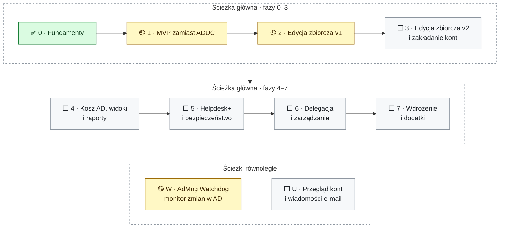

<div align="center">

<picture>
  <source media="(prefers-color-scheme: dark)" srcset="docs/assets/banner-dark.svg">
  <source media="(prefers-color-scheme: light)" srcset="docs/assets/banner-light.svg">
  
</picture>

**Szybki, nowoczesny następca przystawki `dsa.msc` – z edycją zbiorczą, Koszem AD i monitorem zmian w katalogu**

[](https://github.com/DarienRahl/AD_MNG/actions/workflows/ci.yml)
[](https://github.com/DarienRahl/AD_MNG/releases)


**[Funkcje](#-funkcje)** · **[Zrzuty ekranu](#-zrzuty-ekranu)** · **[Roadmapa](#-roadmapa)** ·
**[Pobierz](#-pobierz-i-uruchom)** · **[Budowanie](#-budowanie-i-testy)** · **[Dokumentacja](#-dokumentacja)**

</div>

> [!WARNING]
> **Wersja rozwojowa.** Fazy 1 (codzienna praca zamiast ADUC) i 2 (edycja zbiorcza) z [roadmapy](#-roadmapa) są
> zaimplementowane, podobnie jak Kosz AD z fazy 4 i usługa AdMng Watchdog. Aplikacja jest testowana automatycznie
> (testy jednostkowe, testy UI na Windows, testy integracyjne na kontrolerze Samba AD), ale **nie przeszła jeszcze
> pilotażu na produkcyjnym Windows AD** – zacznijcie od domeny testowej lub konta z ograniczonymi uprawnieniami.

## ✨ Funkcje

Nowoczesna, szybka konsola do zarządzania Active Directory – następca przystawki **Użytkownicy i komputery usługi
Active Directory** (`dsa.msc`). Wygląda i działa znajomo (drzewo domeny i jednostek organizacyjnych, lista obiektów,
karty właściwości, te same skróty klawiszowe), ale jest zbudowana według dzisiejszych standardów: Windows 11 Fluent,
tryb ciemny, PL/EN, okna niemodalne, wyszukiwanie w trakcie pisania i – przede wszystkim – **edycja zbiorcza** z
podglądem zmian, raportem i cofaniem.

- ⚡ **Płynność zamiast przystawki MMC** – zapytania LDAP asynchroniczne i strumieniowane stronami, pobierane są tylko
  potrzebne atrybuty, brak limitu 2000 obiektów w folderze, wirtualizowane listy, karty (Ctrl+T), paleta poleceń
  (Ctrl+K), listy odświeżane na żywo przez powiadomienia LDAP – zmienione obiekty, a nie cały folder.
- 🔒 **Zero lokalnych danych** – nic z katalogu nie jest zapisywane na dysku (brak bazy, cache, snapshotów); każde
  odświeżenie pyta kontroler domeny na żywo. Na dysku (`%APPDATA%\AdMng`) są tylko ustawienia interfejsu, profile
  połączeń bez haseł i definicje widoków. Hasła nigdy nie trafiają do dzienników; do pliku – tylko w eksporcie wyników
  resetu haseł, o który operator wyraźnie poprosi.
- 🔑 **Różne poświadczenia** – logowanie bieżącym kontem Windows albo innym (helpdesk, administrator); Kerberos z
  podpisywaniem i szyfrowaniem, LDAPS lub StartTLS; cała sesja pracuje z jednym kontrolerem domeny. Interfejs pokazuje,
  co dane konto może zmienić, a czego nie (`allowedAttributesEffective`), i wyróżnia konta uprzywilejowane.
- 🪪 **Znajome karty właściwości** – użytkownik, komputer, grupa, kontakt, OU: Ogólne, Adres, Konto, Profil, Telefony,
  Organizacja, Członek grup (bezpośrednio i w pełni, z zagnieżdżeniem), Członkowie, Zarządzany przez, Obiekt, Edytor
  atrybutów; akcje helpdesk (reset hasła, odblokowanie, włącz/wyłącz, dodaj do grupy), tworzenie, przenoszenie
  (także przeciągnij-upuść), zmiana nazwy (F2), usuwanie.
- 🧰 **Edycja zbiorcza** użytkowników, komputerów, grup i kontaktów: ustawianie/czyszczenie atrybutów, szablony
  (`{givenName|nodiacritics|lower}.{sn|nodiacritics|lower}`), znajdź i zamień, włącz/wyłącz, odblokuj, reset haseł,
  przenoszenie, zmiana nazwy, członkostwo w grupach, usuwanie, import CSV (także `;` i cp1250 z polskiego Excela) –
  zawsze z podglądem różnic, walidacją, ochroną przed nadpisaniem cudzych zmian, raportem, eksportem do CSV/PowerShell i
  możliwością cofnięcia.
- 🗂 **Widoki dopasowane do Waszego AD** – przypinanie OU (np. *Pracownicy*, *Komputery*), zapisane zapytania LDAP z
  kolumnami, gotowe szybkie filtry (zablokowane, wyłączone, nieaktywne > N dni, hasło nigdy nie wygasa…), eksport/import
  widoków dla zespołu.
- 📧 **Poczta (Exchange)** – karta *Adresy e-mail*: `proxyAddresses` z dokładnie jednym głównym adresem SMTP, `mail`,
  `mailNickname`, `targetAddress`, ukrycie w książce adresowej; atrybuty poczty edytowalne też zbiorczo.
- ♻ **Kosz AD** – okno *Kosz Active Directory* (Ctrl+Shift+R): usunięte obiekty czytane na żywo, filtry, przywracanie do
  pierwotnego lub wskazanego miejsca, całe poddrzewo OU jednym planem w kolejności rodzic → dzieci.
- 🔎 **Przejrzystość** – dziennik sesji, historia równoważnych poleceń PowerShell, centrum aktywności z postępem i
  anulowaniem, komunikaty błędów AD po polsku.
- 🛡 **AdMng Watchdog – monitor zmian w AD** – osobna usługa Windows (24/7, konto gMSA tylko do odczytu) wykrywa nowe i
  usunięte obiekty, zmiany atrybutów (stara → nowa wartość), blokady, wygasające konta, zmiany członkostwa i
  **uprzywilejowanego dostępu** (także przez grupy zagnieżdżone) oraz zmiany Tier 0; ustala wykonawcę z dzienników
  zabezpieczeń kontrolerów domeny i powiadamia e-mailem (od razu i raportem dziennym), w Microsoft Teams (Workflows) i
  podpisanym webhookiem (SIEM). W AD_MNG zakładka **Watchdog** (Narzędzia → Watchdog) pokazuje zdarzenia, reguły,
  kanały i stan usługi. Usługa jako jedyna część rozwiązania przechowuje dane – we własnym, chronionym folderze
  ([ADR-0008](docs/adr/0008-watchdog-dane-w-osobnym-folderze.md)). Wdrożenie: [docs/WATCHDOG.md](docs/WATCHDOG.md).

Czego jeszcze brakuje (m.in. LAPS, BitLocker, edytor ACL, zakładanie kont z CSV, „Kopiuj użytkownika”): zob.
[znane ograniczenia](#znane-ograniczenia).

### AD Manager a ADUC

| | ADUC (`dsa.msc`) | AD Manager |
|---|---|---|
| **Duże OU** | „Not Responding”, limit 2000 obiektów | wyniki strumieniowane stronami, bez limitu, z anulowaniem |
| **Wyszukiwanie** | Znajdź w osobnym oknie | ANR w trakcie pisania (Ctrl+E), paleta poleceń (Ctrl+K) |
| **Wiele obiektów naraz** | stały podzbiór pól, bez podglądu i raportu | dowolne atrybuty, podgląd przed → po, raport, PowerShell, cofanie |
| **Kosz AD** | tylko w ADAC | przeglądanie i przywracanie, także całych poddrzew OU |
| **Odświeżanie** | ręczne F5 | listy odświeżane na żywo (powiadomienia LDAP) |
| **Poświadczenia** | `runas /netonly`, osobna konsola | bieżące konto Windows albo inne, profile połączeń bez haseł |
| **Wygląd** | rozmyty na wysokim DPI, bez trybu ciemnego | Fluent, motyw jasny i ciemny, PL / EN bez restartu |
| **Instalacja** | RSAT | jeden plik `AdMng.exe` – bez .NET i RSAT |
| **Kto co zmienił** | brak | AdMng Watchdog: wykonawca, stara → nowa wartość, powiadomienia |

## 📸 Zrzuty ekranu

<picture>
  <source media="(prefers-color-scheme: dark)" srcset="docs/assets/screenshots/02-main-window-dark.png">
  <source media="(prefers-color-scheme: light)" srcset="docs/assets/screenshots/01-main-window.png">
  
</picture>

<p align="center"><sub>Okno główne – jednostka organizacyjna IT ze szczegółami zaznaczonego użytkownika
(motyw jasny lub ciemny, jak Twój GitHub)</sub></p>

<table>
  <tr>
    <td width="50%" valign="top">
      
      <br><sub><b>Edytor zbiorczy</b> – podgląd zmian (przed → po) przed wykonaniem</sub>
    </td>
    <td width="50%" valign="top">
      
      <br><sub><b>Kosz Active Directory</b> – usunięte obiekty do przywrócenia</sub>
    </td>
  </tr>
  <tr>
    <td width="50%" valign="top">
      
      <br><sub><b>Wyszukiwanie</b> – warunki zaawansowane i gotowy filtr LDAP</sub>
    </td>
    <td width="50%" valign="top">
      
      <br><sub><b>AdMng Watchdog</b> – co się zmieniło, kto i skąd</sub>
    </td>
  </tr>
</table>

<sub>Zrzuty pochodzą z wersji 0.2.0 (polski interfejs, przykładowa firma z testów). Aktualny komplet CI publikuje przy
każdym pushu na gałęzi `screenshots` – zob. [Zrzuty ekranu z CI](#zrzuty-ekranu-z-ci).</sub>

## 🧭 Roadmapa

Plan prac podzielony na fazy. Każda faza kończy się wersją, której da się realnie używać, i ma mierzalne kryteria
ukończenia. Kolejność wynika z ustaleń z zespołem:

- **technologia:** WPF .NET 10 + Fluent ([ADR-0001](docs/adr/0001-wpf-net10-fluent.md));
- **interfejs:** PL + EN przełączany w locie;
- **priorytety spoza `dsa.msc`:** Kosz AD (przywracanie) oraz atrybuty poczty/Exchange;
- **podziały AD** (pracownicy, komputery, …) obsługiwane przez **konfigurowalne widoki**, a nie zaszyte na sztywno;
- **edycja zbiorcza** jest kluczowa, dlatego silnik zmian powstaje już w fazie 1, a pełne UI w fazie 2.

Szczegóły techniczne i uzasadnienia: [ARCHITECTURE.md](docs/ARCHITECTURE.md), [RESEARCH.md](docs/RESEARCH.md).

Legenda statusu: ✅ zrobione · 🟡 pierwsza wersja gotowa, wymaga dopracowania/weryfikacji na Windows AD · ⬜ planowane



| Faza | Cel | Najważniejsze rezultaty | Status |
|---|---|---|---|
| 0 | Fundamenty | Rozwiązanie, CI, laboratorium Samba AD, rdzeń LDAP, kontrakty, prototyp wydajności | ✅ |
| 1 | MVP – codzienna praca zamiast ADUC | Logowanie (różne poświadczenia), drzewo, szybkie listy, wyszukiwanie, właściwości, akcje helpdesk, tworzenie/przenoszenie/usuwanie | 🟡 zaimplementowane, czeka na pilotaż na Windows AD |
| 2 | Edycja zbiorcza v1 (kluczowa) | Operacje zbiorcze z podglądem różnic, walidacją, raportem, eksportem PowerShell, cofaniem; import CSV (aktualizacja) | 🟡 zaimplementowane, czeka na testy obciążeniowe |
| 3 | Edycja zbiorcza v2 i zakładanie kont | Import CSV (tworzenie), szablony per OU, edytor arkuszowy, koszyk, kreatory (nieaktywne konta, zmiana nazwiska), pełna obsługa poczty | ⬜ (karta Adresy e-mail: ✅) |
| 4 | Kosz AD, widoki i raporty | Przeglądanie i przywracanie usuniętych obiektów, kreator zapytań, przestrzenie robocze dla działów, raporty, wiele domen | ⬜ (Kosz AD: 🟡, członkostwo zagnieżdżone i eksport widoków: ✅) |
| 5 | Helpdesk+ i bezpieczeństwo | Poświadczenia bez hasła w pamięci, ochrona przed usunięciem, karta Zabezpieczenia, stan blokady na wszystkich DC, historia zmian, LAPS, BitLocker, odświeżanie na żywo | ⬜ (odświeżanie list na żywo: ✅) |
| 6 | Delegacja i zarządzanie | Edytor ACL, kreator delegowania i przegląd delegacji, polityki ADMX, dziennik zdarzeń operatora, rzadkie karty ADUC | ⬜ |
| 7 | Wdrożenie i dodatki | Podpisany MSI, WDAC/AppLocker, zatwierdzanie „cztery oczy”, członkostwo czasowe (PAM) | ⬜ |
| W | AdMng Watchdog – monitor zmian (ścieżka równoległa) | Usługa Windows wykrywająca zmiany w AD z ustaleniem wykonawcy, powiadomienia e-mail / raport dzienny / Teams / webhook, zakładka Watchdog w AD_MNG | 🟡 zaimplementowane, czeka na laboratorium Windows Server i pilotaż |
| U | Przegląd kont i wiadomości do użytkowników (ścieżka równoległa) | Wiadomości e-mail (SMTP) z szablonów z danymi konta (np. „hasło wygasa dnia …”) do jednego użytkownika z okna właściwości lub do wielu naraz, przegląd wszystkich kont (zablokowane, wygasłe i wygasające hasła i konta, nieaktywne, higiena haseł), automatyczne przypomnienia w usłudze Watchdog | ⬜ |

Szczegóły każdej fazy są poniżej – kliknij, aby rozwinąć.

### Faza 0 – Fundamenty ✅

**Cel:** podjąć decyzje technologiczne, zweryfikować ryzyka LDAP i przygotować bazę inżynierską.

<details>
<summary><b>Szczegóły fazy 0</b> – rozwiązanie, laboratorium, rdzeń LDAP, CI</summary>

- ✅ Rozwiązanie `.slnx`: `AdMng.Core`, `AdMng.Directory`, `AdMng.Presentation` (ViewModele bez WPF), `AdMng.App` (WPF),
  projekty testów; centralne wersje pakietów; ostrzeżenia traktowane jak błędy.
- ✅ Rdzeń: DN (RFC 4514, polskie znaki), filtry LDAP z escapingiem (RFC 4515) i regułami AD (bit AND/OR, IN_CHAIN, ANR),
  flagi `userAccountControl`/`groupType`, konwersje FILETIME/GeneralizedTime/SID/GUID, model obiektu i schematu, mapowanie
  błędów AD (`0000052D`, `data 775`…).
- ✅ Kontrakty: sesja katalogu przypięta do DC, silnik zmian (plan → wykonanie → rollback), szablony, CSV, dziennik sesji.
- ✅ Laboratorium Samba AD DC z danymi „polskiej firmy” (OU wg działów i lokalizacji, konta zablokowane, delegacja helpdesk),
  uruchamiane lokalnie i w CI.
- ✅ Prototyp wydajności S.DS.P: bind 16 ms, pierwsza strona 100 obiektów 65 ms, VLV/ASQ/`allowedAttributesEffective` działają.
- ✅ CI (GitHub Actions): build i testy na Windows, publikacja `AdMng.exe`, testy integracyjne na Ubuntu z Samba DC.
- ✅ Dokumentacja: architektura, ADR, research.

**Kryteria ukończenia:** build bez ostrzeżeń na Windows i Linux; testy jednostkowe i integracyjne zielone w CI. ✅

**Do zrobienia na laboratorium Windows Server 2025** (przeniesione do fazy 1): pomiar listy 100 000 obiektów (paging vs VLV),
logowanie Kerberos z wymuszonym podpisywaniem i channel binding, test „żadnych danych na dysku” (skan profilu po sesji).

</details>

### Faza 1 – MVP: codzienna praca zamiast ADUC 🟡

**Cel:** helpdesk i administratorzy mogą wykonywać codzienne czynności szybciej niż w `dsa.msc`.

<details>
<summary><b>Szczegóły fazy 1</b> – stan realizacji, połączenie, listy, wyszukiwanie, właściwości, akcje</summary>

#### Stan realizacji

- ✅ **Połączenie:** bieżące konto Windows lub inne poświadczenia, Kerberos z podpisywaniem i szyfrowaniem, LDAPS,
  StartTLS; wykrywanie domeny i kontrolerów (DsGetDcName, lokacja), wybór DC przy łączeniu, profile połączeń bez haseł,
  pasek tożsamości z ostrzeżeniem dla kont uprzywilejowanych, komunikaty błędów AD po polsku i angielsku.
- ✅ **Nawigacja i listy:** drzewo ładowane leniwie, „Funkcje zaawansowane”, listy bez limitu 2000 (strony
  strumieniowane, wirtualizacja), sortowanie, wybór kolumn z atrybutów schematu, nazwy z display specifiers (`CN=415`),
  znaczniki stanu, pasek adresu (DN lub ścieżka), Wstecz/Dalej/W górę, karty (Ctrl+T, Ctrl+Enter), panel szczegółów,
  „stan na godz.”, szybkie filtry po stronie serwera, **odświeżanie list na żywo** (powiadomienia LDAP o zmianach).
- ✅ **Wyszukiwanie:** ANR w trakcie pisania (Ctrl+E), Znajdź (Ctrl+F) z kategoriami i własnym filtrem LDAP, okno wyboru
  obiektów, paleta poleceń (Ctrl+K).
- ✅ **Właściwości:** wszystkie karty z tabeli poniżej, okna niemodalne, pola niedozwolone dla operatora tylko do odczytu
  (`allowedAttributesEffective`), członkostwo bezpośrednie **i pełne (zagnieżdżone)**, grupy z > 1500 członkami,
  **„Godziny logowania…”** (siatka tygodnia w czasie lokalnym jak w ADUC; także zbiorczo w edytorze).
- ✅ **Akcje:** wszystkie z listy poniżej, a także nowy `inetOrgPerson`, historia poleceń PowerShell i dziennik sesji.
  Pojedyncze zmiany przechodzą przez ten sam silnik zmian (walidacja, dziennik, PowerShell), ale **cofanie jest na razie
  dostępne tylko w edytorze zbiorczym** – cofanie pojedynczej zmiany z dziennika sesji jest w planach.
- ✅ **Jakość:** PL/EN bez restartu, motyw jasny/ciemny/systemowy (Fluent), skróty jak w ADUC, testy UI (UI Automation)
  i test dymny opublikowanego `AdMng.exe` w CI.
- ⬜ **Szybkie kopiowanie (następne w kolejce):** przycisk „Kopiuj” przy adresie e-mail, UPN, loginie, telefonach i
  innych wartościach w panelu szczegółów i na kartach właściwości, Ctrl+C na liście obiektów, „Kopiuj jako…” dla wielu
  obiektów naraz – szczegóły w sekcji [Kopiowanie wartości](#kopiowanie-wartości-) poniżej.
- ⬜ **Brakuje:** rozpoznawania kontenerów po WKGUID, „Zmień kontroler domeny” w trakcie sesji,
  „Kopiuj użytkownika” (faza 3), VLV na listach bardzo dużych OU (sesja już go obsługuje), pól opartych o ACL (na razie
  wyświetlane jako tylko do odczytu – faza 5).
- 🟡 **Do weryfikacji na Windows Server:** pilotaż, pomiar 100 000 obiektów, Kerberos z wymuszonym channel binding,
  test „żadnych danych na dysku”, wysoki kontrast i czytnik ekranu.

#### Połączenie i sesja
- Logowanie bieżącym kontem Windows lub innymi poświadczeniami; Kerberos z podpisywaniem i szyfrowaniem, LDAPS, StartTLS.
- Wykrywanie domeny komputera i kontrolerów (DsGetDcName, lokacja), wybór DC, „Zmień kontroler domeny”.
- Profile połączeń (bez haseł), pasek tożsamości z wyróżnieniem kont uprzywilejowanych, zrozumiałe komunikaty błędów PL/EN.

#### Nawigacja i listy
- Drzewo domeny/OU ładowane leniwie, kontenery dobrze znane rozpoznawane po WKGUID, przełącznik „Funkcje zaawansowane”.
- Listy bez limitu 2000: wyniki strumieniowane stronami, wirtualizacja, sortowanie, wybór kolumn z atrybutów schematu,
  nazwy kolumn z polskich display specifiers (jak w polskim ADUC), znaczniki stanu (wyłączone, zablokowane, chronione).
- Pasek adresu (DN lub ścieżka), historia Wstecz/Dalej, karty, panel szczegółów z szybkimi akcjami, „stan na godz.”.
- Szybkie filtry (chipy) wykonywane po stronie serwera: wyłączone, zablokowane, nieaktywne > N dni, hasło nigdy nie wygasa,
  wymagana zmiana hasła, wygasłe/wygasające konta, puste grupy.

#### Wyszukiwanie
- Globalne wyszukiwanie w trakcie pisania (ANR, Ctrl+E), Znajdź (Ctrl+F) z kategoriami jak w ADUC i własnym filtrem LDAP,
  okno wyboru obiektów (zamiennik „Wybierz użytkowników, komputery lub grupy”).

#### Właściwości (okna niemodalne, pola niedozwolone dla operatora tylko do odczytu)

| Typ obiektu | Karty |
|---|---|
| Użytkownik | Ogólne, Adres (c + co + countryCode), Konto (flagi, wygasanie „koniec dnia”, UPN z sufiksami, godziny logowania), Profil, Telefony, Organizacja, Członek grup (z grupą podstawową), Adresy e-mail, Obiekt, Edytor atrybutów |
| Komputer | Ogólne (rola), System operacyjny, Członek grup, Delegowanie (podgląd), Lokalizacja, Zarządzany przez, Obiekt, Edytor atrybutów |
| Grupa | Ogólne (zakres/typ z regułami konwersji), Członkowie (> 1500 przez ranged retrieval), Członek grup, Zarządzany przez, Obiekt, Edytor atrybutów |
| Kontakt | Ogólne, Adres, Telefony, Organizacja, Członek grup, Adresy e-mail, Obiekt, Edytor atrybutów |
| Jednostka organizacyjna | Ogólne, Zarządzany przez, Obiekt, Edytor atrybutów |

#### Akcje
- Reset hasła (wpisane lub wygenerowane, wymuszenie zmiany, odblokowanie), włącz/wyłącz, odblokuj, dodaj do grupy,
  przenieś (okno i przeciągnij-upuść), zmień nazwę (F2), usuń (ostrzeżenia, usuwanie poddrzewa za potwierdzeniem),
  nowy użytkownik/grupa/OU/komputer/kontakt, eksport listy do CSV, kopiuj DN.
- Każda zmiana (także pojedyncza) przechodzi przez silnik zmian: walidacja, dziennik sesji, możliwość cofnięcia.

#### Kopiowanie wartości ⬜

Dziś przycisk kopiowania jest tylko przy DN (panel szczegółów, menu obiektu), przy polach karty *Obiekt* i w Edytorze
atrybutów; adres e-mail czy UPN trzeba zaznaczyć w polu karty właściwości i skopiować Ctrl+C. Plan:

- **Przycisk kopiowania jednym kliknięciem** przy wartościach w **panelu szczegółów** i na kartach właściwości: adres
  e-mail, UPN, nazwa logowania (`sAMAccountName` i `DOMENA\login`), nazwa wyświetlana, telefony, numer pracownika,
  stanowisko, dział, menedżer, ścieżka i DN; krótkie potwierdzenie „Skopiowano” bez dodatkowego okna; wartości w panelu
  szczegółów dają się też zaznaczyć myszą.
- **Ctrl+C na liście obiektów:** zaznaczone wiersze z widocznymi kolumnami jako tekst rozdzielany tabulatorami (wklejanie
  do Excela, Teams, zgłoszenia w helpdesku), z nagłówkami kolumn lub bez.
- **„Kopiuj jako…”** w menu kontekstowym, na pasku narzędzi i w palecie poleceń (Ctrl+K): adres e-mail, UPN, login,
  nazwa, DN, ścieżka kanoniczna, GUID, SID – także dla wielu zaznaczonych obiektów naraz. Adresy e-mail zaznaczonych osób
  (albo członków grupy z karty *Członkowie*) trafiają do schowka jako lista rozdzielana `;`, gotowa do wklejenia w polu
  „Do” w Outlooku; skrót klawiszowy do kopiowania adresu e-mail zaznaczonych obiektów.
- **Kopiowanie z list na kartach:** pojedynczy adres z karty *Adresy e-mail* (bez prefiksu `smtp:`), nazwa lub DN grupy z
  *Członek grup*, członek z *Członkowie*, wpis z dziennika sesji, szczegóły zdarzenia Watchdoga.
- **Bezpieczeństwo:** wartości poufne (LAPS, BitLocker, atrybuty oznaczone w schemacie) można skopiować dopiero po jawnym
  odsłonięciu – z wykluczeniem z historii schowka i wyczyszczeniem po 60 s, jak dziś przy hasłach; kopiowanie niczego nie
  zapisuje na dysku (zasada „zero lokalnych danych”).
- Teksty przycisków i potwierdzeń po polsku i angielsku, obsługa z klawiatury i czytnika ekranu, testy UI.

#### Jakość
- PL/EN bez restartu, motyw jasny/ciemny, skróty jak w ADUC (F5, Del, F2, Alt+Enter, Ctrl+F) + Ctrl+K, dostępność
  (UI Automation, klawiatura, wysoki kontrast).

**Kryteria ukończenia**
- Pilotaż: ~5 osób z helpdesku pracuje równolegle z ADUC przez 2 tygodnie.
- Wartości wyświetlane identycznie jak w ADUC na laboratorium Windows (kraj, godziny logowania, wygasanie konta, zakres grupy).
- Konto helpdesk widzi poprawnie zablokowane pola i dostaje zrozumiałe komunikaty (odmowa dostępu, polityka haseł).
- Pierwsza strona dużego OU < 300 ms w sieci LAN, brak „zamrożeń” UI.
- Test „żadnych danych katalogu na dysku” zaliczony.

</details>

### Faza 2 – Edycja zbiorcza v1 (kluczowa) 🟡

**Cel:** bezpieczne, przewidywalne i odwracalne zmiany na setkach i tysiącach obiektów.

<details>
<summary><b>Szczegóły fazy 2</b> – operacje, potok zmian, import CSV, kryteria ukończenia</summary>

#### Stan realizacji

- ✅ Edytor zbiorczy (Ctrl+Shift+B) ze wszystkimi operacjami z tabeli poniżej, cały potok 1–6, „ponów nieudane”,
  cofanie, eksport podglądu i raportu do CSV, skrypt PowerShell, import CSV aktualizujący obiekty (z wykrywaniem
  separatora i kodowania, także cp1250 z polskiego Excela, i ochroną przed formułami w eksporcie).
- ✅ Wykonanie z ograniczoną równoległością, ponawianiem błędów przejściowych i współbieżnością optymistyczną (atomowe
  „usuń starą wartość + dodaj nową” – zmiana wprowadzona przez kogoś innego po podglądzie kończy się konfliktem, a nie
  nadpisaniem). Paczki ponad próg z ustawień albo z usuwaniem, przenoszeniem lub resetem haseł wymagają wpisania liczby
  obiektów.
- ✅ Hasła wygenerowane przy resecie istnieją tylko w pamięci; eksport wyników z hasłami wyłącznie na wyraźne polecenie,
  z ostrzeżeniem przed nadpisaniem niezapisanych haseł.
- 🟡 Kryteria ukończenia: konflikty, cofanie i plan PowerShell są pokryte testami automatycznymi (także na laboratorium
  Samba); paczka 5000 obiektów i porównanie z `-WhatIf` na Windows Server – do zrobienia.

#### Źródła zaznaczenia
- Zaznaczenie wielu obiektów na liście, wynik wyszukiwania, szybki filtr lub zapisany widok, plik CSV.

#### Operacje (użytkownicy, komputery, grupy, kontakty)

| Operacja | Szczegóły |
|---|---|
| Ustaw atrybut | Wartość stała lub szablon: `{givenName|nodiacritics|lower}.{sn|nodiacritics|lower}@firma.pl` |
| Wyczyść atrybut | Z kontrolą atrybutów obowiązkowych |
| Dodaj / usuń wartości | Atrybuty wielowartościowe (np. `proxyAddresses`, `otherTelephone`) – idempotentnie |
| Znajdź i zamień | Tekst lub wyrażenie regularne |
| Konto | Włącz/wyłącz, odblokuj, flagi (hasło nigdy nie wygasa, karta inteligentna…), wymuszenie zmiany hasła, data wygaśnięcia, godziny logowania (ta sama siatka co na karcie Konto) |
| Reset haseł | Unikalne hasła generowane kryptograficznie lub jedno hasło; eksport wyników tylko za wyraźną zgodą |
| Przenieś / zmień nazwę | Do wskazanego OU; nowa nazwa z szablonu |
| Grupy | Dodaj do grup / usuń z grup (wiele-do-wielu) |
| Usuń | Osobno, z potwierdzeniem przez wpisanie liczby obiektów |

#### Potok
1. **Plan** – świeży odczyt bieżących wartości z przypiętego DC, renderowanie szablonów, pominięcie zmian bez efektu.
2. **Walidacja** – schemat (typ, jedno-/wielowartościowość, długość), uprawnienia operatora (`allowedAttributesEffective`),
   unikalność (`sAMAccountName`, UPN, mail – w AD i w obrębie paczki), obiekty chronione (adminCount=1, krytyczne systemowe,
   konta wbudowane).
3. **Podgląd różnic** – „przed → po” dla każdego obiektu i atrybutu, filtry (zmiany / ostrzeżenia / błędy / bez zmian),
   wykluczanie pojedynczych obiektów, eksport podglądu do CSV, **równoważny skrypt PowerShell**.
4. **Wykonanie** – w tle, z postępem i anulowaniem; ograniczona równoległość; ponawianie błędów przejściowych;
   **współbieżność optymistyczna** (zmiana wprowadzona przez kogoś innego po podglądzie nie zostanie nadpisana).
5. **Raport** – status każdego obiektu, kody błędów AD po polsku, „ponów nieudane”, eksport CSV.
6. **Cofnięcie** – plan odwrotny z zapamiętanych (w pamięci) starych wartości, przez ten sam podgląd.

#### Import CSV (aktualizacja istniejących obiektów)
- Automatyczne wykrycie separatora (`;` z polskiego Excela, `,`, tab), UTF-8/BOM, klucz: `sAMAccountName`, UPN, mail,
  `employeeID`, DN lub `objectGUID`; mapowanie kolumn na atrybuty (automatyczne po nazwie LDAP lub polskiej etykiecie);
  puste komórki: pomiń lub wyczyść; wiersze nieznalezione/niejednoznaczne jako błędy w podglądzie.

**Kryteria ukończenia**
- Paczka 5000 obiektów na laboratorium bez przeciążenia DC (limit współbieżności, brak alarmów opóźnień LDAP).
- Wstrzyknięte równoległe zmiany wykrywane jako konflikty.
- Cofnięcie przywraca 100% odwracalnych zmian (testy automatyczne).
- Wygenerowany PowerShell z `-WhatIf` daje te same zmiany co plan.

</details>

### Faza 3 – Edycja zbiorcza v2 i zakładanie kont ⬜

**Cel:** zakładanie kont z CSV i szablonów przypisanych do OU, edytor arkuszowy, koszyk obiektów, kreatory (nieaktywne
konta, zmiana nazwiska) i pełna obsługa poczty.

<details>
<summary><b>Szczegóły fazy 3</b> – import CSV tworzący obiekty, szablony per OU, edytor arkuszowy, kreatory, poczta</summary>

- Import CSV **tworzący** obiekty (użytkownicy, kontakty, grupy, komputery) z szablonem pliku do pobrania; obsługa cp1250.
- Szablony nowych obiektów przypisane do OU (np. *Pracownicy/IT*: UPN, mail, grupy startowe, atrybuty działu), polityka
  nazewnictwa z transliteracją polskich znaków i licznikami unikalności (`jan.kowalski2`).
- „Kopiuj użytkownika” (atrybuty kopiowalne wg schematu + członkostwa).
- Edytor arkuszowy (jak Excel) nad wynikami listy: wklejanie z Excela, wypełnianie w dół, zmiany trafiają do podglądu.
- Koszyk obiektów z różnych OU, „wklej listę” (rozpoznawanie po sAMAccountName/UPN/mail/employeeID).
- Kreatory: nieaktywne konta i komputery (wyłącz → opisz → przenieś → usuń później), zmiana nazwiska (sn, displayName, cn,
  UPN, mail, główny adres SMTP), migracja sufiksu UPN, kopiowanie członkostw A → B.
- **Poczta / Exchange (priorytet):** pełna obsługa `proxyAddresses` (dokładnie jeden główny `SMTP:`, unikalność w całym lesie
  przez GC), `mailNickname`, `targetAddress`, `extensionAttribute1–15`, ukrycie w GAL; operacje zbiorcze na adresach
  (np. dodanie aliasu w nowej domenie dla całego działu).
- Synchronizacja członkostwa grupy z zapytania lub CSV (różnicowo, nigdy przez nadpisanie `member`).

</details>

### Faza 4 – Kosz AD, widoki i raporty ⬜ (Kosz AD: 🟡)

**Cel:** przeglądanie i przywracanie usuniętych obiektów, kreator zapytań, przestrzenie robocze dla działów, raporty
na żywo i wiele domen.

<details>
<summary><b>Szczegóły fazy 4</b> – Kosz AD, widoki dla działów, kreator zapytań, raporty, wiele domen</summary>

- 🟡 **Kosz AD (priorytet) – pierwsza wersja gotowa.** Okno *Kosz Active Directory* (menu Narzędzia, paleta poleceń,
  Ctrl+Shift+R): lista usuniętych obiektów czytana na żywo z `CN=Deleted Objects` (kontrolka Show Deleted, wyniki
  strumieniowane, z możliwością przerwania), filtry po stronie serwera (nazwa, typ obiektu, data usunięcia, kontener,
  z którego usunięto obiekt), kolumny: nazwa, typ, pierwotna lokalizacja (ścieżka kanoniczna – także przez usunięte
  kontenery nadrzędne), czas usunięcia. Przywracanie do pierwotnego lub wskazanego miejsca przez silnik zmian: podgląd
  planu z uwagami i potwierdzeniem, dziennik sesji, historia PowerShell (`Restore-ADObject`), odświeżenie list i drzewa.
  **Całe poddrzewo OU wraca jednym planem w kolejności rodzic → dzieci** (czego nie potrafi ADAC): dzieci trafiają do
  przywróconego rodzica, a wykonanie dziecka czeka na rodzica. Plan wykrywa konflikty nazw w miejscu docelowym (odczyt na
  żywo), obiekty, których kontener pozostaje usunięty, i obiekty już ostatecznie usunięte. Okno pokazuje stan Kosza i czas
  przechowywania usuniętych obiektów (`msDS-deletedObjectLifetime`/`tombstoneLifetime`); gdy Kosz jest wyłączony,
  ostrzega i pozwala odtworzyć obiekt z tombstone (bez większości atrybutów) po dodatkowym potwierdzeniu. Sprawdzone
  testami jednostkowymi, testami UI i na laboratorium Samba (odtworzenie poddrzewa z tombstone).
  Do zrobienia: weryfikacja na Windows Server z włączonym Koszem i z uprawnieniami delegowanymi do `CN=Deleted Objects`,
  ostrzeżenie w oknie usuwania, gdy Kosz jest wyłączony, przywracanie w partycjach Configuration i stref DNS.
- 🟡 **Widoki dla działów:** ✅ przypinanie OU, zapisane widoki (zapytanie LDAP + kontener + kolumny), gotowe widoki
  wbudowane i eksport/import widoków dla zespołu; ⬜ przestrzenie robocze (np. *Pracownicy*, *Komputery*,
  *Kontrahenci*) łączące widoki z szablonami, osobne dla helpdesku i administratorów.
- Kreator zapytań (warunki ↔ LDAP), zapisane zapytania jako foldery w drzewie, import zapytań zapisanych w ADUC (XML).
- Raporty na żywo: bezpieczeństwo (PASSWD_NOTREQD, brak preautentykacji Kerberos, delegowanie nieograniczone, adminCount,
  konta z SPN), inwentaryzacja (systemy operacyjne, puste i duże grupy, liczności OU); każdy wynik można przekazać do edycji zbiorczej.
  Przegląd stanu kont użytkowników (zablokowane, terminy haseł i kont, nieaktywne) –
  [ścieżka U](#ścieżka-u--przegląd-kont-i-wiadomości-do-użytkowników-).
- ✅ Członkostwo bezpośrednie vs pełne (zagnieżdżone) na kartach *Członek grup* i *Członkowie*
  (`LDAP_MATCHING_RULE_IN_CHAIN`); ⬜ raport efektywnego członkostwa wielu użytkowników.
- Wiele domen i lasów, wyszukiwanie w katalogu globalnym, paleta poleceń z prefiksami, porównanie dwóch obiektów.

</details>

### Faza 5 – Helpdesk+ i bezpieczeństwo ⬜

**Cel:** poświadczenia bez hasła w pamięci, ochrona przed usunięciem, karta Zabezpieczenia, stan blokady na wszystkich
DC, historia zmian, LAPS i BitLocker.

<details>
<summary><b>Szczegóły fazy 5</b> – poświadczenia, pola oparte o ACL, blokady na wszystkich DC, historia, LAPS</summary>

- Alternatywne poświadczenia bez trzymania hasła w pamięci (token `LogonUser` NEW_CREDENTIALS + impersonacja, weryfikacja
  WhoAmI), Kerberos-only z opcjonalnym NTLM, obsługa Protected Users, blokada sesji po bezczynności.
- Pola oparte o ACL: „Chroń obiekt przed przypadkowym usunięciem”, „Użytkownik nie może zmienić hasła”, „Menedżer może
  aktualizować listę członków”; karta Zabezpieczenia (podgląd), znaczniki Tier 0.
- Ostatnie logowanie i stan blokady na **wszystkich** DC (zamiennik LockoutStatus.exe) – korzysta z nich także przegląd
  kont ze ścieżki U.
- Karta Historia: kiedy i na którym DC zmieniono każdy atrybut (`msDS-ReplAttributeMetaData`) i członka grupy.
- ✅ Odświeżanie list na żywo przez powiadomienia LDAP o zmianach (osobne połączenie do tego samego DC, odświeżane są
  tylko zmienione obiekty); ⬜ zapasowe odpytywanie USN, gdy DC odmawia powiadomień.
- Windows LAPS (odczyt/odszyfrowanie dla uprawnionych, „wygaś teraz”), klucze odzyskiwania BitLocker, TPM,
  polityki haseł szczegółowych (FGPP) i wynikowa polityka użytkownika.

</details>

### Faza 6 – Delegacja i zarządzanie ⬜

**Cel:** edytor ACL, kreator delegowania i przegląd delegacji, polityki ADMX, dziennik zdarzeń operatora i rzadkie
karty ADUC.

<details>
<summary><b>Szczegóły fazy 6</b> – edytor ACL, delegowanie, szablony ADMX, rzadkie karty ADUC</summary>

- Edytor ACL, kreator „Deleguj kontrolę” i **przegląd delegacji** (niestandardowe ACE per OU) z cofaniem.
- Wstępna kontrola uprawnień rozszerzonych (AuthZ) przed operacją.
- Szablony ADMX (progi potwierdzeń, limity eksportu, blokada bezczynności, wymaganie PAW), kanał Dziennika zdarzeń
  operatora (metadane zmian, bez wartości), wsparcie korelacji z audytem DC (5136/5137/5141).
- Rzadkie karty ADUC: Dial-in, Środowisko/Sesje/Zdalne sterowanie (RDS), Mapowania nazw, Opublikowane certyfikaty,
  zasady replikacji haseł RODC; wzorce operacji (FSMO), konta gMSA/dMSA.

</details>

### Faza 7 – Wdrożenie i dodatki ⬜

**Cel:** podpisany instalator MSI, WDAC/AppLocker, zatwierdzanie „cztery oczy” i członkostwo czasowe (PAM).

<details>
<summary><b>Szczegóły fazy 7</b> – instalator MSI, WDAC/AppLocker, „cztery oczy”, PAM</summary>

- Podpisany instalator MSI (certyfikat z firmowego AD CS), reguły WDAC/AppLocker, dystrybucja przez Intune/ConfigMgr/GPO.
- Zatwierdzanie „cztery oczy”: operator A eksportuje podpisany plan zmian, operator B weryfikuje go na żywo i wykonuje.
- Członkostwo czasowe (PAM/TTL), polityki i silosy uwierzytelniania (podgląd), logowanie kartą inteligentną.

</details>

### AdMng Watchdog – monitor zmian w AD 🟡

**Cel:** wiedzieć w ciągu minut, co zmieniło się w katalogu, kto i skąd to zrobił – bez czytania dzienników DC i bez
alarmów o rutynie. Osobna usługa Windows ([WATCHDOG.md](docs/WATCHDOG.md), [ADR-0008](docs/adr/0008-watchdog-dane-w-osobnym-folderze.md),
specyfikacja [dev/watchdog-spec.md](docs/dev/watchdog-spec.md)); AD_MNG dostaje zakładkę Watchdog.

<details>
<summary><b>Szczegóły ścieżki W</b> – wykrywanie, atrybucja, powiadomienia, usługa, plan przed wersją stabilną</summary>

- 🟡 **Wykrywanie:** odpytywanie `uSNChanged` jednego DC z migawką obserwowanych atrybutów (Extended DN, metadane
  replikacji, watermark per DC, uzgodnienie dobowe), nowe/usunięte/przywrócone/przeniesione obiekty, zmiany atrybutów
  stara → nowa wartość, flagi konta, blokady i odblokowania, członkostwo i **dostęp uprzywilejowany przez zagnieżdżenia**,
  zmiany Tier 0 (delegowanie, SPN, KeyCredentialLink, sIDHistory, ACL obiektów krytycznych, DC, FSMO, PKI, schemat,
  zasady domeny), wygasające konta i hasła, serie (masowe blokady i usunięcia), samokontrola uprawnień konta usługi.
- 🟡 **Atrybucja:** dzienniki Security kontrolerów (47xx, 5136–5141, 4624 dla stacji źródłowej, 4771/4776 dla źródeł
  blokad), poziom pewności i kody przyczyn, gdy wykonawcy nie da się ustalić; uzupełnienia wysyłane w tym samym wątku.
- 🟡 **Powiadomienia:** reguły z zakresem, wyjątkami i godzinami pracy (polskie święta), agregacja i limity, e-mail
  (relay, Basic, Exchange Online OAuth2), raport dzienny, Microsoft Teams (Workflows, Adaptive Card 1.4), webhook
  podpisany Standard Webhooks, heartbeat; tryb wdrożenia przez pierwsze 7 dni.
- 🟡 **Usługa:** API HTTPS tylko z Kerberosem, role wg grup AD, SQLite z retencją i kopiami, sekrety w Data Protection
  (DPAPI-NG) powiązane z miejscem docelowym, skrypty instalacyjne, test dymny; archiwum w wydaniach (od 0.2.0) i artefakt
  CI `AdMng-Watchdog-win-x64`.
- 🟡 **Zakładka Watchdog w AD_MNG** (wersja zapoznawcza 0.2.0): zdarzenia z filtrami i szczegółami, reguły z podglądem, kanały i testowe wysyłki,
  raport dzienny, stan usługi, dziennik wysyłek.
- ✅ **Środowisko testowe:** testy silnika i usługi na Linuksie, testy integracyjne na laboratorium Samba (scenariusze
  wykrywania z kontem tylko do odczytu, usługa end-to-end z Mailpit i podpisanym webhookiem, opcjonalnie prawdziwy
  Kerberos), skrypty laboratoryjne (`tools/testlab/watchdog`: usługa, Mailpit, odbiornik webhooków, scenariusz
  z weryfikacją) uruchamiane także w CI.

**Do zrobienia przed wersją stabilną (0.2.0 jest wersją zapoznawczą):** przebieg na laboratorium Windows Server 2022/2025 (odczyt `msDS-ReplAttributeMetaData`
przez konto bez uprawnień administratora, zdarzenia 4624 dla zmian przez ADWS/PowerShell, 4740 na DC innych niż PDC,
pokrycie SACL dla 5136/5137, czytnik dzienników przez „Event Log Readers” – wyłącznie Kerberos, DC i kolektor WEF po
nazwach DNS –, HTTP.sys: czy każde logowanie dociera do usługi jako Kerberos, a klient tylko-NTLM jest odrzucany) z zapisem
prawdziwych zdarzeń jako danych testowych; sprawdzenie Teams Workflows na żywej dzierżawie (wersja karty, SAS vs OAuth);
akceptacja zakresu danych w powiadomieniach przez IOD (RODO); pilotaż w jednej domenie.

**Faza 2 Watchdoga:** Microsoft Graph `sendMail`, uwierzytelnianie zintegrowane SMTP, strumień zdarzeń (SSE), korelacja
z planami zmian AD_MNG (mniej szumu przy edycji zbiorczej), atrybucja z dziennika audytu Samba (JSON), więcej domen w
jednej instancji, wartości czasowe członkostwa (PAM TTL).

</details>

### Ścieżka U – Przegląd kont i wiadomości do użytkowników ⬜

**Cel:** helpdesk jednym przebiegiem sprawdza wszystkie konta (zablokowane, wygasające hasła i konta, nieaktywne …)
i od razu powiadamia właściwe osoby e-mailem – jedną osobę z okna właściwości albo setki z zaznaczenia lub z wyniku
przeglądu – z takim samym podglądem, raportem i zabezpieczeniami jak w edycji zbiorczej. Ścieżka równoległa: korzysta
z chipów filtrów (faza 1), silnika szablonów (faza 2) i transportu SMTP Watchdoga ([WATCHDOG.md](docs/WATCHDOG.md#52-smtp)).
U1 i U2 można realizować niezależnie; U3 wymaga szablonów z U1 i usługi Watchdog.

<details>
<summary><b>Szczegóły ścieżki U</b> – wiadomości e-mail (SMTP), przegląd stanu kont, automatyczne przypomnienia</summary>

#### U1 – Wiadomości e-mail do użytkowników (SMTP)

- **Skąd wysłać:**
  - **jeden użytkownik** – przycisk *Wyślij wiadomość…* w oknie właściwości (także w menu kontekstowym i palecie
    poleceń); okno wysyłki otwiera się z danymi tego konta, a przez okno wyboru obiektów można dopisać kolejnych
    odbiorców;
  - **wielu użytkowników** – zaznaczenie na liście, wynik wyszukiwania, szybki filtr, zapisany widok, członkowie grupy
    (także zagnieżdżeni), plik CSV, lista z przeglądu kont (U2) – te same źródła co w edycji zbiorczej.
- **Szablony wiadomości:** temat i treść (tekst oraz HTML w prostym edytorze), wersje PL/EN wybierane wg
  `preferredLanguage` odbiorcy (domyślny język w ustawieniach), biblioteka szablonów z eksportem i importem dla zespołu
  (jak zapisane widoki – sam tekst z polami, bez danych katalogu). Pola z silnika szablonów edycji zbiorczej
  (`{givenName}`, `{sAMAccountName|lower}` …) rozszerzone o wartości wyliczane, z datami w języku wiadomości i w strefie
  Europe/Warsaw: `{$passwordExpires:d MMMM yyyy}`, `{$passwordExpiresInDays}`, `{$accountExpires:dd.MM.yyyy}`,
  `{$lastLogon}`, dane przełożonego (`{$manager:displayName}`) i pola wpisywane przez operatora przy wysyłce
  (`{$input:termin}`). Przykład: *„Dzień dobry {givenName}, hasło do konta {sAMAccountName} wygaśnie
  {$passwordExpires:d MMMM yyyy} (za {$passwordExpiresInDays} dni).”*
- **Szablony wbudowane:** hasło wygasa za N dni (dnia …), hasło wygasło dnia …, konto wygasa / wygasło, konto
  zablokowane / odblokowane, wymagana zmiana hasła przy następnym logowaniu, konto zostanie wyłączone z powodu braku
  aktywności, wiadomość dowolna.
- **Warunek z parametrem:** szablon może mieć warunek wysyłki (np. „hasło wygasa w ciągu N dni”, N podawane przy
  wysyłce). Kto w chwili planu go nie spełnia (np. zmienił hasło po wczytaniu listy), jest pomijany z uwagą w podglądzie.
  Data wygaśnięcia hasła zawsze z `msDS-UserPasswordExpiryTimeComputed` (uwzględnia FGPP); „hasło nigdy nie wygasa”
  i „musi zmienić hasło” rozpoznawane osobno.
- **Adresaci:** `mail` konta (zapasowo główny adres `SMTP:` z `proxyAddresses`), dodatkowo lub zamiast niego przełożony
  (`manager`) – np. dla kont bez skrzynki i kont kontrahentów; DW do helpdesku, adres odpowiedzi. **Zawsze osobna
  wiadomość dla każdego użytkownika** – nigdy wspólna lista adresów w polach Do/DW.
- **Potok jak w edycji zbiorczej:**
  1. **Plan** – świeży odczyt z przypiętego DC, wyrenderowanie każdej wiadomości.
  2. **Walidacja** – brak adresu, konto wyłączone, puste pole w treści, niespełniony warunek, powtórzony odbiorca, zbyt
     długi temat.
  3. **Podgląd** – gotowa wiadomość każdego odbiorcy (przełączanie odbiorców, filtr ostrzeżeń i błędów, wykluczanie
     pojedynczych osób), wiadomość testowa do siebie.
  4. **Wysyłka** – w tle, z postępem i anulowaniem; limit tempa (domyślne limity Exchange Online: 30 wiadomości na
     minutę i 10 000 odbiorców dziennie na skrzynkę), ponawianie błędów przejściowych SMTP (4xx); powyżej progu
     z ustawień potwierdzenie przez wpisanie liczby odbiorców.
  5. **Raport** – status każdego odbiorcy (przyjęta przez serwer / odrzucona z kodem SMTP i podpowiedzią, jak w testach
     kanałów Watchdoga), „ponów nieudane”, eksport CSV na żądanie, wpis w dzienniku sesji (szablon i liczba odbiorców –
     bez treści).
- **Transport:** SMTP z wymaganym STARTTLS, TLS 1.2+ i weryfikacją certyfikatu. Zalecane: **wysyłka przez usługę AdMng
  Watchdog** – ta sama konfiguracja SMTP (przekaźnik, Basic, Exchange Online OAuth2 – Basic SMTP AUTH w Exchange Online
  jest wyłączane), sekrety zaszyfrowane po stronie usługi, kolejka z ponawianiem, dziennik wysyłek i nowa rola
  „Wysyłający” wg grupy AD. Wariant bez usługi: wysyłka bezpośrednio z AD_MNG przez przekaźnik bez logowania albo
  z logowaniem bieżącym kontem Windows; hasło SMTP, jeśli jest potrzebne, tylko w pamięci na czas sesji (zasada
  „nigdy nie zapisujemy haseł”).
- **Bezpieczeństwo i RODO:** w szablonie nie da się umieścić hasła (nie ma takiego pola – wysyłanie nowego hasła
  e-mailem jest zablokowane); łącza tylko do domen z listy dozwolonych, stała stopka „nigdy nie prosimy o podanie
  hasła”, bez załączników; wartości z AD są kodowane w HTML, a z tematu i nagłówków usuwane są znaki nowej linii
  (ochrona przed wstrzyknięciem nagłówków); nagłówek `Auto-Submitted: auto-generated` (bez pętli autoodpowiedzi);
  polskie znaki w temacie i treści (UTF-8, RFC 2047). Wyrenderowane wiadomości i listy odbiorców istnieją tylko
  w pamięci; na dysku są wyłącznie szablony i ustawienia (zasada „brak danych katalogu na dysku”).

#### U2 – Przegląd stanu kont

**Okno *Przegląd kont*** (menu Narzędzia, paleta poleceń): zakres (domena, OU z poddrzewem, zapisany widok, członkowie
grupy), parametry (N dni dla każdego sprawdzenia, zapamiętywane w ustawieniach) i jeden przycisk *Sprawdź*. Jedno
stronicowane zapytanie z potrzebnymi atrybutami, wyniki strumieniowane, z możliwością przerwania i „stanem na godz.”;
kafelki z licznikami, a kliknięcie kafelka otwiera listę kont z kolumnami właściwymi dla danego sprawdzenia.

| Sprawdzenie | Skąd dane | Co dalej |
|---|---|---|
| Zablokowane teraz | `lockoutTime` + bit 0x10 w `msDS-User-Account-Control-Computed`; na żądanie stan na wszystkich DC (liczba błędnych haseł, ostatnia próba, DC – faza 5) | odblokuj, wiadomość „konto zablokowane / odblokowane” |
| Hasło wygasło / wygasa w ≤ N dni | `msDS-UserPasswordExpiryTimeComputed` | wiadomość „hasło wygasa dnia …”, wymuszenie zmiany hasła |
| Konto wygasło / wygasa w ≤ N dni | `accountExpires` („koniec dnia”, jak na karcie Konto) | przedłuż (data wygaśnięcia), wiadomość do użytkownika lub przełożonego |
| Wyłączone | UAC 0x2 | kreator nieaktywnych kont (faza 3) |
| Musi zmienić hasło | `pwdLastSet = 0` | wiadomość |
| Nieaktywne > N dni, nigdy nie logowane | `lastLogonTimestamp` (opóźnienie 9–14 dni), na żądanie dokładny `lastLogon` ze wszystkich DC; „nigdy”: brak logowania i `whenCreated` starsze niż N dni | wyłącz, kreator nieaktywnych kont, wiadomość „konto zostanie wyłączone” |
| Higiena haseł | hasło nigdy nie wygasa, hasło niewymagane (PASSWD_NOTREQD), szyfrowanie odwracalne, hasło starsze niż N dni (`pwdLastSet`) | edycja zbiorcza flag, wymuszenie zmiany hasła |
| Gotowość do powiadomień | brak `mail`, brak przełożonego, przełożony wyłączony | uzupełnij atrybuty (edycja zbiorcza) |
| Pozostałości wyłączonych kont | wyłączone, ale nadal w grupach (poza podstawową) lub widoczne w GAL | usuń z grup, ukryj w GAL |
| Konta uprzywilejowane z problemem | `adminCount = 1` lub członkostwo (zagnieżdżone) w grupach chronionych + któreś z powyższych | raport dla bezpieczeństwa |

- Z każdej listy: otwórz właściwości, przekaż do edycji zbiorczej, **przekaż do wysyłki wiadomości z pasującym
  szablonem**, eksport CSV na żądanie. Zestawy sprawdzeń można zapisać pod nazwą (np. „Poranny przegląd helpdesku”).
- **Pojedyncze konto:** na karcie Konto okna właściwości podsumowanie stanu – blokada (także na innych DC), data
  wygaśnięcia hasła i liczba dni do niej, wygaśnięcie konta, ostatnie logowanie – z przyciskiem *Wyślij wiadomość…*.
- Atrybutów konstruowanych nie da się użyć w filtrze, więc przegląd filtruje wstępnie na serwerze, gdzie się da (jak
  chipy z fazy 1, [RESEARCH.md 4.5](docs/RESEARCH.md#45-szybkie-filtry-w-stylu-search-adaccount)), a resztę liczy po stronie
  klienta; wyniki istnieją tylko w pamięci.

#### U3 – Automatyczne przypomnienia (usługa Watchdog)

- Rozszerzenie „Terminów” Watchdoga o wiadomości **do samych użytkowników**: hasło wygasa za 14 / 7 / 3 / 1 dni (progi
  konfigurowalne), konto wygasa (do użytkownika lub przełożonego) – z szablonów U1, w godzinach wysyłki, z przesunięciem
  na poprzedni dzień roboczy, gdy termin wypada w weekend lub święto.
- Każdy próg wysyłany raz (klucz: konto + `pwdLastSet` + próg) – zmiana hasła kończy serię; zakres (OU, grupy)
  i wyjątki (konta serwisowe, konta bez skrzynki); konta, do których nie da się wysłać wiadomości, trafiają do raportu
  dziennego helpdesku.
- Pierwsze 7 dni w trybie na sucho (tylko raport, kto dostałby wiadomość) – jak tryb wdrożenia reguł.
- Uzasadnienie: monit Windows przy logowaniu nie dociera do osób pracujących przez VPN, OWA i na urządzeniach
  mobilnych; przypomnienia zastępują skrypty z przestarzałym `Send-MailMessage` uruchamiane z Harmonogramu zadań.
- Wymaga uzupełnienia [ADR-0008](docs/adr/0008-watchdog-dane-w-osobnym-folderze.md): kolejka wysyłek usługi przechowuje
  wtedy także wiadomości do użytkowników (retencja, ACL).

**Kryteria ukończenia**
- Wiadomość do jednego użytkownika z okna właściwości i do ≥ 500 użytkowników z zaznaczenia: podgląd każdej
  wiadomości, raport per odbiorca, „ponów nieudane”; testy automatyczne z Mailpit na laboratorium Samba (polskie znaki
  w temacie i treści, odrzucenia, limit tempa).
- Data wygaśnięcia hasła w wiadomości i stan kont w przeglądzie zgodne z `Get-ADUser` (`LockedOut`, `PasswordExpired`,
  `msDS-UserPasswordExpiryTimeComputed`, `AccountExpirationDate`, `LastLogonDate`) na laboratorium Windows Server, także
  dla kont objętych FGPP.
- Przegląd 10 000 kont w czasie porównywalnym z jednym `Get-ADUser -Filter *` o tych samych atrybutach, bez zamrożeń UI.
- Test „żadnych danych katalogu na dysku” zaliczony także po przeglądzie i wysyłce (wiadomości są tylko na serwerze
  poczty, a przy wysyłce przez usługę – w jej kolejce zgodnie z ADR).
- Przypomnienia automatyczne: każdy próg dokładnie raz, zmiana hasła przerywa serię, święta przesuwają wysyłkę.

</details>

### Znane ograniczenia

Stan na październik 2026. Funkcje z kolejnych faz opisano wyżej; tu są braki i uproszczenia w tym, co już działa.

- **Nie sprawdzone na Windows Server AD.** Testy integracyjne działają na kontrolerze Samba 4.19; pilotaż, pomiary na
  dużych katalogach, Kerberos z wymuszonym channel binding, Kosz AD z delegowanymi uprawnieniami i test „żadnych danych
  na dysku” są przed nami (fazy 1–2, 4).
- **AdMng Watchdog – nie sprawdzone na Windows:** tryb HTTP.sys może odrzucać każde logowanie (zdarzenie 2500
  „unknown (Negotiate)”; obejście: Kestrel ze SPN-em albo tymczasowo `RequireKerberos: false`); w trybie WEF zdarzenia
  dostarczone z opóźnieniem w trakcie zalewu (więcej niż `maxRecordsPerPoll`) mogą ominąć atrybucję; zmiana podsieci
  w `appsettings.json` nie aktualizuje reguły zapory. Szczegóły: [WATCHDOG.md, rozdział 9](docs/WATCHDOG.md#9-ograniczenia).
- **Jeden kontroler przez całą sesję** – zmiana DC wymaga rozłączenia i ponownego połączenia (brak okna „Zmień
  kontroler domeny”).
- **Kontenery dobrze znane** (`Users`, `Computers`, …) nie są rozpoznawane po WKGUID – drzewo pokazuje je jak zwykłe
  kontenery, a obiekty są zawsze tworzone w bieżącym kontenerze, nie w domyślnym z `wellKnownObjects`.
- **Bardzo duże OU** są wczytywane strumieniowo w całości (bez VLV) – lista działa płynnie, ale zajmuje pamięć
  proporcjonalną do liczby obiektów.
- **Pola oparte o ACL** („Chroń obiekt przed przypadkowym usunięciem”, „Użytkownik nie może zmienić hasła”, „Menedżer
  może aktualizować listę członków”) są pokazywane tylko do odczytu; brak karty Zabezpieczenia.
- **Godziny logowania** są pokazywane w czasie lokalnym komputera operatora z **bieżącym** przesunięciem względem UTC –
  tak jak w ADUC. Kontroler domeny stosuje je w UTC, więc godziny wpisane zimą (UTC+1) latem (UTC+2) wyświetlają się i
  obowiązują o godzinę później (okno podaje użyte przesunięcie). Strefy z niepełną godziną (np. UTC+5:30) są zaokrąglane
  w stronę zera do pełnej godziny. „Wszystkie godziny” zapisujemy jak ADUC (21 bajtów `FF`) – atrybut nie jest czyszczony.
- **Cofanie** działa w edytorze zbiorczym (cała paczka); pojedynczych zmian z kart właściwości i menu nie da się jeszcze
  cofnąć z dziennika sesji – można je odwrócić ręcznie, a dziennik pokazuje stare wartości.
- **Kopiowanie** – przycisk kopiowania jest tylko przy DN, polach karty *Obiekt* i w Edytorze atrybutów; wartości w
  panelu szczegółów nie da się zaznaczyć, a e-mail, UPN czy telefon kopiuje się z pola karty właściwości (zaznaczenie i
  Ctrl+C); brak Ctrl+C na liście obiektów – szybkie kopiowanie jest zaplanowane w fazie 1.
- **LAPS i BitLocker** – brak kart; hasła LAPS są traktowane jako atrybuty poufne (maskowane w dzienniku).
- **Zakładanie kont** tylko formularzem (bez szablonów per OU, CSV i „Kopiuj użytkownika”) – faza 3.
- **Filtr „Puste grupy”** sprawdza atrybut `member` i pomija domyślne grupy podstawowe domeny (Domain Users, Domain
  Guests, Domain Computers, Domain Controllers, Read-only Domain Controllers – po SID domeny); własna grupa, która jest
  grupą podstawową (`primaryGroupID`) części kont i nie ma innych członków, nadal może być pokazywana jako pusta.

### Pokrycie według typów obiektów

<details>
<summary><b>Tabela: która funkcja w której fazie</b> dla użytkowników, komputerów, grup, kontaktów i OU</summary>

| Funkcja | Użytkownicy | Komputery | Grupy | Kontakty | OU |
|---|---|---|---|---|---|
| Lista, wyszukiwanie, właściwości | F1 | F1 | F1 | F1 | F1 |
| Edycja pól, Edytor atrybutów | F1 | F1 | F1 | F1 | F1 |
| Tworzenie | F1 (formularz), F3 (szablony, CSV) | F1, F3 | F1, F3 | F1, F3 | F1 |
| Akcje konta (reset, odblokuj, włącz/wyłącz) | F1 | F1 (włącz/wyłącz) | – | – | – |
| Edycja zbiorcza atrybutów | F2 | F2 | F2 | F2 | F2 |
| Członkostwo zbiorczo | F2 | F2 | F2 (zagnieżdżanie) | F2 | – |
| Import CSV (aktualizacja / tworzenie) | F2 / F3 | F2 / F3 | F2 / F3 | F2 / F3 | – |
| Poczta / Exchange | F1 (karta), F3 (pełna) | – | F3 | F1, F3 | – |
| Kosz AD | F4 | F4 | F4 | F4 | F4 (poddrzewo) |
| LAPS, BitLocker | – | F5 | – | – | – |
| Delegacja, ACL | F5–F6 | F5–F6 | F5–F6 | F5–F6 | F6 |
| Przegląd stanu kont | U | – | – | – | – |
| Wiadomości e-mail do użytkowników | U | – | U (członkowie jako odbiorcy) | – | – |

</details>

### Decyzje do podjęcia z zespołem

<details>
<summary><b>Najważniejsze pytania</b> dla kolejnych faz</summary>

Pełna lista pytań: [RESEARCH.md](docs/RESEARCH.md#11-pytania-otwarte-do-zespołu). Najważniejsze dla kolejnych faz:

1. **Skala i topologia:** liczba domen/lasów i zaufań, liczba obiektów, największe OU i grupa (wpływa na priorytet VLV i
   wielu domen).
2. **Granica „brak danych lokalnych”:** czy dopuszczalne są: zapisane widoki z DN (zakładamy, że tak), eksporty CSV na
   żądanie (zakładamy, że tak), dziennik zmian ze starymi/nowymi wartościami w pliku lub w Dzienniku zdarzeń (domyślnie
   tylko w pamięci), eksport dziennika cofania.
3. **Konfiguracja bezpieczeństwa domen:** LDAPS na DC, wymuszone podpisywanie/channel binding, ograniczenia NTLM, model
   warstwowy/PAW, Protected Users.
4. **Edycja zbiorcza:** najczęstsze operacje i typowy rozmiar paczki, progi potwierdzeń, potrzeba zatwierdzania przez drugą osobę.
5. **Konwencje nazewnicze:** wzorzec `sAMAccountName`/UPN/mail, sufiksy UPN, zasady dla nazwisk dwuczłonowych i duplikatów,
   różnice między OU.
6. **Źródło danych CSV** (system kadrowy?): format, kodowanie, unikalność `employeeID`.
7. **Exchange:** lokalny, hybrydowy czy tylko Entra/Exchange Online; czy zmiany adresów mają iść przez AD.
8. **Używane rzadkie karty ADUC** (RDS, Dial-in, certyfikaty) – decyduje o zakresie fazy 6.
9. **Wiadomości do użytkowników (ścieżka U):** wysyłka przez usługę Watchdog (zalecane) czy bezpośrednio z AD_MNG;
   skrzynka nadawcy (np. współdzielona skrzynka helpdesku) i adres odpowiedzi; kto może wysyłać i do ilu osób naraz;
   treść i stopka szablonów zaakceptowane przez bezpieczeństwo (ochrona przed phishingiem) i IOD (RODO); czy kopie
   zostają w Elementach wysłanych; czy automatyczne przypomnienia mają zastąpić obecne skrypty i z jakimi progami.

</details>

## 🚀 Pobierz i uruchom

**Wymagania**

- Windows 10 22H2 / Windows 11 / Windows Server 2019+ (stacja w domenie lub z dostępem sieciowym do DC).
- Do uruchomienia wersji self-contained nie jest potrzebny .NET ani RSAT.
- Do budowania: .NET SDK 10.0.

**Gotowa wersja**

Wydania są w zakładce **Releases** repozytorium: archiwum `AdMng-<wersja>-win-x64.zip` z `AdMng.exe`
i jego bibliotekami natywnymi WPF (win-x64, self-contained – bez instalacji, .NET i RSAT), sumy SHA-256 i zrzuty ekranu.
Rozpakuj całe archiwum do jednego folderu i uruchom `AdMng.exe`.

> [!NOTE]
> Plik nie jest jeszcze podpisany (podpis i MSI – faza 7), więc SmartScreen lub AppLocker/WDAC mogą go zablokować.

Wersje rozwojowe między wydaniami: każdy przebieg CI publikuje artefakt **AdMng-win-x64** (zakładka **Actions** →
workflow **CI** → najnowszy zielony przebieg → *Artifacts*; przechowywany 14 dni).

**Pierwsze uruchomienie:** okno połączenia podpowiada domenę komputera i listę kontrolerów; wybierz bieżące konto
Windows albo podaj inne poświadczenia (`DOMENA\login` lub UPN) i tryb zabezpieczenia połączenia (domyślnie Kerberos
z podpisywaniem i szyfrowaniem). Profil połączenia można zapisać – bez hasła.

**AdMng Watchdog** (od wersji 0.2.0) jest w tym samym wydaniu jako archiwum `AdMng-Watchdog-<wersja>-win-x64.zip`,
a między wydaniami jako artefakt CI **AdMng-Watchdog-win-x64**. Usługa jest zależna od środowiska uruchomieniowego:
wymaga ASP.NET Core Runtime ≥ 10.0.13 x64 na serwerze, aktualizowanego przez Microsoft Update; w archiwum są skrypty
`Deploy\Install-AdMngWatchdog.ps1` / `Uninstall-AdMngWatchdog.ps1`. Instalacja krok po kroku (gMSA, SPN,
certyfikat, uprawnienia, inspekcja): [docs/WATCHDOG.md](docs/WATCHDOG.md#4-wdrożenie-krok-po-kroku).

<details>
<summary><b>Jak powstaje wydanie</b></summary>

Wydanie tworzy workflow `.github/workflows/release.yml`, gdy na gałąź wydań trafi nowy opis
`docs/releases/v<wersja>.md` (pierwsza linia może wskazać commit: `<!-- release-commit: <sha> -->`) albo gdy zostanie
wypchnięty tag `v<wersja>`. Workflow buduje i testuje wskazany commit na Windows, tworzy tag oraz wydanie z archiwami
aplikacji i usługi Watchdog, zrzutami ekranu i sumami SHA-256; późniejsza zmiana opisu aktualizuje tylko opis wydania.

</details>

## 🔧 Budowanie i testy

```powershell
dotnet build AdMng.slnx
dotnet run --project src/AdMng.App
# wersja jednoplikowa:
dotnet publish src/AdMng.App -c Release -r win-x64 --self-contained -p:PublishSingleFile=true -o publish
# szybki test uruchomienia wszystkich okien bez połączenia z AD:
publish\AdMng.exe --smoke-test
```

Testy:

```bash
dotnet test tests/AdMng.Core.Tests
dotnet test tests/AdMng.Presentation.Tests
# testy integracyjne na laboratorium Samba AD DC – zob. tools/testlab/README.md
```

Rozwiązanie buduje się także na Linuksie (aplikacja WPF jest tam tylko kompilowana); testy jednostkowe i integracyjne
działają na obu systemach.

<details>
<summary><b>AdMng Watchdog</b> – testy, laboratorium i test dymny usługi</summary>

Każdy projekt testów osobnym wywołaniem `dotnet test`:

```bash
dotnet test tests/AdMng.Watchdog.Core.Tests        # silnik: wykrywanie, atrybucja, reguły, powiadomienia, formatery
dotnet test tests/AdMng.Watchdog.Service.Tests     # usługa w procesie: API, SQLite, transporty, hosting
dotnet test tests/AdMng.Watchdog.IntegrationTests  # laboratorium Samba + Mailpit (zob. tools/testlab/watchdog/README.md)
# usługa przeciw laboratorium (Mailpit, odbiornik webhooków, scenariusz zmian):
tools/testlab/watchdog/run-watchdog-lab.sh --reset --background
tools/testlab/watchdog/configure-lab.sh --test
tools/testlab/watchdog/lab-scenario.sh --verify
```

Publikacja usługi i jej test dymny (tymczasowy folder danych, pętla zwrotna, bez katalogu – jak w CI):

```powershell
dotnet publish src/AdMng.Watchdog.Service -c Release -r win-x64 --self-contained false -o publish-watchdog
publish-watchdog\AdMng.Watchdog.exe --smoke-test
```

</details>

<details>
<summary><b>Testy UI</b> – tylko Windows</summary>

```powershell
$env:ADMNG_UI_TESTS = "1"; dotnet test tests/AdMng.App.UiTests
```

</details>

#### Zrzuty ekranu z CI

Zrzuty ekranu (polski interfejs na przykładowej firmie z testów, PNG + `manifest.json` z opisami) powstają przy każdym
pushu: krok CI **Screenshots** zapisuje je jako artefakt `screenshots`, a zadanie **publish-screenshots** commituje je do
gałęzi `screenshots` – folder o nazwie gałęzi źródłowej (`/` zamienione na `_`), z `README.md` (commit, przebieg CI,
opisy obrazów). Pobranie bez przełączania gałęzi:

```bash
git fetch origin screenshots && mkdir -p zrzuty && git archive origin/screenshots main | tar -x -C zrzuty
```

Lokalnie (Windows): `$env:ADMNG_SCREENSHOTS_DIR = "$PWD\zrzuty"; dotnet test tests/AdMng.App.UiTests --filter "FullyQualifiedName~ScreenshotTests"`.

## 📚 Dokumentacja

| Dokument | O czym |
|---|---|
| 🏗 [Architektura](docs/ARCHITECTURE.md) | warstwy, sesja katalogu, potok zmian, interfejs, bezpieczeństwo, AdMng Watchdog, testy |
| 📐 [Decyzje architektoniczne (ADR)](docs/adr/) | dlaczego WPF .NET 10, S.DS.P, brak lokalnych danych, jeden potok zmian, sesja przypięta do DC … |
| 🔬 [Wyniki analizy](docs/RESEARCH.md) | `dsa.msc`, ADAC, produkty konkurencyjne, techniki LDAP |
| 🛡 [AdMng Watchdog](docs/WATCHDOG.md) | wdrożenie i konfiguracja usługi monitorującej |
| 🧪 [Laboratorium testowe](tools/testlab/README.md) | Samba AD DC z danymi „polskiej firmy”; [Watchdog w laboratorium](tools/testlab/watchdog/README.md) |
| 🧑‍💻 [Notatki dla deweloperów](CLAUDE.md) | zasady, układ projektów, polecenia, konwencje |

---

<div align="center">
<sub>AD Manager · WPF .NET 10 · LDAP na żywo, zero danych katalogu na dysku · <a href="#top">⬆ do góry</a></sub>
</div>
