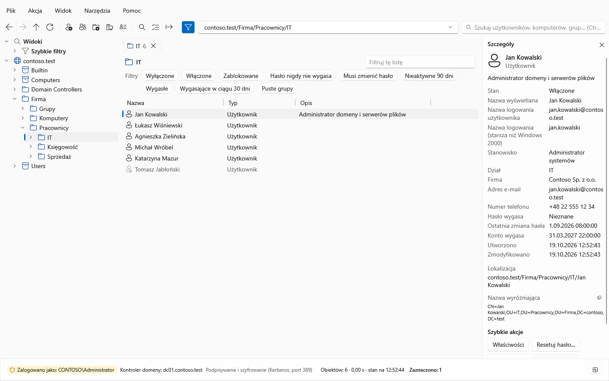
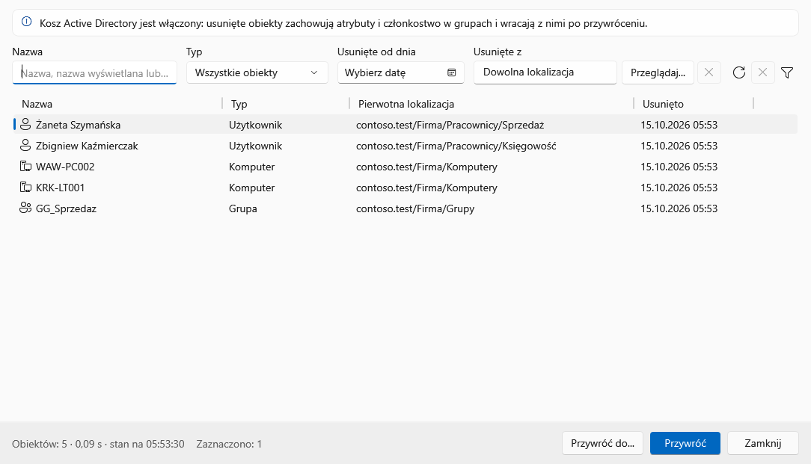
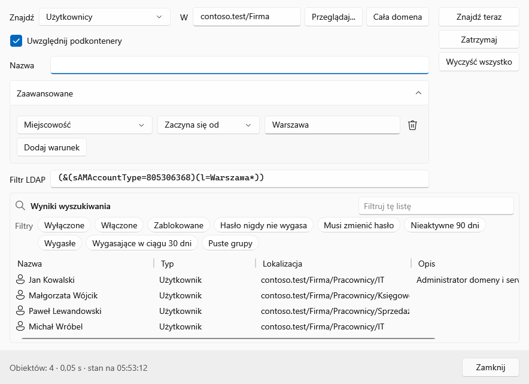
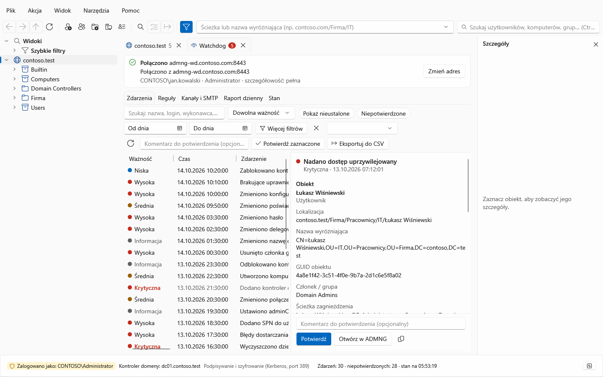
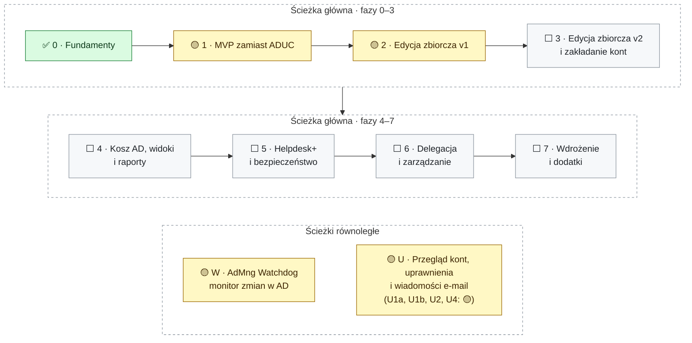

<div align="center">

<picture>
  <source media="(prefers-color-scheme: dark)" srcset="docs/assets/banner-dark.svg">
  <source media="(prefers-color-scheme: light)" srcset="docs/assets/banner-light.svg">
  
</picture>

**Szybki, nowoczesny następca przystawki `dsa.msc` – z edycją zbiorczą, Koszem AD i monitorem zmian w katalogu**

[](https://github.com/DarienRahl/AD_MNG/actions/workflows/ci.yml)
[](https://github.com/DarienRahl/AD_MNG/releases)


**[Funkcje](#-funkcje)** · **[Zrzuty ekranu](#-zrzuty-ekranu)** · **[Roadmapa](#-roadmapa)** ·
**[Pobierz](#-pobierz-i-uruchom)** · **[Budowanie](#-budowanie-i-testy)** · **[Dokumentacja](#-dokumentacja)**

</div>

> [!WARNING]
> **Wersja rozwojowa.** Fazy 1 (codzienna praca zamiast ADUC) i 2 (edycja zbiorcza) z [roadmapy](#-roadmapa) są
> zaimplementowane, podobnie jak Kosz AD z fazy 4 i usługa AdMng Watchdog. Aplikacja jest testowana automatycznie
> (testy jednostkowe, testy UI na Windows, testy integracyjne na kontrolerze Samba AD), ale **nie przeszła jeszcze
> pilotażu na produkcyjnym Windows AD** – zacznijcie od domeny testowej lub konta z ograniczonymi uprawnieniami.

## ✨ Funkcje

Nowoczesna, szybka konsola do zarządzania Active Directory – następca przystawki **Użytkownicy i komputery usługi
Active Directory** (`dsa.msc`). Wygląda i działa znajomo (drzewo domeny i jednostek organizacyjnych, lista obiektów,
karty właściwości, te same skróty klawiszowe), ale jest zbudowana według dzisiejszych standardów: Windows 11 Fluent,
tryb ciemny, PL/EN, okna niemodalne, wyszukiwanie w trakcie pisania i – przede wszystkim – **edycja zbiorcza** z
podglądem zmian, raportem i cofaniem.

- ⚡ **Płynność zamiast przystawki MMC** – zapytania LDAP asynchroniczne i strumieniowane stronami, pobierane są tylko
  potrzebne atrybuty, brak limitu 2000 obiektów w folderze, wirtualizowane listy, karty (Ctrl+T), paleta poleceń
  (Ctrl+K), listy odświeżane na żywo przez powiadomienia LDAP – zmienione obiekty, a nie cały folder. Kontenery
  powyżej 5000 obiektów przechodzą w **listę wirtualną (VLV)**: kontroler sortuje, strony są czytane w trakcie
  przewijania, a pamięć nie rośnie z liczbą obiektów.
- 🔒 **Zero lokalnych danych** – nic z katalogu nie jest zapisywane na dysku (brak bazy, cache, snapshotów); każde
  odświeżenie pyta kontroler domeny na żywo. Na dysku (`%APPDATA%\AdMng`) są tylko ustawienia interfejsu, profile
  połączeń bez haseł i definicje widoków. Hasła nigdy nie trafiają do dzienników; do pliku – tylko w eksporcie wyników
  resetu haseł, o który operator wyraźnie poprosi.
- 🔑 **Różne poświadczenia** – logowanie bieżącym kontem Windows albo innym (helpdesk, administrator); Kerberos z
  podpisywaniem i szyfrowaniem, LDAPS lub StartTLS; cała sesja pracuje z jednym kontrolerem domeny, który można zmienić
  w trakcie pracy (**„Zmień kontroler domeny…”** – lista DC z lokacją, GC i RODC, bez ponownego wpisywania hasła, otwarte
  karty zostają). Interfejs pokazuje, co dane konto może zmienić, a czego nie (`allowedAttributesEffective`), i wyróżnia
  konta uprzywilejowane.
- 🪪 **Znajome karty właściwości** – użytkownik, komputer, grupa, kontakt, OU: Ogólne, Adres, Konto (z **godzinami
  logowania** – siatka tygodnia jak w ADUC), Profil, Telefony, Organizacja, Członek grup (bezpośrednio i w pełni, z
  zagnieżdżeniem), Członkowie, Zarządzany przez, Obiekt, Edytor atrybutów; akcje helpdesk (reset hasła, odblokowanie,
  włącz/wyłącz, dodaj do grupy), tworzenie, przenoszenie (także przeciągnij-upuść), zmiana nazwy (F2), usuwanie. Kontenery
  dobrze znane (`Users`, `Computers` – także przekierowane) są rozpoznawane po WKGUID: drzewo je oznacza, a nowe konta
  bez wskazanego kontenera trafiają tam, gdzie wskazuje domena.
- 📋 **Szybkie kopiowanie** – przycisk „Kopiuj” przy adresie e-mail, UPN, loginie (także `DOMENA\login`), telefonach i
  innych wartościach w panelu szczegółów i na kartach właściwości; Ctrl+C kopiuje zaznaczone wiersze listy (do Excela,
  Teams, zgłoszeń); „Kopiuj jako…” dla wielu obiektów naraz – np. adresy e-mail jako lista gotowa do pola „Do” w
  Outlooku (Ctrl+Shift+M). Wartości poufne nie trafiają do schowka bez jawnego odsłonięcia.
- 🧰 **Edycja zbiorcza** użytkowników, komputerów, grup i kontaktów: ustawianie/czyszczenie atrybutów, szablony
  (`{givenName|nodiacritics|lower}.{sn|nodiacritics|lower}`), znajdź i zamień, włącz/wyłącz, odblokuj, reset haseł,
  przenoszenie, zmiana nazwy, członkostwo w grupach, usuwanie, import CSV (także `;` i cp1250 z polskiego Excela) –
  zawsze z podglądem różnic, walidacją, ochroną przed nadpisaniem cudzych zmian, raportem, eksportem do CSV/PowerShell i
  możliwością cofnięcia.
- 🗂 **Widoki dopasowane do Waszego AD** – przypinanie OU (np. *Pracownicy*, *Komputery*), zapisane zapytania LDAP z
  kolumnami, gotowe szybkie filtry (zablokowane, wyłączone, nieaktywne > N dni, hasło nigdy nie wygasa…), eksport/import
  widoków dla zespołu.
- 📧 **Poczta (Exchange)** – karta *Adresy e-mail*: `proxyAddresses` z dokładnie jednym głównym adresem SMTP, `mail`,
  `mailNickname`, `targetAddress`, ukrycie w książce adresowej; atrybuty poczty edytowalne też zbiorczo.
- ♻ **Kosz AD** – okno *Kosz Active Directory* (Ctrl+Shift+R): usunięte obiekty czytane na żywo, filtry, przywracanie do
  pierwotnego lub wskazanego miejsca, całe poddrzewo OU jednym planem w kolejności rodzic → dzieci.
- 🔎 **Przejrzystość** – dziennik sesji, historia równoważnych poleceń PowerShell, centrum aktywności z postępem i
  anulowaniem, komunikaty błędów AD po polsku.
- 🛡 **AdMng Watchdog – monitor zmian w AD** – osobna usługa (24/7) na serwerze **Debian 12/13** poza domeną (od 0.3.0;
  pakiety `.deb`, systemd, konto komputera tylko do odczytu z keytabem i hasłem zmienianym co 30 dni) wykrywa nowe i
  usunięte obiekty, zmiany atrybutów (stara → nowa wartość), blokady, wygasające konta, zmiany członkostwa i
  **uprzywilejowanego dostępu** (także przez grupy zagnieżdżone), zmiany Tier 0 i **treści GPO** („ustawienie: było →
  jest”); ustala **kto i skąd** z dzienników zabezpieczeń kontrolerów przekazywanych przez Windows Event Forwarding
  (OpenWEC, bez agentów na DC), przechowuje historię 3 lata i powiadamia e-mailem (od razu i raportem dziennym),
  w Microsoft Teams (Workflows) i podpisanym webhookiem (SIEM). W AD_MNG zakładka **Watchdog** (Narzędzia → Watchdog)
  pokazuje zdarzenia, reguły, kanały i stan usługi. Usługa jako jedyna część rozwiązania przechowuje dane – we własnym,
  chronionym folderze ([ADR-0008](docs/adr/0008-watchdog-dane-w-osobnym-folderze.md),
  [ADR-0009](docs/adr/0009-watchdog-na-linuksie.md)). Funkcje: [docs/WATCHDOG.md](docs/WATCHDOG.md), wdrożenie:
  [docs/WATCHDOG-LINUX.md](docs/WATCHDOG-LINUX.md).

Czego jeszcze brakuje (m.in. LAPS, BitLocker, edytor ACL, zakładanie kont z CSV, „Kopiuj użytkownika”): zob.
[znane ograniczenia](#znane-ograniczenia).

### AD Manager a ADUC

| | ADUC (`dsa.msc`) | AD Manager |
|---|---|---|
| **Duże OU** | „Not Responding”, limit 2000 obiektów | wyniki strumieniowane stronami, bez limitu, z anulowaniem; kontenery > 5000 obiektów jako lista wirtualna VLV (sortowanie i wyszukiwanie po wpisaniu na serwerze, stała ilość pamięci) |
| **Wyszukiwanie** | Znajdź w osobnym oknie | ANR w trakcie pisania (Ctrl+E), paleta poleceń (Ctrl+K) |
| **Kopiowanie** | zaznaczenie tekstu w polu karty właściwości | przycisk „Kopiuj” przy wartości, Ctrl+C wierszy listy, „Kopiuj jako…” dla wielu obiektów (adresy e-mail dla Outlooka) |
| **Wiele obiektów naraz** | stały podzbiór pól, bez podglądu i raportu | dowolne atrybuty, podgląd przed → po, raport, PowerShell, cofanie |
| **Kosz AD** | tylko w ADAC | przeglądanie i przywracanie, także całych poddrzew OU |
| **Odświeżanie** | ręczne F5 | listy odświeżane na żywo (powiadomienia LDAP) |
| **Poświadczenia** | `runas /netonly`, osobna konsola | bieżące konto Windows albo inne, profile połączeń bez haseł |
| **Wygląd** | rozmyty na wysokim DPI, bez trybu ciemnego | Fluent, motyw jasny i ciemny, PL / EN bez restartu |
| **Instalacja** | RSAT | jeden plik `AdMng.exe` – bez .NET i RSAT |
| **Kto co zmienił** | brak | AdMng Watchdog: wykonawca, stara → nowa wartość, powiadomienia |

## 📸 Zrzuty ekranu

<picture>
  <source media="(prefers-color-scheme: dark)" srcset="docs/assets/screenshots/02-main-window-dark.png">
  <source media="(prefers-color-scheme: light)" srcset="docs/assets/screenshots/01-main-window.png">
  
</picture>

<p align="center"><sub>Okno główne – jednostka organizacyjna IT ze szczegółami zaznaczonego użytkownika
(motyw jasny lub ciemny, jak Twój GitHub)</sub></p>

<table>
  <tr>
    <td width="50%" valign="top">
      
      <br><sub><b>Edytor zbiorczy</b> – podgląd zmian (przed → po) przed wykonaniem</sub>
    </td>
    <td width="50%" valign="top">
      
      <br><sub><b>Kosz Active Directory</b> – usunięte obiekty do przywrócenia</sub>
    </td>
  </tr>
  <tr>
    <td width="50%" valign="top">
      
      <br><sub><b>Wyszukiwanie</b> – warunki zaawansowane i gotowy filtr LDAP</sub>
    </td>
    <td width="50%" valign="top">
      
      <br><sub><b>AdMng Watchdog</b> – co się zmieniło, kto i skąd</sub>
    </td>
  </tr>
</table>

<sub>Zrzuty pochodzą z wersji 0.2.0 (polski interfejs, przykładowa firma z testów); zrzuty wersji 0.4.0 – także okna
*Przegląd kont* i *Wiadomości do użytkowników*, potwierdzenie certyfikatu Watchdoga i podzakładka „Źródła i retencja” –
są dołączone do wydania. Aktualny komplet CI
publikuje przy każdym pushu na gałęzi `screenshots` – zob. [Zrzuty ekranu z CI](#zrzuty-ekranu-z-ci).</sub>

## 🧭 Roadmapa

Plan prac podzielony na fazy. Każda faza kończy się wersją, której da się realnie używać, i ma mierzalne kryteria
ukończenia. Kolejność wynika z ustaleń z zespołem:

- **technologia:** WPF .NET 10 + Fluent ([ADR-0001](docs/adr/0001-wpf-net10-fluent.md));
- **interfejs:** PL + EN przełączany w locie;
- **priorytety spoza `dsa.msc`:** Kosz AD (przywracanie) oraz atrybuty poczty/Exchange;
- **podziały AD** (pracownicy, komputery, …) obsługiwane przez **konfigurowalne widoki**, a nie zaszyte na sztywno;
- **edycja zbiorcza** jest kluczowa, dlatego silnik zmian powstaje już w fazie 1, a pełne UI w fazie 2.

Szczegóły techniczne i uzasadnienia: [ARCHITECTURE.md](docs/ARCHITECTURE.md), [RESEARCH.md](docs/RESEARCH.md).

Legenda statusu: ✅ zrobione · 🟡 pierwsza wersja gotowa, wymaga dopracowania/weryfikacji na Windows AD · ⬜ planowane



| Faza | Cel | Najważniejsze rezultaty | Status |
|---|---|---|---|
| 0 | Fundamenty | Rozwiązanie, CI, laboratorium Samba AD, rdzeń LDAP, kontrakty, prototyp wydajności | ✅ |
| 1 | MVP – codzienna praca zamiast ADUC | Logowanie (różne poświadczenia), drzewo, szybkie listy, wyszukiwanie, właściwości, akcje helpdesk, tworzenie/przenoszenie/usuwanie | 🟡 cały zakres zaimplementowany (także kopiowanie wartości, „Zmień kontroler domeny”, godziny logowania, WKGUID i VLV: ✅), czeka na pilotaż na Windows AD |
| 2 | Edycja zbiorcza v1 (kluczowa) | Operacje zbiorcze z podglądem różnic, walidacją, raportem, eksportem PowerShell, cofaniem; import CSV (aktualizacja) | 🟡 zaimplementowane, czeka na testy obciążeniowe |
| 3 | Edycja zbiorcza v2 i zakładanie kont | Import CSV (tworzenie), szablony per OU, edytor arkuszowy, koszyk, kreatory (nieaktywne konta, zmiana nazwiska), pełna obsługa poczty | ⬜ (karta Adresy e-mail: ✅) |
| 4 | Kosz AD, widoki i raporty | Przeglądanie i przywracanie usuniętych obiektów, kreator zapytań, przestrzenie robocze dla działów, raporty, wiele domen | ⬜ (Kosz AD: 🟡, członkostwo zagnieżdżone i eksport widoków: ✅) |
| 5 | Helpdesk+ i bezpieczeństwo | Poświadczenia bez hasła w pamięci, ochrona przed usunięciem, karta Zabezpieczenia, stan blokady na wszystkich DC, historia zmian, LAPS, BitLocker, odświeżanie na żywo | ⬜ (odświeżanie list na żywo: ✅) |
| 6 | Delegacja i zarządzanie | Edytor ACL, kreator delegowania i przegląd delegacji, polityki ADMX, dziennik zdarzeń operatora, rzadkie karty ADUC | ⬜ |
| 7 | Wdrożenie i dodatki | Podpisany MSI, WDAC/AppLocker, zatwierdzanie „cztery oczy”, członkostwo czasowe (PAM) | ⬜ |
| W | AdMng Watchdog – monitor zmian (ścieżka równoległa) | Usługa na Linuksie (Debian, systemd) wykrywająca zmiany w AD z ustaleniem wykonawcy i źródła (WEF), treść GPO, historia 3 lata, powiadomienia e-mail / raport dzienny / Teams / webhook, zakładka Watchdog w AD_MNG | 🟡 wersja zapoznawcza (pakiety Debian od 0.3.0), czeka na pilotaż na kontrolerach Windows Server |
| U | Przegląd kont i wiadomości do użytkowników (ścieżka równoległa) | Wiadomości e-mail (SMTP) z szablonów z danymi konta (np. „hasło wygasa dnia …”) do jednego użytkownika z okna właściwości lub do wielu naraz, przegląd wszystkich kont (zablokowane, wygasłe i wygasające hasła i konta, nieaktywne, higiena haseł), uprawnienia kont (każde konto z prawami ponad zwykłego użytkownika domeny, z poziomem i ścieżką), kreator filtrów, automatyczne przypomnienia w usłudze Watchdog | 🟡 (U1a – wiadomości z AD Managera z bezpośrednim SMTP, U1b – wysyłka przez usługę Watchdog, U2 – przegląd stanu kont, U4 – uprawnienia kont: U4a z grup i ustawień kont z kreatorem filtrów, U4b z delegowań w ACL i U4c z uprawnień lokalnych z GPO: 🟡 zaimplementowane, czekają na pilotaż na Windows Server AD; U3: ⬜) |

Szczegóły każdej fazy są poniżej – kliknij, aby rozwinąć.

### Faza 0 – Fundamenty ✅

**Cel:** podjąć decyzje technologiczne, zweryfikować ryzyka LDAP i przygotować bazę inżynierską.

<details>
<summary><b>Szczegóły fazy 0</b> – rozwiązanie, laboratorium, rdzeń LDAP, CI</summary>

- ✅ Rozwiązanie `.slnx`: `AdMng.Core`, `AdMng.Directory`, `AdMng.Presentation` (ViewModele bez WPF), `AdMng.App` (WPF),
  projekty testów; centralne wersje pakietów; ostrzeżenia traktowane jak błędy.
- ✅ Rdzeń: DN (RFC 4514, polskie znaki), filtry LDAP z escapingiem (RFC 4515) i regułami AD (bit AND/OR, IN_CHAIN, ANR),
  flagi `userAccountControl`/`groupType`, konwersje FILETIME/GeneralizedTime/SID/GUID, model obiektu i schematu, mapowanie
  błędów AD (`0000052D`, `data 775`…).
- ✅ Kontrakty: sesja katalogu przypięta do DC, silnik zmian (plan → wykonanie → rollback), szablony, CSV, dziennik sesji.
- ✅ Laboratorium Samba AD DC z danymi „polskiej firmy” (OU wg działów i lokalizacji, konta zablokowane, delegacja helpdesk),
  uruchamiane lokalnie i w CI.
- ✅ Prototyp wydajności S.DS.P: bind 16 ms, pierwsza strona 100 obiektów 65 ms, VLV/ASQ/`allowedAttributesEffective` działają.
- ✅ CI (GitHub Actions): build i testy na Windows, publikacja `AdMng.exe`, testy integracyjne na Ubuntu z Samba DC.
- ✅ Dokumentacja: architektura, ADR, research.

**Kryteria ukończenia:** build bez ostrzeżeń na Windows i Linux; testy jednostkowe i integracyjne zielone w CI. ✅

**Do zrobienia na laboratorium Windows Server 2025** (przeniesione do fazy 1): pomiar listy 100 000 obiektów (paging vs VLV),
logowanie Kerberos z wymuszonym podpisywaniem i channel binding, test „żadnych danych na dysku” (skan profilu po sesji).

</details>

### Faza 1 – MVP: codzienna praca zamiast ADUC 🟡

**Cel:** helpdesk i administratorzy mogą wykonywać codzienne czynności szybciej niż w `dsa.msc`.

<details>
<summary><b>Szczegóły fazy 1</b> – stan realizacji, połączenie, listy, wyszukiwanie, właściwości, akcje</summary>

#### Stan realizacji

- ✅ **Połączenie:** bieżące konto Windows lub inne poświadczenia, Kerberos z podpisywaniem i szyfrowaniem, LDAPS,
  StartTLS; wykrywanie domeny i kontrolerów (DsGetDcName, lokacja), wybór DC przy łączeniu, profile połączeń bez haseł,
  pasek tożsamości z ostrzeżeniem dla kont uprzywilejowanych, komunikaty błędów AD po polsku i angielsku,
  **„Zmień kontroler domeny…”** w trakcie sesji (lista DC z lokacją, GC, RODC i emulatorem PDC, „dowolny zapisywalny
  DC w mojej lokacji”, bez ponownego wpisywania hasła; otwarte karty przeładowują się z nowego DC).
- ✅ **Nawigacja i listy:** drzewo ładowane leniwie, „Funkcje zaawansowane”, listy bez limitu 2000 (strony
  strumieniowane, wirtualizacja), sortowanie, wybór kolumn z atrybutów schematu, nazwy z display specifiers (`CN=415`),
  znaczniki stanu, pasek adresu (DN lub ścieżka), Wstecz/Dalej/W górę, karty (Ctrl+T, Ctrl+Enter), panel szczegółów,
  „stan na godz.”, szybkie filtry po stronie serwera, **odświeżanie list na żywo** (powiadomienia LDAP o zmianach),
  **kontenery dobrze znane rozpoznawane po WKGUID** (`wellKnownObjects`: znacznik w drzewie, domyślny kontener nowych
  użytkowników, grup i komputerów – także po `redirusr`/`redircmp`), **lista wirtualna VLV** dla kontenerów powyżej
  5000 obiektów (strony czytane w trakcie przewijania, sortowanie, szybki filtr i wyszukiwanie po wpisaniu na serwerze).
- ✅ **Wyszukiwanie:** ANR w trakcie pisania (Ctrl+E), Znajdź (Ctrl+F) z kategoriami i własnym filtrem LDAP, okno wyboru
  obiektów, paleta poleceń (Ctrl+K).
- ✅ **Właściwości:** wszystkie karty z tabeli poniżej, okna niemodalne, pola niedozwolone dla operatora tylko do odczytu
  (`allowedAttributesEffective`), członkostwo bezpośrednie **i pełne (zagnieżdżone)**, grupy z > 1500 członkami,
  **„Godziny logowania…”** (siatka tygodnia w czasie lokalnym jak w ADUC; także zbiorczo w edytorze).
- ✅ **Akcje:** wszystkie z listy poniżej, a także nowy `inetOrgPerson`, historia poleceń PowerShell i dziennik sesji.
  Pojedyncze zmiany przechodzą przez ten sam silnik zmian (walidacja, dziennik, PowerShell), ale **cofanie jest na razie
  dostępne tylko w edytorze zbiorczym** – cofanie pojedynczej zmiany z dziennika sesji jest w planach.
- ✅ **Jakość:** PL/EN bez restartu, motyw jasny/ciemny/systemowy (Fluent), skróty jak w ADUC, testy UI (UI Automation)
  i test dymny opublikowanego `AdMng.exe` w CI.
- ✅ **Szybkie kopiowanie:** przycisk „Kopiuj” przy adresie e-mail, UPN, loginie, telefonach i innych wartościach w
  panelu szczegółów i na kartach właściwości, Ctrl+C na liście obiektów (widoczne kolumny, tabulatory), „Kopiuj jako…”
  dla wielu obiektów naraz (adresy e-mail jako lista dla Outlooka, Ctrl+Shift+M) – szczegóły w sekcji
  [Kopiowanie wartości](#kopiowanie-wartości-) poniżej.
- ✅ **Zakres funkcjonalny fazy 1 jest kompletny** – ostatnie braki (kopiowanie wartości, „Zmień kontroler domeny” w
  trakcie sesji, „Godziny logowania”, kontenery dobrze znane po WKGUID, VLV na listach bardzo dużych OU) są gotowe;
  projekty: [kopiowanie](docs/dev/phase1-copy.md), [zmiana DC](docs/dev/phase1-changedc.md),
  [godziny logowania](docs/dev/phase1-logonhours.md), [WKGUID i VLV](docs/dev/phase1-navigation.md).
- ➡ **Przeniesione do kolejnych faz:** „Kopiuj użytkownika” (faza 3), edycja pól opartych o ACL – na razie wyświetlane
  tylko do odczytu (faza 5).
- 🟡 **Do weryfikacji na Windows Server:** pilotaż, pomiar 100 000 obiektów, Kerberos z wymuszonym channel binding,
  test „żadnych danych na dysku”, wysoki kontrast i czytnik ekranu.

#### Połączenie i sesja
- Logowanie bieżącym kontem Windows lub innymi poświadczeniami; Kerberos z podpisywaniem i szyfrowaniem, LDAPS, StartTLS.
- Wykrywanie domeny komputera i kontrolerów (DsGetDcName, lokacja), wybór DC przy łączeniu.
- „Zmień kontroler domeny…” w trakcie sesji (menu *Plik*, menu kontekstowe domeny w drzewie, paleta poleceń): lista DC
  domeny z lokacją, „Twoja lokacja”, GC, RODC i emulatorem PDC, wpisanie nazwy ręcznie albo „dowolny zapisywalny DC w
  mojej lokacji”; nowa sesja powstaje z poświadczeniem bieżącej (bez ponownego wpisywania hasła) i zastępuje ją dopiero
  po sprawdzeniu (ta sama domena, inny DC) – błąd lub anulowanie zostawia bieżącą. Opcjonalnie zapis wybranego DC w
  profilu połączenia; zmiana trafia do dziennika sesji.
- Profile połączeń (bez haseł), pasek tożsamości z wyróżnieniem kont uprzywilejowanych, zrozumiałe komunikaty błędów PL/EN.

#### Nawigacja i listy
- Drzewo domeny/OU ładowane leniwie, przełącznik „Funkcje zaawansowane”; kontenery dobrze znane rozpoznawane po WKGUID
  (`wellKnownObjects`/`otherWellKnownObjects` głowy domeny – znacznik i opis roli w drzewie, także po przekierowaniu
  `redirusr`/`redircmp`); „Nowy użytkownik/grupa/kontakt/komputer” z karty domeny, wyników wyszukiwania lub widoku
  tworzy obiekt w domyślnym kontenerze Users/Computers.
- Listy bez limitu 2000: wyniki strumieniowane stronami, wirtualizacja, sortowanie, wybór kolumn z atrybutów schematu,
  nazwy kolumn z polskich display specifiers (jak w polskim ADUC), znaczniki stanu (wyłączone, zablokowane, chronione).
- Bardzo duże kontenery (powyżej 5000 obiektów) jako lista wirtualna VLV: kontroler sortuje i zwraca tylko oglądane
  strony (200 wierszy, w pamięci najwyżej 12 stron), wyszukiwanie po wpisaniu przez `seek` VLV, szybki filtr po stronie
  serwera, odświeżanie na żywo widocznych stron; znacznik „Lista wirtualna (VLV)” na pasku stanu.
- Pasek adresu (DN lub ścieżka), historia Wstecz/Dalej, karty, panel szczegółów z szybkimi akcjami, „stan na godz.”.
- Szybkie filtry (chipy) wykonywane po stronie serwera: wyłączone, zablokowane, nieaktywne > N dni, hasło nigdy nie wygasa,
  wymagana zmiana hasła, wygasłe/wygasające konta, puste grupy.

#### Wyszukiwanie
- Globalne wyszukiwanie w trakcie pisania (ANR, Ctrl+E), Znajdź (Ctrl+F) z kategoriami jak w ADUC i własnym filtrem LDAP,
  okno wyboru obiektów (zamiennik „Wybierz użytkowników, komputery lub grupy”).

#### Właściwości (okna niemodalne, pola niedozwolone dla operatora tylko do odczytu)

| Typ obiektu | Karty |
|---|---|
| Użytkownik | Ogólne, Adres (c + co + countryCode), Konto (flagi, wygasanie „koniec dnia”, UPN z sufiksami, godziny logowania), Profil, Telefony, Organizacja, Członek grup (z grupą podstawową), Adresy e-mail, Obiekt, Edytor atrybutów |
| Komputer | Ogólne (rola), System operacyjny, Członek grup, Delegowanie (podgląd), Lokalizacja, Zarządzany przez, Obiekt, Edytor atrybutów |
| Grupa | Ogólne (zakres/typ z regułami konwersji), Członkowie (> 1500 przez ranged retrieval), Członek grup, Zarządzany przez, Obiekt, Edytor atrybutów |
| Kontakt | Ogólne, Adres, Telefony, Organizacja, Członek grup, Adresy e-mail, Obiekt, Edytor atrybutów |
| Jednostka organizacyjna | Ogólne, Zarządzany przez, Obiekt, Edytor atrybutów |

#### Akcje
- Reset hasła (wpisane lub wygenerowane, wymuszenie zmiany, odblokowanie), włącz/wyłącz, odblokuj, dodaj do grupy,
  przenieś (okno i przeciągnij-upuść), zmień nazwę (F2), usuń (ostrzeżenia, usuwanie poddrzewa za potwierdzeniem),
  nowy użytkownik/grupa/OU/komputer/kontakt, eksport listy do CSV, kopiowanie wartości (Ctrl+C, „Kopiuj jako…”).
- Każda zmiana (także pojedyncza) przechodzi przez silnik zmian: walidacja, dziennik sesji, możliwość cofnięcia.

#### Kopiowanie wartości ✅

Wartość kopiuje się jednym kliknięciem albo skrótem – bez zaznaczania tekstu w polu i bez dodatkowych okien. Projekt:
[docs/dev/phase1-copy.md](docs/dev/phase1-copy.md).

- **Przycisk kopiowania jednym kliknięciem** przy wartościach w **panelu szczegółów** (adres e-mail, UPN, nazwa
  logowania `sAMAccountName` i `DOMENA\login`, nazwa wyświetlana, telefon i komórka, numer/identyfikator pracownika,
  stanowisko, dział, firma, menedżer, nazwa, ścieżka i DN) i na kartach właściwości (e-mail, nazwa wyświetlana, nazwa
  logowania z przyciskiem `DOMENA\`, telefony, stanowisko, dział, firma, biuro, UPN, menedżer, pola karty *Obiekt*).
  Potwierdzenie to krótki komunikat „Skopiowano: …” (bez okna, czytany przez czytnik ekranu) i znacznik ✓ na przycisku;
  gdy schowek jest zajęty przez inny program, zamiast potwierdzenia pojawia się ostrzeżenie. Wartości w panelu
  szczegółów dają się też zaznaczyć myszą.
- **Ctrl+C na liście obiektów:** zaznaczone wiersze (w kolejności listy) z widocznymi kolumnami jako tekst rozdzielany
  tabulatorami – do Excela, Teams czy zgłoszenia w helpdesku; „Kopiuj wiersze z nagłówkami” dodaje nagłówki kolumn.
  Wartości zaczynające się od `=`, `+`, `-`, `@` dostają apostrof (ochrona przed formułami jak w eksporcie CSV), z
  wyjątkiem liczb i numerów telefonów. DN zaznaczonych obiektów kopiuje Ctrl+Shift+C.
- **„Kopiuj jako…”** w menu kontekstowym, w menu *Akcja*, na pasku narzędzi i w palecie poleceń (Ctrl+K, kategoria
  „Kopiuj jako”): adres e-mail, UPN, nazwa logowania, `DOMENA\login`, nazwa, nazwa wyświetlana, DN, ścieżka kanoniczna,
  GUID, SID – dla jednego lub wielu obiektów (wartości czytane na żywo z kontrolera sesji, po jednej w wierszu). Adresy
  e-mail (Ctrl+Shift+M) trafiają do schowka jako lista rozdzielana `; `, gotowa do pola „Do” w Outlooku; obiekty bez
  adresu są pomijane, a komunikat mówi, ile ich było.
- **Kopiowanie z list na kartach:** pojedynczy adres z karty *Adresy e-mail* bez prefiksu `smtp:` (przycisk, menu,
  Ctrl+C), nazwa (Ctrl+C), DN (Ctrl+Shift+C) i adres e-mail z *Członek grup* i *Członkowie*, adresy e-mail wszystkich
  członków grupy dla Outlooka, wpis dziennika sesji (Ctrl+C), szczegóły zdarzenia Watchdoga.
- **Bezpieczeństwo:** wartości poufne (hasła, LAPS, BitLocker, atrybuty oznaczone w schemacie jako poufne) nie są
  kopiowane tymi poleceniami – kolumny z nimi są pomijane przy Ctrl+C (komunikat mówi które); skopiować je można tylko
  po jawnym odsłonięciu w Edytorze atrybutów, z wykluczeniem z historii schowka i wyczyszczeniem po 60 s. Kopiowanie
  niczego nie zapisuje na dysku (zasada „zero lokalnych danych”).
- Teksty przycisków i potwierdzeń po polsku i angielsku, obsługa z klawiatury (przyciski kopiowania są w kolejności Tab,
  z nazwą „Kopiuj: …” dla czytnika ekranu), testy jednostkowe i testy UI (CI Windows).

#### Jakość
- PL/EN bez restartu, motyw jasny/ciemny, skróty jak w ADUC (F5, Del, F2, Alt+Enter, Ctrl+F) + Ctrl+K, dostępność
  (UI Automation, klawiatura, wysoki kontrast).

**Kryteria ukończenia**
- Pilotaż: ~5 osób z helpdesku pracuje równolegle z ADUC przez 2 tygodnie.
- Wartości wyświetlane identycznie jak w ADUC na laboratorium Windows (kraj, godziny logowania, wygasanie konta, zakres grupy).
- Konto helpdesk widzi poprawnie zablokowane pola i dostaje zrozumiałe komunikaty (odmowa dostępu, polityka haseł).
- Pierwsza strona dużego OU < 300 ms w sieci LAN, brak „zamrożeń” UI.
- Test „żadnych danych katalogu na dysku” zaliczony.

</details>

### Faza 2 – Edycja zbiorcza v1 (kluczowa) 🟡

**Cel:** bezpieczne, przewidywalne i odwracalne zmiany na setkach i tysiącach obiektów.

<details>
<summary><b>Szczegóły fazy 2</b> – operacje, potok zmian, import CSV, kryteria ukończenia</summary>

#### Stan realizacji

- ✅ Edytor zbiorczy (Ctrl+Shift+B) ze wszystkimi operacjami z tabeli poniżej, cały potok 1–6, „ponów nieudane”,
  cofanie, eksport podglądu i raportu do CSV, skrypt PowerShell, import CSV aktualizujący obiekty (z wykrywaniem
  separatora i kodowania, także cp1250 z polskiego Excela, i ochroną przed formułami w eksporcie).
- ✅ Wykonanie z ograniczoną równoległością, ponawianiem błędów przejściowych i współbieżnością optymistyczną (atomowe
  „usuń starą wartość + dodaj nową” – zmiana wprowadzona przez kogoś innego po podglądzie kończy się konfliktem, a nie
  nadpisaniem). Paczki ponad próg z ustawień albo z usuwaniem, przenoszeniem lub resetem haseł wymagają wpisania liczby
  obiektów.
- ✅ Hasła wygenerowane przy resecie istnieją tylko w pamięci; eksport wyników z hasłami wyłącznie na wyraźne polecenie,
  z ostrzeżeniem przed nadpisaniem niezapisanych haseł.
- 🟡 Kryteria ukończenia: konflikty, cofanie i plan PowerShell są pokryte testami automatycznymi (także na laboratorium
  Samba); paczka 5000 obiektów i porównanie z `-WhatIf` na Windows Server – do zrobienia.

#### Źródła zaznaczenia
- Zaznaczenie wielu obiektów na liście, wynik wyszukiwania, szybki filtr lub zapisany widok, plik CSV.

#### Operacje (użytkownicy, komputery, grupy, kontakty)

| Operacja | Szczegóły |
|---|---|
| Ustaw atrybut | Wartość stała lub szablon: `{givenName|nodiacritics|lower}.{sn|nodiacritics|lower}@firma.pl` |
| Wyczyść atrybut | Z kontrolą atrybutów obowiązkowych |
| Dodaj / usuń wartości | Atrybuty wielowartościowe (np. `proxyAddresses`, `otherTelephone`) – idempotentnie |
| Znajdź i zamień | Tekst lub wyrażenie regularne |
| Konto | Włącz/wyłącz, odblokuj, flagi (hasło nigdy nie wygasa, karta inteligentna…), wymuszenie zmiany hasła, data wygaśnięcia, godziny logowania (ta sama siatka co na karcie Konto) |
| Reset haseł | Unikalne hasła generowane kryptograficznie lub jedno hasło; eksport wyników tylko za wyraźną zgodą |
| Przenieś / zmień nazwę | Do wskazanego OU; nowa nazwa z szablonu |
| Grupy | Dodaj do grup / usuń z grup (wiele-do-wielu) |
| Usuń | Osobno, z potwierdzeniem przez wpisanie liczby obiektów |

#### Potok
1. **Plan** – świeży odczyt bieżących wartości z przypiętego DC, renderowanie szablonów, pominięcie zmian bez efektu.
2. **Walidacja** – schemat (typ, jedno-/wielowartościowość, długość), uprawnienia operatora (`allowedAttributesEffective`),
   unikalność (`sAMAccountName`, UPN, mail – w AD i w obrębie paczki), obiekty chronione (adminCount=1, krytyczne systemowe,
   konta wbudowane).
3. **Podgląd różnic** – „przed → po” dla każdego obiektu i atrybutu, filtry (zmiany / ostrzeżenia / błędy / bez zmian),
   wykluczanie pojedynczych obiektów, eksport podglądu do CSV, **równoważny skrypt PowerShell**.
4. **Wykonanie** – w tle, z postępem i anulowaniem; ograniczona równoległość; ponawianie błędów przejściowych;
   **współbieżność optymistyczna** (zmiana wprowadzona przez kogoś innego po podglądzie nie zostanie nadpisana).
5. **Raport** – status każdego obiektu, kody błędów AD po polsku, „ponów nieudane”, eksport CSV.
6. **Cofnięcie** – plan odwrotny z zapamiętanych (w pamięci) starych wartości, przez ten sam podgląd.

#### Import CSV (aktualizacja istniejących obiektów)
- Automatyczne wykrycie separatora (`;` z polskiego Excela, `,`, tab), UTF-8/BOM, klucz: `sAMAccountName`, UPN, mail,
  `employeeID`, DN lub `objectGUID`; mapowanie kolumn na atrybuty (automatyczne po nazwie LDAP lub polskiej etykiecie);
  puste komórki: pomiń lub wyczyść; wiersze nieznalezione/niejednoznaczne jako błędy w podglądzie.

**Kryteria ukończenia**
- Paczka 5000 obiektów na laboratorium bez przeciążenia DC (limit współbieżności, brak alarmów opóźnień LDAP).
- Wstrzyknięte równoległe zmiany wykrywane jako konflikty.
- Cofnięcie przywraca 100% odwracalnych zmian (testy automatyczne).
- Wygenerowany PowerShell z `-WhatIf` daje te same zmiany co plan.

</details>

### Faza 3 – Edycja zbiorcza v2 i zakładanie kont ⬜

**Cel:** zakładanie kont z CSV i szablonów przypisanych do OU, edytor arkuszowy, koszyk obiektów, kreatory (nieaktywne
konta, zmiana nazwiska) i pełna obsługa poczty.

<details>
<summary><b>Szczegóły fazy 3</b> – import CSV tworzący obiekty, szablony per OU, edytor arkuszowy, kreatory, poczta</summary>

- Import CSV **tworzący** obiekty (użytkownicy, kontakty, grupy, komputery) z szablonem pliku do pobrania; obsługa cp1250.
- Szablony nowych obiektów przypisane do OU (np. *Pracownicy/IT*: UPN, mail, grupy startowe, atrybuty działu), polityka
  nazewnictwa z transliteracją polskich znaków i licznikami unikalności (`jan.kowalski2`).
- „Kopiuj użytkownika” (atrybuty kopiowalne wg schematu + członkostwa).
- Edytor arkuszowy (jak Excel) nad wynikami listy: wklejanie z Excela, wypełnianie w dół, zmiany trafiają do podglądu.
- Koszyk obiektów z różnych OU, „wklej listę” (rozpoznawanie po sAMAccountName/UPN/mail/employeeID).
- Kreatory: nieaktywne konta i komputery (wyłącz → opisz → przenieś → usuń później), zmiana nazwiska (sn, displayName, cn,
  UPN, mail, główny adres SMTP), migracja sufiksu UPN, kopiowanie członkostw A → B.
- **Poczta / Exchange (priorytet):** pełna obsługa `proxyAddresses` (dokładnie jeden główny `SMTP:`, unikalność w całym lesie
  przez GC), `mailNickname`, `targetAddress`, `extensionAttribute1–15`, ukrycie w GAL; operacje zbiorcze na adresach
  (np. dodanie aliasu w nowej domenie dla całego działu).
- Synchronizacja członkostwa grupy z zapytania lub CSV (różnicowo, nigdy przez nadpisanie `member`).

</details>

### Faza 4 – Kosz AD, widoki i raporty ⬜ (Kosz AD: 🟡)

**Cel:** przeglądanie i przywracanie usuniętych obiektów, kreator zapytań, przestrzenie robocze dla działów, raporty
na żywo i wiele domen.

<details>
<summary><b>Szczegóły fazy 4</b> – Kosz AD, widoki dla działów, kreator zapytań, raporty, wiele domen</summary>

- 🟡 **Kosz AD (priorytet) – pierwsza wersja gotowa.** Okno *Kosz Active Directory* (menu Narzędzia, paleta poleceń,
  Ctrl+Shift+R): lista usuniętych obiektów czytana na żywo z `CN=Deleted Objects` (kontrolka Show Deleted, wyniki
  strumieniowane, z możliwością przerwania), filtry po stronie serwera (nazwa, typ obiektu, data usunięcia, kontener,
  z którego usunięto obiekt), kolumny: nazwa, typ, pierwotna lokalizacja (ścieżka kanoniczna – także przez usunięte
  kontenery nadrzędne), czas usunięcia. Przywracanie do pierwotnego lub wskazanego miejsca przez silnik zmian: podgląd
  planu z uwagami i potwierdzeniem, dziennik sesji, historia PowerShell (`Restore-ADObject`), odświeżenie list i drzewa.
  **Całe poddrzewo OU wraca jednym planem w kolejności rodzic → dzieci** (czego nie potrafi ADAC): dzieci trafiają do
  przywróconego rodzica, a wykonanie dziecka czeka na rodzica. Plan wykrywa konflikty nazw w miejscu docelowym (odczyt na
  żywo), obiekty, których kontener pozostaje usunięty, i obiekty już ostatecznie usunięte. Okno pokazuje stan Kosza i czas
  przechowywania usuniętych obiektów (`msDS-deletedObjectLifetime`/`tombstoneLifetime`); gdy Kosz jest wyłączony,
  ostrzega i pozwala odtworzyć obiekt z tombstone (bez większości atrybutów) po dodatkowym potwierdzeniu. Sprawdzone
  testami jednostkowymi, testami UI i na laboratorium Samba (odtworzenie poddrzewa z tombstone).
  Do zrobienia: weryfikacja na Windows Server z włączonym Koszem i z uprawnieniami delegowanymi do `CN=Deleted Objects`,
  ostrzeżenie w oknie usuwania, gdy Kosz jest wyłączony, przywracanie w partycjach Configuration i stref DNS.
- 🟡 **Widoki dla działów:** ✅ przypinanie OU, zapisane widoki (zapytanie LDAP + kontener + kolumny), gotowe widoki
  wbudowane i eksport/import widoków dla zespołu; ⬜ przestrzenie robocze (np. *Pracownicy*, *Komputery*,
  *Kontrahenci*) łączące widoki z szablonami, osobne dla helpdesku i administratorów.
- 🟡 Kreator zapytań: ✅ kreator filtrów (warunki ↔ LDAP, grupy I/LUB) z zapisanymi filtrami, chipami na listach
  obiektów i eksportem/importem JSON ([ścieżka U4a](#u4--uprawnienia-kont--u4a-u4b-i-u4c-)); ⬜ zapisane zapytania jako
  foldery w drzewie, import zapytań zapisanych w ADUC (XML).
- Raporty na żywo: bezpieczeństwo (PASSWD_NOTREQD, brak preautentykacji Kerberos, delegowanie nieograniczone, adminCount,
  konta z SPN), inwentaryzacja (systemy operacyjne, puste i duże grupy, liczności OU); każdy wynik można przekazać do edycji zbiorczej.
  Przegląd stanu kont użytkowników (zablokowane, terminy haseł i kont, nieaktywne) –
  [ścieżka U](#ścieżka-u--przegląd-kont-i-wiadomości-do-użytkowników--u1a-u1b-u2-i-u4-); konta z uprawnieniami
  ponad zwykłego użytkownika (grupy, delegowanie Kerberos, SPN, adminCount, brak preautentykacji, delegowania w ACL,
  uprawnienia lokalne z GPO) – zakładka *Uprawnienia* tego okna ([U4](#u4--uprawnienia-kont--u4a-u4b-i-u4c-)).
- ✅ Członkostwo bezpośrednie vs pełne (zagnieżdżone) na kartach *Członek grup* i *Członkowie*
  (`LDAP_MATCHING_RULE_IN_CHAIN`); ⬜ raport efektywnego członkostwa wielu użytkowników.
- Wiele domen i lasów, wyszukiwanie w katalogu globalnym, paleta poleceń z prefiksami, porównanie dwóch obiektów.

</details>

### Faza 5 – Helpdesk+ i bezpieczeństwo ⬜

**Cel:** poświadczenia bez hasła w pamięci, ochrona przed usunięciem, karta Zabezpieczenia, stan blokady na wszystkich
DC, historia zmian, LAPS i BitLocker.

<details>
<summary><b>Szczegóły fazy 5</b> – poświadczenia, pola oparte o ACL, blokady na wszystkich DC, historia, LAPS</summary>

- Alternatywne poświadczenia bez trzymania hasła w pamięci (token `LogonUser` NEW_CREDENTIALS + impersonacja, weryfikacja
  WhoAmI), Kerberos-only z opcjonalnym NTLM, obsługa Protected Users, blokada sesji po bezczynności.
- Pola oparte o ACL: „Chroń obiekt przed przypadkowym usunięciem”, „Użytkownik nie może zmienić hasła”, „Menedżer może
  aktualizować listę członków”; karta Zabezpieczenia (podgląd), znaczniki Tier 0.
- Ostatnie logowanie i stan blokady na **wszystkich** DC (zamiennik LockoutStatus.exe) – korzysta z nich także przegląd
  kont ze ścieżki U.
- Karta Historia: kiedy i na którym DC zmieniono każdy atrybut (`msDS-ReplAttributeMetaData`) i członka grupy.
- ✅ Odświeżanie list na żywo przez powiadomienia LDAP o zmianach (osobne połączenie do tego samego DC, odświeżane są
  tylko zmienione obiekty); ⬜ zapasowe odpytywanie USN, gdy DC odmawia powiadomień.
- Windows LAPS (odczyt/odszyfrowanie dla uprawnionych, „wygaś teraz”), klucze odzyskiwania BitLocker, TPM,
  polityki haseł szczegółowych (FGPP) i wynikowa polityka użytkownika.

</details>

### Faza 6 – Delegacja i zarządzanie ⬜

**Cel:** edytor ACL, kreator delegowania i przegląd delegacji, polityki ADMX, dziennik zdarzeń operatora i rzadkie
karty ADUC.

<details>
<summary><b>Szczegóły fazy 6</b> – edytor ACL, delegowanie, szablony ADMX, rzadkie karty ADUC</summary>

- Edytor ACL, kreator „Deleguj kontrolę” i **przegląd delegacji** (niestandardowe ACE per OU) z cofaniem.
- Wstępna kontrola uprawnień rozszerzonych (AuthZ) przed operacją.
- Szablony ADMX (progi potwierdzeń, limity eksportu, blokada bezczynności, wymaganie PAW), kanał Dziennika zdarzeń
  operatora (metadane zmian, bez wartości), wsparcie korelacji z audytem DC (5136/5137/5141).
- Rzadkie karty ADUC: Dial-in, Środowisko/Sesje/Zdalne sterowanie (RDS), Mapowania nazw, Opublikowane certyfikaty,
  zasady replikacji haseł RODC; wzorce operacji (FSMO), konta gMSA/dMSA.

</details>

### Faza 7 – Wdrożenie i dodatki ⬜

**Cel:** podpisany instalator MSI, WDAC/AppLocker, zatwierdzanie „cztery oczy” i członkostwo czasowe (PAM).

<details>
<summary><b>Szczegóły fazy 7</b> – instalator MSI, WDAC/AppLocker, „cztery oczy”, PAM</summary>

- Podpisany instalator MSI (certyfikat z firmowego AD CS), reguły WDAC/AppLocker, dystrybucja przez Intune/ConfigMgr/GPO.
- Zatwierdzanie „cztery oczy”: operator A eksportuje podpisany plan zmian, operator B weryfikuje go na żywo i wykonuje.
- Członkostwo czasowe (PAM/TTL), polityki i silosy uwierzytelniania (podgląd), logowanie kartą inteligentną.

</details>

### AdMng Watchdog – monitor zmian w AD 🟡

**Cel:** wiedzieć w ciągu minut, co zmieniło się w katalogu, kto i skąd to zrobił – bez czytania dzienników DC i bez
alarmów o rutynie. Osobna usługa – od wersji 0.3.0 wyłącznie na Linuksie (Debian 12/13, systemd;
[WATCHDOG.md](docs/WATCHDOG.md), wdrożenie [WATCHDOG-LINUX.md](docs/WATCHDOG-LINUX.md),
[ADR-0008](docs/adr/0008-watchdog-dane-w-osobnym-folderze.md), [ADR-0009](docs/adr/0009-watchdog-na-linuksie.md),
specyfikacje [dev/watchdog-spec.md](docs/dev/watchdog-spec.md) i
[dev/watchdog-linux-design.md](docs/dev/watchdog-linux-design.md)); AD_MNG ma zakładkę Watchdog.

<details>
<summary><b>Szczegóły ścieżki W</b> – wykrywanie, atrybucja, powiadomienia, usługa, plan przed wersją stabilną</summary>

- 🟡 **Wykrywanie:** odpytywanie `uSNChanged` jednego DC z migawką obserwowanych atrybutów (Extended DN, metadane
  replikacji, watermark per DC, uzgodnienie dobowe), nowe/usunięte/przywrócone/przeniesione obiekty, zmiany atrybutów
  stara → nowa wartość, flagi konta, blokady i odblokowania, członkostwo i **dostęp uprzywilejowany przez zagnieżdżenia**,
  zmiany Tier 0 (delegowanie, SPN, KeyCredentialLink, sIDHistory, ACL i SACL obiektów krytycznych, DC, FSMO, PKI,
  schemat, zasady domeny), **BadSuccessor** (dMSA), `ms-DS-MachineAccountQuota`, zmiany własnego konta usługi,
  wygasające konta i hasła, serie (masowe blokady i usunięcia), samokontrola uprawnień konta usługi.
- 🟡 **Treść GPO** (od 0.3.0): odczyt SYSVOL przez SMB 3 z Kerberosem, szablon zabezpieczeń, `Registry.pol`, preferencje
  GPP, skrypty, zasady inspekcji – zmiany jako „ustawienie: było → jest”, przekierowanie folderu GPO, zmiany z pominięciem
  GPMC, hasła GPP (`cpassword`) nigdy nie zapisywane.
- 🟡 **Atrybucja:** dzienniki Security kontrolerów przekazywane przez **Windows Event Forwarding do OpenWEC** (bez agentów
  na DC): 47xx, 5136–5141, 4624 (typ 3 i 10) / 4625 / 4771 / 4776 dla stacji źródłowej i źródeł blokad – „kto i skąd”;
  poziom pewności i kody przyczyn, gdy wykonawcy nie da się ustalić; uzupełnienia wysyłane w tym samym wątku.
- 🟡 **Powiadomienia:** reguły z zakresem, wyjątkami i godzinami pracy (polskie święta), agregacja i limity, e-mail
  (relay, Basic, Exchange Online OAuth2), raport dzienny, Microsoft Teams (Workflows, Adaptive Card 1.4), webhook
  podpisany Standard Webhooks, heartbeat; tryb wdrożenia przez pierwsze 7 dni.
- 🟡 **Usługa** (od 0.3.0): pakiety `admng-watchdog` i `admng-openwec` dla Debiana 12 i 13, jednostki systemd
  z pełnymi ograniczeniami, konto komputera `ADMNG-WD$` z keytabem i zmianą hasła co 30 dni (`admng-watchdog-keytab`),
  LDAP z Kerberosem, podpisem i szyfrowaniem, API HTTPS tylko z Kerberosem i rolami z grup AD, SQLite z retencją
  (historia 3 lata, próg retencji w ustawieniach startowych) i kopiami, sekrety w Data Protection z kluczem
  w poświadczeniu systemd (TPM2) powiązane z miejscem docelowym, testy instalacji pakietów w CI. Usługa Windows
  (gMSA, DPAPI-NG, HTTP.sys) jest dostępna tylko jako wydanie 0.2.0 i zostanie usunięta z kodu.
- 🟡 **Zakładka Watchdog w AD_MNG**: zdarzenia z filtrami i szczegółami, reguły z podglądem, kanały i testowe wysyłki,
  raport dzienny, stan usługi (od 0.3.0 także konto usługi, kolektor WEF, treść GPO, host), dziennik wysyłek,
  „Źródła i retencja”, potwierdzanie odcisku certyfikatu przy pierwszym połączeniu.
- ✅ **Środowisko testowe:** testy silnika i usługi na Linuksie, testy integracyjne na laboratorium Samba (scenariusze
  wykrywania z kontem tylko do odczytu, usługa end-to-end z Mailpit i podpisanym webhookiem, konto komputera z keytabem,
  LDAP przez GSSAPI, API z Negotiate i rolami, OpenWEC, SYSVOL), skrypty laboratoryjne (`tools/testlab/watchdog`)
  uruchamiane także w CI, testy instalacji pakietów w kontenerach Debian 12 i 13.

**Do zrobienia przed wersją stabilną (0.4.0 jest wersją zapoznawczą):** pilotaż na laboratorium Windows Server 2025
z Debianem 13 i stacją administratora, potem w domenie testowej z kontrolerami 2025 i 2022 – lista kontrolna
[WATCHDOG-LINUX.md, rozdział 7](docs/WATCHDOG-LINUX.md#7-pilotaż--lista-kontrolna) (przekazywanie zdarzeń z prawdziwych
DC do OpenWEC i atrybucja „kto i skąd”, zmiana hasła konta komputera przy wpisie odmowy dla SELF, pierwsza
automatyczna zmiana po 30 dniach, podpisywanie LDAP na Windows Server 2025 z GSSAPI, `tokenGroups` po nadaniu praw,
prawdziwa treść GPO, zmiana SACL, kopia i odtworzenie vTPM); sprawdzenie Teams Workflows na żywej dzierżawie;
akceptacja zakresu danych i 3-letniej retencji przez IOD (RODO); po wydaniu 0.3.0 – usunięcie kodu usługi Windows.

**Faza 2 Watchdoga:** Microsoft Graph `sendMail`, certyfikat dla Exchange Online OAuth2 na Linuksie, strumień zdarzeń
(SSE), korelacja z planami zmian AD_MNG (mniej szumu przy edycji zbiorczej), atrybucja zmian przez ADWS, więcej domen
w jednej instancji, wartości czasowe członkostwa (PAM TTL), podpisane pakiety i repozytorium APT.

</details>

### Ścieżka U – Przegląd kont i wiadomości do użytkowników 🟡 (U1a, U1b, U2 i U4: 🟡)

**Cel:** helpdesk jednym przebiegiem sprawdza wszystkie konta (zablokowane, wygasające hasła i konta, nieaktywne …)
i od razu powiadamia właściwe osoby e-mailem – jedną osobę z okna właściwości albo setki z zaznaczenia lub z wyniku
przeglądu – z takim samym podglądem, raportem i zabezpieczeniami jak w edycji zbiorczej. Ścieżka równoległa: korzysta
z chipów filtrów (faza 1), silnika szablonów (faza 2) i transportu SMTP Watchdoga ([WATCHDOG.md](docs/WATCHDOG.md#52-smtp)).
U1 i U2 można realizować niezależnie; U3 wymaga szablonów z U1 i usługi Watchdog; U4 (uprawnienia kont) to druga
zakładka okna przeglądu z U2.

<details>
<summary><b>Szczegóły ścieżki U</b> – wiadomości e-mail (SMTP), przegląd stanu kont, automatyczne przypomnienia, uprawnienia kont i kreator filtrów</summary>

#### U1 – Wiadomości e-mail do użytkowników (SMTP) 🟡

**Stan realizacji – U1a (strona AD Managera z wysyłką bezpośrednio przez SMTP) i U1b (wysyłka przez usługę Watchdog)
gotowe; czeka na pilotaż.** Opis techniczny: [docs/dev/u1-user-messages.md](docs/dev/u1-user-messages.md), po stronie
usługi: [WATCHDOG.md, rozdz. 5.8](docs/WATCHDOG.md#58-wiadomości-do-użytkowników-z-ad-managera).

- ✅ Okno *Wyślij wiadomość…* z okna właściwości (karta Konto), z menu kontekstowego listy i menu Obiekt, z palety
  poleceń (`object.sendMessage`) i z każdej listy przeglądu kont (U2) – z szablonem pasującym do sprawdzenia i jego
  N dni; odbiorców można dopisać oknem wyboru obiektów albo usunąć. Zawsze jedna wiadomość na konto.
- ✅ Szablony: wersje PL/EN wybierane wg `preferredLanguage` (domyślny język w ustawieniach), tekst i opcjonalny HTML,
  pola edycji zbiorczej oraz `{$passwordExpires:…}`, `{$passwordExpiresInDays}`, `{$accountExpires:…}`,
  `{$accountExpiresInDays}`, `{$lastLogon:…}`, `{$lockedSince:…}`, `{$today:…}`, `{$manager:atrybut}`, `{$input:nazwa}` –
  daty w języku wiadomości i strefie Europe/Warsaw (z `AccountStatus` z U2, FGPP przez
  `msDS-UserPasswordExpiryTimeComputed`). 9 szablonów wbudowanych (hasło wygasa / wygasło, konto wygasa / wygasło,
  zablokowane / odblokowane, musi zmienić hasło, konto zostanie wyłączone, wiadomość dowolna), warunek wysyłki z N,
  tryb adresatów (użytkownik, przełożony, użytkownik + przełożony w DW, użytkownik albo przełożony). Biblioteka
  szablonów w ustawieniach (zapis kopii, usuwanie, eksport i import JSON – sam tekst).
- ✅ Potok: plan (świeży odczyt kont i przełożonych z przypiętego DC) → walidacja → podgląd każdej wiadomości (filtr,
  wykluczanie, wiadomość testowa do siebie) → wysyłka w tle (postęp, przerwanie, limit tempa i dobowy limit odbiorców,
  ponawianie błędów 4xx na nowym połączeniu, zatrzymanie przy błędzie uwierzytelnienia lub TLS, potwierdzenie przez
  wpisanie liczby powyżej progu) → raport (kod SMTP i podpowiedź jak w testach kanałów Watchdoga, „Ponów nieudane”,
  eksport CSV na żądanie, wpis w dzienniku sesji bez treści i adresów).
- ✅ Bezpieczeństwo: brak pól z hasłem (atrybuty poufne, wszystko z `password`/`pwd`, pola `{$input:…}` nazwane jak
  hasło), łącza tylko do domen z listy dozwolonych (oraz domeny AD i nadawcy), ograniczony HTML (bez skryptów,
  formularzy, `on…=`, `javascript:`/`data:`), stała stopka „Nigdy nie prosimy o podanie hasła”, bez załączników, wartości
  z AD kodowane w HTML, CR/LF usuwane z tematu i nagłówków, `Auto-Submitted: auto-generated`, UTF-8 i RFC 2047.
- ✅ Wysyłka bezpośrednia (nowy projekt `AdMng.Mail`, MailKit): STARTTLS wymagany (domyślnie) / TLS od początku (465) /
  STARTTLS, jeśli dostępny / bez szyfrowania (dwa ostatnie tylko po potwierdzeniu ostrzeżenia), TLS 1.2+, certyfikat
  zaufany przez system albo przypięty SHA-256 (bez „akceptuj wszystko”), uwierzytelnianie: brak, bieżące konto Windows
  (SASL GSSAPI, a bez niego NTLM), nazwa użytkownika i hasło (hasło tylko w pamięci do końca sesji, nigdy przez
  niezaszyfrowane połączenie). Karta *Wiadomości e-mail* w ustawieniach: nadawca (domyślnie `noreply@<domena AD>`),
  adres odpowiedzi, DW (helpdesk), adres testowy, język, limity, próg, dozwolone domeny, sposób wysyłki, serwer SMTP,
  *Testuj połączenie*, *Wyślij wiadomość testową do mnie*, *Przypnij certyfikat z testu*.
- ✅ Wysyłka przez AdMng Watchdog (U1b): tryb automatyczny wybiera Watchdoga, gdy jest skonfigurowany, a usługa ma
  włączone wiadomości do użytkowników (przełącznik w zakładce Watchdog → Kanały i SMTP, domyślnie wyłączony), w
  przeciwnym razie SMTP. Wysyłać mogą administratorzy i obserwatorzy Watchdoga (`DeniedSids` wygrywa). Każda wiadomość
  to jedno `POST /api/v1/user-messages` – idempotentne po identyfikatorze wiadomości, więc ponowienie po przekroczeniu
  czasu nigdy nie wysyła jej dwa razy. Usługa ponownie sprawdza wiadomość (CR/LF w nagłówkach, bez załączników, limity
  rozmiaru, ograniczony HTML, nadawca i adres odpowiedzi tylko z konfiguracji kanału SMTP lub listy dozwolonych
  nadawców – nadawcą koperty jest zawsze `smtp.from`), pilnuje limitu na godzinę i dobę (wszyscy wywołujący), wysyła
  istniejącym kanałem SMTP (także OAuth2 Exchange Online) przez kolejkę z ponawianiem i dziennikiem wysyłek (bez tematu i
  adresów), a treść usuwa zaraz po wysłaniu. AD Manager dostaje wynik pierwszej próby (przyjęta / odrzucona z kodem
  SMTP / błąd kanału zatrzymujący przebieg) albo „w kolejce usługi” (liczone jako przyjęta – usługa dokończy wysyłkę).
  Audyt w usłudze: kto, kiedy, liczba odbiorców i skrót SHA-256 adresów – bez treści.
- ⬜ XOAUTH2 (Exchange Online) w wysyłce bezpośredniej – nie pasuje do istniejącego kodu MSAL (poufny klient usługi
  Watchdog); Exchange Online z OAuth2 – przez Watchdoga (U1b, ✅).
- ✅ Testy: jednostkowe (pola i daty z polskimi znakami w obu językach i strefie Europe/Warsaw, reguły bezpieczeństwa,
  wstrzykiwanie nagłówków, plan i podgląd, limit tempa, ponawianie, zatrzymanie, raport CSV), modelu okna na fałszywym
  DC z polską firmą przykładową, transportu SMTP na serwerach SMTP w procesie (STARTTLS z przypiętym certyfikatem,
  465, odrzucenia, 535 5.7.139) i na Mailpit (polski temat i treść, odrzucenie, ponowienie 4xx, limit tempa), test UI,
  test dymny i zrzut ekranu `18-user-messages.png`; U1b: kontrakt JSON, punkt końcowy usługi w procesie (role
  administrator / obserwator / brak / odmowa, walidacja, idempotencja, limity, przełącznik, odbiornik SMTP, odrzucenie,
  „w kolejce”), magazyn audytu, klient HTTPS, transport AD Managera na fałszywym kliencie, test laboratoryjny z Mailpit.
- 🟡 Do weryfikacji na Windows i Exchange: uwierzytelnianie bieżącym kontem Windows (GSSAPI/NTLM) wobec Exchange
  on-premises, wysyłka do ≥ 500 odbiorców z zaznaczenia, test „żadnych danych katalogu na dysku” po wysyłce.

**Zakres (specyfikacja):**

- **Skąd wysłać:**
  - **jeden użytkownik** – przycisk *Wyślij wiadomość…* w oknie właściwości (także w menu kontekstowym i palecie
    poleceń); okno wysyłki otwiera się z danymi tego konta, a przez okno wyboru obiektów można dopisać kolejnych
    odbiorców;
  - **wielu użytkowników** – zaznaczenie na liście, wynik wyszukiwania, szybki filtr, zapisany widok, członkowie grupy
    (także zagnieżdżeni), plik CSV, lista z przeglądu kont (U2) – te same źródła co w edycji zbiorczej.
- **Szablony wiadomości:** temat i treść (tekst oraz HTML w prostym edytorze), wersje PL/EN wybierane wg
  `preferredLanguage` odbiorcy (domyślny język w ustawieniach), biblioteka szablonów z eksportem i importem dla zespołu
  (jak zapisane widoki – sam tekst z polami, bez danych katalogu). Pola z silnika szablonów edycji zbiorczej
  (`{givenName}`, `{sAMAccountName|lower}` …) rozszerzone o wartości wyliczane, z datami w języku wiadomości i w strefie
  Europe/Warsaw: `{$passwordExpires:d MMMM yyyy}`, `{$passwordExpiresInDays}`, `{$accountExpires:dd.MM.yyyy}`,
  `{$lastLogon}`, dane przełożonego (`{$manager:displayName}`) i pola wpisywane przez operatora przy wysyłce
  (`{$input:termin}`). Przykład: *„Dzień dobry {givenName}, hasło do konta {sAMAccountName} wygaśnie
  {$passwordExpires:d MMMM yyyy} (za {$passwordExpiresInDays} dni).”*
- **Szablony wbudowane:** hasło wygasa za N dni (dnia …), hasło wygasło dnia …, konto wygasa / wygasło, konto
  zablokowane / odblokowane, wymagana zmiana hasła przy następnym logowaniu, konto zostanie wyłączone z powodu braku
  aktywności, wiadomość dowolna.
- **Warunek z parametrem:** szablon może mieć warunek wysyłki (np. „hasło wygasa w ciągu N dni”, N podawane przy
  wysyłce). Kto w chwili planu go nie spełnia (np. zmienił hasło po wczytaniu listy), jest pomijany z uwagą w podglądzie.
  Data wygaśnięcia hasła zawsze z `msDS-UserPasswordExpiryTimeComputed` (uwzględnia FGPP); „hasło nigdy nie wygasa”
  i „musi zmienić hasło” rozpoznawane osobno.
- **Adresaci:** `mail` konta (zapasowo główny adres `SMTP:` z `proxyAddresses`), dodatkowo lub zamiast niego przełożony
  (`manager`) – np. dla kont bez skrzynki i kont kontrahentów; DW do helpdesku, adres odpowiedzi. **Zawsze osobna
  wiadomość dla każdego użytkownika** – nigdy wspólna lista adresów w polach Do/DW.
- **Potok jak w edycji zbiorczej:**
  1. **Plan** – świeży odczyt z przypiętego DC, wyrenderowanie każdej wiadomości.
  2. **Walidacja** – brak adresu, konto wyłączone, puste pole w treści, niespełniony warunek, powtórzony odbiorca, zbyt
     długi temat.
  3. **Podgląd** – gotowa wiadomość każdego odbiorcy (przełączanie odbiorców, filtr ostrzeżeń i błędów, wykluczanie
     pojedynczych osób), wiadomość testowa do siebie.
  4. **Wysyłka** – w tle, z postępem i anulowaniem; limit tempa (domyślne limity Exchange Online: 30 wiadomości na
     minutę i 10 000 odbiorców dziennie na skrzynkę), ponawianie błędów przejściowych SMTP (4xx); powyżej progu
     z ustawień potwierdzenie przez wpisanie liczby odbiorców.
  5. **Raport** – status każdego odbiorcy (przyjęta przez serwer / odrzucona z kodem SMTP i podpowiedzią, jak w testach
     kanałów Watchdoga), „ponów nieudane”, eksport CSV na żądanie, wpis w dzienniku sesji (szablon i liczba odbiorców –
     bez treści).
- **Transport:** SMTP z wymaganym STARTTLS, TLS 1.2+ i weryfikacją certyfikatu. Zalecane: **wysyłka przez usługę AdMng
  Watchdog** – ta sama konfiguracja SMTP (przekaźnik, Basic, Exchange Online OAuth2 – Basic SMTP AUTH w Exchange Online
  jest wyłączane), sekrety zaszyfrowane po stronie usługi, kolejka z ponawianiem, dziennik wysyłek i nowa rola
  „Wysyłający” wg grupy AD. Wariant bez usługi: wysyłka bezpośrednio z AD_MNG przez przekaźnik bez logowania albo
  z logowaniem bieżącym kontem Windows; hasło SMTP, jeśli jest potrzebne, tylko w pamięci na czas sesji (zasada
  „nigdy nie zapisujemy haseł”).
- **Bezpieczeństwo i RODO:** w szablonie nie da się umieścić hasła (nie ma takiego pola – wysyłanie nowego hasła
  e-mailem jest zablokowane); łącza tylko do domen z listy dozwolonych, stała stopka „nigdy nie prosimy o podanie
  hasła”, bez załączników; wartości z AD są kodowane w HTML, a z tematu i nagłówków usuwane są znaki nowej linii
  (ochrona przed wstrzyknięciem nagłówków); nagłówek `Auto-Submitted: auto-generated` (bez pętli autoodpowiedzi);
  polskie znaki w temacie i treści (UTF-8, RFC 2047). Wyrenderowane wiadomości i listy odbiorców istnieją tylko
  w pamięci; na dysku są wyłącznie szablony i ustawienia (zasada „brak danych katalogu na dysku”).

#### U2 – Przegląd stanu kont 🟡

**Stan realizacji (pierwsza wersja gotowa):**

- ✅ Okno *Przegląd kont* (Narzędzia → *Przegląd kont…*, paleta poleceń; jedno okno na aplikację): zakres – cała
  domena, jednostka organizacyjna z poddrzewem, zapisany widok (jego kontener, filtr i chipy), członkowie grupy
  (zagnieżdżeni, `LDAP_MATCHING_RULE_IN_CHAIN`, oraz konta, dla których grupa jest podstawową); N dni dla sprawdzeń i
  wybór sprawdzeń zapamiętywane w ustawieniach; *Sprawdź* (F5) / *Przerwij*. Jedno stronicowane zapytanie o konta
  użytkowników (`sAMAccountType`) z filtrem wstępnym złożonym z filtrów sprawdzeń (chipy fazy 1 tam, gdzie istnieją),
  atrybuty konstruowane (`msDS-User-Account-Control-Computed`, `msDS-UserPasswordExpiryTimeComputed`) tylko odczytywane
  i liczone po stronie klienta, wyniki strumieniowane i oceniane poza wątkiem UI, „stan na godz.”, liczba odczytanych
  kont i kont z uwagami. Wszystkie sprawdzenia z tabeli poniżej jako kafelki z licznikami (pogrupowane obszarami);
  kliknięcie kafelka pokazuje listę z kolumnami właściwymi dla sprawdzenia (sortowanie po kliknięciu nagłówka, daty
  względne „za 5 dni” / „3 dni temu”).
- ✅ Z każdej listy: właściwości (Enter, dwuklik), edycja zbiorcza (zaznaczenie albo cała lista), eksport CSV na żądanie
  (kolumny listy i DN, separator z ustawień regionalnych). Akcje sprawdzeń zawsze przez silnik zmian: odblokuj, wymuś
  zmianę hasła, wyłącz (z progiem potwierdzenia jak w oknie głównym), a przez edytor zbiorczy z podglądem: przedłuż
  ważność (data wygaśnięcia za 90 dni do zmiany), wyłącz flagę higieny haseł, usuń z grup (wszystkie grupy zaznaczonych
  kont), ukryj w GAL (`msExchHideFromAddressLists`, tylko ze schematem Exchange). Po zmianach (także z edytora
  zbiorczego i innych okien) zmienione konta są czytane ponownie i oceniane od nowa – listy i liczniki aktualizują się
  bez ponownego przeglądu.
- ✅ *Dokładne ostatnie logowanie (wszystkie DC)* na listach „Nieaktywne” i „Nigdy nie logowane”: `lastLogon` ze
  wszystkich kontrolerów domeny (lista z partycji konfiguracji), każdy przez własną, krótkotrwałą sesję przypiętą do
  tego DC; konta aktywne mimo wszystko znikają z list, kontroler bez odpowiedzi jest wymieniony w komunikacie.
- ✅ Zestawy sprawdzeń zapisywane pod nazwą (np. „Poranny przegląd helpdesku”): sprawdzenia, N dni i zakres (DN w postaci
  przenośnej `{domain}`) – bez danych katalogu.
- ✅ Karta *Konto* okna właściwości – sekcja *Stan konta*: blokada (od kiedy), wygaśnięcie hasła z liczbą dni (z FGPP;
  bez atrybutu konstruowanego szacunek z `maxPwdAge` domeny z adnotacją), wygaśnięcie konta („do końca dnia”),
  ostatnie logowanie (`lastLogonTimestamp`, przybliżone), przycisk *Sprawdź na wszystkich DC* (na których DC konto jest
  zablokowane, dokładne ostatnie logowanie i jego DC).
- ✅ Testy: jednostkowe (stan konta z zegarem testowym i strefą Europe/Warsaw – FGPP, „nigdy nie wygasa”, „musi zmienić”,
  koniec dnia przy zmianie czasu), modeli widoku na fałszywym DC z polską firmą przykładową (wszystkie sprawdzenia,
  zakresy, akcje przez potok, przekazanie do edytora zbiorczego, CSV, zestawy, wszystkie DC, przerwanie, koniec sesji),
  test UI, test dymny, zrzut ekranu `17-account-review.png` i test na laboratorium Samba (filtry wstępne przyjęte przez
  serwer, atrybuty konstruowane w wyszukiwaniu poddrzewa, blokada po 5 błędnych hasłach, wygaśnięcia, flagi,
  przełożony wyłączony, członkostwo zagnieżdżone, lista DC).
- ✅ *Wyślij wiadomość…* z list przeglądu (szablon pasujący do sprawdzenia, z N dni przeglądu) i z karty Konto – okno
  wysyłki z U1. ⬜ Kreator nieaktywnych kont (faza 3) – do tego czasu wyłączanie z listy lub
  w edytorze zbiorczym. ⬜ Liczba błędnych haseł i ostatnia nieudana próba na każdym DC (faza 5).
- 🟡 Do weryfikacji na Windows Server: zgodność z `Get-ADUser` (`LockedOut`, `PasswordExpired`,
  `msDS-UserPasswordExpiryTimeComputed`, `AccountExpirationDate`, `LastLogonDate`) także dla kont objętych FGPP, czas
  przeglądu 10 000 kont, test „żadnych danych katalogu na dysku” po przeglądzie.

**Okno *Przegląd kont*** (menu Narzędzia, paleta poleceń): zakres (domena, OU z poddrzewem, zapisany widok, członkowie
grupy), parametry (N dni dla każdego sprawdzenia, zapamiętywane w ustawieniach) i jeden przycisk *Sprawdź*. Jedno
stronicowane zapytanie z potrzebnymi atrybutami, wyniki strumieniowane, z możliwością przerwania i „stanem na godz.”;
kafelki z licznikami, a kliknięcie kafelka otwiera listę kont z kolumnami właściwymi dla danego sprawdzenia.

| Sprawdzenie | Skąd dane | Co dalej |
|---|---|---|
| Zablokowane teraz | `lockoutTime` + bit 0x10 w `msDS-User-Account-Control-Computed`; na żądanie stan na wszystkich DC (liczba błędnych haseł, ostatnia próba, DC – faza 5) | odblokuj, wiadomość „konto zablokowane / odblokowane” |
| Hasło wygasło / wygasa w ≤ N dni | `msDS-UserPasswordExpiryTimeComputed` | wiadomość „hasło wygasa dnia …”, wymuszenie zmiany hasła |
| Konto wygasło / wygasa w ≤ N dni | `accountExpires` („koniec dnia”, jak na karcie Konto) | przedłuż (data wygaśnięcia), wiadomość do użytkownika lub przełożonego |
| Wyłączone | UAC 0x2 | kreator nieaktywnych kont (faza 3) |
| Musi zmienić hasło | `pwdLastSet = 0` | wiadomość |
| Nieaktywne > N dni, nigdy nie logowane | `lastLogonTimestamp` (opóźnienie 9–14 dni), na żądanie dokładny `lastLogon` ze wszystkich DC; „nigdy”: brak logowania i `whenCreated` starsze niż N dni | wyłącz, kreator nieaktywnych kont, wiadomość „konto zostanie wyłączone” |
| Higiena haseł | hasło nigdy nie wygasa, hasło niewymagane (PASSWD_NOTREQD), szyfrowanie odwracalne, hasło starsze niż N dni (`pwdLastSet`) | edycja zbiorcza flag, wymuszenie zmiany hasła |
| Gotowość do powiadomień | brak `mail`, brak przełożonego, przełożony wyłączony | uzupełnij atrybuty (edycja zbiorcza) |
| Pozostałości wyłączonych kont | wyłączone, ale nadal w grupach (poza podstawową) lub widoczne w GAL | usuń z grup, ukryj w GAL |
| Konta uprzywilejowane z problemem | `adminCount = 1` lub członkostwo (zagnieżdżone) w grupach chronionych + któreś z powyższych | raport dla bezpieczeństwa |

- Z każdej listy: otwórz właściwości, przekaż do edycji zbiorczej, **przekaż do wysyłki wiadomości z pasującym
  szablonem**, eksport CSV na żądanie. Zestawy sprawdzeń można zapisać pod nazwą (np. „Poranny przegląd helpdesku”).
- **Pojedyncze konto:** na karcie Konto okna właściwości podsumowanie stanu – blokada (także na innych DC), data
  wygaśnięcia hasła i liczba dni do niej, wygaśnięcie konta, ostatnie logowanie – z przyciskiem *Wyślij wiadomość…*.
- Atrybutów konstruowanych nie da się użyć w filtrze, więc przegląd filtruje wstępnie na serwerze, gdzie się da (jak
  chipy z fazy 1, [RESEARCH.md 4.5](docs/RESEARCH.md#45-szybkie-filtry-w-stylu-search-adaccount)), a resztę liczy po stronie
  klienta; wyniki istnieją tylko w pamięci.

#### U3 – Automatyczne przypomnienia (usługa Watchdog)

- Rozszerzenie „Terminów” Watchdoga o wiadomości **do samych użytkowników**: hasło wygasa za 14 / 7 / 3 / 1 dni (progi
  konfigurowalne), konto wygasa (do użytkownika lub przełożonego) – z szablonów U1, w godzinach wysyłki, z przesunięciem
  na poprzedni dzień roboczy, gdy termin wypada w weekend lub święto.
- Każdy próg wysyłany raz (klucz: konto + `pwdLastSet` + próg) – zmiana hasła kończy serię; zakres (OU, grupy)
  i wyjątki (konta serwisowe, konta bez skrzynki); konta, do których nie da się wysłać wiadomości, trafiają do raportu
  dziennego helpdesku.
- Pierwsze 7 dni w trybie na sucho (tylko raport, kto dostałby wiadomość) – jak tryb wdrożenia reguł.
- Uzasadnienie: monit Windows przy logowaniu nie dociera do osób pracujących przez VPN, OWA i na urządzeniach
  mobilnych; przypomnienia zastępują skrypty z przestarzałym `Send-MailMessage` uruchamiane z Harmonogramu zadań.
- Wymaga uzupełnienia [ADR-0008](docs/adr/0008-watchdog-dane-w-osobnym-folderze.md): kolejka wysyłek usługi przechowuje
  wtedy także wiadomości do użytkowników (retencja, ACL).

#### U4 – Uprawnienia kont 🟡 (U4a, U4b i U4c: 🟡)

**Cel:** jedna lista wszystkich kont, które mają jakiekolwiek uprawnienia ponad zwykłego użytkownika domeny – „nawet
minimalnie więcej niż inni” – z poziomem każdego ustalenia (Tier 0 / wysoki / podwyższony / drobny), ścieżką „skąd to
ma” (konto → grupa A → grupa B → Operatorzy kont) i zakresem. Cztery źródła: (1) grupy i „power users”, (2) ryzykowne
ustawienia konta – U4a; (3) delegowania w ACL – U4b; (4) uprawnienia lokalne z GPO – U4c. Opis techniczny:
[docs/dev/u4-privileged-access.md](docs/dev/u4-privileged-access.md).

**Stan realizacji – U4 zaimplementowane w całości: U4a (grupy, ustawienia kont, podobne konta, kreator filtrów), U4b
(delegowania w ACL) i U4c (uprawnienia lokalne z GPO); czeka na pilotaż na Windows Server AD.** Wszystko sprawdzono
testami na fałszywym kontrolerze domeny i na laboratorium Samba 4.19, nie na Windows Server: domyślne ACL Windows,
Exchange, LAPS, czytnik SYSVOL dla Windows i zgodność z `gpresult` potwierdzi dopiero pilotaż (szczegóły przy każdej
części poniżej i w [znanych ograniczeniach](#znane-ograniczenia)).

- ✅ Zakładka *Uprawnienia* w oknie *Przegląd kont*: ten sam zakres co U2 (domena, OU z poddrzewem, zapisany widok,
  członkowie grupy) i nowe pole *Filtr* (zapisany filtr, dla obu zakładek); *Sprawdź* (F5) uruchamia wybraną zakładkę,
  wyniki strumieniowane, *Przerwij*. Jedno stronicowane zapytanie o grupy zabezpieczeń (graf członkostwa w pamięci:
  najkrótsza ścieżka zagnieżdżenia, grupa podstawowa, cykle, *Wszyscy* / *Użytkownicy uwierzytelnieni* zagnieżdżeni
  w grupach; grupy dystrybucyjne pominięte) i jedno o konta (użytkownicy, opcjonalnie komputery i gMSA); wyniki
  tylko w pamięci okna.
- ✅ Źródło 1 – grupy: katalog 40 grup wbudowanych rozpoznawanych po SID/RID (nigdy po zlokalizowanej nazwie): Tier 0
  (Administratorzy, Domain Admins, Enterprise Admins, Schema Admins, kontrolery domeny, Operatorzy kont / serwerów /
  drukowania / kopii zapasowych, Key Admins, DnsAdmins, grupy Exchange z uprawnieniami do domeny), wysoki (Group Policy
  Creator Owners, Cert Publishers, RODC, Organization Management), podwyższony (Użytkownicy pulpitu zdalnego, Remote
  Management Users, Hyper-V Administrators, Replikator …) i drobny (Czytelnicy dziennika zdarzeń, Performance Monitor /
  Log Users, Distributed COM Users, Network Configuration Operators …); poziom każdej grupy można zmienić
  w ustawieniach zakładki. Własne grupy i konta („Oznacz grupy…”, „Oznacz konta…” – poziom i notatka) oraz reguły
  „oznacz jako uprzywilejowane z poziomem X” z zapisanego filtra – dla kont albo dla grup (wtedy ich członkowie,
  także zagnieżdżeni).
- ✅ Źródło 2 – ryzykowne ustawienia konta: konta wbudowane (Administrator, krbtgt), `adminCount = 1` (także osierocony
  – bez grupy chronionej, z akcją *Wyczyść adminCount…*), konto użytkownika z SPN (kerberoasting), delegowanie
  nieograniczone (poza kontrolerami domeny), ograniczone i z przejściem protokołu (Tier 0, gdy cel jest na kontrolerze
  domeny), RBCD ustawione na koncie, `sIDHistory` (wyższy poziom dla SID tej domeny lub grupy uprzywilejowanej), brak
  preautentykacji Kerberos.
- ✅ Odstępstwa od podobnych kont: grupa (bezpośrednia), której nie ma nikt albo mniej niż N % (domyślnie 20 %)
  z co najmniej M (5) kont w tej samej OU, w tym samym dziale lub na tym samym stanowisku – „ma 2 grupy, których nie ma
  nikt inny w Księgowości”; wymiary i progi w ustawieniach, przełącznik *Tylko nietypowe na tle podobnych kont*.
- ✅ Lista kont: poziom konta (najwyższy z ustaleń), źródła, liczba ustaleń, „nietypowe”, lokalizacja; kafelki z liczbą
  kont na każdym poziomie i przełączniki źródeł; panel szczegółów – każde ustalenie z poziomem, ścieżką *Skąd*,
  *Zakresem*, opisem *Co daje*, wartościami (SPN, cele delegowania, SID) i notatką operatora. Akcje przez silnik zmian
  z podglądem: *Usuń z grupy…* (grupa bezpośrednia na ścieżce wybranego ustalenia), *Wyczyść adminCount…*, *Wyłącz
  konto*, właściwości, edycja zbiorcza, *Wyślij wiadomość…*, eksport CSV na żądanie (z kolumną wszystkich ustaleń).
  Lista „Konta uprzywilejowane z problemem” (U2) prowadzi do zakładki („Wszystkie konta uprzywilejowane: N →”).
- ✅ Kreator filtrów (Narzędzia → *Zapisane filtry…*, paleta poleceń, ustawienia zakładki): grupy warunków łączone I /
  LUB; operatory równa się, różne od, zawiera, zaczyna się od, kończy się na, istnieje, nie istnieje, większe / mniejsze
  lub równe, data starsza / nowsza niż N dni, flaga ustawiona / nieustawiona, członek grupy (także pośrednio) / nie jest
  członkiem; atrybuty ze schematu, podgląd LDAP na żywo (zawsze przez `LdapFilter`), problemy wskazane przy warunku,
  *Testuj* (liczba pasujących obiektów), surowy LDAP ze sprawdzeniem składni; warunki na atrybutach konstruowanych
  sprawdzane po stronie klienta. Filtry zapisywane pod nazwą (tylko warunki – jak zapisane widoki, bez danych
  katalogu), eksport/import JSON dla zespołu. Użycie: filtr zakresu przeglądu, chipy zapisanych filtrów na listach
  obiektów obok szybkich filtrów (zachowywane przez *Zapisz jako widok*) i reguły uprawnień.
- ✅ Testy: jednostkowe (katalog grup, kompilator i ewaluator filtrów z polskimi znakami, porównanie z podobnymi kontami,
  skaner na fałszywym katalogu z polskimi nazwami grup wbudowanych, spójność z poziomami grup Watchdoga), modeli widoku
  (zakładka, akcje przez potok, ustawienia bez wyników przeglądu, filtry, chipy, widoki), test UI, test dymny, zrzut
  ekranu `19-privileged-access.png`, test na laboratorium Samba (zagnieżdżenie do Operatorów kont przez dwie grupy,
  delegowanie, SPN, osierocony `adminCount`, brak preautentykacji, każdy operator kreatora przyjęty przez serwer).
- 🟡 Do weryfikacji na Windows Server: czas dla 10 000 kont bez zamrożeń UI, domena podrzędna (Enterprise / Schema
  Admins z domeny głównej lasu), zgodność z `Get-ADGroupMember -Recursive` i raportami narzędzi audytowych.

**U4b – delegowania w ACL** 🟡 (gotowe, czeka na pilotaż):

- ✅ Źródło *Delegacje w AD*: deskryptory zabezpieczeń (właściciel i DACL, kontrolka SD flags) domeny, wszystkich OU,
  `CN=Users`, `CN=Computers`, `CN=Builtin`, `CN=Policies` i każdego obiektu GPO, AdminSDHolder i obiektów Tier 0
  (kontrolery domeny, Administrator, `krbtgt`, grupy chronione i grupy Tier 0) – kilka zapytań na przebieg, na
  kontrolerze sesji, tylko w pamięci. Użytkownicy, grupy i komputery pojedynczo tylko z opcją *Głębokie skanowanie*
  w ustawieniach zakładki (domyślnie wyłączona, wolniejsza).
- ✅ Pomijane wartości domyślne: ACE z `defaultSecurityDescriptor` klasy w schemacie (*CREATOR OWNER* = właściciel
  obiektu lub konto z `mS-DS-CreatorSID`, które dołączyło komputer w ramach `ms-DS-MachineAccountQuota`), domyślni powiernicy (SYSTEM, Administratorzy, Domain/Enterprise Admins, kontrolery domeny, Key Admins …)
  i to, co AD nadaje przy instalacji (Operatorzy kont i drukowania na `CN=Users`/`CN=Computers`, Group Policy Creator
  Owners na `CN=Policies`); uprawnienie dziedziczone pokazane raz – przy kontenerze, z którego pochodzi, i dodatkowo
  przy obiekcie Tier 0, który je dziedziczy (np. DnsAdmins w `CN=Users`, OU kontrolerów domeny) – tam z poziomem Tier 0.
- ✅ Prawa i poziomy: pełna kontrola, WriteDacl, WriteOwner i właściciel (Tier 0 na domenie, AdminSDHolder, obiekcie
  Tier 0 i GPO dołączonym do domeny lub OU kontrolerów, inaczej wysoki), DCSync (`DS-Replication-Get-Changes-All`,
  Tier 0), reset hasła, zmiana członków grup, wszystkie prawa rozszerzone, zapis wszystkich właściwości, `gPLink`,
  edycja GPO, zapis `msDS-KeyCredentialLink` i RBCD (wysoki), tworzenie i usuwanie obiektów (podwyższony), odczyt hasła
  LAPS (wysoki dla serwerów, inaczej podwyższony); GUID-y typów obiektów rozpoznawane ze schematu i `CN=Extended-Rights`.
  Podmioty wpisane w RBCD konta dostają „może podszywać się pod dowolnego użytkownika wobec tego konta” (Tier 0 wobec
  kontrolera domeny, wysoki wobec serwera).
- ✅ Członkowie grup z ACE dostają ustalenie ze ścieżką przez graf członkostwa (konto → grupa A → grupa B), także
  *Użytkownicy uwierzytelnieni* / *Wszyscy*; tytuł „Uprawnienie w zabezpieczeniach obiektu Firma”, prawa po polsku,
  zakres = obiekt. Parser deskryptorów przeniesiony z Watchdoga do AdMng.Core (Watchdog korzysta z niego dalej).
- ✅ Testy: jednostkowe na prawdziwych binarnych deskryptorach (polskie nazwy, wartości domyślne, dziedziczenie,
  głębokie skanowanie, LAPS, SDDL), modeli widoku zakładki, test UI, test na laboratorium Samba z delegowaniem przez
  `samba-tool dsacl` (reset hasła i członkostwo na OU testu, pełna kontrola użytkownika; zmiany tylko w OU testu).
- 🟡 Do weryfikacji na Windows Server: brak fałszywych ustaleń na świeżej domenie Windows (domyślne ACL różnią się od
  Samby), Exchange, LAPS (legacy i Windows LAPS), czas głębokiego skanowania dla 10 000 kont, właściciel i ACE
  komputerów dołączonych w ramach `ms-DS-MachineAccountQuota`.

**U4c – uprawnienia lokalne z GPO** 🟡 (gotowe, czeka na pilotaż):

- ✅ Źródło *Uprawnienia lokalne z GPO* w zakładce *Uprawnienia*: obiekty GPO z `CN=Policies`, połączenia z `gPLink`
  i `gPOptions` domeny, jednostek organizacyjnych i lokacji (kolejność połączeń, wymuszenie, blokada dziedziczenia,
  połączenia wyłączone, GPO z wyłączoną konfiguracją komputera) oraz konta komputerów – zakresem ustalenia są komputery,
  do których GPO faktycznie dociera (*Komputery w …* – kontener połączenia), z liczbą kontrolerów domeny, serwerów
  i stacji roboczych. Ustawienia z najwyższym pierwszeństwem wygrywają jak w kliencie zasad grupy.
- ✅ Z SYSVOL kontrolera sesji (`\\<DC sesji>\SYSVOL\…\{GUID}`, nigdy ścieżka z `gPCFileSysPath`), tylko w pamięci,
  z limitem rozmiaru: `GptTmpl.inf` – *Grupy z ograniczeniami* (obie formy: *Członkowie* i *Członek grupy*)
  i *Przypisywanie praw użytkownika* – oraz *Preferencje zasad grupy* `Groups.xml` (dodawanie i usuwanie członków,
  „usuń wszystkich”, zastąp/usuń; elementy z określaniem elementów docelowych oznaczone jako warunkowe). Parsery są
  wspólne z AdMng Watchdog (`AdMng.Core.GroupPolicy`).
- ✅ Grupy lokalne po SID: Administratorzy (wysoki na serwerach, podwyższony na stacjach), Operatorzy kopii zapasowych
  (wysoki), Użytkownicy zaawansowani, Użytkownicy pulpitu zdalnego, Remote Management Users (podwyższony) i drobne;
  wrażliwe prawa: `SeDebugPrivilege`, `SeBackupPrivilege`, `SeRestorePrivilege`, `SeTakeOwnershipPrivilege`,
  `SeLoadDriverPrivilege`, `SeImpersonatePrivilege`, `SeTcbPrivilege`, `SeAssignPrimaryTokenPrivilege`,
  `SeEnableDelegationPrivilege`, `SeCreateTokenPrivilege`, `SeManageVolumePrivilege`, `SeRelabelPrivilege` (wysoki),
  `SeTrustedCredManAccessPrivilege` (podwyższony, na kontrolerach domeny wysoki) oraz logowanie lokalne i przez Pulpit
  zdalny na kontrolerach domeny (podwyższony); `SeSecurityPrivilege` pominięte (na kontrolerach mają je serwery
  Exchange). Na kontrolerach domeny – przez *Default Domain Controllers Policy* albo każdy GPO, który do nich
  dociera – obowiązuje poziom grupy wbudowanej z katalogu (Administratorzy, Operatorzy kopii zapasowych: Tier 0),
  a wrażliwe prawa są Tier 0. *Grupy z ograniczeniami*, które wpisują konto do uprzywilejowanej grupy domeny z katalogu
  (np. Domain Admins) w GPO docierającym do kontrolerów domeny, są ustaleniem z poziomem tej grupy i dopiskiem, że GPO
  wymusza to członkostwo (usunięcie z grupy wróci przy odświeżeniu zasad). Nazwy z GPO zamieniane na SID jednym
  wyszukiwaniem LDAP; *Wszyscy* i *Użytkownicy uwierzytelnieni* dotyczą każdego konta. Filtry zabezpieczeń GPO
  (uprawnienie *Zastosuj zasady grupy*, także odmowa) są oceniane dla każdego komputera z jego grupami.
- ✅ Sesja z innymi poświadczeniami niż konto Windows: SYSVOL czytany w osobnej sesji logowania na czas przebiegu
  (`LogonUser` z nowymi poświadczeniami, jak `runas /netonly`; hasło tylko w pamięci, sesja logowania operatora nie
  dostaje poświadczeń sesji, więc nie ma konfliktu z jego połączeniami SMB); gdy to niemożliwe (proste wiązanie z DN,
  odmowa logowania, brak dostępu do udziału, niedostępny kontroler, system inny niż Windows), pasek nad listą mówi
  dlaczego, a pozostałe źródła działają dalej. Tam też: nieczytelne lub nieprawidłowe pliki GPO i nazwy spoza domeny.
- ✅ Testy: parsery (UTF-16 z BOM, `Groups.xml`, wrogi XML), rozwiązywanie połączeń, źródło na fałszywym katalogu
  z SYSVOL w pamięci (polskie nazwy), zakładka (teksty po polsku, przełączniki, komunikaty, CSV), test UI, laboratorium
  Samba (GPO z `samba-tool`, połączenia i blokada dziedziczenia przez LDAP, pliki zapisane `smbclient` i odczyt całości
  przez testową implementację czytnika SYSVOL).
- 🟡 Do weryfikacji na Windows Server: czytnik SYSVOL z poświadczeniami sesji (osobna sesja logowania `LogonUser`
  z nowymi poświadczeniami) i kontem Windows – jeszcze nigdzie nie uruchomiony, bo wymaga Windows (testy obejmują tylko
  rozbiór nazwy logowania i mapowanie błędów); zgodność z `gpresult` / RSoP. Nie są oceniane zapytania filtrów WMI
  i warunki określania elementów docelowych (pokazywane jako „warunkowo”), lokacje komputerów innych niż kontrolery
  domeny, uprawnienie *Odczyt* w filtrach zabezpieczeń ani kolejność rozszerzeń (Grupy z ograniczeniami i preferencje
  oceniane niezależnie).

**U4b i U4c razem** 🟡: oba źródła są zarejestrowane w aplikacji i działają w jednym przebiegu zakładki (przełączniki
*Delegacje w AD* i *Uprawnienia lokalne z GPO*, wspólny pasek komunikatów); jedno konto może mieć ustalenia z obu, każde
z własną ścieżką i zakresem. Parser deskryptorów zabezpieczeń w AdMng.Core służy delegowaniom w ACL, filtrom
zabezpieczeń GPO i usłudze Watchdog. Sprawdzone testem obu źródeł naraz na fałszywym kontrolerze (obie próbki danych),
testem UI (oba źródła w zakładce; uruchamiany na Windows w CI) i testami na laboratorium Samba obu źródeł w jednym przebiegu (każdy tylko we własnej
OU). Szczegóły: [docs/dev/u4-privileged-access.md, 6.3](docs/dev/u4-privileged-access.md#63-u4b-and-u4c-together-as-built).

**Kryteria ukończenia**
- Wiadomość do jednego użytkownika z okna właściwości i do ≥ 500 użytkowników z zaznaczenia: podgląd każdej
  wiadomości, raport per odbiorca, „ponów nieudane”; testy automatyczne z Mailpit na laboratorium Samba (polskie znaki
  w temacie i treści, odrzucenia, limit tempa).
- Data wygaśnięcia hasła w wiadomości i stan kont w przeglądzie zgodne z `Get-ADUser` (`LockedOut`, `PasswordExpired`,
  `msDS-UserPasswordExpiryTimeComputed`, `AccountExpirationDate`, `LastLogonDate`) na laboratorium Windows Server, także
  dla kont objętych FGPP.
- Przegląd 10 000 kont w czasie porównywalnym z jednym `Get-ADUser -Filter *` o tych samych atrybutach, bez zamrożeń UI.
- Test „żadnych danych katalogu na dysku” zaliczony także po przeglądzie i wysyłce (wiadomości są tylko na serwerze
  poczty, a przy wysyłce przez usługę – w jej kolejce zgodnie z ADR).
- Przypomnienia automatyczne: każdy próg dokładnie raz, zmiana hasła przerywa serię, święta przesuwają wysyłkę.
- Uprawnienia kont: 10 000 kont bez zamrożeń UI; na laboratorium Windows Server wszystkie konta z grup Tier 0
  (także zagnieżdżone i przez grupę podstawową), z delegowaniem Kerberos i z delegowaniem w ACL (U4b) są na liście
  z poprawnym poziomem i ścieżką; uprawnienia lokalne z GPO (U4c) zgodne z `gpresult /scope computer` komputerów
  w OU z blokadą dziedziczenia i wymuszonymi połączeniami, także dla sesji z innymi poświadczeniami niż konto Windows;
  test „żadnych danych katalogu na dysku” zaliczony po przeglądzie uprawnień.

</details>

### Znane ograniczenia

Stan na październik 2026. Funkcje z kolejnych faz opisano wyżej; tu są braki i uproszczenia w tym, co już działa.

- **Nie sprawdzone na Windows Server AD.** Testy integracyjne działają na kontrolerze Samba 4.19; pilotaż, pomiary na
  dużych katalogach, Kerberos z wymuszonym channel binding, Kosz AD z delegowanymi uprawnieniami i test „żadnych danych
  na dysku” są przed nami (fazy 1–2, 4). Dotyczy to też nowych funkcji fazy 1: VLV na OU z dziesiątkami tysięcy
  obiektów (limity serwera, np. `MaxTempTableSize`), lista DC i „dowolny zapisywalny DC w mojej lokacji” w oknie
  „Zmień kontroler domeny” (lokator DsGetDcName, lokacje AD) oraz zgodność siatki godzin logowania z ADUC.
- **„Zmień kontroler domeny”** – okna otwarte przed zmianą (np. właściwości) zostają przy poprzednim kontrolerze: nie
  czytają i nie zapisują, tylko informują, że trzeba je otworzyć ponownie. Zmiana przerywa operacje w tle (po
  potwierdzeniu). Gdy lokacja komputera jest nieznana (komputer spoza domeny, lokator DsGetDcName nie odpowiada), opcja
  „dowolny zapisywalny DC w mojej lokacji” jest niedostępna, a lista DC pochodzi tylko z katalogu. Kontrolera innej
  domeny nie da się wybrać – to wymaga nowego połączenia.
- **AdMng Watchdog na Linuksie – nie sprawdzony na kontrolerach Windows:** usługa na Linuksie przeszła testy instalacji na
  Debianie 12 i 13 i testy na laboratorium Samba, ale przekazywanie zdarzeń z prawdziwych kontrolerów (WEF → OpenWEC),
  zmiana hasła konta komputera przy wpisie odmowy dla SELF, szyfrowanie sekretów z vTPM (systemd) i treść GPO
  prawdziwej domeny potwierdzi dopiero pilotaż (lista: [WATCHDOG-LINUX.md, 7.4](docs/WATCHDOG-LINUX.md#74-co-pilotaż-ma-rozstrzygnąć)).
  AD Manager nie ma jeszcze edytora retencji zdarzeń i limitu rozmiaru bazy; Exchange Online OAuth2 działa na Linuksie
  tylko z sekretem klienta; powiadomienia o zatrzymaniu usługi przez błąd konfiguracji trafiają tylko do dziennika
  systemowego. Szczegóły: [WATCHDOG.md, rozdział 9](docs/WATCHDOG.md#9-ograniczenia).
- **Kontenery dobrze znane** – domyślny kontener z `wellKnownObjects` dotyczy poleceń „Nowy” bez wskazanego kontenera
  (karta domeny, wyniki wyszukiwania, widoki); jednostki organizacyjne nie mają kontenera domyślnego. Gdy atrybutu nie da
  się odczytać, drzewo nie pokazuje znaczników, a obiekty powstają w bieżącym kontenerze (nazwy nie są zgadywane).
- **Lista wirtualna (VLV)** – kontener przełącza się na nią dopiero po 5000 wczytanych obiektach (wcześniej strumień);
  w tym trybie nie ma „Zaznacz wszystko” ani eksportu listy (do eksportu służy Znajdź albo zapisany widok), kolumn Typ i
  Lokalizacja nie da się sortować, szybki filtr działa po stronie serwera (bez ignorowania polskich znaków), a filtr
  „Zablokowane” wraca do strumienia. Odświeżenie na żywo czyta ponownie widoczne strony. Wyszukiwanie po wpisaniu działa
  po kolumnie sortowania (jak w książce telefonicznej).
- **Pola oparte o ACL** („Chroń obiekt przed przypadkowym usunięciem”, „Użytkownik nie może zmienić hasła”, „Menedżer
  może aktualizować listę członków”) są pokazywane tylko do odczytu; brak karty Zabezpieczenia.
- **Godziny logowania** są pokazywane w czasie lokalnym komputera operatora z **bieżącym** przesunięciem względem UTC –
  tak jak w ADUC. Kontroler domeny stosuje je w UTC, więc godziny wpisane zimą (UTC+1) latem (UTC+2) wyświetlają się i
  obowiązują o godzinę później (okno podaje użyte przesunięcie). Strefy z niepełną godziną (np. UTC+5:30) są zaokrąglane
  w stronę zera do pełnej godziny. „Wszystkie godziny” zapisujemy jak ADUC (21 bajtów `FF`) – atrybut nie jest czyszczony.
- **Cofanie** działa w edytorze zbiorczym (cała paczka); pojedynczych zmian z kart właściwości i menu nie da się jeszcze
  cofnąć z dziennika sesji – można je odwrócić ręcznie, a dziennik pokazuje stare wartości.
- **Kopiowanie** – identyfikator i numer pracownika nie mają pola na kartach właściwości (jak w ADUC): kopiuje się je
  z panelu szczegółów albo z Edytora atrybutów. „Kopiuj jako…” dla wielu tysięcy obiektów czyta je ponownie z kontrolera
  (paczkami po 100) – przy bardzo dużym zaznaczeniu trwa to chwilę i nie ma wskaźnika postępu (rozłączenie sesji lub
  zmiana DC przerywa odczyt). Ctrl+C na liście obiektów kopiuje wiersze, a nie – jak wcześniej – DN; DN zaznaczonych
  obiektów kopiuje Ctrl+Shift+C. Na liście wirtualnej (VLV) kopiowane są tylko wczytane zaznaczone wiersze (wiersze
  „Ładowanie…” są pomijane, a komunikat mówi, ile ich było), a całego kontenera nie da się zaznaczyć – do tego służy
  Znajdź albo zapisany widok.
- **LAPS i BitLocker** – brak kart; hasła LAPS są traktowane jako atrybuty poufne (maskowane w dzienniku).
- **Zakładanie kont** tylko formularzem (bez szablonów per OU, CSV i „Kopiuj użytkownika”) – faza 3.
- **Przegląd kont (U2)** – sprawdzenia problemów (blokada, hasła, wygaśnięcia, nieaktywność, higiena haseł,
  gotowość do powiadomień) dotyczą tylko włączonych kont; „Wyłączone” i pozostałości – tylko wyłączonych (bez kont
  krytycznych systemu, np. krbtgt, Gość). „Nigdy nie logowane” używa tego samego N co „Nieaktywne” (`whenCreated`
  starsze niż N dni). „Uprzywilejowane z problemem” = `adminCount = 1` lub członkostwo (zagnieżdżone) w grupach chronionych
  bieżącej domeny (Administratorzy, operatorzy, Domain/Schema/Enterprise Admins, kontrolery domeny, Key Admins…) oraz
  blokada, wygasłe hasło lub konto, „musi zmienić”, nieaktywność, flagi higieny, stare hasło albo – dla wyłączonych –
  pozostałe członkostwa; grupy domeny głównej lasu widziane z domeny podrzędnej nie są rozpoznawane. „Widoczne w GAL”
  = niepusty `showInAddressBook` i `msExchHideFromAddressLists` różne od TRUE. Po zmianach odświeżane są tylko konta
  już widoczne w przeglądzie – konta, które dopiero stały się „problemem”, pojawią się po kolejnym *Sprawdź*. Grupa
  jako zakres obejmuje konta, dla których jest grupą podstawową, ale nie członków przez zagnieżdżoną grupę podstawową.
  Samba nie zapisuje `lastLogon` przy prostym logowaniu LDAP; FGPP i „nigdy nie logowane” sprawdzono tylko testami na
  fałszywym DC (laboratorium wymagałoby PSO poza własną OU i starego `whenCreated`).
- **Uprawnienia kont (U4)** – sprawdzone tylko testami na fałszywym kontrolerze i na laboratorium Samba, nie na Windows
  Server AD: domyślne ACL świeżej domeny Windows różnią się od Samby (możliwe fałszywe ustalenia delegowań), do
  potwierdzenia są też Exchange, LAPS i komputery dołączone w ramach `ms-DS-MachineAccountQuota`, a czytnik SYSVOL dla
  Windows nie był jeszcze uruchomiony. Delegowania w ACL (U4b): odmowy (deny) nie są oceniane, nie są czytane
  kontenery inne niż `CN=Users` / `CN=Computers` (np. `CN=Managed Service Accounts`, `CN=System`) ani partycja
  konfiguracji (lokacje, PKI), właściciele zwykłych użytkowników, grup i komputerów nie są pokazywani, edycja GPO jest
  oceniana po ACL obiektu GPO w AD (nie po uprawnieniach plików w SYSVOL), deskryptor, którego nie da się odczytać,
  jest pomijany bez komunikatu; pojedyncze konta i grupy tylko z *Głębokim skanowaniem*. Uprawnienia lokalne z GPO
  (U4c): filtry WMI i określanie elementów docelowych nie są oceniane (ustalenia „warunkowe”), lokacje komputerów
  członkowskich też nie; lokalne konta i grupy samych komputerów są poza zasięgiem (tylko to, co nadają GPO); SYSVOL
  tylko na Windows. Z domeny podrzędnej nie są widoczne Enterprise / Schema Admins domeny głównej lasu.
- **Wiadomości do użytkowników (U1)** – wysyła AD Manager bezpośrednio przez SMTP albo usługa Watchdog (U1b: kolejka,
  sekrety po stronie usługi, OAuth2 Exchange Online); XOAUTH2 w wysyłce bezpośredniej nie jest obsługiwany – bez
  Watchdoga dla Exchange Online zostaje przekaźnik albo konto z włączonym SMTP AUTH. Przez Watchdoga usługa nie zna listy
  dozwolonych domen łączy AD Managera (sprawdza ją AD Manager), a wiadomość „w kolejce usługi” raport pokazuje jako
  przyjętą – ostateczny wynik jest w dzienniku wysyłek Watchdoga. Hasło SMTP trzeba wpisać raz na
  sesję (nie jest zapisywane). Limit tempa i dobowy limit odbiorców liczy tylko ta instancja AD Managera (w pamięci,
  od uruchomienia) – inne komputery i skrzynka nadawcy w innych programach nie są wliczane. Pola `{$input:…}` mają jedną
  wartość dla wszystkich odbiorców. Edytor HTML to zwykłe pole tekstowe (bez podglądu renderowanego HTML – w podglądzie
  widać tekst i źródło HTML). Wiadomości mają stałą stopkę i nie mają załączników. Uwierzytelnianie bieżącym kontem
  Windows sprawdzono tylko testem negocjacji mechanizmów (bez Exchange).
- **Filtr „Puste grupy”** sprawdza atrybut `member` i pomija domyślne grupy podstawowe domeny (Domain Users, Domain
  Guests, Domain Computers, Domain Controllers, Read-only Domain Controllers – po SID domeny); własna grupa, która jest
  grupą podstawową (`primaryGroupID`) części kont i nie ma innych członków, nadal może być pokazywana jako pusta.

### Pokrycie według typów obiektów

<details>
<summary><b>Tabela: która funkcja w której fazie</b> dla użytkowników, komputerów, grup, kontaktów i OU</summary>

| Funkcja | Użytkownicy | Komputery | Grupy | Kontakty | OU |
|---|---|---|---|---|---|
| Lista, wyszukiwanie, właściwości | F1 | F1 | F1 | F1 | F1 |
| Edycja pól, Edytor atrybutów | F1 | F1 | F1 | F1 | F1 |
| Tworzenie | F1 (formularz), F3 (szablony, CSV) | F1, F3 | F1, F3 | F1, F3 | F1 |
| Akcje konta (reset, odblokuj, włącz/wyłącz) | F1 | F1 (włącz/wyłącz) | – | – | – |
| Edycja zbiorcza atrybutów | F2 | F2 | F2 | F2 | F2 |
| Członkostwo zbiorczo | F2 | F2 | F2 (zagnieżdżanie) | F2 | – |
| Import CSV (aktualizacja / tworzenie) | F2 / F3 | F2 / F3 | F2 / F3 | F2 / F3 | – |
| Poczta / Exchange | F1 (karta), F3 (pełna) | – | F3 | F1, F3 | – |
| Kosz AD | F4 | F4 | F4 | F4 | F4 (poddrzewo) |
| LAPS, BitLocker | – | F5 | – | – | – |
| Delegacja, ACL | F5–F6 | F5–F6 | F5–F6 | F5–F6 | F6 |
| Przegląd stanu kont | U | – | – | – | – |
| Wiadomości e-mail do użytkowników | U | – | U (członkowie jako odbiorcy) | – | – |

</details>

### Decyzje do podjęcia z zespołem

<details>
<summary><b>Najważniejsze pytania</b> dla kolejnych faz</summary>

Pełna lista pytań: [RESEARCH.md](docs/RESEARCH.md#11-pytania-otwarte-do-zespołu). Najważniejsze dla kolejnych faz:

1. **Skala i topologia:** liczba domen/lasów i zaufań, liczba obiektów, największe OU i grupa (wpływa na próg listy
   wirtualnej VLV i priorytet wielu domen).
2. **Granica „brak danych lokalnych”:** czy dopuszczalne są: zapisane widoki z DN (zakładamy, że tak), eksporty CSV na
   żądanie (zakładamy, że tak), dziennik zmian ze starymi/nowymi wartościami w pliku lub w Dzienniku zdarzeń (domyślnie
   tylko w pamięci), eksport dziennika cofania.
3. **Konfiguracja bezpieczeństwa domen:** LDAPS na DC, wymuszone podpisywanie/channel binding, ograniczenia NTLM, model
   warstwowy/PAW, Protected Users.
4. **Edycja zbiorcza:** najczęstsze operacje i typowy rozmiar paczki, progi potwierdzeń, potrzeba zatwierdzania przez drugą osobę.
5. **Konwencje nazewnicze:** wzorzec `sAMAccountName`/UPN/mail, sufiksy UPN, zasady dla nazwisk dwuczłonowych i duplikatów,
   różnice między OU.
6. **Źródło danych CSV** (system kadrowy?): format, kodowanie, unikalność `employeeID`.
7. **Exchange:** lokalny, hybrydowy czy tylko Entra/Exchange Online; czy zmiany adresów mają iść przez AD.
8. **Używane rzadkie karty ADUC** (RDS, Dial-in, certyfikaty) – decyduje o zakresie fazy 6.
9. **Wiadomości do użytkowników (ścieżka U):** wysyłka przez usługę Watchdog (zalecane) czy bezpośrednio z AD_MNG;
   skrzynka nadawcy (np. współdzielona skrzynka helpdesku) i adres odpowiedzi; kto może wysyłać i do ilu osób naraz;
   treść i stopka szablonów zaakceptowane przez bezpieczeństwo (ochrona przed phishingiem) i IOD (RODO); czy kopie
   zostają w Elementach wysłanych; czy automatyczne przypomnienia mają zastąpić obecne skrypty i z jakimi progami.

</details>

## 🚀 Pobierz i uruchom

**Wymagania**

- Windows 10 22H2 / Windows 11 / Windows Server 2019+ (stacja w domenie lub z dostępem sieciowym do DC).
- Do uruchomienia wersji self-contained nie jest potrzebny .NET ani RSAT.
- Do budowania: .NET SDK 10.0.

**Gotowa wersja**

Wydania są w zakładce **Releases** repozytorium: archiwum `AdMng-<wersja>-win-x64.zip` z `AdMng.exe`
i jego bibliotekami natywnymi WPF (win-x64, self-contained – bez instalacji, .NET i RSAT), sumy SHA-256 i zrzuty ekranu.
Rozpakuj całe archiwum do jednego folderu i uruchom `AdMng.exe`.

> [!NOTE]
> Plik nie jest jeszcze podpisany (podpis i MSI – faza 7), więc SmartScreen lub AppLocker/WDAC mogą go zablokować.

Wersje rozwojowe między wydaniami: każdy przebieg CI publikuje artefakt **AdMng-win-x64** (zakładka **Actions** →
workflow **CI** → najnowszy zielony przebieg → *Artifacts*; przechowywany 14 dni).

**Pierwsze uruchomienie:** okno połączenia podpowiada domenę komputera i listę kontrolerów; wybierz bieżące konto
Windows albo podaj inne poświadczenia (`DOMENA\login` lub UPN) i tryb zabezpieczenia połączenia (domyślnie Kerberos
z podpisywaniem i szyfrowaniem). Profil połączenia można zapisać – bez hasła.

**AdMng Watchdog** (od wersji 0.3.0 – serwer Debian 12 lub 13, amd64) jest w tym samym wydaniu jako pakiety
`admng-watchdog_<wersja>-1_amd64.deb` (jeden dla obu wersji Debiana) i `admng-openwec_…-deb12_amd64.deb` /
`admng-openwec_…-deb13_amd64.deb` (odbiornik zdarzeń z kontrolerów, GPL-3.0 – jego źródła są dołączone jako
`admng-openwec-…-source.tar.xz`), a między wydaniami jako artefakty CI **admng-watchdog-deb** i
**admng-openwec-deb12/13**. Usługa wymaga ASP.NET Core Runtime ≥ 10.0.13 z repozytorium packages.microsoft.com.
Instalacja krok po kroku (konto usługi i keytab, uprawnienia, inspekcja, WEF, certyfikat, pilotaż):
[docs/WATCHDOG-LINUX.md](docs/WATCHDOG-LINUX.md). Usługa Windows (archiwum `AdMng-Watchdog-0.2.0-win-x64.zip`) jest
tylko w wydaniu 0.2.0 i nie będzie rozwijana.

<details>
<summary><b>Jak powstaje wydanie</b></summary>

Wydanie tworzy workflow `.github/workflows/release.yml`, gdy na gałąź wydań trafi nowy opis
`docs/releases/v<wersja>.md` (pierwsza linia może wskazać commit: `<!-- release-commit: <sha> -->`) albo gdy zostanie
wypchnięty tag `v<wersja>`. Workflow buduje i testuje wskazany commit na Windows (AD Manager, zrzuty ekranu) i na
Linuksie (pakiety Debian Watchdoga i OpenWEC z testem instalacji na Debianie 12 i 13), tworzy tag oraz wydanie
z archiwum aplikacji, pakietami, źródłami OpenWEC, zrzutami ekranu i sumami SHA-256; późniejsza zmiana opisu
aktualizuje tylko opis wydania.

</details>

## 🔧 Budowanie i testy

```powershell
dotnet build AdMng.slnx
dotnet run --project src/AdMng.App
# wersja jednoplikowa:
dotnet publish src/AdMng.App -c Release -r win-x64 --self-contained -p:PublishSingleFile=true -o publish
# szybki test uruchomienia wszystkich okien bez połączenia z AD:
publish\AdMng.exe --smoke-test
```

Testy:

```bash
dotnet test tests/AdMng.Core.Tests
dotnet test tests/AdMng.Presentation.Tests
# wiadomości do użytkowników (U1): MIME i transport SMTP na serwerach w procesie, a z Mailpit także test integracyjny
tools/testlab/watchdog/start-mailpit.sh
ADMNG_TEST_SMTP_HOST=127.0.0.1 ADMNG_TEST_SMTP_PORT=1025 ADMNG_TEST_MAILPIT_API=http://127.0.0.1:8025 dotnet test tests/AdMng.Mail.Tests
# testy integracyjne na laboratorium Samba AD DC – zob. tools/testlab/README.md
```

Rozwiązanie buduje się także na Linuksie (aplikacja WPF jest tam tylko kompilowana); testy jednostkowe i integracyjne
działają na obu systemach.

<details>
<summary><b>AdMng Watchdog</b> – testy, laboratorium i test dymny usługi</summary>

Każdy projekt testów osobnym wywołaniem `dotnet test`:

```bash
dotnet test tests/AdMng.Watchdog.Core.Tests        # silnik: wykrywanie, atrybucja, reguły, powiadomienia, formatery
dotnet test tests/AdMng.Watchdog.Service.Tests     # usługa w procesie: API, SQLite, transporty, hosting
dotnet test tests/AdMng.Watchdog.IntegrationTests  # laboratorium Samba + Mailpit (zob. tools/testlab/watchdog/README.md)
# usługa przeciw laboratorium (Mailpit, odbiornik webhooków, scenariusz zmian):
tools/testlab/watchdog/run-watchdog-lab.sh --reset --background
tools/testlab/watchdog/configure-lab.sh --test
tools/testlab/watchdog/lab-scenario.sh --verify
```

Pakiety Debiana (na Linuksie; wersja z `VersionPrefix`) i test instalacji jak w CI:

```bash
tools/packaging/build-deb.sh --output artifacts/deb                 # admng-watchdog_<wersja>-1_amd64.deb
# admng-openwec – w obrazie rust:slim-trixie (Debian 13) albo rust:slim-bookworm (12):
tools/packaging/build-openwec-deb.sh --release 13 --output artifacts/deb --source-tarball
docker run --rm --cap-add=NET_ADMIN -v "$PWD:/src:ro" debian:13 bash /src/tools/packaging/test-deb-install.sh \
    /src/artifacts/deb/admng-watchdog_<wersja>-1_amd64.deb /src/packaging/admng-watchdog /src/artifacts/deb/admng-openwec_<wersja>~deb13_amd64.deb
```

</details>

<details>
<summary><b>Testy UI</b> – tylko Windows</summary>

```powershell
$env:ADMNG_UI_TESTS = "1"; dotnet test tests/AdMng.App.UiTests
```

</details>

#### Zrzuty ekranu z CI

Zrzuty ekranu (polski interfejs na przykładowej firmie z testów, PNG + `manifest.json` z opisami) powstają przy każdym
pushu: krok CI **Screenshots** zapisuje je jako artefakt `screenshots`, a zadanie **publish-screenshots** commituje je do
gałęzi `screenshots` – folder o nazwie gałęzi źródłowej (`/` zamienione na `_`), z `README.md` (commit, przebieg CI,
opisy obrazów). Pobranie bez przełączania gałęzi:

```bash
git fetch origin screenshots && mkdir -p zrzuty && git archive origin/screenshots main | tar -x -C zrzuty
```

Lokalnie (Windows): `$env:ADMNG_SCREENSHOTS_DIR = "$PWD\zrzuty"; dotnet test tests/AdMng.App.UiTests --filter "FullyQualifiedName~ScreenshotTests"`.

## 📚 Dokumentacja

| Dokument | O czym |
|---|---|
| 🏗 [Architektura](docs/ARCHITECTURE.md) | warstwy, sesja katalogu, potok zmian, interfejs, bezpieczeństwo, AdMng Watchdog, testy |
| 📐 [Decyzje architektoniczne (ADR)](docs/adr/) | dlaczego WPF .NET 10, S.DS.P, brak lokalnych danych, jeden potok zmian, sesja przypięta do DC … |
| 🔬 [Wyniki analizy](docs/RESEARCH.md) | `dsa.msc`, ADAC, produkty konkurencyjne, techniki LDAP |
| 🛡 [AdMng Watchdog](docs/WATCHDOG.md) | funkcje i konfiguracja usługi monitorującej |
| 🐧 [AdMng Watchdog na Linuksie](docs/WATCHDOG-LINUX.md) | wdrożenie krok po kroku: AD, kontrolery, serwer Debian, pakiety, pilotaż, wycofanie |
| 🧪 [Laboratorium testowe](tools/testlab/README.md) | Samba AD DC z danymi „polskiej firmy”; [Watchdog w laboratorium](tools/testlab/watchdog/README.md) |
| 🧑‍💻 [Notatki dla deweloperów](CLAUDE.md) | zasady, układ projektów, polecenia, konwencje |

---

<div align="center">
<sub>AD Manager · WPF .NET 10 · LDAP na żywo, zero danych katalogu na dysku · <a href="#top">⬆ do góry</a></sub>
</div>
