# Zrzuty ekranu – gałąź `claude/active-directory-manager-w9v9i8`

- Gałąź: `claude/active-directory-manager-w9v9i8`
- Commit: [`da395c3`](https://github.com/DarienRahl/AD_MNG/commit/da395c37b3efc340c94515c3644775953993ad70) (`da395c37b3efc340c94515c3644775953993ad70`)
- Przebieg CI: https://github.com/DarienRahl/AD_MNG/actions/runs/40403079502

## Okno główne – jednostka organizacyjna IT, szczegóły zaznaczonego użytkownika

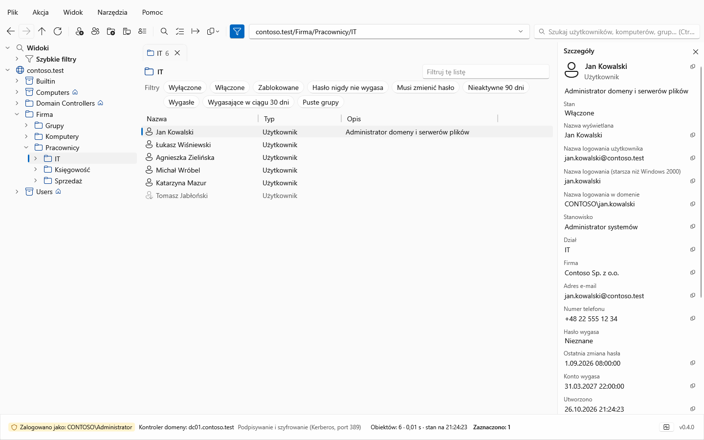

## Okno główne w motywie ciemnym

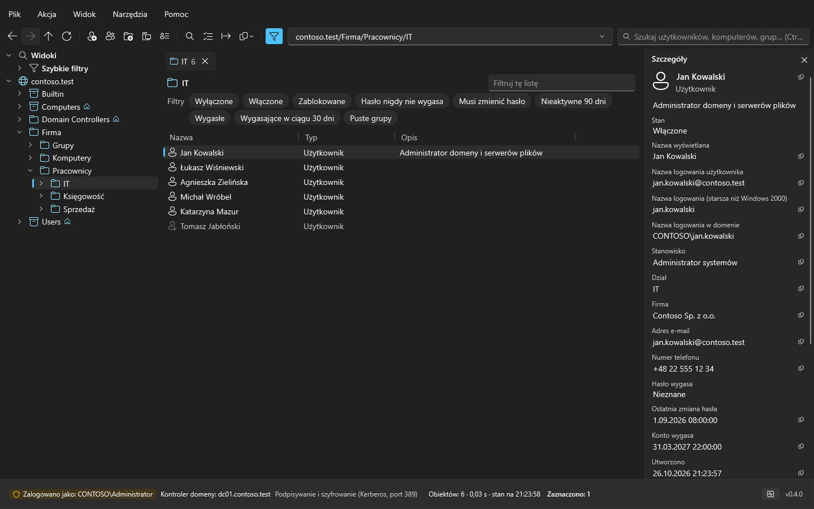

## Właściwości użytkownika – karta Ogólne

## Właściwości użytkownika – karta Konto

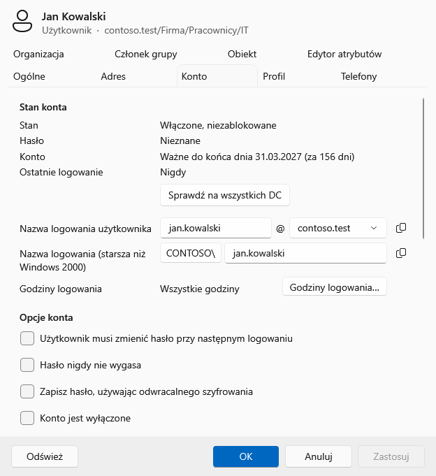

## Edytor zbiorczy – podgląd zmian (przed → po) przed wykonaniem

## Kosz Active Directory – usunięte obiekty do przywrócenia

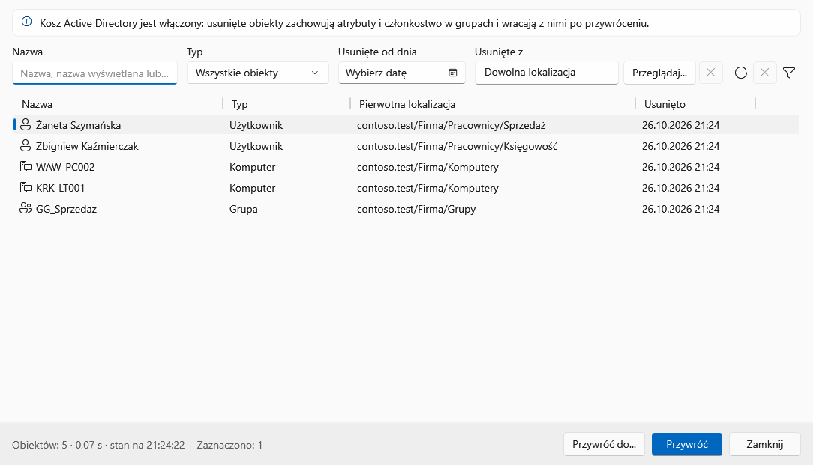

## Wyszukiwanie – użytkownicy z Warszawy (warunek zaawansowany)

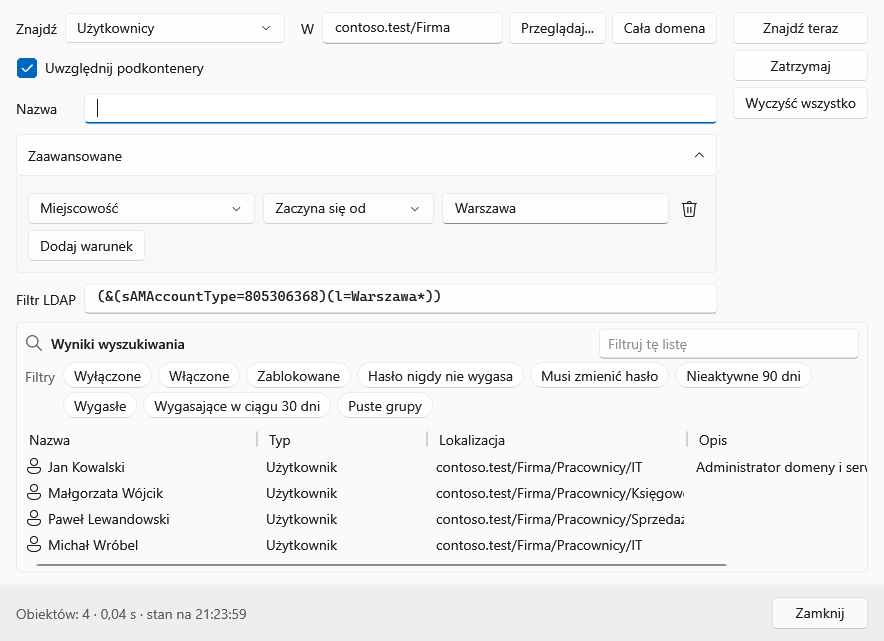

## Połączenie z domeną

## Watchdog – zdarzenia (filtr, lista i szczegóły blokady konta)

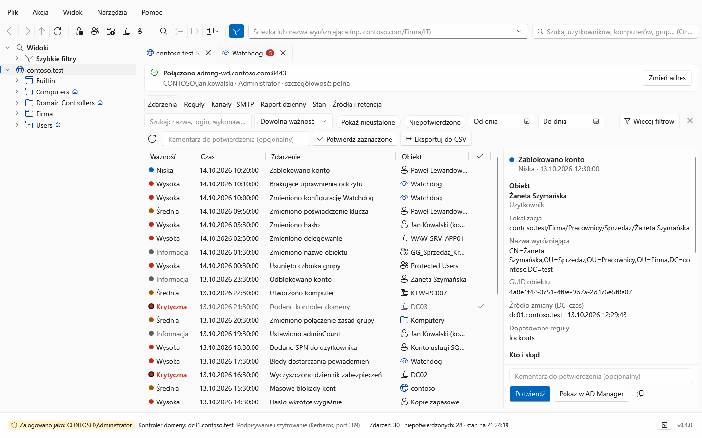

## Watchdog – szczegóły zdarzenia: co się zmieniło, kto i skąd

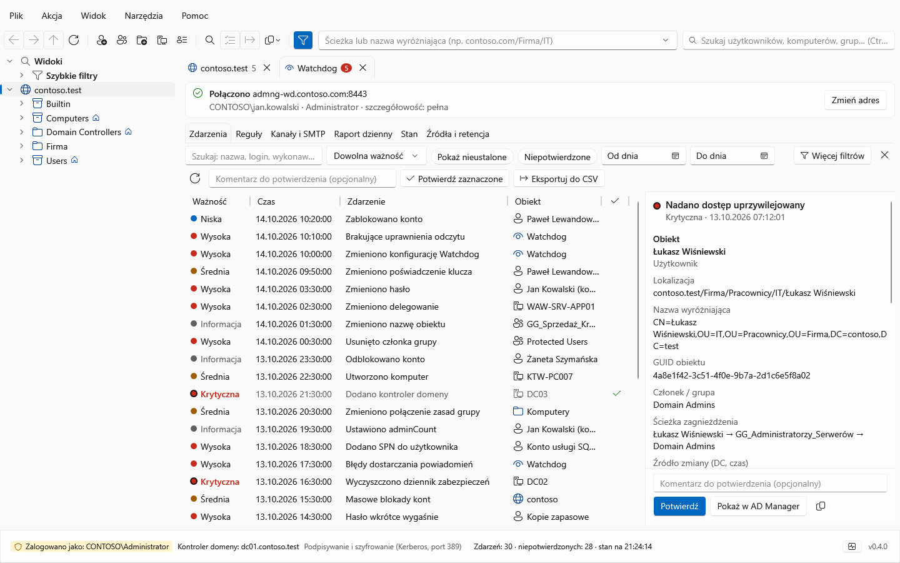

## Watchdog – reguły (lista i edytor reguły)

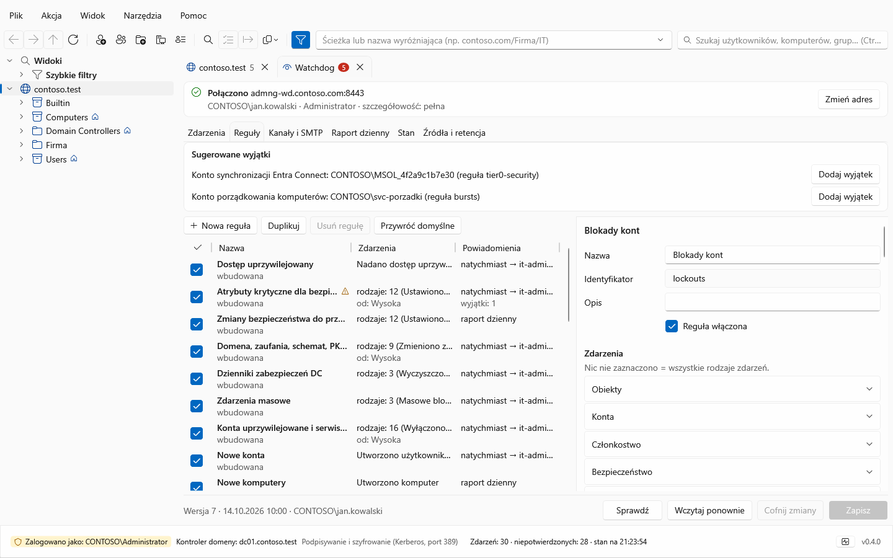

## Watchdog – kanały i SMTP

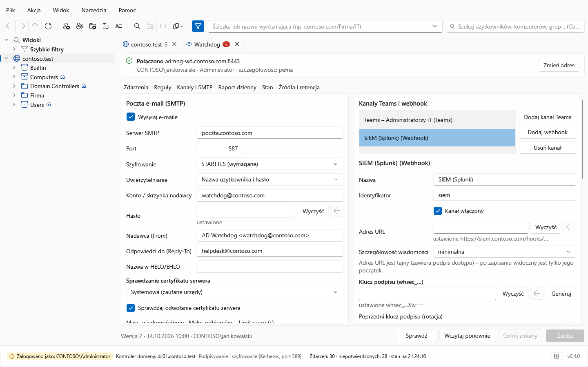

## Watchdog – stan usługi

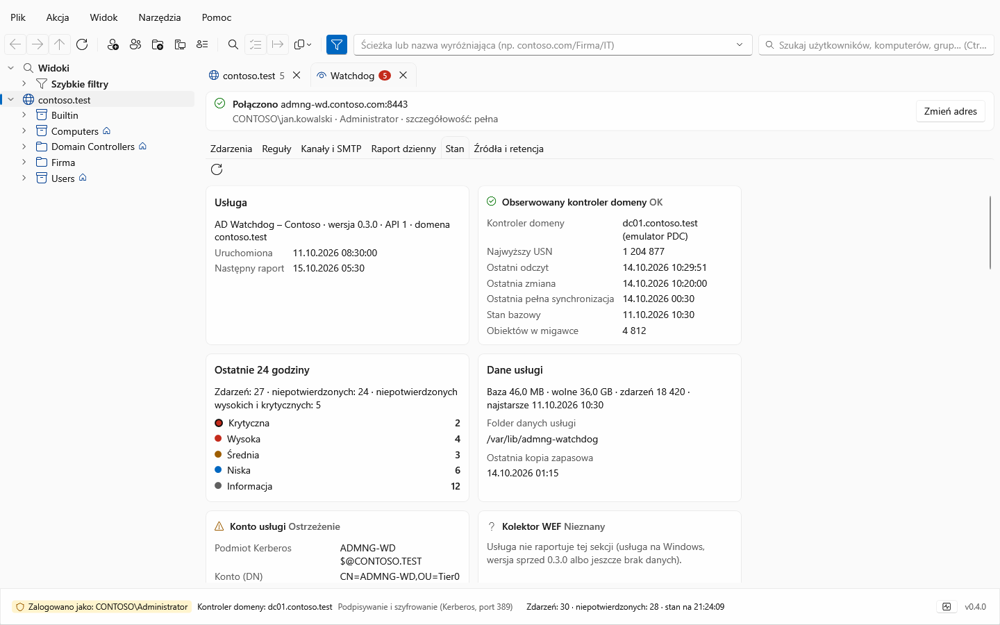

## Godziny logowania – tygodniowy harmonogram konta w czasie lokalnym, zaznaczone godziny pracy

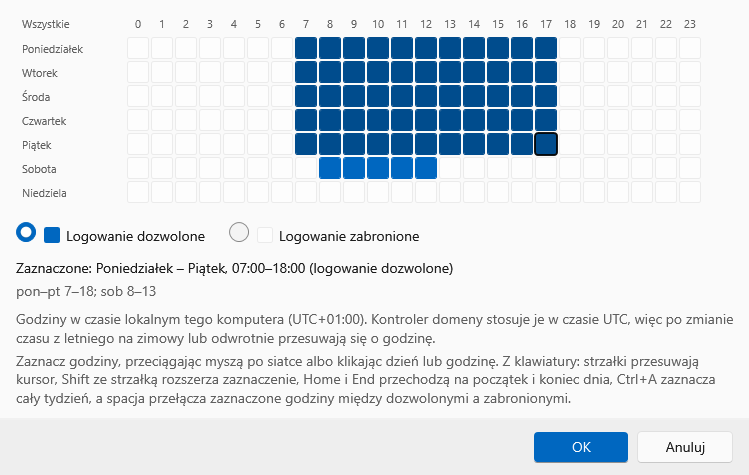

## Watchdog – potwierdzenie certyfikatu usługi przy pierwszym połączeniu (odcisk SHA-256 do porównania z serwerem)

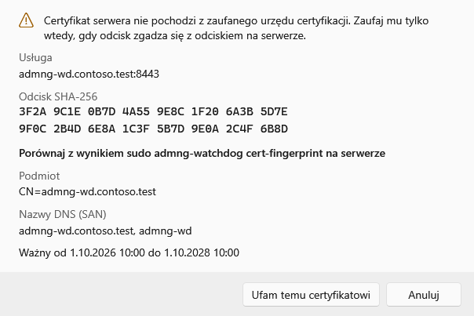

## Watchdog – źródła i retencja (OpenWEC, treść GPO, rekordy logowań)

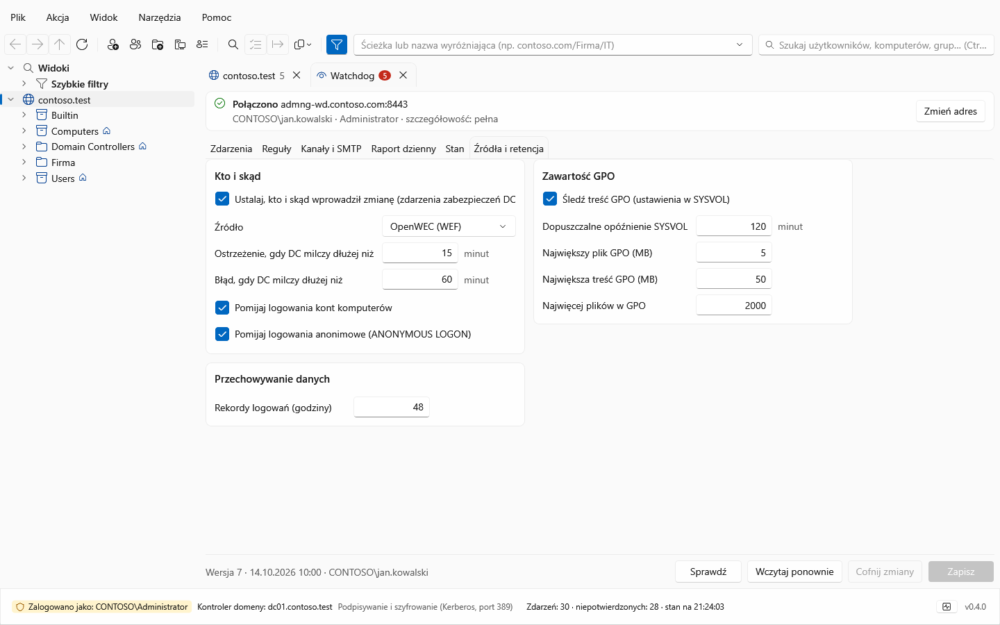

## Przegląd kont – kafelki sprawdzeń i lista kont, którym wkrótce wygaśnie hasło

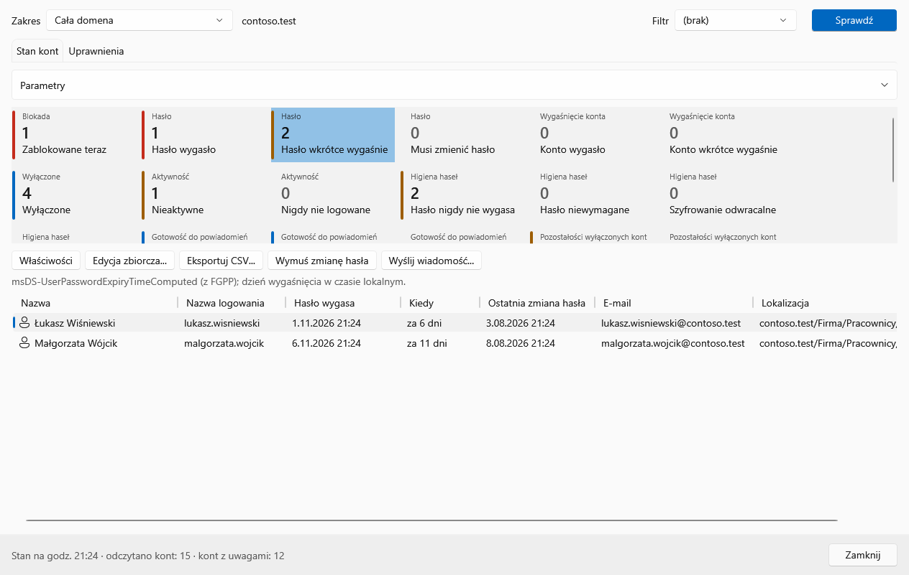

## Wiadomości do użytkowników – podgląd wiadomości „hasło wygasa” dla każdego odbiorcy przed wysyłką

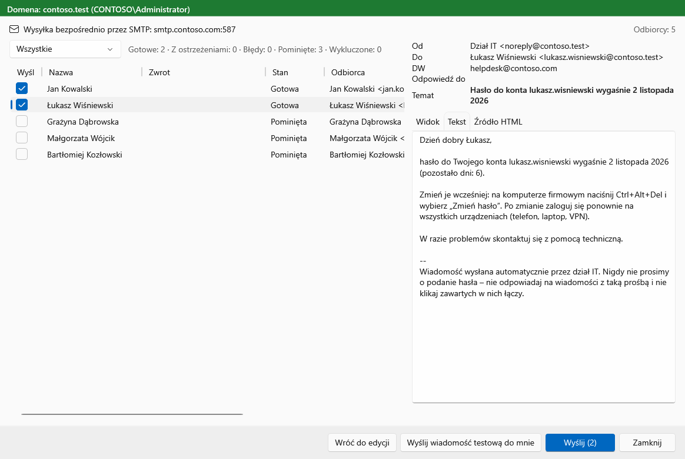

## Przegląd kont – zakładka Uprawnienia: konta z uprawnieniami ponad zwykłego użytkownika, poziomy i ścieżka uprawnienia

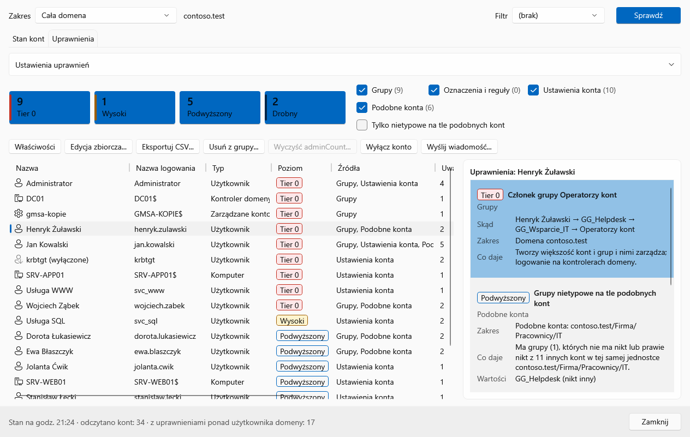

