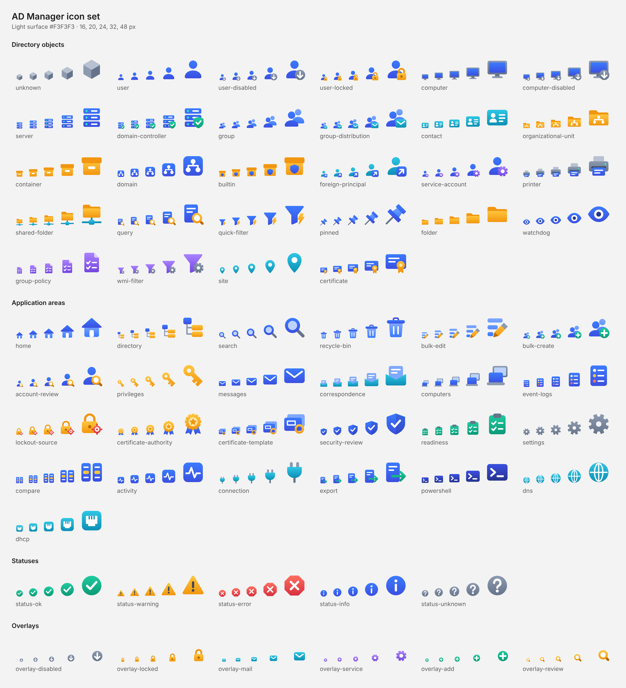
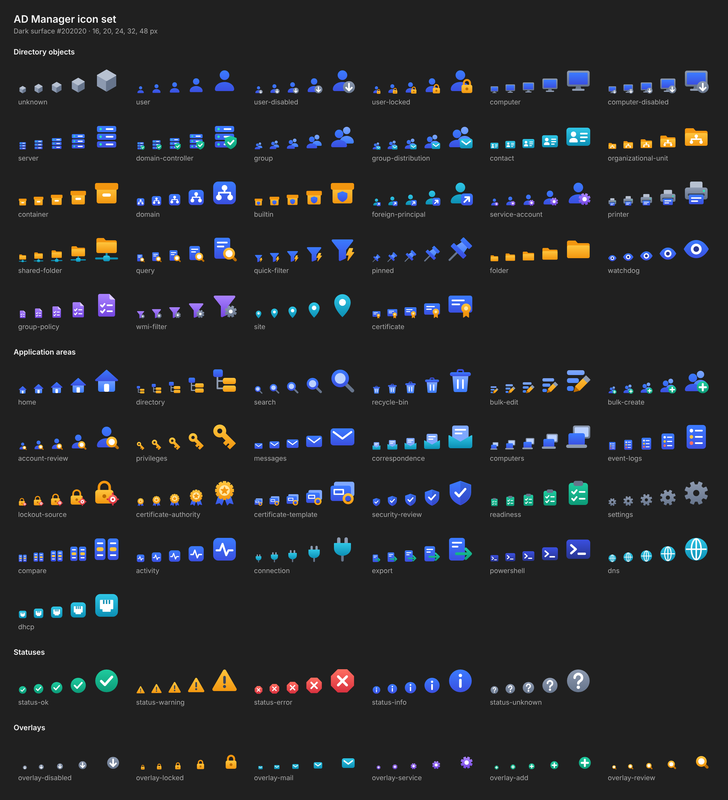

# AD Manager icon set

Original vector icons for AD Manager: directory object kinds, application areas, statuses and the overlays (badges)
that the state variants are built from. They are small colourful pictures (not font glyphs), drawn for this project in
one palette that comes from the application icon (`tools/icon/admng-icon.svg`: blue to indigo, white figures, a green
shield).

The SVG files in this folder are the sources. `tools/icon/build-icon-set.py` validates them and generates the WPF
resources the application uses:

| File | Content |
|---|---|
| `docs/assets/icons/<group>/<name>.svg` | the drawings (this folder) |
| `docs/assets/icons/icons.json` | groups, names, meanings and the state variants (base + overlay) |
| `src/AdMng.App/Themes/Icons.xaml` | generated: one `DrawingImage` per icon, key `Icon.<PascalCaseName>` |
| `src/AdMng.App/Controls/AppIcons.cs` | generated: the keys as constants, `KeyFor(ObjectIcon)`, `Find(key)` |

In XAML: `<Image Source="{StaticResource Icon.User}" Width="16" Height="16" />`; in code:
`AppIcons.Find(AppIcons.KeyFor(icon))`. Every image is 48 x 48 units and scales to any size.

Where the application uses them (from V1a of `docs/dev/v-interface-renewal.md`): `Controls/ObjectIconView` draws the
object icons wherever a thing is shown (tree, lists, tabs, details and property sheet headers, pickers) and
`Controls/AreaIconView` the area pictures (the connect window); both fall back to the monochrome glyphs of
`Controls/Glyphs.cs` when the operator chose *Icons: monochrome* or Windows High Contrast is on.

## Preview

Every icon at 16, 20, 24, 32 and 48 px on the light (`#F3F3F3`) and on the dark (`#202020`) surface:





## Palette

The only colours the icons may use (the build script reads this table; a colour outside it fails validation).
Each hue has a pale tint for details on a coloured base, a light and a deep tone that form the vertical gradient of a
shape (lighter at the top), and a dark tone for details on that hue.

<!-- palette:start -->
| Token | Colour | Family | Use |
|---|---|---|---|
| `white` | `#FFFFFF` | white | inner shapes on a coloured base – never the outer silhouette |
| `mist` | `#E3E9FF` | white | second white tone (app icon: the figure discs), lower end of white gradients |
| `blue-200` | `#BCD2FF` | blue | pale detail on blue |
| `blue-300` | `#7FA8FF` | blue | secondary shapes (the person or sheet behind) |
| `blue-500` | `#3B7BFF` | blue | primary hue, top of the gradient (app icon) |
| `indigo-600` | `#3A4FE0` | blue | primary hue, bottom of the gradient (app icon) |
| `indigo-800` | `#27348F` | blue | dark detail on blue or white |
| `green-200` | `#B5F5E3` | green | pale detail on green |
| `green-300` | `#2EE6B8` | green | highlight (app icon: top of the shield) |
| `green-400` | `#1FCB9F` | green | top of the gradient: healthy, allowed, add |
| `green-600` | `#0C9A77` | green | bottom of the gradient |
| `green-800` | `#0A6E57` | green | dark detail on green |
| `amber-200` | `#FFE7A3` | amber | pale detail on amber |
| `amber-400` | `#FFC53D` | amber | top of the gradient: folders, keys, locks, warnings |
| `amber-600` | `#F2960F` | amber | bottom of the gradient |
| `amber-800` | `#B96A00` | amber | dark detail on amber |
| `red-200` | `#FFC2BD` | red | pale detail on red |
| `red-400` | `#FF6F61` | red | top of the gradient: errors, delete, lockout |
| `red-600` | `#D8303E` | red | bottom of the gradient |
| `red-800` | `#9C1C2B` | red | dark detail on red |
| `violet-200` | `#DCCBFF` | violet | pale detail on violet |
| `violet-400` | `#A982FF` | violet | top of the gradient: policy (GPO, WMI filters), services |
| `violet-600` | `#7446E0` | violet | bottom of the gradient |
| `violet-800` | `#5B2FC9` | violet | dark detail on violet (app icon: end of the background gradient) |
| `teal-200` | `#B4ECF7` | teal | pale detail on teal |
| `teal-400` | `#2FC6E6` | teal | top of the gradient: network, sites, other domains |
| `teal-600` | `#0C8FB4` | teal | bottom of the gradient |
| `teal-800` | `#086A87` | teal | dark detail on teal |
| `slate-200` | `#DCE2EC` | slate | pale neutral detail |
| `slate-300` | `#B7C1D1` | slate | light neutral: stands, cables, connectors |
| `slate-400` | `#8D9AB0` | slate | neutral, top of the gradient: hardware, disabled badge |
| `slate-500` | `#66748B` | slate | neutral, bottom of the gradient |
| `slate-700` | `#3A465A` | slate | dark detail (marks on amber) |
<!-- palette:end -->

## Style rules

- **Canvas**: `viewBox="0 0 48 48"`, everything inside a 2 px safe margin (2 .. 46).
- **Shapes**: flat, with a soft vertical gradient (lighter tone at the top), rounded joins, corner radius of at least
  2. No drop shadows, no filters, no text or letters.
- **Small sizes first**: no detail thinner than 2.5 px – the icon has to survive at 16 px. Prefer one bold silhouette
  to many details.
- **Colour**: two or three hues per icon, only from the palette. Blue is identity (users, groups), amber containers,
  keys and warnings, slate hardware and neutral tools, teal the network, violet policy and services, green health,
  red errors and deletion.
- **Both themes**: every icon must read on the light (`#F3F3F3`) and on the dark (`#202020`) surface. White and the
  pale tints only sit on a coloured base; the darkest tones are never the outer silhouette.
- **State variants** reuse the base drawing and add an overlay (badge) in the bottom-right quadrant, at least 40 % of
  the icon: a slate disc with a down arrow for *disabled* and an amber padlock for *locked* (ADUC conventions), a teal
  envelope for mail, a violet gear for services, a green plus for creating, an amber magnifier for reviewing. The
  variant files are generated from `base` + `overlay` in `icons.json` – edit the base or the overlay, never the variant.
- **Families**: what belongs together shares a shape and differs by one bold feature – the folder (plain: application
  folder, with a tree: organizational unit, on a network line: shared folder), the box (container, with a shield:
  Builtin), the person (user, teal with a shortcut tile: foreign principal, on a card: contact), the stacked units
  (server, with a green shield: domain controller), the funnel (with a bolt: quick filter, violet with a gear: WMI
  filter), the certificate sheet (with a seal: certificate, stacked with a blank field: template; the seal alone: the
  authority). Statuses differ by shape as well as by colour (disc, triangle, octagon), not by colour alone.

### SVG subset

The sources use only what converts exactly to WPF drawings; the build script rejects anything else:

- `<svg>`, `<defs>`, `<linearGradient gradientUnits="userSpaceOnUse">` with `<stop offset stop-color>`;
- `<path>` with **absolute** commands only (`M L H V C S Q T A Z`) and an explicit `fill-rule`;
- `<rect>` (with `rx`), `<circle>`, `<ellipse>`;
- `fill` by palette colour, gradient or `none`; optional `opacity`;
- strokes only with explicit `stroke-width`, `stroke-linecap` and `stroke-linejoin` (`round` or `bevel`);
- plain numbers with at most three decimals;
- **not allowed**: `transform`, `clipPath`, `mask`, `filter`, `use`, `<style>`, `class`, `style`, text, images,
  percentages, relative path commands, miter joins.

## Adding or changing an icon

1. Draw `docs/assets/icons/<group>/<name>.svg` (kebab-case name) within the rules above. A state variant needs no
   file: give it `"base"` and `"overlay"` in `icons.json`. Shapes that overlap inside one path need
   `fill-rule="nonzero"`, a hole needs `evenodd` with both outlines running the same way.
2. Add the icon to its group in `icons.json` with a short `meaning` (it becomes the gallery text and the XML comment
   of the constant). An icon for a new `ObjectIcon` value must have the kebab-case name of that value.
3. Run the build script and look at the result at 16 px on both surfaces:

   ```bash
   tools/icon/build-icon-set.py              # validate + regenerate Icons.xaml, AppIcons.cs, variants, the gallery below
   tools/icon/build-icon-set.py --preview    # preview-light.png / preview-dark.png (Node with Playwright)
   tools/icon/build-icon-set.py --roundtrip  # compare the generated XAML with the sources pixel by pixel
   tools/icon/build-icon-set.py --check      # what CI runs: sources valid, generated files up to date
   ```

   `--preview --only 'user*' --out /tmp/sheet --columns 4` renders a sheet of a few icons while drawing.
4. Commit the SVG, `icons.json`, the generated files and the two preview pictures together.

The round trip is the check of the converter that runs without Windows: the script reads the generated `Icons.xaml`
back by WPF's rules (and defaults), rebuilds an SVG from it and compares it with the source in Chromium at 96 px. It
then breaks the XAML on purpose (gradients without the absolute mapping, pens without caps or joins, swapped or
dropped fill rules) and expects the comparison to notice each time. On Windows,
`tests/AdMng.App.UiTests/IconSetTests.cs` loads every key and renders it at 16 and 48 px. The icons are resources
only: the views still show their glyphs until the icons are wired in.

## Licence

The icons are original drawings made for AD Manager and are part of it: Apache-2.0 (see `LICENSE` in the repository
root). No shape was taken from another icon set.

## Gallery

<!-- gallery:start -->
<!-- Generated by tools/icon/build-icon-set.py from icons.json - edit the meanings there. -->

### Directory objects

| Icon | Name | Resource key | Meaning |
|---|---|---|---|
|  | `unknown` | `Icon.Unknown` | An object of a class the application has no picture for |
|  | `user` | `Icon.User` | A user account (user, inetOrgPerson) |
|  | `user-disabled` | `Icon.UserDisabled` | A disabled user account |
|  | `user-locked` | `Icon.UserLocked` | A locked-out user account |
|  | `computer` | `Icon.Computer` | A computer account (workstation) |
|  | `computer-disabled` | `Icon.ComputerDisabled` | A disabled computer account |
|  | `server` | `Icon.Server` | A member server |
|  | `domain-controller` | `Icon.DomainController` | A domain controller (also read-only) |
|  | `group` | `Icon.Group` | A security group |
|  | `group-distribution` | `Icon.GroupDistribution` | A distribution group |
|  | `contact` | `Icon.Contact` | A contact |
|  | `organizational-unit` | `Icon.OrganizationalUnit` | An organizational unit |
|  | `container` | `Icon.Container` | A container (also LostAndFound) |
|  | `domain` | `Icon.Domain` | The domain (root of the tree) |
|  | `builtin` | `Icon.Builtin` | The Builtin container |
|  | `foreign-principal` | `Icon.ForeignPrincipal` | A foreign security principal (an account of another domain) |
|  | `service-account` | `Icon.ServiceAccount` | A managed service account (MSA, gMSA) |
|  | `printer` | `Icon.Printer` | A published printer (print queue) |
|  | `shared-folder` | `Icon.SharedFolder` | A published shared folder |
|  | `query` | `Icon.Query` | A saved query and query results |
|  | `quick-filter` | `Icon.QuickFilter` | A quick filter |
|  | `pinned` | `Icon.Pinned` | A pinned object or location |
|  | `folder` | `Icon.Folder` | A folder of the application (grouping node, default list icon) |
|  | `watchdog` | `Icon.Watchdog` | The Watchdog tab and the watchdog's own events |
|  | `group-policy` | `Icon.GroupPolicy` | A group policy object and the Group Policy Objects node |
|  | `wmi-filter` | `Icon.WmiFilter` | A WMI filter and the WMI Filters node |
|  | `site` | `Icon.Site` | A site and the Sites node |
|  | `certificate` | `Icon.Certificate` | A certificate and the Public Key Services node |

### Application areas

| Icon | Name | Resource key | Meaning |
|---|---|---|---|
|  | `home` | `Icon.Home` | The start page |
|  | `directory` | `Icon.Directory` | The directory tree and object lists |
|  | `search` | `Icon.Search` | Search and Find |
|  | `recycle-bin` | `Icon.RecycleBin` | The AD Recycle Bin |
|  | `bulk-edit` | `Icon.BulkEdit` | Bulk edit (batch editor) |
|  | `bulk-create` | `Icon.BulkCreate` | Bulk account creation |
|  | `account-review` | `Icon.AccountReview` | Account review |
|  | `privileges` | `Icon.Privileges` | Privileged access |
|  | `messages` | `Icon.Messages` | Messages to users |
|  | `correspondence` | `Icon.Correspondence` | Correspondence (Outlook) |
|  | `computers` | `Icon.Computers` | Computer review and remote actions |
|  | `event-logs` | `Icon.EventLogs` | Event logs |
|  | `lockout-source` | `Icon.LockoutSource` | Lockout source analysis |
|  | `certificate-authority` | `Icon.CertificateAuthority` | A certification authority |
|  | `certificate-template` | `Icon.CertificateTemplate` | A certificate template |
|  | `security-review` | `Icon.SecurityReview` | Security review (findings) |
|  | `readiness` | `Icon.Readiness` | Readiness check |
|  | `settings` | `Icon.Settings` | Settings |
|  | `compare` | `Icon.Compare` | Comparison of objects and domains |
|  | `activity` | `Icon.Activity` | Activities (running and finished operations) |
|  | `connection` | `Icon.Connection` | The connection to a domain controller |
|  | `export` | `Icon.Export` | Export to a file |
|  | `powershell` | `Icon.Powershell` | PowerShell (generated scripts, the console) |
|  | `dns` | `Icon.Dns` | DNS |
|  | `dhcp` | `Icon.Dhcp` | DHCP |

### Statuses

| Icon | Name | Resource key | Meaning |
|---|---|---|---|
|  | `status-ok` | `Icon.StatusOk` | Healthy, passed, done |
|  | `status-warning` | `Icon.StatusWarning` | Warning: needs attention |
|  | `status-error` | `Icon.StatusError` | Error, failed |
|  | `status-info` | `Icon.StatusInfo` | Information |
|  | `status-unknown` | `Icon.StatusUnknown` | Not checked or not known |

### Overlays

| Icon | Name | Resource key | Meaning |
|---|---|---|---|
|  | `overlay-disabled` | `Icon.OverlayDisabled` | Disabled account: slate disc with a down arrow (ADUC convention) |
|  | `overlay-locked` | `Icon.OverlayLocked` | Locked-out account: amber padlock (ADUC convention) |
|  | `overlay-mail` | `Icon.OverlayMail` | Mail: teal envelope (distribution group) |
|  | `overlay-service` | `Icon.OverlayService` | Service: violet gear (managed service account) |
|  | `overlay-add` | `Icon.OverlayAdd` | Create: green disc with a plus |
|  | `overlay-review` | `Icon.OverlayReview` | Review: amber magnifier |

<!-- gallery:end -->
