# Zrzuty ekranu – gałąź `main`

- Gałąź: `main`
- Commit: [`ca161c0`](https://github.com/DarienRahl/AD_MNG/commit/ca161c0b0860ae7c0a680f9134cd85b9f396a1ea) (`ca161c0b0860ae7c0a680f9134cd85b9f396a1ea`)
- Przebieg CI: https://github.com/DarienRahl/AD_MNG/actions/runs/38904212795

## Okno główne – jednostka organizacyjna IT, szczegóły zaznaczonego użytkownika

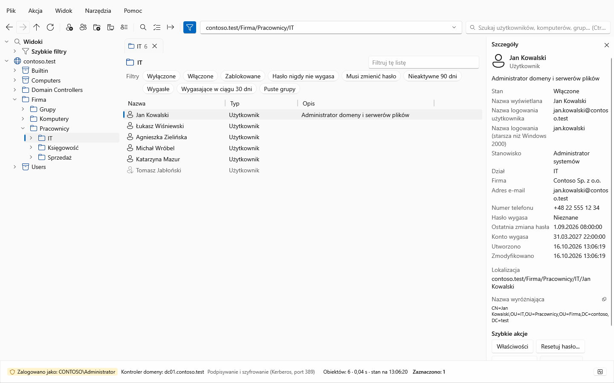

## Okno główne w motywie ciemnym

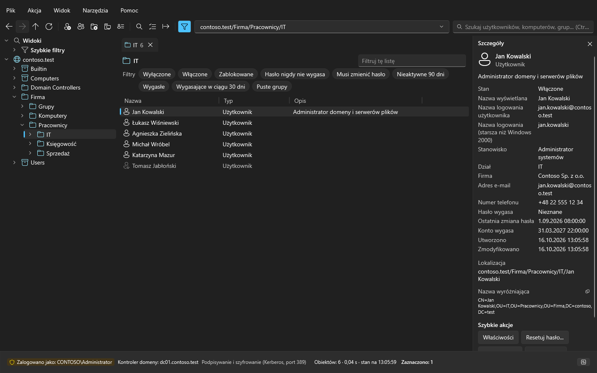

## Właściwości użytkownika – karta Ogólne

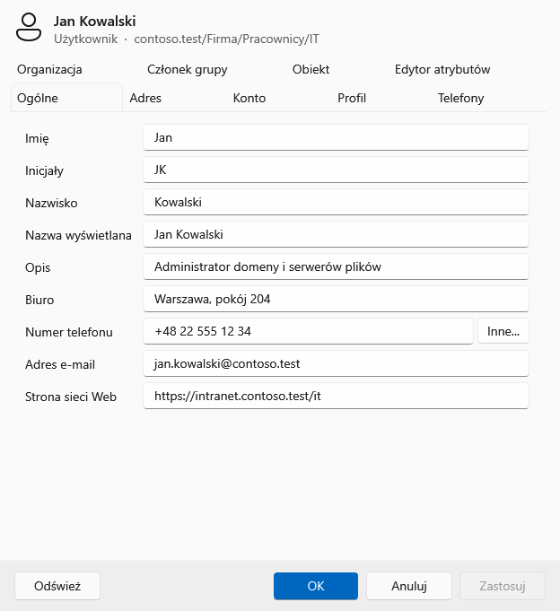

## Właściwości użytkownika – karta Konto

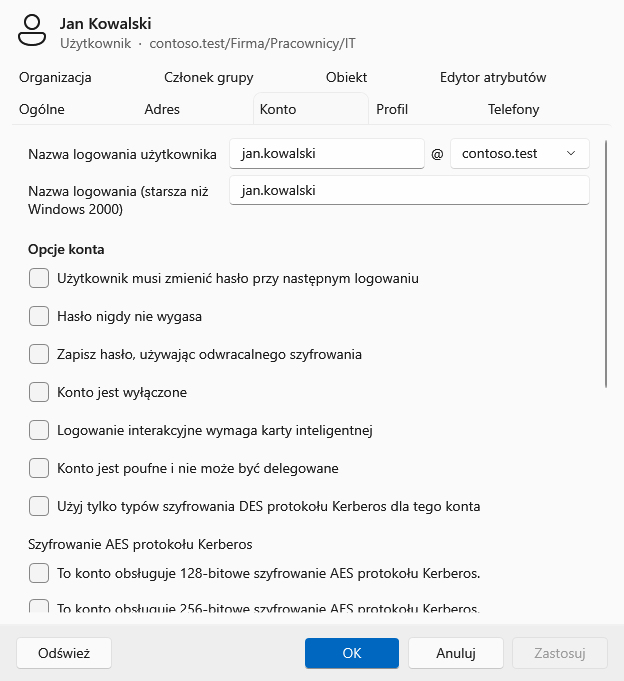

## Edytor zbiorczy – podgląd zmian (przed → po) przed wykonaniem

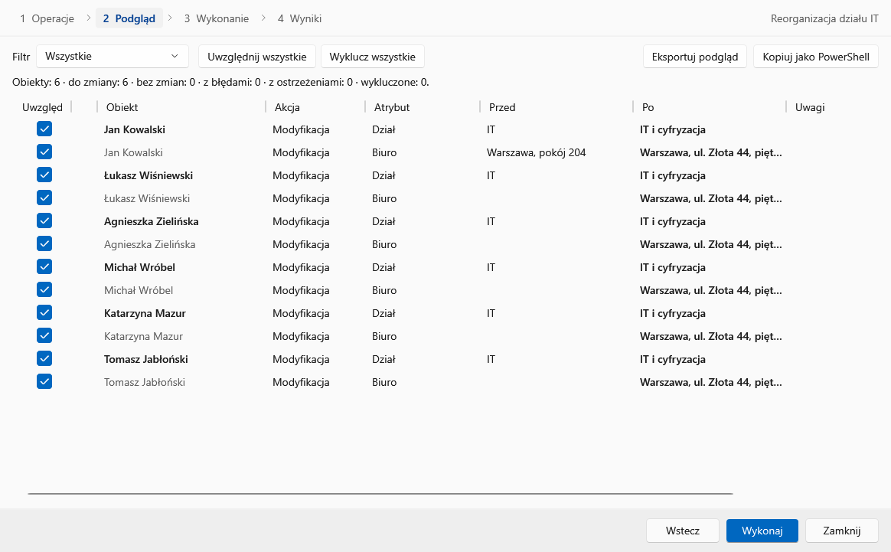

## Kosz Active Directory – usunięte obiekty do przywrócenia

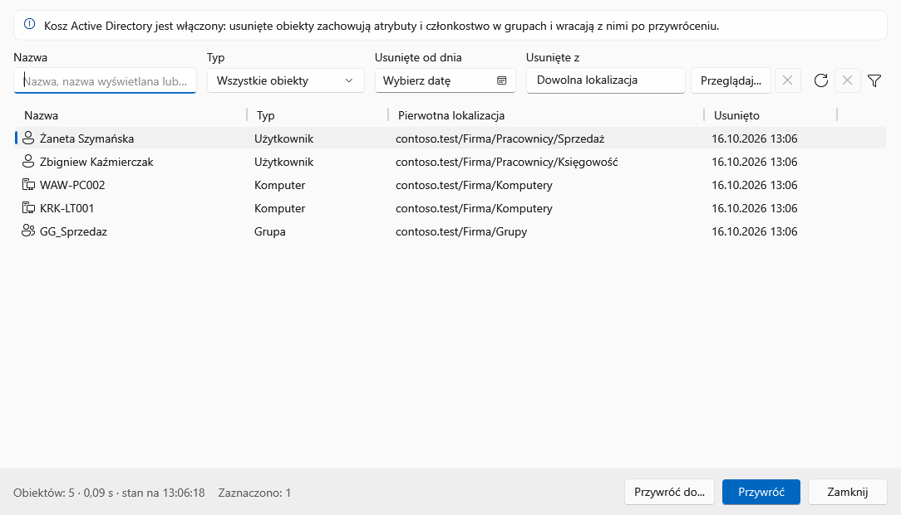

## Wyszukiwanie – użytkownicy z Warszawy (warunek zaawansowany)

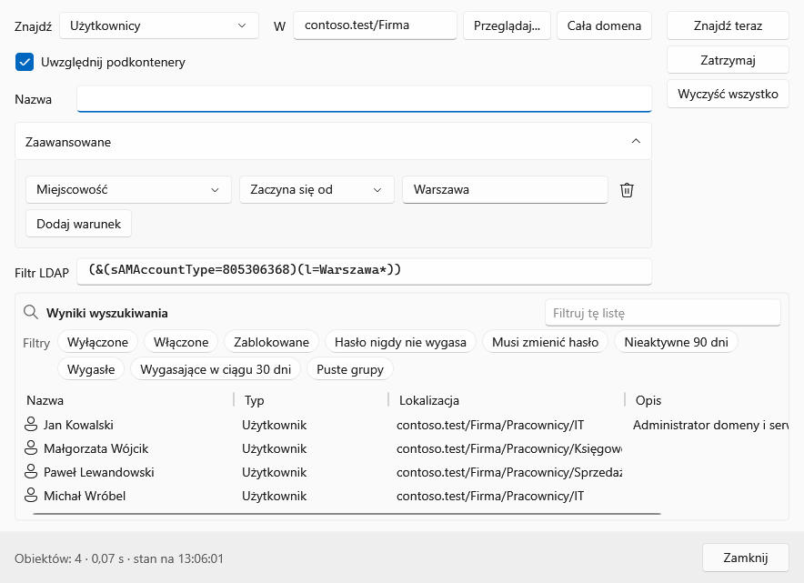

## Połączenie z domeną

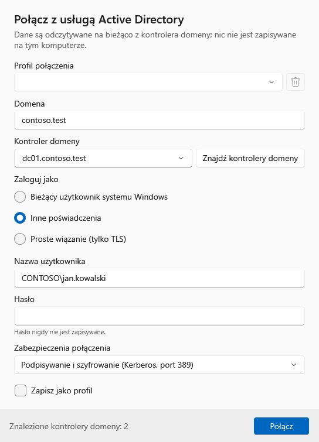

## Watchdog – zdarzenia (filtr, lista i szczegóły blokady konta)

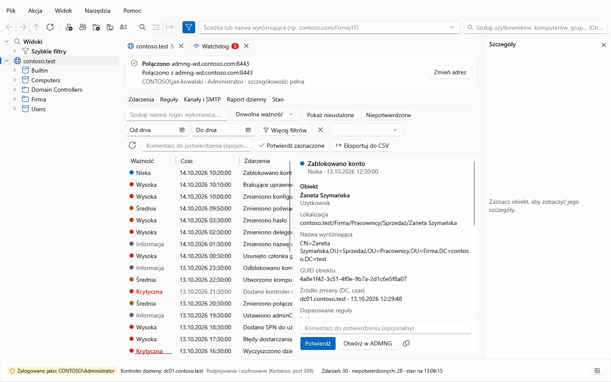

## Watchdog – szczegóły zdarzenia: co się zmieniło, kto i skąd

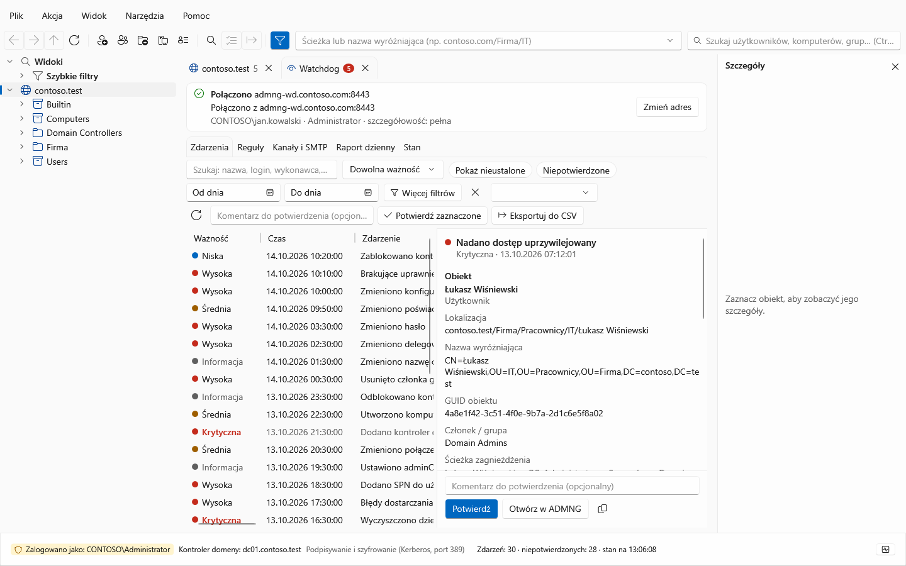

## Watchdog – reguły (lista i edytor reguły)

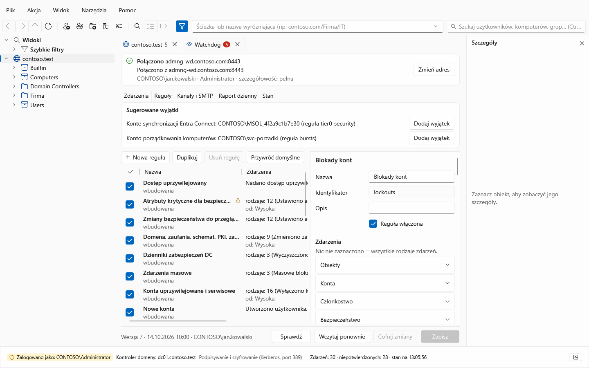

## Watchdog – kanały i SMTP

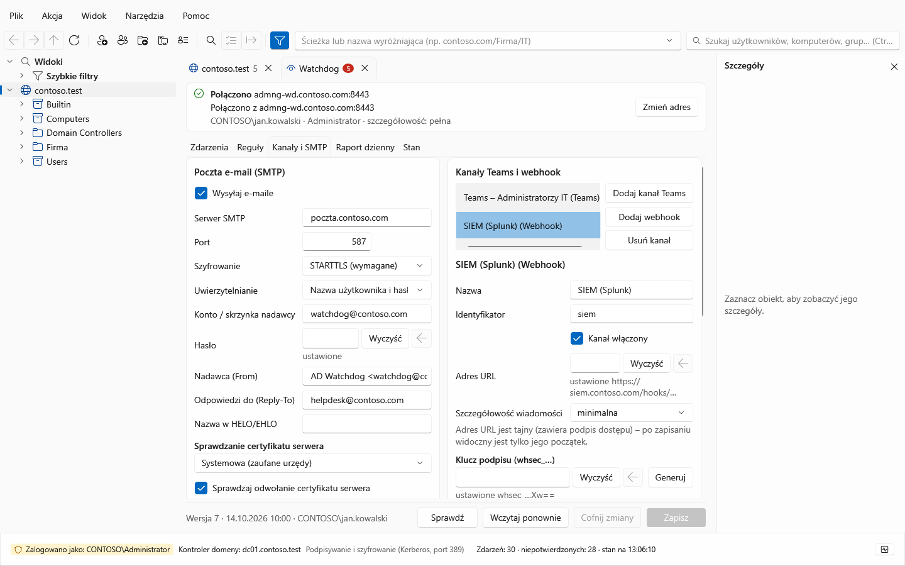

## Watchdog – stan usługi

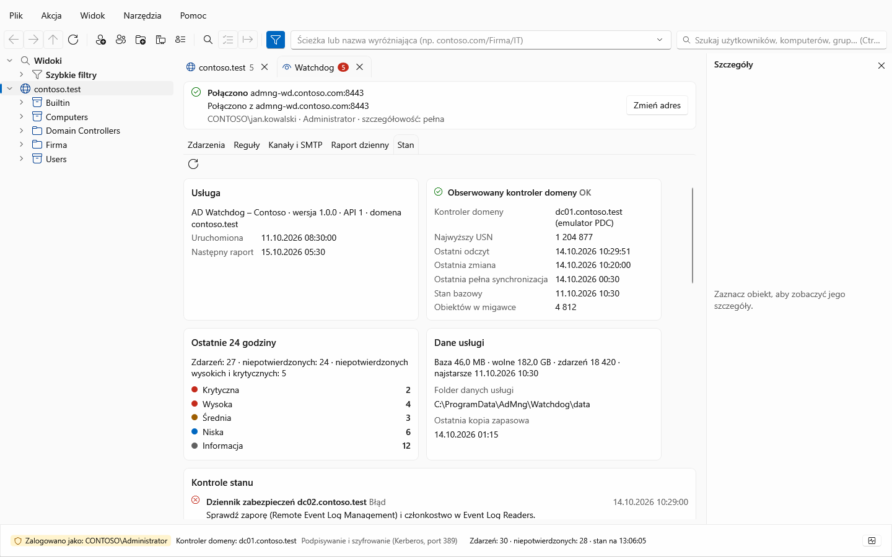

